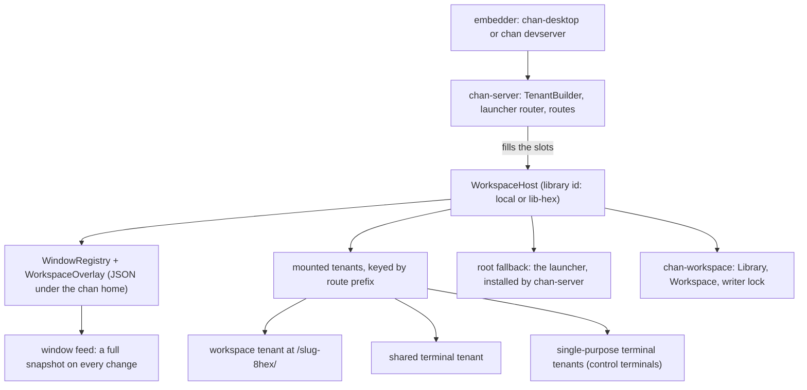
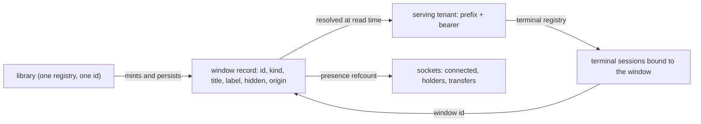
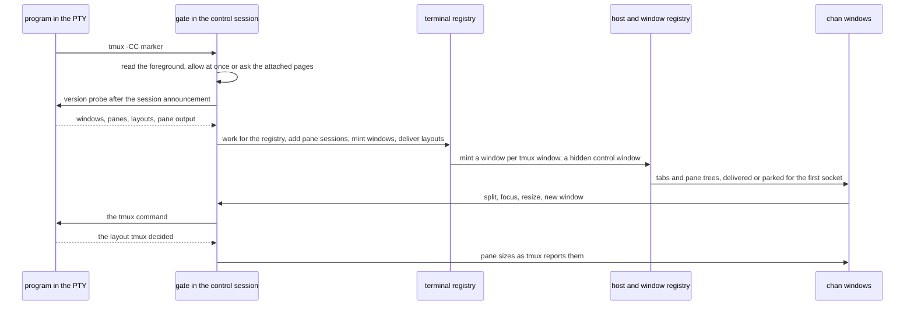

# chan-library design

chan-library is the host: the layer that owns a chan process's workspaces, terminals and windows and serves all of them from one server, whether that process is the desktop's embedded server or a headless devserver. It is the source of truth every client reconciles to. Native desktop windows, browser tabs and `cs` are views of its state: they ask it to mint a window or spawn a terminal, and they read back what exists. This document says what the crate provides, where it sits, its main flows, its invariants and the decisions behind them. Route handlers, wire shapes and timeouts live in the code and in [chan-server's design](../chan-server/design.md).

## Where it sits

The crate depends downward on `chan-workspace` (the filesystem core and the workspace registry), `chan-tmux` (the tmux control-mode protocol, with no I/O), `chan-shell` (the control-socket wire types) and `chan-revtunnel` (the reverse-tunnel registry). It knows nothing of HTTP handlers or the web bundle. `chan-server` depends on it, wraps each tenant in routes and the embedded apps, and drives it from `chan serve`, the devserver and the desktop.

That direction is the point of the split. Everything the host needs from the layers above arrives through slots the embedder fills; the library exposes the slot, the server or the desktop fills it:

- `TenantBuilder`: how a tenant is built. chan-server implements it, constructing the tenant's router, control socket, MCP bridge, terminal registry and background tasks, and hands back the artifacts the host routes to, reconciles windows against and tears down.
- The root fallback: the router served when no tenant prefix matches a request. chan-server installs the launcher there, so the library root serves the Computers screen and the `/api/library/*` surface without this crate naming either.
- `WindowRegistry` and `WorkspaceOverlay`: the persisted window set and the persisted on/off set, opened by the embedder at its store path under the chan home and installed once.
- `DevserverRegistry`, `GatewayRegistry`, `DevserverFeedSource`, `LocalColorStore` and `LocalThemeStore`: state the desktop owns (the configured devservers and gateways, the live devserver connections, the pane colour, the launcher theme). chan-desktop implements the traits over its config; a headless host installs none, and the launcher routes then list nothing and refuse mutation.
- `DesktopBridge`: a channel to the desktop's window manager for the operations that need the Tauri app handle (new window, focus, hide, close, connect a devserver or a gateway, pick a directory), each answered through a one-shot reply. It is absent under `chan serve`, where every such operation refuses with one fixed message; the absence is the "no desktop attached" fact, encoded in the type.
- `FdStorePark`: the systemd fd store, installed by the devserver when it runs under systemd and nowhere else.
- `HostControl`: the slice of the host a tenant's control socket reaches back through a weak handle, so `chan close`, `cs window list`, `cs window rm`, an escaping `cs open` and `cs tunnel` work without the control socket naming the concrete host.

*The host owns the tenants and the stores; chan-server builds the tenants and installs the launcher; chan-workspace holds the workspaces underneath.*

## The host and its tenants

`WorkspaceHost` keeps every mounted tenant in one map keyed by route prefix. A request goes to the tenant with the longest mounted prefix that owns its path. A bare tenant root redirects to its trailing-slash form, because the SPA's asset URLs are relative and resolve against the document path. A path no tenant owns goes to the root fallback, or answers 404 when none is installed. The router consults the map on every request, so mounts and unmounts need no rebuild of the outer app.

A workspace tenant mounts at `/{slug}-{8hex}/`: a legible slug from the directory's basename plus eight hex digits of the canonical root's hash. The prefix is deterministic, so a workspace re-mounts at the same path across restarts, an off workspace has a stable prefix without a live tenant, and two workspaces with the same basename under different parents never collide. It is derived from the root the registry row stores, never by resolving the path again, so listing, naming and resolving one workspace never waits on the filesystem of another. It is also the public path a gateway forwards unchanged.

The shared terminal tenant is the one workspace-less tenant every standalone terminal window attaches to. Its PTYs start in the home directory, it keeps each window's pane layout on disk so a relaunch restores the layout with fresh shells, and it is the tenant that serves the machine's own filesystem and the per-library drafts. A single-purpose terminal tenant runs one program: a devserver's control terminal runs its connect script, and a default-terminal launch runs the shell. The tenant's default program is either a command line run through the login shell and echoed as the session's banner, so an interactive script sees the profile's PATH and gets a real PTY for its prompts, or an argv exec'd as given with no banner. The shared tenant is the one the mount declares shared, not the one that happens to carry no program; it alone gets the hook that drops a terminal window's row when its shell exits.

The root fallback is held under a lease. The launcher router holds the host, so a host that kept the fallback for its own lifetime would own itself and never be dropped. The host keeps the fallback only while one of its routers exists and lets it go when the last router, and the last request it is serving, is dropped.

The host also holds the one reverse-tunnel registry where a tenant's `cs tunnel` and the desktop-dialed WebSocket legs on the launcher router meet. An embedder that admits no tunnels, as chan-desktop's hosts do, says so when it builds the host, and the control socket refuses a tunnel before registering one.

### Workspace lifecycle

A registered open runs `Library::open_workspace` on the blocking pool: the writer lock, canonicalization and open-time recovery never park a runtime worker. The builder constructs the tenant, a root check runs after the build, and the runtime is published into the map under the write lock. Publication checks that no runtime holds the prefix or the canonical root, so two spellings of one root racing onto one prefix settle to one runtime, and it is refused once host shutdown has begun, so a mount that outlives the shutdown sweep shuts its own runtime down instead of publishing after it.

A workspace's live state is distinct from its persisted intent. The overlay records whether the deployment wants each registered workspace on or off; the registry stays the existence source. Boot restore mounts the rows that are on. The host projects each root's transient state into one status for the launcher: stopped, starting, running, closing, removing, locked (another process holds the writer lock), unknown (the lock could not be probed), error (a mount or removal failed and should be retried) and unavailable (mounted, but the directory under the root does not answer).

A close commits when it detaches the runtime and records off, before the asynchronous teardown. Teardown gives the tenant's tasks a grace, aborts what remains, drops the socket and other keep-alive owners, then clears the workspace cell and checks that the writer lock is released on one bounded blocking hop. A workspace still held at the bound answers that it is still releasing and leaves the hop looking until the workspace is let go, because an abandoned blocking open can retain the writer handle until its filesystem call returns. The launcher shows that answer as a retryable error rather than a failure.

A removal closes, then unregisters on the blocking pool under a claim on the registry row. Only once the registry has answered are the overlay rows forgotten and the window records purged, so no persisted row ever names a workspace the launcher cannot list. A removal that meets another process's writer lock, or a handle of the root this process still holds, keeps the registration for a retry.

A periodic health probe checks every mounted root at once, each on a thread of its own, and waits a bounded time for the answers, so a root whose network filesystem hangs holds up no other row. A root that stops answering, or that was removed or replaced while the tenant held it open, reads unavailable; nothing is torn down, because open documents keep their buffers and terminals keep running there, and a root that answers again clears the state on its own. On Unix the check compares inodes, so a remount of the same directory clears it and a different directory at the same path does not.

### Root locks and call permits

Every lifecycle call on a root goes by the root's canonical key, computed on the blocking pool before any lock is taken, so two spellings of one root share a lock and a caller whose root hangs during that computation holds nothing. One computation per spelled path is in flight; concurrent callers of that spelling share its answer.

A caller holds at most one root lock, through its whole call, and the blocking work it dispatches takes a permit keyed by the root and the kind of call: mount, revalidation, registry lookup, registry write or teardown. The permit moves into the blocking work and outlives a caller that leaves, so a cancelled call releases its root lock at once, letting a close or a removal proceed, while its abandoned work still refuses another call of the same kind on that root. A waiter for a mount or registry-write permit gives up within the open's release budget and answers the retry state; a revalidation or lookup already in flight is skipped rather than waited for.

The lock order is fixed: the devserver's per-prefix mount-attempt lock sits above the root lock; the routing map, the mount-state map, the stores' data and save locks and the library's registry mutex are taken below it, held across no await and no filesystem call. Registry claims come from `chan-workspace`: a removal claims its row and the paths it holds, a mount's publication takes a shared use of the row, and a registration, open, second claim or removal that meets a conflicting hold answers that the workspace is already open and changes nothing.

## Windows

The window registry is the single authority for which windows exist. Every window, a standalone terminal or a view of one workspace, is a durable row with a library-minted opaque id, a kind, a composed title and ordinal, an optional user label, the workspace path for a workspace window, a hidden flag and the origin of the surface that minted it. The title names no machine, since a library cannot tell how the client that lists its rows names it: `windows::window_title` composes it from the kind, the ordinal and the workspace folder's last path component (`chan Window 1`, `Terminal Window 2`), and chan-desktop builds a watched window's OS title with `windows::window_title_on_machine` (`geekom / chan Window 1` behind its arrow), so that OS title ends with what `cs window list` prints, which adds the user's label in brackets as the desktop's title does. Other names differ: the browser tab and the launcher's rows name a window by its ordinal and label alone (`Window 1 [notes]`), a control row's title (a devserver's control terminal, a tmux connection's control window) is the one its minting gave it, where the desktop titles a devserver's control terminal `Control Terminal - NAME`, and a devserver of another release lists its rows under titles in its own form. The library composes the title of every plain row again when it loads its own store, so a title stored in another form never reaches its window set; no save writes a control or tmux-marked row, and one found in a store keeps the title it carries. Clients never mint or parse an id; they ask the library to mint a window and reconcile their surface to the set. An id is unique within its library, and the global key is the pair of library id and window id, since libraries mint independently. The library id is `local` for the desktop's own library and a stable `lib-<hex>` for a devserver, stamped on every record.

A record on the wire is the durable row plus live state assembled at read time: the serving tenant's prefix and bearer (empty while the workspace is off, so the desktop turns it on before attaching), whether any socket for the window is live, the holders of those sockets, and whether a file transfer is in flight. The feed is a full snapshot pushed on connect and on every change, driven by one aggregate change signal that the registry, every tenant's presence, the tenant mounts and the desktop's feed all fire. A full snapshot rather than a delta keeps the reconcile idempotent and lets a dropped frame heal on the next one. The window set also carries each tenant's leader and the live tmux connections.

Presence is a refcount per window id, kept per holder tag beside the untagged count. It is a refcount, not a set, because a reload briefly overlaps the old and new socket of one window and a plain set would flicker it disconnected. `connected` means a live socket exists somewhere, hidden or visible; a client that tagged its socket reads in the holders whether its own is live where another client holds the same window. The transfer count is the same shape, summed across a window's sockets and cleared when they drop, so the desktop can refuse to close a window mid-transfer with one synchronous question.

A workspace window is in the feed only while its workspace is mounted. Turning a workspace off leaves its windows on disk, so turning it back on restores the same windows and layouts, and hides them from the live list so nothing points at an unmounted tenant. The registry reads its store row by row: a row this build cannot read is kept out of the set and written back by every save, so a build never replaces rows another build wrote. Saves stamp a generation under the data lock, and an older snapshot never overwrites a newer one on disk.

The host addresses one window's own socket with targeted commands, discarded, hidden, shown, labelled, delivered on every mounted tenant's event channel and forwarded only by the pump serving that window id. This is courtesy to the page: a native desktop window is torn down and retitled by the window watcher's reconcile instead. Hiding is server-persisted, so a desktop connect mirrors the saved layout instead of opening every window.

Three kinds of row never reach the store. A control row, the devserver's connect-script window, lives in memory per connection, grouped under the devserver's library id, and is reaped when its PTY exits. A tmux row lasts its connection. A throwaway terminal window is the window a default-terminal launch hands to a running desktop: its row lasts one process, so a relaunch does not restore it, and it seeds no default terminal because its first tab is a frame parked for its first attach. A crash leaves no buried window behind from any of them.

Opening a library spawns one terminal, locally and remotely alike. The first-open marker is set once and persisted before the open returns, so an emptied registry never re-mints and a crash right after the mint cannot mint a second one at the next boot. A discard drops the row, reaps the window's terminal sessions and layout, and fires the feed; the live-terminal count behind it lets `cs window rm` refuse to kill running shells unless forced.

Routing a frame into a window that was minted microseconds ago is the one case where a command has no socket yet: an escaping `cs open` picks or mints a standalone window, and the webview takes a second or two to open. Such frames are parked under the window id and drained by the window's first attach. The park is bounded per window, expires, and is take-once, so a reload replays nothing; a window minted by a routed open is marked so the surface that opens it seeds no default terminal beside the parked content.

*A window is a durable row; its tenant, sockets and sessions are joined to it at read time.*

## Terminal sessions

A terminal socket is only an attachment. The PTY, the child process, the scrollback ring and the lifecycle policy live in a per-tenant registry, so a browser reload, a closed window or an attach from another machine never kills the shell. The registry creates, attaches, writes to, restarts and closes sessions for the tenant's socket handler, its control socket and the host.

A spawn reaps exited sessions first, refuses under file-descriptor pressure or at the tenant's session cap, and settles the tab name and group against the live ones. Name and group are server-authoritative, so `cs terminal` lists, targets and broadcasts by them. Only the id and the program are decided under the registry lock; the PTY is opened and the child forked outside it, so one spawn stalls no other terminal operation. Each session carries the environment chan injects (its control socket, workspace, library, tab name and group, and the MCP discovery variables when enabled), a shell profile when one was chosen, and the write queue that `cs terminal write` and the Rich Prompt share, drained when the program's visible output has gone quiet so a message to a coding agent lands as one turn.

Output goes through the tmux gate and then into the ring, a bounded buffer of numbered chunks. An attach subscribes to the session's events and snapshots the ring under one lock, so every chunk is in the replay or on the subscription and never in both. A client resumes from a cursor; a cursor past the ring's end replays from the start with a count of what was missed. Each PTY life has a generation, bumped by a restart in place, so a client proves its cached scrollback belongs to the same incarnation before trusting a cursor. An attach in the alternate screen replays nothing and instead re-asserts the private modes the foreground program had on, because a program that set cursor-key or mouse modes at startup will not announce them again. An exit recorded before the attach rides the attach handle, so a command that ends before its socket subscribes still reports its exit.

Several views can be attached at once. The PTY takes the last size asked of it; a hidden window's measured size is admitted only until a visible client has sized the PTY, so a buried desktop window never shrinks a shell someone is looking at. A restart relaunches the session in place under the same id, with the same spawn options unless overridden, and tells attached readers to re-attach rather than tear down, so the tab stays put and shows the new shell.

Sessions end in named ways: explicitly, at idle, with their workspace, at shutdown, parked for a restart, or capped. The registry remembers the ids of sessions that were closed or that exited, so a window that reattaches by an id after a reconnect learns that its tab is closed or its process ended instead of getting a fresh shell under the tab's name. Exited sessions nobody is attached to are reaped; an attached one is kept so its client can read the final output. Pruning is persistence-driven, not activity-driven, because a busy detached session would never go idle: a session of a window with a saved layout is kept until an explicit discard, a session of a window that never saved one is reaped after a grace, and a headless session with no window is reaped on activity idleness. A tenant's pruner, write-queue drainer and program sampler are tasks of the tenant, stopped with it.

Each ordinary PTY also retains a display reading, `{ title, command }`, independently of Program Status Protocol settings and terminal names. The title observer reads OSC 0 and 2 after the tmux gate, beside the output ring, without changing the bytes sent to the terminal. It accepts BEL and ST terminators across reads, retains at most 4,096 payload bytes, and normalizes display text to 128 Unicode scalar values with control characters removed and blank text represented as null. The command is the foreground group leader's name, including the shell at its prompt: Linux reads a bounded `/proc/<pid>/comm`; macOS and FreeBSD batch selected PIDs through the linked `sysinfo` process-table reader. Chan retains and sends only the name, not process arguments or environment. Windows has title-only readings because it has no Unix foreground-group observation.

One sampler per registry observes quiet and detached PTYs as well as active ones, nominally every 500 ms on Linux and every 1,000 ms on macOS and FreeBSD. Title-triggered refreshes coalesce to at most one name-reading batch per 150 ms, with one blocking batch in flight and no name read under the output lock. Results apply only to the same session incarnation and observer revision with the same observed foreground group. A title belongs to the foreground observed when its bytes are read; a later observed group or known command change discards it, and returning to that group does not resurrect it. A writer that exits before the read, a complete job between observations, a remote job behind ssh, or a reused group id can escape this attribution: a PTY stream does not identify its writer. Windows clears on an empty title, terminal reset, session exit or restart but cannot detect an inner program's exit through foreground sampling.

Attach snapshots and subscriptions share the output lock. The terminal socket sends the retained pair in `session.program`, then full replacements as `{"type":"program","id":...,"generation":...,"program":{"title":...,"command":...}}`, at most once per 150 ms per attachment and only when the pair differs from the last sent value. The latest value is read at send time, independently of byte-event lag; a changed empty pair is delivered before `exit`. Restart replaces the reading and subscription with the new generation. Replay is never reparsed to recover a title, and fd-store restoration seeds the live command without restoring title ownership. A tmux pane has an empty pair and keeps its existing tmux name. These display frames carry no rename acknowledgement and change neither the registry name nor `cs` identity.

Every session keeps the records of the Program Status Protocol (OSC 7501, specified by Superlogical at <https://www.superlogical.com/rex/docs/build/program-status>) beside its ring: a bounded set of reports keyed by id, published to attached pages and listed by `cs terminal list`, with working and blocked states ended by the shell's prompt mark or the process's exit. The terminal configuration can switch it off, which bypasses the framer and clears the records in live sessions as well as new ones.

### Parking across a devserver restart

Under systemd, a devserver restart keeps every terminal alive. The registry parks each windowed session's PTY master in the systemd fd store as soon as it has a window, together with a ring file that mirrors every push from then on, so the next process rebuilds the ring from it. Windowless sessions are not parked: a restore needs a persisted window row to land in. A restart manifest beside the store records each parked session's identity and restore metadata; a seal before the restart asks the parked readers to stop and freezes the manifest at the last byte this process took from the PTY, so what the child writes afterwards stays in the PTY for the next process. The store half is a trait the devserver implements; every other serving path installs nothing and is byte-identical.

A graceful detach broadcasts a parked close to attached terminals without killing the PTY; a drain or a tenant teardown broadcasts a shutdown close and kills it. The two reasons let a client tell a session retained for restoration from one that has ended. On restore, a session is adopted into the tenant mounted at the prefix its manifest names, or, when none is, into the one workspace tenant its window is shown under, so it lands where the window's panes dial. A restored child is adopted only after its recorded boot id and start time match a process pinned by a pidfd; the controller keeps that descriptor for signals and watches exit through it, never consulting the numeric pid again, so a reused pid can never be signalled. Mismatching evidence skips the session, and a skipped standalone terminal window is removed while workspace windows are kept.

## tmux control mode

A `tmux -CC` run in a chan terminal turns that tmux server's windows and panes into chan windows and panes, with tmux keeping the geometry. The protocol, framing, commands and layouts, is `chan-tmux`, a state machine with no I/O ([its design](../chan-tmux/design.md)). The gate and the connection are this crate's.

The gate sits in every session, fed each PTY read before the ring sees it. It is armed by the terminal configuration's `tmux.enabled`, off by default, under which the marker tmux prints is ordinary bytes. When the marker arrives, the gate reads what the OS says holds the PTY's foreground. A tmux of this machine, a program in the configured trust list, or a session the user already answered allow-for-tab enters at once; anything else, such as ssh to a remote tmux, raises a question every attached page shows, with a bounded hold on the protocol read meanwhile. No answer, or a flood, is a deny. A deny writes one newline, which detaches a real tmux, and swallows the protocol until its exit so none of it draws. An allow probes the peer's version once it has announced a session; a peer that never does is not tmux and the bytes draw again, and one below tmux 3.2 is detached. From the marker until the stream is plain again, typed bytes reach nothing, since the PTY's input is then the protocol's and the gate alone writes it.

Once connected, the gate holds the connection: the windows and panes tmux reports and the pane sessions that show them. The connection runs on the control session's reader thread under its gate lock, and what it cannot do there, because sessions and windows belong to the registry and the host, it hands back as work the registry performs off that lock. The attach lists the windows and, for each window within a cap of eight, its panes, with one capture per pane sized by the scrollback setting; the rest are listed for the user to open on request. A pane session is a registry session with no PTY: it has the ring, the attach handle, the program status and the write queue every session has, its output is what tmux reports for the pane, and its input, resize and kill go to the connection. Its gate is off, so a marker printed inside a pane is pane bytes and not a nested session. It is never restarted, parked or pruned for idleness, since a pane nobody opened is still tmux's and its connection ends it, and it does not count against the PTY session cap; a separate bound caps pane sessions per registry.

A pane session is named after its own pane, never after the window it is in. The connection subscribes to its panes' names with its first commands, and tmux, which has the subscription from 3.2, the oldest the gate connects to, reports each pane within a second of the subscription or of the pane's appearing and again whenever its command or its title changes. The name is the pane's foreground command, as tmux's automatic rename names a window after its active pane, cut to the length a terminal's name may have; the pane's title names nothing, since a shell may set one at every prompt (`user@host:dir`) that the program it runs leaves standing. Until the first report a session reads as its pane's id (`tmux %3`), and it reads so again if tmux reports no name at all. A report that comes while the registry is still making the session, or ahead of the list that brings the pane, or for a pane of a window past the cap, is kept and names the session once there is one; a second connection starts with none. tmux reports only the panes of the session the client is attached to, so a pane of a window from another session keeps its id's label. Tab names are unique among a registry's live sessions, so two panes tmux calls `bash` are `bash` and `bash-2` to `cs`, and the second keeps its suffix until its own pane is renamed, since a name another session frees moves nobody's address. The roster carries what tmux calls the pane beside the tab name, as `tmux_name`, and that is what a page shows for the pane.

tmux owns the layout. chan asks tmux for every split, resize, focus and new window, and draws what tmux reports: a layout change sizes each pane session as tmux did, told to clients as a resize, and a chan window shows one tmux window as the pane tree tmux's layout converts to. A client's request to size a window becomes the tmux window's size; a request to resize one pane is submitted to tmux and the layout it answers with is the truth. A window tmux reports closed is put to tmux as a question before its chan window goes, since tmux reports a window that moves, to another index or to another session, as closing where it was, and before 3.8 names a kill and a move to another session alike: the connection asks for the window's pane list, which tmux answers for a window that lives on in any session and refuses for one that is gone, and only the refusal closes the chan window and ends its pane sessions. A swap or a renumber keeps every window's id and tmux reports neither. A window moved to another session keeps its chan window and shows nothing new until it is back, since tmux sends a client only its own session's output. Detach and end are answered by tmux's own exit through the usual end, which ends every pane session with its exit, drops every minted window, and lets the control terminal draw again.

The host gives each terminal registry the hook the connection mints windows through: on the shared terminal tenant a terminal window with no workspace, on a workspace tenant a window of that workspace, so a tmux window's tabs attach to the tenant that holds its pane sessions. A minted row carries the tmux window's name as its label, is marked with its connection, and is a routed mint, so the surface seeds no default terminal beside the parked tabs. The label follows tmux: a rename tmux reports, or the name a listing brings for a window a notification added unnamed, relabels the row in memory and reaches the window's page as `window_labeled`, so the window's title, its pane tree and Computers read what tmux calls the window. A label the user gives the row in Computers takes that place and stands: tmux's later names for the window are kept in the connection's record and relabel nothing, and the page is told nothing, until the user clears the label, which gives the row the name tmux has for the window by then. The row is never saved, so the label lasts as long as the row does: until the tmux window closes or the connection ends, and not across a reconnect, whose windows are minted anew. The window's name is the window's alone: with automatic renaming tmux calls a window after its active pane's command, so the name changes with every switch between panes, and no pane session takes it. The control session gets a window of its own at connect, hidden and titled by the connection's origin, and the window it came from is told to drop the tab without ending the session once the first tmux window exists, so a desktop whose only window ran `tmux -CC` has a window to show before that one empties. When the connection ends the control row loses its mark, takes the plain title of its ordinal, is shown so the shell that drew again is in front, and is saved from then on like any terminal window. Hiding a connection's last shown window detaches the connection, since the user is done with it, and tmux keeps the session for the next attach. The connection's record, one per live connection with its origin, version, session, windows and control window, lives in the window registry, rides the window feed, and backs the launcher's card; the desktop relays records of connected devservers and posts card actions back through its own transport.

*tmux decides every layout; chan asks and then draws what it is told.*

## Clients and participants

One roster of clients is shared by every tenant of a library. A socket can name its holder, a tag that groups a desktop's windows into one client with a generated id and an editable name; the tag is an operational claim and carries no authority. Each connection takes an RAII lease that records its tenant and window, and dropping it removes that connection alone, never a window or a PTY. Detaching a client cancels all of its connections and refuses automatic reattach until an explicit resume, and the detached tag is remembered for the process lifetime, so a sleeping client cannot silently reconnect later. The roster is bounded; a disconnected record is evicted before a live one, and a live record or a detached tombstone is never evicted.

Each tenant also keeps a collaboration roster over one served workspace: participants keyed by window id, with a role read from the socket's origin (loopback reads leader, a tunnel socket reads follower), a lifecycle with a reload grace so a page reload is never read as a leader loss, and one designated-owner slot elected local-first and re-elected when its holder is gone past the grace. The slot drives handover, which is a blocked request the leader accepts from a separate connection, the launcher's leader gate, the leaders map in the window feed, and the leader each roster frame names, which is the only window whose status bar reads leader. Every participant gets a generated default name so a roster row never renders empty; a gateway identity or an explicit `cs session self --name` overrides it. Client and participant names share one validator and one case-folded comparison, and the combined rename updates both rosters under their locks in a fixed order, so a name is never taken by two live clients or two participants of one tenant.

## Invariants

- **The library is the only authority on windows.** Ids are minted here and persisted here; a client reconciles to the set and never parses an id.
- **A terminal socket is an attachment.** The PTY, its child and its scrollback outlive every view, and a session ends only by a named reason.
- **No frontend bundle, no route handler.** The launcher is installed into a slot; the desktop's state is reached through traits; the dependency flows from chan-server to this crate, never back.
- **Transient rows are never saved.** Control, tmux and throwaway windows live in memory, so a crash leaves no buried window to sweep.
- **No root's filesystem is asked under a shared lock.** Keys are computed and roots are probed on the blocking pool; the routing map, the stores and the registry are held across no await and no filesystem call, so a hung network mount delays only its own row.
- **A removal forgets nothing before the registry answers.** The overlay rows and the window records go only once the unregister has succeeded.
- **One serving process per workspace.** The writer lock from chan-workspace, the root lock per canonical root and the publication checks keep two runtimes off one root and one prefix.

## Further reading

The core underneath is [chan-workspace](../chan-workspace/design.md); the routes, the tenant builder and the devserver are [chan-server](../chan-server/design.md); the control socket and `cs` are [chan-shell](../chan-shell/design.md); the fd store and the notify protocol are [chan-systemd](../chan-systemd/design.md); the protocol behind the tmux gate is [chan-tmux](../chan-tmux/design.md); the desktop that embeds the host is [desktop/design.md](../../desktop/design.md). The whole-system picture is the root [design.md](../../design.md).
