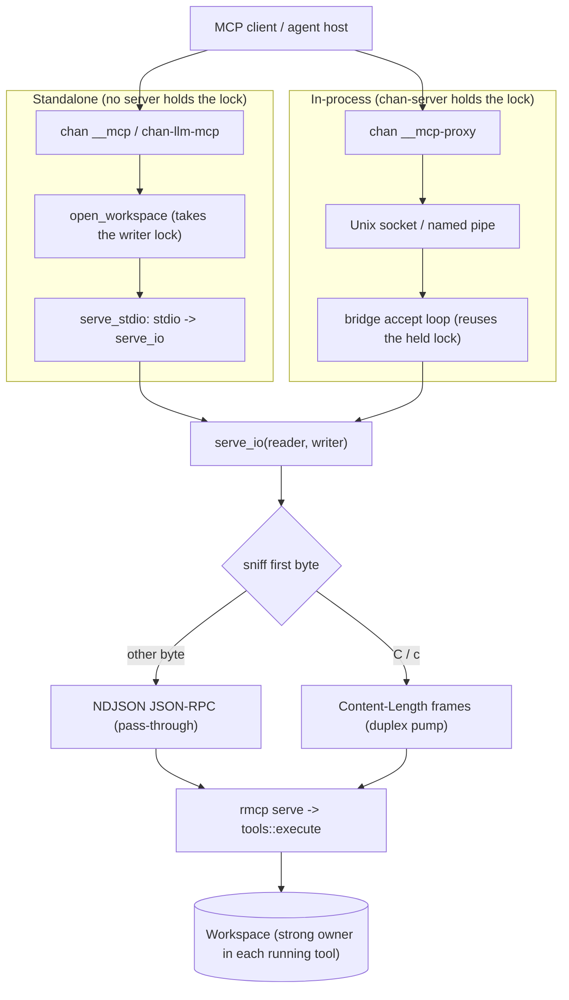
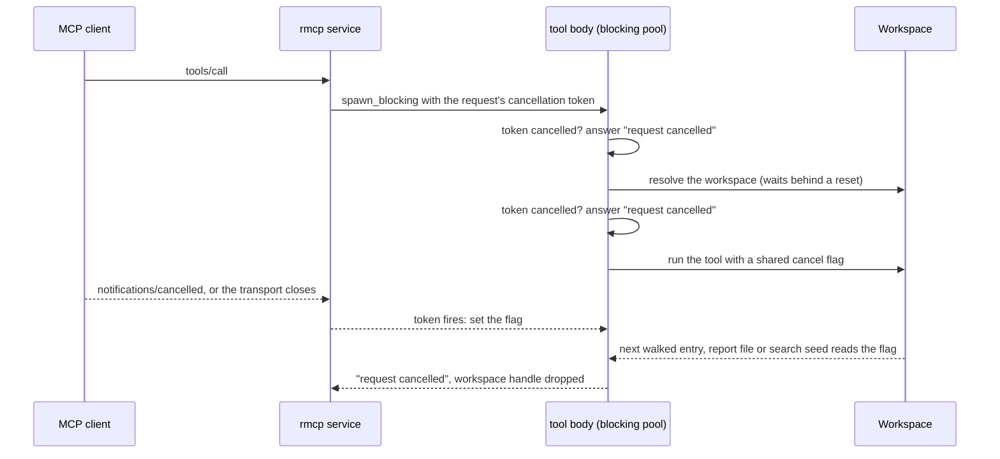

# chan-llm design

`chan-llm` is how coding agents reach a chan workspace: a small set of file, search and report tools, sandboxed through `chan-workspace`, and an MCP server that exposes them. Agents connect over MCP and nothing else. There is no in-app chat, no agent transcript, no model or provider configuration, and no HTTP surface; chan spawns no agent and writes no agent CLI's config file.

## What it is and where it sits

The crate sits between `chan-workspace` below it and three hosts above it. The standalone `chan-llm-mcp` binary, and the hidden `chan __mcp` subcommand, open a workspace through the registry and serve MCP on stdio for any client that spawns a process (Claude Code, Codex, Cursor and the like). chan-server's MCP bridge hosts the same service in-process over a local socket (a Unix-domain socket, a named pipe on Windows), and `chan __mcp-proxy` pipes an agent's stdio to that socket. The bridge exists because the serving process already holds the workspace's writer lock: a second process reopening the workspace would be refused, so the tools must run where the lock is.

In scope: one description per tool shared by every surface; JSON tool dispatch through `tools::execute`; the MCP service over stdio or any async read/write pair, behind the `mcp` feature; media reads capped by server policy; and typed passthroughs for the chan-workspace errors a host branches on.

Out of scope: routes and frontend state (chan-server), API keys and model choice (nothing in chan holds them), transcripts, and spawning or supervising agent processes (the terminal and Team Work do that, through `cs`).

## Architecture

*Both entry paths converge on `serve_io`, which sniffs the framing and dispatches tool calls on the blocking pool.*

The server accepts either newline-delimited JSON-RPC or LSP-style `Content-Length` frames by sniffing the first byte of the stream; framed clients are adapted through an internal duplex pump. Clients of both conventions exist, and asking the user to configure which one their client speaks would be a wiring failure waiting to happen.

## Workspace ownership

`mcp::Server` holds a workspace resolver rather than a workspace. `Server::new(Arc<Workspace>)` captures an owner for the standalone paths; the bridge uses `Server::from_resolver` with a lookup into the tenant's workspace cell, so a reset or a metadata import that replaces the workspace is seen by the next tool call. A tool body resolves the workspace only inside its blocking closure and drops the strong handle when it returns; waiting requests, idle sessions and stalled response writes retain nothing, and a cleared cell answers `workspace is closed`. Reads, writes, graph and search work run on the blocking pool, never on the async transport task.

## Tools

The JSON tools are `read_file`, `write_file`, `list_files`, `resolve_path`, `workspace_search` and `repo_report`, dispatched by name through `tools::execute`, which tests and hosts can also call directly. `read_media` is MCP-only because it returns image content blocks or embedded PDF resources rather than JSON text; it accepts PNG, JPEG, GIF, WebP, SVG, AVIF and PDF.

Every content tool routes through `chan_workspace::Workspace`, so the path sandbox, the special-file refusal, the editable-text gate and atomic writes apply without the tool doing anything. `write_file` replaces a whole file and accepts an expected mtime for compare-and-swap; a conflict surfaces as `WriteConflict` so the agent re-reads before retrying. `resolve_path` is metadata-only: it maps a public path to the host path for a shell tool that needs a working directory, without reading or writing. `workspace_search` is a mechanical translation of one typed request into the core's unified search, so agents, the HTTP routes and `cs` get identical results; its parameter type generates both the standard schema and the rmcp schema, and a test pins them equal.

Responses are capped so a runaway call cannot bloat a model turn: `read_file` pages text (256 KiB per page, with `truncated` and `next_offset` when bytes follow, and the whole file's size from its stat), `read_media` refuses a file past the media cap rather than downscaling it, `list_files` and `repo_report` truncate their lists and say so, and `write_file` rejects content over chan-workspace's text-write limit before crossing the dispatch boundary. A tool never reads a file to learn its size; every read is bounded by its tool's cap, not the file's length.

Tool descriptions are constants in `prompts` shared by the schemas and the MCP server. The rmcp macros accept only string literals, so the descriptions are duplicated inside the `#[tool]` attributes and a test pins the copies together; drift breaks the build rather than the agent's understanding of a tool.

## Cancellation

*Cancellation is cooperative: the flag is read at tool-defined boundaries, and whatever unit is in flight runs to completion.*

A tool body checks the request's token before resolving the workspace and again after a potentially blocked cell read, so a cancelled request never starts its workspace operation. Once the body runs, the token firing, or the request future being dropped (including at shutdown), sets the body's cancel flag. `list_files`, `workspace_search` and `repo_report` read the flag at walked-entry, report-file and search-seed boundaries and answer `request cancelled`; a body that finishes answers its result, so a write that landed is reported even when its request was cancelled.

What runs to completion: one graph or search query with the pass over its rows, one report load or snapshot, one bounded read, a lock wait, and any individual filesystem call. None of these gains in-flight cancellation; each is bounded by its tool's cap rather than the file's size, and together they bound how long a cancelled request can delay the release of its workspace, which matters to a bridge that is unmounting a tenant. A dropped MCP service cancels its requests, and a peer that closes the transport without a cancel notification gets a short drain of pending responses first.

## Configuration

The library has no model or provider configuration. The one policy knob is the media cap: `DEFAULT_MCP_MEDIA_MAX_BYTES` by default, `Server::with_max_media_bytes` for a host, `--max-media-bytes` on the standalone binary. `chan-llm-mcp --config` points at the chan-workspace registry, not at any LLM settings.

## Error boundary

`LlmError` is deliberately small: `Tool`, `Core`, `WriteConflict`, `WriteTooLarge`, `ListingTooLarge`, `PathRefused`, `Io` and `Mcp`. The typed passthroughs preserve the chan-workspace kinds a host branches on (a reload prompt for a conflict, a too-large dialog for a budget), and every other core error flattens into `Core` with its display text.

The MCP layer scrubs outgoing error strings. chan-workspace's display text can carry host absolute paths (a refused special file, a symlink escape), and the MCP client may be a third-party process, so across that boundary an error surfaces as its category plus the numbers an agent can act on (sizes, mtimes, caps), never the host's filesystem layout.
