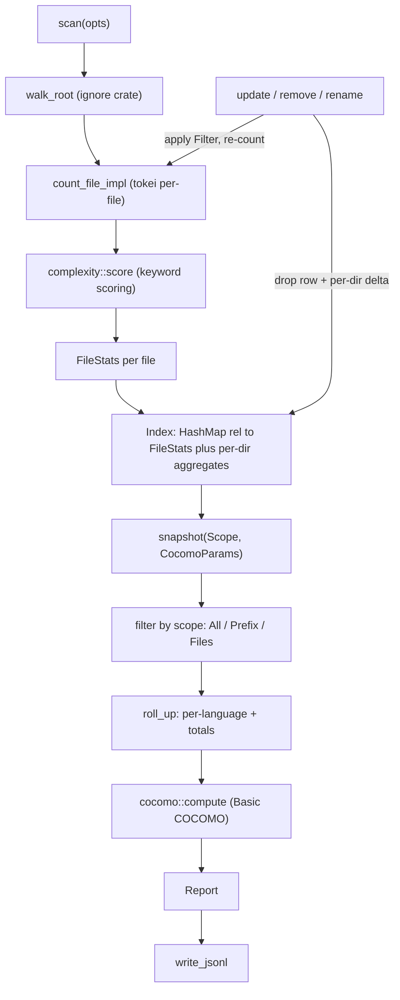

# chan-report design

`chan-report` turns a directory tree into a structured report: per-file language, lines of code, comments, blanks and a keyword complexity score, with per-language roll-ups and a Basic COCOMO estimate on top. It is the data backend behind chan-workspace's per-workspace report, and through it behind the dashboard, the file inspector, the graph's language relationships and the `repo_report` MCP tool. The crate computes and never persists: chan-workspace owns the JSONL on disk, the watcher that feeds updates, and the lock around the index.

## What it is and where it sits

The crate sits below chan-workspace, its only consumer, and depends on nothing of chan's. It owns one small thing chan-workspace needs to agree on, the spelling of a root-relative path (`rel_path_text`), because the report's keys and the workspace's keys must not spell one name two ways and the dependency only runs this direction.

In scope: walking a directory with gitignore-aware filtering; identifying a file's language with tokei's filename and extension rules plus a bounded shebang probe; counting code, comments and blanks per file; a cheap complexity score; per-language, whole-tree and per-directory roll-ups; Basic COCOMO; an in-memory `Index` that takes per-file updates, removals and renames; and a stable JSONL serialization of that index.

Out of scope: persistence and atomic writes (the consumer writes the bytes the crate emits), filesystem watching (the consumer wires its watcher to `update`, `remove` and `rename`), cyclomatic or AST-level complexity, git history, and aggregation across more than one root.

## Architecture

*`scan` fills the index once; incremental calls re-count one file; `snapshot` derives a `Report` for a scope without mutating anything.*

`Index` is the state: the per-file rows, a maintained per-directory aggregation, the accept filter captured at scan time, and the count of entries the scan skipped. Every mutation is O(1 file) plus an O(depth) walk up the directory cache, so a watcher can call it on every event. `Report` is a pure value derived from an `Index`, a `Scope` and `CocomoParams`; snapshots never mutate state. The walker runs only during `scan`; incremental updates take a relative path from the caller and skip it.

## Data model

A `Scope` is the whole tree, a relative prefix, or an explicit set of files, and all three produce the same `Report` shape (meta, totals, per-language roll-up, file rows, COCOMO) so consumers render one model. `Index::dir_report` is the O(1) read side of the directory cache: every file's stats contribute to each ancestor directory, and the cache is rebuilt from the file rows on load rather than persisted. `None` for a directory means no tracked file lives under it, which lets a caller tell "untracked" from "tracked and zero".

Each file row carries a `bucket`, a source-code-shaped axis with two values: `Markdown` for notes and `SourceCode { language }` for everything else tokei recognizes. It exists for the graph's colouring and is orthogonal to chan-workspace's `FileClass`, the I/O-contract axis; the graph composes the two, using the bucket for files the report tracks and the class for everything else.

Incremental outcomes distinguish `Inserted`, `Updated`, `Unchanged`, `Removed` and `Skipped`. `Unchanged` is the signal chan-workspace uses to skip rewriting the JSONL after a burst of events. `rename` is a remove plus an update in one call, and it reports a change whenever the source row existed so the consumer's debouncer still flushes.

## The JSONL format

One record per line, discriminated by `kind`: one `meta` record, one `file` record per tracked file, then `language`, `totals` and `cocomo` roll-ups. Records may appear in any order; blank lines and `#` comments are ignored on load. The schema is integer-versioned in `meta`; a mismatch is `SchemaMismatch`, which chan-workspace treats as "discard the cache and rescan". Paths are POSIX and root-relative, timestamps are RFC3339 UTC, and optional fields (`mtime`, `bucket`, the skipped-entry count) are omitted when absent so a file written without them loads under the same schema.

The `file` records alone reconstruct the index. The roll-up records are materialized for consumers that only need the overview; `load_jsonl` recomputes them from the file rows and treats the persisted ones as advisory, so a stale roll-up can never disagree with its rows. Unknown record kinds are tolerated so an older reader survives a newer writer.

## The walker

The walker is the `ignore` crate (ripgrep's engine) configured from `ReportOptions`: respect gitignore (on by default, with `.gitignore` also registered as a plain ignore file so it works in trees that are not git repositories), include hidden entries (off by default), follow symlinks (off by default), and extra gitignore-style exclude globs. Unrecognized languages are dropped. Unreadable descendants, non-UTF-8 names and per-file counting failures are skipped and counted, so one bad entry does not fail the scan; an error traversing the root itself still does. The skipped count travels in the JSONL `meta` record so a loaded index reports the scan that wrote it.

A caller can instead supply a `ReportPathPolicy`, which replaces all of the above: both the full walk and the incremental filter ask the same object whether a path is in scope. chan-workspace uses this seam so the report's scope is exactly its index scope rather than a second matcher with its own ignore sources; the richer standalone behaviour remains for callers without a policy.

## Counting

Language detection is tokei's: extension and filename rules without I/O, and for an extensionless file a bounded probe of the first bytes for a shebang line. Files larger than a fixed read cap keep a metadata-only row (path, language, bytes, mtime, bucket) with zero line counts, so they contribute file and byte totals and keep their graph classification without being read; an oversized file recognizable only by its shebang is untracked, since its language cannot be known without reading it. Within the cap a file is read once through one handle, with size and mtime taken from that handle, so nothing reopens the path. Non-UTF-8 content is decoded with tokei's own decoder options and counted by tokei's slice parser.

## Complexity

The complexity score is a per-file keyword count over a small list mirroring scc's (`if`, `else`, `for`, `while`, `switch`, `case`, `match`, `try`, `catch`, `&&`, `||`, `and`, `or`, and the like), alphabetic keywords on word boundaries and symbolic operators as substrings. It is cheap, deterministic and comparable within a language, and it is documented as a heuristic: cyclomatic complexity would need an AST per language, which is not worth it for a roll-up, and the score must never be read as a defect signal.

## COCOMO

Basic COCOMO is computed from total lines of code across the scoped files. The modes are Organic (the default), Semi-Detached and Embedded, each with the standard Basic COCOMO coefficients for effort and schedule; cost multiplies effort by a configurable average monthly salary and an overhead multiplier. The defaults are an organic model, a salary of 8,000 USD per month and Boehm's overhead multiplier of 2.4, overridable per call without recompiling. The JSONL `cocomo` record labels the model (`basic-organic`, `basic-semi-detached`, `basic-embedded`) so a consumer can parse it back.

## Error model

`ChanReportError` is one umbrella with primitive payloads (strings and integers), so chan-workspace maps it into its own error type as text: I/O, a path escaping the root, a JSONL parse error with its line, a schema mismatch, walker and counter failures, and `Cancelled` for a scan stopped by the caller's flag.
