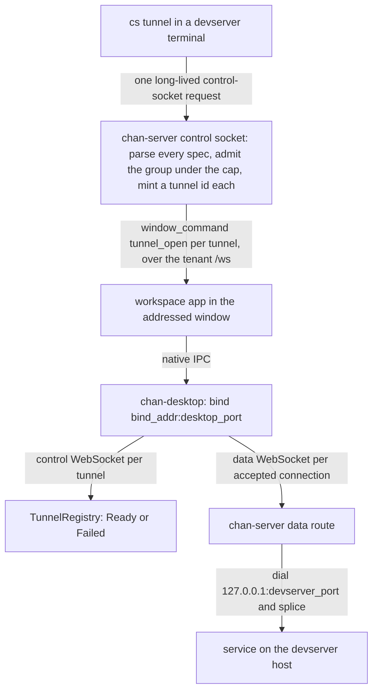

# chan-revtunnel design

chan-revtunnel is reverse port forwarding from a chan devserver to the chan-desktop connected to it: `cs tunnel [bind:]desktop:devserver ...`, run in a devserver terminal, asks the desktop that owns the terminal's window to listen on ports of the desktop machine and forward every connection back to ports on the devserver host. It is `ssh -R` with the roles the chan topology already has. It exists because a devserver can never dial a desktop: only the desktop opens connections, so the devserver asks over a channel the desktop already holds open and the desktop dials back. The name is deliberate: the `chan-tunnel-*` crates are the dial-out gateway tunnel, and this crate is the desktop-facing reverse forward, which works over a direct connection and through a gateway alike.

## Where it sits

The crate holds what both ends must agree on and nothing that belongs to one end's framework. The spec parser is shared by the `cs` CLI (chan-shell) and the control-socket handler (chan-server), so both reject the same input with the same words. The wire contract is shared by chan-server's WebSocket routes and chan-desktop's native client. The devserver registry is held by the `WorkspaceHost` in chan-library and driven by chan-server's control socket. The byte pump is written against channels so the devserver's axum side and the desktop's tungstenite side share it. The desktop client is a cargo feature (`client`, on by default) because it pulls a WebSocket client stack the devserver must not link; chan-server takes the crate without it. Transport is TCP; UDP parses and travels on the wire but is refused at the edge rather than silently behaving like TCP.

## The three legs

*Every hop after the trigger is desktop-initiated; the devserver only ever asks.*

1. **Trigger.** The control-socket handler pushes a `tunnel_open` window command to the terminal's own window. Addressing the window is also how the desktop is chosen: a window's webview belongs to exactly one desktop process, so no separate selection rule is needed. The payload carries everything the desktop needs to act and no capability of its own: the desktop resolves which devserver to dial from the window's own connection record, never from the payload, so a page that forges the command can only ask its own devserver for what that devserver could already ask.
2. **Control.** The desktop dials one WebSocket per tunnel. Its first frame is the acknowledgement the blocked `cs` waits on: `Ready` with the bound authority (which matters when the request asked for port 0) or `Failed` with the reason. The desktop dials this socket before binding the listener, so a bind failure is reported as a reason instead of a timeout. Afterwards the socket carries nothing but its own liveness, which is the point: it is the lifetime anchor in both directions. `cs` exits, the registration drops, the socket closes, the desktop tears the listener down; the desktop dies, the socket drops, the devserver fails the blocked `cs`.
3. **Data.** The desktop dials one WebSocket per accepted connection; the devserver dials the loopback port and splices. Binary frames are raw bytes both ways. Half-close is negotiated: the devserver advertises it in the trigger, a supporting desktop advertises it on the data-leg URL, and only a leg both sides advertised uses a text marker as the sender's end-of-stream, so each direction can finish independently and a request's EOF does not cut the response. Either side missing the advertisement keeps the contract where either direction ending closes both.

Both WebSocket paths sit under `/api/library/`, because `/api/devserver/` is not forwarded on the gateway's public wildcard and a gateway-attached desktop must be able to reach them.

## The spec

A spec reads the way `ssh -R` reads from the machine the command runs on: the listener end first (the desktop), the destination end second (the devserver host), and the two ends are named that way in every error, since "local" and "remote" invert depending on where the reader stands. One side alone names both ends; an optional bind address comes first, with an IPv6 literal bracketed or not, which works because the last two colon fields are always the ports. The bind address defaults to loopback and a non-loopback bind parses on purpose: policy lives at the edges, where the CLI and the desktop warn, so the parser stays a parser.

Each side is a port or an inclusive range, so one spec names one tunnel or many, expanded in port order. Two ranges pair in order and must be the same length; a desktop port of 0 pairs with every port of a devserver range (one OS-picked listener each); a desktop range may fan in to one devserver port; any other fixed desktop port with a devserver range is refused, since one authority listens once. A list that names the same desktop listener twice (the same bind address and fixed port) is refused by the CLI before any round trip and again by the server.

## Lifetime and bounds

A command's tunnels are one group that lives and dies together. The registry admits every tunnel of a command or none of them, checking the host's cap and inserting under one lock so two commands racing against the cap cannot interleave past it; a refusal names the counts. Each `Registration` is a guard whose drop is the single teardown path, so a clean Ctrl-C, a killed client and a panic unwinding the handler all end the tunnel the same way, and the handler drops a command's guards together. On the desktop, every bridge is owned by the tunnel's task set rather than detached, so ending the tunnel also ends the connections it is carrying. Nothing is persisted: a devserver restart takes every tunnel with it, the same lifetime its terminals have.

A data socket may attach only after the desktop reported `Ready`, and a stale or forged tunnel id never causes a dial. A refused devserver-side dial closes that one data socket and leaves the tunnel up. An accept error on the desktop listener never ends a tunnel, since only the command, the devserver or the control socket may; a resource-exhaustion failure pauses before the next accept.

What is not bounded: the connections one tunnel carries and the bytes it moves. On a gateway-attached devserver every data socket is one more substream on the same session that carries the terminal's own WebSocket, so bulk traffic through a tunnel contends directly with the terminal; the code records the cap and the accounting as a TODO.

## Boundaries

- The unguessable tunnel id is the only thing naming a tunnel on the two WebSocket paths. Over a gateway the legs additionally present the gateway session cookie and the exact Origin, and chan-server's owner-desktop gate admits a leg only when the forwarded assertion names the owner on a session minted for the desktop app: a grantee's desktop, the owner's browser session and a stolen browser cookie are all refused, because a leg binds a listener on a machine outside what a grant covers, and only chan-desktop dials the legs natively.
- The gate classifies legs, not the trigger. Anyone with a shell on the devserver, a grantee included, can address the owner's window and ask that desktop to open a tunnel; the app forwards the request without a prompt and the desktop binds after only warning about a non-loopback host. The desktop then dials with its own session, so the leg gate is not a boundary against a devserver shell.
- `cs tunnel` is served by a devserver. A standalone `chan serve` and the desktop's own embedded host refuse it at once, since there is no remote desktop to forward to.
- A dropped control socket fails the blocked command immediately. That matches a directly attached desktop, where the socket drops only if the desktop went away, and not a gateway-attached one, whose sessions expire absolutely and whose bridged sockets the proxy force-closes. Holding a registration through a grace window and letting the desktop redial by tunnel id is a recorded TODO; it lands with the authority question on the routes, since it makes the id a resumable credential.
