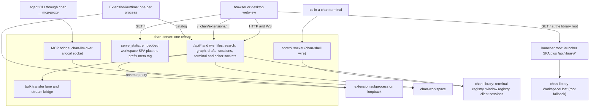
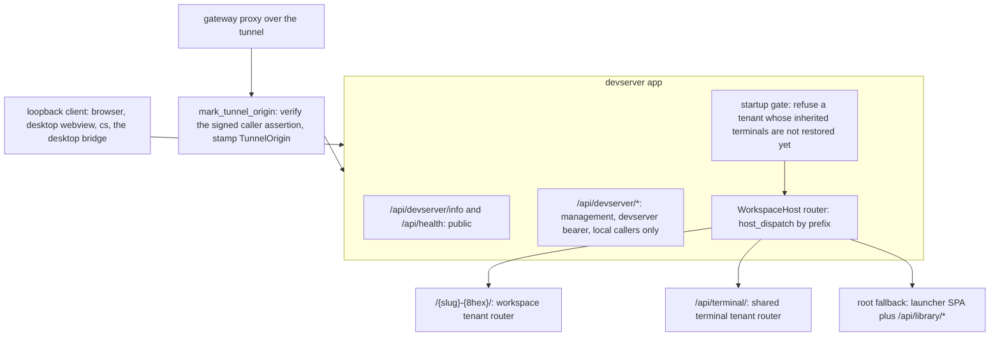
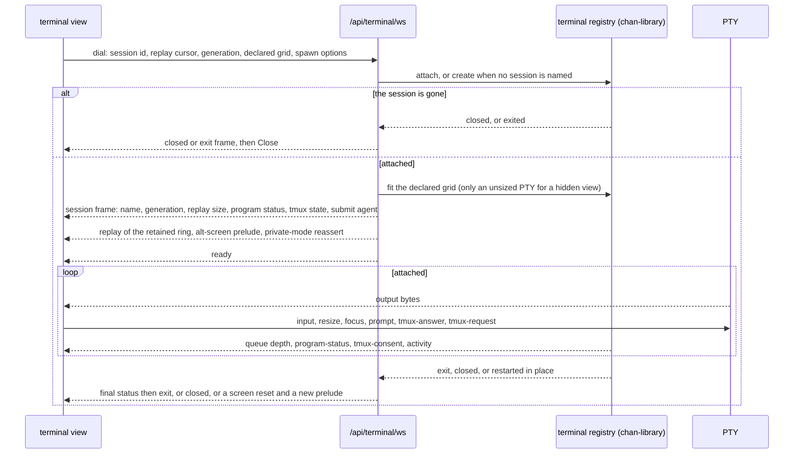

# chan-server design

chan-server is the serving layer. It takes a tenant that `chan-library` hosts, a workspace or the shared terminal, and turns it into a web app: the HTTP and WebSocket routes the workspace app speaks, the embedded SPA bundles, bearer authentication, the control socket `cs` speaks, the in-process MCP bridge agents connect to, the extension proxy, and the headless devserver with its supervision and its gateway tunnel. It is the crate behind every shape the root [design.md](../../design.md) describes: `chan serve` on loopback, the desktop's embedded server, and `chan devserver` reached over a TCP tunnel or through a gateway.

## Where it sits

chan-server depends downward on `chan-workspace` (the core), `chan-library` (the host, windows, terminal sessions and client sessions), `chan-llm` (the MCP server), `chan-shell` (the control-socket wire types), `chan-metrics` (the counters the listeners, the tunnel and the transfer lane feed), and the tunnel, reverse-tunnel and systemd crates; the process readings behind `/api/metrics` come from the `sysinfo` crate. Its callers are the `chan` CLI (`chan serve`, `chan devserver`) and chan-desktop, which embeds a `WorkspaceHost`, builds tenants through this crate's `TenantBuilder`, installs the launcher on the host's root fallback, and listens on the desktop handoff socket. chan-library never references a frontend bundle; chan-workspace knows nothing of HTTP. Every request handler is thin: it deserializes, picks the live workspace handle, moves filesystem, index, report and archive work onto the blocking pool, and serializes. Search ranking, path policy, link resolution and write semantics stay in the core.

## Tenants and route tables

A tenant is one router plus the state and background tasks behind it. A workspace tenant wraps a `chan-workspace` handle and owns its watcher bridge, indexer, document and drawing session authorities, terminal registry, control socket and MCP bridge. A terminal tenant has no workspace: it serves standalone terminal windows and, when the host gives it a durable layout store, the standalone Files application over the machine's own filesystem through a `MiniWorkspace`; it omits the watcher, the indexer and the MCP bridge, and its control socket refuses workspace commands by tenant kind rather than with a transient error. One function builds both kinds, and the standalone `chan serve`, chan-desktop and the devserver all mount tenants through it, so every surface serves byte-identical request handling. A tenant is nested under its path prefix at build time, so handlers always see paths from `/api` and `/ws` and the same code serves at the root or under `/{slug}-{8hex}/`.

Four route tables exist: the workspace tenant's router, the terminal tenant's router, the launcher router (`/` plus `/api/library/*` and `/api/metrics`, one bundle installed on the host's root fallback by the desktop loopback and the devserver alike), and the devserver app, which puts the reserved `/api/devserver/*` management namespace in front of the host's dispatcher. Each table is written down in `route_authority.rs`, one row per mounted verb and path with the authority class a caller meets there, and a test walks each assembled router against its table, so a route cannot land unclassified. Nothing at runtime reads the tables; they are a ratchet on the gates.

*The devserver composition. chan-desktop serves the host's router directly behind its own loopback, with the same launcher root and tenant routers; a standalone `chan serve` is one workspace tenant at the root of its own listener.*

## The embedded web apps

Two Svelte bundles are embedded with rust-embed: the workspace app from `web/dist` and the launcher from `web-launcher/dist`. Debug builds read them from disk per request, so a frontend rebuild needs no cargo rebuild; release builds bake them into the binary, which is what keeps the CLI a single file. `serve_static` is each tenant's fallback: a baked asset is served as is, any other path gets the shell so client-side routes work, and a miss under `/api` or at `/ws` is a real JSON 404, never the shell, so a programmatic caller never receives HTML for a missing route. The launcher is served the same way at the library root with a generated PWA manifest; the workspace shell carries no manifest, so a single workspace cannot be installed as its own app, and there is no service worker anywhere.

The served shell carries boot metadata in meta tags, because the SPA needs the answers before its first render and asset URLs are relative. The workspace shell gets the tenant's path prefix, which the transport layer prepends to every fetch and WebSocket URL; this is what lets one bundle work at the desktop loopback, under a devserver prefix, and through the gateway, which forwards paths unchanged. It also gets whether settings writes are locked, whether the tenant serves the standalone file surface and the draft store (the tenant is the authority, because it is the thing that constructed those surfaces or did not), and the renderer and GPU answers chan-desktop appends to a window's URL so the terminal picks a backend WebKit can composite. The launcher shell gets the host's OS family and the surface it is served on: the desktop loopback (registry mutation plus a native window bridge), a devserver (registry mutation, browser-managed windows), or read-only (nowhere to mount a workspace).

## Authentication and caller authority

Every `/api/*` route and `/ws` is gated by a bearer token; static assets stay open because the browser loads them before any script can carry a token. A workspace tenant's token is minted once and persisted under the chan home with owner-only permissions, so a rebuild and restart does not invalidate the token a browser cached; a terminal tenant's token is minted per process. Clients present it as a `t` query parameter, which the launch URL carries and the SPA moves into session storage, or as an `Authorization` bearer header. A request that names a detached client holder is refused on the data routes, so a page the operator detached stops autosaving as well as reconnecting.

The launcher root has its own gate, the launcher bearer: the desktop's minted loopback token or the devserver's rotatable token, accepted as a query parameter only on the WebSocket routes a browser cannot set a header for. The local colour and theme routes accept any live tenant token the host serves as well, because a window is served with its tenant's token and still needs to set the library's colour. The devserver's management namespace takes the devserver bearer in the header only. A `--no-settings` serve locks the settings-write lane for every caller alike, as middleware on that sub-router, so the refusal lands before any body is parsed.

Over the gateway tunnel the gateway is the trust boundary. The tunnel copy of the app verifies the signed caller assertion the gateway's proxy attaches to every forwarded request, refuses a request with no verifiable assertion or whose subject names no user, and stamps the verified caller on the request; the local bearer gates admit a stamped request without a token. There are three kinds of caller: a local caller, the owner (a tunnel caller whose subject is the devserver's owner, on a desktop, browser or unstated client), and a grantee (any other signed-in subject). A grant is all-or-nothing, so a grantee meets what the owner meets everywhere except the reverse-tunnel legs, which only the owner's desktop session may attach, since a reverse tunnel opens listeners on the desktop machine. The management namespace is local only: the gateway forwards nothing under it.

## The event socket

`GET /ws` is each tenant's watcher and window-presence side channel. One broadcast channel per tenant carries pre-serialized JSON frames with a `type` discriminator: watcher events, indexing progress, graph invalidations, config changes, the terminal roster, the session roster, transfer queue positions, and window commands addressed to one window. A slow subscriber lags and skips ahead rather than blocking producers; a lagged socket then receives a direct resync cue so the page rechecks the workspace root, plus fresh survey and identification snapshots when it names a window. Alongside the broadcast, a socket subscribes to directories with `sub` and `unsub` frames and receives scoped `fs` frames for them. A workspace tenant derives those from the core's one recursive watcher; the standalone Files tenant serves the whole machine, where a recursive watch is unacceptable, so a serving-layer actor attaches exactly one non-recursive OS watch per directory with a live subscriber and drops it with the last one. That watcher lives here rather than in the core because its lifetime is a subscription's, not a workspace's.

A socket that names its window registers with window presence, which is how the window feed reports which windows are connected and who holds them, and joins the window's leader and followers session; a local socket joins as a leader candidate and a tunnel socket as a follower. Event, terminal and editor sockets register their holder and window with the library's client sessions, which is what `cs session list` reads and `cs session detach` revokes. On attach a tagged socket receives, in order, its client receipt, the session roster, any window commands parked for it while it had no socket, and the surveys and identification prompts still open in that window, built after the socket subscribed so nothing falls between the snapshot and the stream. The server's own writes are noted before they happen so the watcher bridge can attribute the resulting event to the writing window or suppress its echo; the indexer never honours that suppression, because an in-app save must reindex.

## Terminals

The terminal registry, PTYs, scrollback rings, write queues and the tmux gate live in chan-library; chan-server is their transport. The routes create, delete, restart and rename sessions, toggle cross-window broadcast, forward tmux requests, list the roster and the selectable shell profiles, and attach a view over `GET /api/terminal/ws`. The roster says whether a page holds each session's window and is pushed over `/ws` on every session change and whenever a window that holds a session gains its first socket or loses its last. A session outlives its view, so a window can reload or attach from another machine and the shell keeps running, and several views can be attached at once.

The attach prelude is the same for a first attach, a resumed attach and a restart in place, so a page always converges on the server's view, and the session frame is authoritative for the page even when it carries an older revision than one an earlier socket saw. A tmux pane's grid belongs to tmux, so its size goes out ahead of the replay. The private-mode reassert exists because a full-screen program that set cursor keys, mouse reporting or bracketed paste will not announce them again to a view that attaches later.

Sizing follows one rule: visible views decide. A view declares its measured grid on the dial; a hidden view qualifies its declaration so it sizes only a PTY no client has sized yet, and otherwise adopts whatever a visible view chose. Among visible views the last size wins, and a view whose grid the PTY no longer holds sends it again only on the next trusted interaction in that view, never in answer to another client's resize, so two visible clients cannot resize the PTY back and forth. A restored PTY is already sized; a relaunched one starts unsized.

The socket also carries what the program reports. The Program Status Protocol records the session keeps arrive as the current set in the session frame and as later values paced per socket with the latest winning, so a socket that lags on output still reads the right status, and the final value precedes `exit`. The tmux control-mode gate's question rides the same socket: any attached client may answer, the first answer wins, and a tmux window's own requests hop from a pane session to the control session that holds the connection. Rich Prompt submissions and `cs terminal write` pokes share one FIFO per session so prompts and pokes submit one at a time when the agent is idle; the socket reports queue depth, acknowledges tagged prompts and confirms their delivery, lets a still-queued prompt be recalled, and streams the queued message texts while the Details panel subscribes, a subscription that never touches the PTY. Each socket sends exactly one `exit` however the exit reaches it. A close names its reason: a PTY parked for a service restart is told apart from one killed by a shutdown, because the first comes back.

## The control socket

Every tenant binds a local control socket, a Unix socket in a validated owner-only runtime directory or a named pipe on Windows, and exports its path to the terminals it spawns as `CHAN_CONTROL_SOCKET`; a bind failure does not fail the tenant and reaches new shells as a diagnostic variable instead, so `cs` can say why it has no server. A standalone serve or a desktop tenant binds a path unique to its process; a devserver tenant binds a path derived from the library's persisted identity and the tenant prefix, taken over under a lock only when no live server owns it, so the path baked into shells that predate a restart reaches the restarted instance. The wire contract is chan-shell's `ControlRequest` and `ControlResponse`, one newline-framed request and one reply per connection; the client side is in [chan-shell](../chan-shell/design.md#the-transport-and-discovery).

Commands fall into a few shapes. Window commands (`cs open`, `graph`, `dashboard`, `terminal new`, `upload`, `download`, team spawns) become a `window_command` frame addressed to the caller's window over `/ws`; the CLI is told the request is queued and the SPA acts on the frame. A command for a window with no live socket is refused rather than broadcast into nothing, except that an open the server routed into a window it just minted is parked for that window's first socket. Registry commands (`terminal write`, `list`, `status`, `restart`, `close`, `scrollback`) act on the terminal registry directly. Blocked round trips (`terminal survey`, `pane`, `copy`, `paste`, `export`, `session handover`, an interactive `session self`) park a one-shot reply on a bus keyed by a server-minted id and wait for the SPA's reply route or the leader's answer to complete it; surveys additionally queue per target, because the SPA holds one overlay slot per terminal tab and one per window. `Identify` answers the serving kind, the library identity and the tenant's workspace root and metadata key, which is how the CLI finds the process serving a workspace among several on one machine. `Close` unmounts a hosted workspace by root or ends a standalone serve. `cs tunnel` is admitted against the host's reverse-tunnel registry and cap, triggers the owner's desktop through the window's socket, and holds the connection for the tunnel's life; a standalone serve and the desktop's embedded host refuse it, since only a devserver has a desktop to ask. The tenant kind decides availability: workspace-only commands are refused on a standalone terminal with one message family. A dispatched handler owns its own lifetime; unmount aborts idle requests, parked handlers and tunnel conversations.

## Documents, drawings and files

The document and drawing WebSockets share one design: while a file is open live, the server is the single writer to disk. A per-path authority accepts client updates, fans them to every attachment, debounces dirty state to atomic compare-and-swap writes, and folds clean external edits back in through the watcher; an external edit that overlaps dirty state becomes a three-way conflict that only an explicit reload or overwrite resolves, never a silent replacement. Each authority writes a bounded recovery record under the chan home, outside the user tree, so a restart rehydrates dirty or conflicted state before any flush can run and stale authority cannot overwrite a newer file. A socket's first frame after upgrade is a `hello` sent before the session is attached, so the time a large snapshot takes is not read as a failed dial. These sockets serve the user workspace alone; drafts live under the workspace's metadata sidecar, are addressed by a draft id, and have their own routes, because a draft's path can spell a user file's.

The file routes are a thin shell over the facade: list, read as text, bytes or an NDJSON stream, write with an optional modification-time token for compare-and-swap, create, delete, move, transfer, attachments with collision-safe names, and multipart upload. A mutation that names its window records that window on its self-write note so the resulting watcher frame carries its source. `POST /api/open` is the command launcher's Open riding `cs open` semantics over HTTP: an in-workspace path opens in the submitting window, an escaping path is routed through the host to its standalone window, and the reply names where it went. Search, graph, report and contact routes delegate to the core on the blocking pool; the workspace search route takes the shared typed request and returns the core result unchanged, so HTTP and `cs search` share one contract.

The background indexer runs a full build when the index is empty and debounced incremental updates from the watcher feed, and broadcasts a graph invalidation naming the files it applied, the writer's window included, since every window reads the same derived graph. A file the watcher cannot read or decode is logged and skipped without locking the workspace; a failure of the index's own maintenance sets the index error and locks preflight. Recovery passes the core asks for at open time are retried on a cooldown under a recovering readiness envelope, so a query during recovery answers not-ready rather than a fresh-looking empty result. A storage reset or a metadata import swaps the workspace cell wholesale, flushing and closing the editor authorities and terminal sessions first; a handler that meets the held cell answers busy with a retry hint rather than parking a worker.

Each tenant holds its own copy of `server.toml` and `preferences.toml` and pushes a `config_changed` frame to its windows when its own settings route writes them. One watch on the config directory per process covers every other change, `chan config set`, a hand edit, or another tenant's write in the same host: it reloads and compares content with the in-memory copy, so a tenant's own save is a no-op and only a genuine external change reaches the bus.

## Transfers

Bulk sends and receives, file and archive downloads and multipart uploads, run on a process-owned transfer lane with a small fixed set of dedicated threads and a bounded waiting queue, never on the blocking pool that editor saves and terminal spawns queue on. The bound is server-side on purpose: a browser, a second window, `curl`, MCP and a shell in a chan terminal all reach the same allocation, so no client can widen it, and a request past the bound is refused with a retry hint. Every tenant in a hosted process shares one lane; a standalone serve owns its own. The contract for a client that goes silent is the same in both directions: no channel progress for the configured no-progress bound in `server.toml` ends the job and returns its slot even while the response stays unpolled. A stalled download ends its body as an error rather than as a stream that looks complete; a stalled upload is answered as the client's own failure, and its partial temporary file is discarded. A body that fails or ends early is answered as incomplete, not as a server error. Multipart destination metadata is read under the same bound before lane admission, so a refusal there takes no slot and writes no file. The smaller streams, NDJSON text reads, report rows and graph views, stay on the blocking pool because each is a handful of frames, but reach the response through a bridge that borrows the lane's no-progress policy, so a reader that stops releases the producing thread within the bound.

A window can cancel its own upload. An upload that carries a window id and a transfer id registers that pair with the tenant before its destination is parsed, and `POST /api/transfers/cancel` under the same pair withdraws queued work before its writer runs or signals active work cooperatively; the pair is a routing match under the route's existing authority, not proof of window ownership. Each writer claims finalization once: a cancel that wins first discards the temporary file, and a cancel after finalization is answered as not cancellable, so a completed write is never undone by a late cancel. Downloads and copies are not cancellable. A tracked request reports its queue position to its window over `/ws` until it starts running; untracked callers are admitted and bounded exactly the same, they simply have no window to address. On a standalone terminal, transfers resolve against the shell's working directory with the reach of the shell's own uid; the terminal already grants that access, so there is no second sandbox wall.

## Extensions

One `ExtensionRuntime` per process scans the extension declarations under the chan home, starts every valid subprocess, waits for its marker-delimited handshake naming a loopback URL and a token, supervises the process group, and injects one catalog into every workspace tenant, so a host that mounts many workspaces spawns each extension once. A failed extension is logged and does not stop a workspace from opening; an exited one stays in the catalog marked not running. The catalog a browser reads exposes only capability-scoped paths under `/_chan/extensions/{id}/{capability}/`, and the tenant reverse-proxies those, HTTP and WebSocket alike, to the process-private loopback endpoint with the extension's own token and a private tenant scope added upstream. The upstream URL and token never enter browser memory or persisted window state, and every surface, standalone, desktop, devserver and gateway tunnel, reaches an extension on chan's one address and port. An extension is an independent loopback trust domain, never a workspace filesystem authority: it holds no chan bearer and reaches files only through what its host bridge offers. The model is described in [docs/extensions.md](../../docs/extensions.md).

## The MCP bridge

A workspace tenant hosts chan-llm's MCP server in process over a local socket of the same family as the control socket, and `chan __mcp-proxy` pipes a subprocess's stdio into it. The bridge exists because chan-workspace's per-workspace writer lock would refuse a child's own open of the workspace; in process the server borrows the tenant's live handle through the cell, so a tool body reads the workspace after a reset or import has installed its replacement, and a cleared cell answers that the workspace is closed. The terminal registry injects the discovery variables into spawned terminals only when opted in per server, per attach or per team member, because a stray descriptor makes some agent CLIs refuse to start. The bridge's accept task owns its sessions; unmount gives them a bounded grace, then aborts them before the host waits for the workspace lock, and dropping a session cancels its requests at the boundaries [chan-llm](../chan-llm/design.md) describes.

## Process metrics

`metrics.rs` owns the readings the Dashboard, `chan metrics` and its systemd-report source show. One `Runtime` per process runs two threads: a sampler that reads the process through `sysinfo` and chan's own counters from `chan-metrics` once a second into a ring of 600 samples, ten minutes, and a walker that sizes the chan home once a minute, only while reads arrive, and rests after five minutes without one. A request copies the cache and never waits on collection, and a failed scan keeps the last completed total beside its error. `GET /api/metrics` is mounted on the workspace and terminal tenant routers and on the launcher router, behind each one's bearer, and every mount answers from the one runtime.

The sampler and walker share one stop flag and condition variable with the walker's read demand; dropping the runtime sets that flag and wakes both workers. A storage syscall already in progress finishes before that worker observes the stop, so teardown does not join it. The runtime belongs to no tenant: the embedder installs it. `metrics::with_metrics` starts it and wraps the outermost router with it as an extension the route reads, and a router served without that wrap answers `/api/metrics` with 503. The serving sockets are counted only through `metrics::MeteredListener`, which meters every TCP stream it accepts, upgraded WebSockets included, so an embedder that serves through a plain listener leaves its local sockets out of the network reading. `serve` and the devserver app wrap their routers and serve through `signal::graceful_serve`, which uses the metered listener, and chan-desktop does both for its embedded server. The tunnel's copy of the devserver app is made from the wrapped router, so a caller through the gateway reads the same runtime. The response carries a schema version (`SCHEMA_VERSION`); [docs/metrics.md](../../docs/metrics.md) states that contract and what each reading measures.

## Desktop handoff and devserver discovery

`chan serve PATH` must never bind a second server for a workspace a running desktop or devserver already owns, because one process holds a workspace's writer lock. Two same-user local endpoints make the handoff possible, both newline-framed JSON over a Unix socket or a named pipe with a protocol version checked before dispatch, so a version skew falls back to standalone rather than decoding an unknown shape. The desktop handoff is a well-known per-account endpoint the desktop listens on: open or close a workspace in a native window, register a devserver by URL, drive a connected devserver's workspace verbs, open a throwaway terminal (`OpenTerminal`, which `chan-term` sends from a shell through `try_open_terminal`, and a second desktop launch through `try_open_terminal_at` for the terminal a `chan-term` started it for), self-upgrade, `Activate`, which a second desktop launch sends so that the running desktop comes forward and the launch exits, and `OpenPath`, which such a launch sends for each path it was given, and which the CLI's `chan-files` and `chan-edit` send from a shell outside chan (`try_open_path`, which tells nothing listening on the endpoint from a listener that gave no answer or closed without one, so the CLI starts a desktop only when none listens). Both senders read their arguments through `launch_arg_path`, which makes a relative path absolute against the sender's working directory and decodes a `file://` URI, so a path a desktop entry's `%U` hands over and one typed on a command line arrive alike. `OpenPath` carries one absolute path and does what `cs open PATH` does in a standalone window: the host reuses or mints a standalone window, native so the watcher opens it, and raises it, and the shared terminal tenant's standalone filesystem resolves the path by `cs open`'s own rules (`standalone_open_target`), so a directory opens the file browser, a text file the editor, any other file is revealed in its directory and a missing one is created empty. The answer is `PathOpened` with the line `cs` prints for that open, its path absolute since the reader is outside chan (the path, the window, whether it is still opening, the workspace that holds the path when one does), or `Error` with a sentence: a relative path, a path the surface cannot reach, a host with no standalone filesystem (every Windows desktop), a desktop shutting down. On the wire, one line each way: `{"type":"open_path","protocol":1,"cli_version":"0.128.0","path":"/home/u/notes.md"}` is answered `{"status":"path_opened","desktop_version":"0.128.0","message":"open request queued for /home/u/notes.md in standalone window w-6b2f (opening)"}` or `{"status":"error","message":"cannot open /home/u/gone/notes.md: canonicalize path: No such file or directory (os error 2)"}`. A window minted for a path that then cannot be opened is discarded, since it would show empty. `Activate` and `OpenPath` are more requests under the same protocol number: a desktop that predates one answers an error for the unknown type, which the launch reads as a refusal from a desktop that is running. The CLI consults the endpoint before it opens anything and exits as a launcher on success. The endpoint is also what keeps one desktop per account, so the right to serve it is taken apart from the listener. `claim_endpoint_at` takes an `EndpointClaim`, which a desktop takes before the rest of its boot, and `start_claimed_listener` serves a claim once the handler exists; `start_listener` does both in one call. On Unix the claim is the flock beside the socket. On Windows it is the first and only instance of a pipe of its own, `<endpoint>.claim`, which no client opens: a pipe instance takes a client as soon as it exists, so the endpoint's own pipe is created only when the listener starts, and a client during the boot meets no pipe and answers at once instead of writing a request into an instance nobody reads yet, one the listener would otherwise serve after its client gave up. The listener's handle holds the claim, not its accept loop, so a loop that stops while its desktop runs (a failed re-arm, logged once) leaves the endpoint claimed. Whether each pipe exists is read from the `\\.\pipe\` listing, which opens no instance: a claim pipe without the endpoint's pipe is a desktop still booting (`endpoint_is_booting_at`, and `desktop_is_starting` for the CLI), which a second launch waits for before it asks and which the CLI names when it serves on its own; the endpoint's pipe without a claim pipe holds no claim, since nothing that holds this account's claim serves the endpoint without it: the launch takes the claim, the listener's first instance fails on the pipe already there, and the desktop runs without its listener and keeps the claim. A listing that cannot be read is no reading of a boot: a second launch asks as it would a desktop that is up, and the CLI falls back without naming a desktop starting. Every pipe on a Windows machine shares one namespace, so the endpoint is named by the account's SID, `\\.\pipe\chan-desktop-<SID>`, with the claim pipe `<endpoint>.claim` beside it, the SID read once from the process token: a user name cut to the characters a pipe name allows can be another account's too (`first.last` and `firstlast`, or a local and a domain account of one name), whose claims would hold each other's endpoint. A SID holds no dot, so no account's endpoint is another account's claim pipe. Both pipes, and every instance the listener arms, are created through [chan-winpipe](../chan-winpipe/design.md) with a descriptor that grants their account alone (the account owns them, and a protected DACL's one entry gives it full access); the default named-pipe descriptor also grants LocalSystem and Administrators, which let an elevated process of another account open a desktop's endpoint and be served as that desktop's account. Any local user can still create a pipe of the name first, so every Windows client, the connect-only probe included, opens the endpoint through one connect that reads the account the pipe's server runs as (its process id, then that process's token) and writes nothing to a pipe of another account, or of one it cannot read, which is no desktop. This account's second claim meets the claim pipe's limit of one, pipe busy, and reads held; access denied on the claim pipe can only be another account's pipe of the name, `ClaimError::Foreign`, and the launch boots without the listener rather than wait for and ask a holder no launch of this account can reach. Two limits are stated rather than closed: that desktop holds no claim, so a second launch boots beside it; and another account's pipe of the claim's name that admits one instance and grants this account access is indistinguishable from the account's own busy claim, so the launch waits and exits; an owner-only lock file as the claim would close both. The SID name and the user name do not meet, so the desktop and the CLI of one release talk across a release boundary only as no desktop: a CLI of the previous release beside a desktop of this one finds no pipe and serves on its own, as does a CLI of this release beside a desktop of the previous one, and a launch of either release beside a desktop of the other boots a desktop of its own. The pair converges at the desktop's next boot, which writes the `chan` and `cs` shims over the CLI it ships with, and Chan's Windows installer stops a running desktop before it copies files, so two releases' desktops run side by side only when an older copy is started by hand. A listener that fails to start hands the claim back in its error (`ListenerStartError`), still held, so its caller can keep it for the life of the process and a later launch still meets a held endpoint that does not answer. Which launches claim, ask and wait is the desktop's rule, in [desktop/design.md](../../desktop/design.md). The devserver discovery namespace holds one stable endpoint per local devserver instance, derived from its library identity and port, so several instances stay independently discoverable; `chan serve` identifies them and selects one without guessing (an explicit selector, else the devserver that spawned its shell, else its own library's, refusing ambiguity), then asks it to mount the workspace and mint one window. A registration a later request overtook, a turn-off, a forget or a newer turn-on, is refused with a fixed sentence commands compare by equality and end on, without a standalone fallback that would serve a directory just turned off; a workspace another process holds is refused with the sentence the HTTP routes use for the same lock.

A local `CloseWorkspace` handoff, used by both `chan close` and `chan workspace forget`, waits for the tenant-task shutdown grace plus the workspace teardown hop's release budget plus three seconds for dispatch and the reply. Both the Unix socket and Windows pipe clients derive that wait from chan-library's two shutdown constants (five seconds each, giving thirteen seconds in total). A retained workspace reference can therefore produce the host's `workspace is still releasing; retry` reply within the client's window. The host records the workspace off and keeps teardown running until release; increasing the client wait does not cancel or transfer that ownership. Tenant tasks that cannot finish even after abort, or synchronous filesystem work that never returns, can still outlast the client. Registry-only requests retain their three-second window, and remote workspace verbs retain their own longer budgets.

## The devserver

`run_devserver` is the headless multi-workspace server behind `chan devserver`. It installs on its `WorkspaceHost` the persisted window registry, the workspace on/off overlay and a stable control identity for every tenant it mounts; then it mounts the shared terminal tenant, mints the first-open terminal when the library is fresh, and restores every workspace the overlay says is on. Its own state, the bearer token, the library identity and the last bound port, persists owner-only under the chan home; the token is reused across restarts so a reconnecting client keeps working, rotated by an operator verb, and rotated on a cold start once it is old. The devserver binds loopback by default and prints its launch URL with the token; in tunnel-only mode it binds no TCP listener, and requests that need a bound address are refused.

Startup is coordinated so clients never see a half-restored library. Desired-on rows are published as starting before any mount runs, restore attempts run a bounded number at a time under one mount bound each, and `Ready` comes once every attempt has settled or one mount bound after the restore began, whichever is first, so a root that does not answer delays its own row and not the service. A startup gate refuses a mounted tenant's routes until the terminal sessions inherited from the previous process that name it are adopted, and the window list and feed publish no set until the set is whole, since a desktop that reconciles to a short set would close windows. From the stop signal on, the same gate refuses every tenant and the feed publishes nothing, so no client reads a set the shutdown drain shortened. A workspace is served at exactly one prefix, derived from its registered root, whichever spelling of the root a request names and across restarts. The launcher rows and the management list come from one builder over the host's live status, so a root that is unreachable, gone or replaced reads as unavailable with its reason on every surface, and a periodic probe re-checks mounted roots so that state appears and clears without an operator verb. A workspace another process holds is refused naming that process; one this process is still releasing is refused with a retry hint.

The management API under `/api/devserver/*` is what the desktop and `cs` drive over a connection they already hold: an unauthenticated info probe and health route, the workspace list, open, turn-on, forget, token rotation and a terminal drain, all but the probes behind the devserver bearer. The gateway never forwards it. The launcher root serves the same surface to a browser with the `/api/library/*` routes, the tmux connection records and requests, the command capabilities a window mints to run library commands scoped to its own library, and the reverse-tunnel legs.

Supervision lives in the `chan` CLI: `chan devserver start` installs a systemd user unit on Linux, a launchd agent on macOS, and chan's own daemon with a pidfile lock elsewhere, and `join` is what a desktop's connect script runs to ensure the service and print the token. chan-server is what runs under them: readiness and watchdog notifications through `chan-systemd`, and, under systemd's fd store, continuous parking. Every windowed PTY parks its master descriptor in the store at spawn and a maintained manifest describes the parked set, so any unit restart rebuilds the terminals on boot with their scrollback, while a stop releases the store and hangs up the shells; the stop and restart asymmetry is systemd's store semantics, never a guess from a signal. At shutdown the parker seals the manifest and detaches the parked sessions before tenant teardown, so teardown kills only the rest. Per-tenant control sockets bind at paths derived from the library identity rather than the pid, which is what keeps `cs` working in shells that predate the restart.

With a tunnel configured, the devserver hands a copy of the same router to `chan-tunnel-client` behind the assertion layer that stamps every forwarded request with its verified caller, and the client dials the gateway, registers the whole library under one devserver identity, and reconnects with backoff until shutdown. The gateway publishes every mounted tenant at the devserver's origin under the same prefixes, so nothing about tenant request handling changes with the transport; see [chan-tunnel-client](../chan-tunnel-client/design.md). With a WireGuard configuration the devserver first starts a `chan-wireguard` tunnel, which does no lookup at start, logs that the tunnel started with the configured endpoint and the tunnel's public key, and hands the client a connector over it. The tunnel looks the endpoint name up on each handshake initiation, so a supervised service that comes up before the resolver connects once a lookup answers, and a record that moves is followed (see [chan-wireguard](../chan-wireguard/design.md)). The connector resolves the tunnel URL's host on the host and refuses an address outside the peer's AllowedIPs before a byte is sent. The dial then runs inside the tunnel to the ingress's WireGuard address, with the peer pinned by its static key rather than a certificate, which is why an `http://` tunnel URL is admitted there. The connector lives in this crate, not in chan-tunnel-client, so the gateway workspace builds the client without the WireGuard stack.

## Shutdown

One `watch` channel per process carries the shutdown signal, fed by the first SIGINT or SIGTERM (Ctrl-C on Windows) or by the idle watcher a standalone `--timeout` serve runs. axum drains in-flight connections against a hard grace, because long-lived WebSocket subscribers never close on their own; on Unix the deadline returns to the remaining teardown and on Windows it exits the process, since the listener is not always released synchronously there. The same signal closes every event, terminal and editor socket promptly, cancels an in-flight reindex at its next file boundary, and ends the tunnel run loop. Tenant tasks get a bounded grace, then the MCP sessions and control connections end before the host waits for the workspace writer lock; the extension runtime signals all children together and waits for their supervisors under one three-second grace, then aborts those still pending without waiting past that deadline; and the transfer lane's final release is waited for within a bound, after which the CLI exits without waiting for an unfinished transfer, which may leave a partial destination. The devserver additionally seals the fd store, stops accepting registrations and lets accepted ones finish beside the tenant shutdown, shuts the mounted tenants down, and stops its startup coordinator so a mount in flight settles as closed.

## HTTP refusals

A refusal for a JSON client is an object with a string `error` holding a sentence the client can display as received. A refusal a client branches on also carries a nonempty string `code`; other refusals omit it, and typed details sit beside those two fields without reusing their names. Every router takes its JSON, query, path, body, multipart and extension extractors from `extract.rs`, whose rejections keep the framework's status but answer one fixed sentence per kind of fault and never leak a field name or a Rust type; what the framework said goes to the log. A method a route does not serve answers in the envelope with the framework's `Allow` header, and a gate placed on a sub-router answers a wrong method before the 405, so a refusal never reveals that a handler ran. Static and navigation 404s, WebSocket upgrade rejections, an empty 416 for an unsatisfied byte range and HEAD refusals stay outside the envelope because the browser consumes them as resources, not as JSON. In the crate's own unit-test build a layer around each assembled router rejects any 4xx or 5xx body outside this envelope and its listed exceptions, so a route cannot ship a refusal shape by accident. Request spans redact extension capability paths and query bearers.

## Boundaries

- chan-server depends on chan-library, so the launcher bundle and its handlers live here and are injected into the host's root fallback; chan-library never references a frontend bundle, and the launcher build is wired into the web build so a release embeds a real launcher.
- Search ranking, selector resolution, traversal, normalization, limits and structured partial errors stay in chan-workspace; the HTTP and control-socket handlers only deserialize, choose the active tenant, and serialize.
- Async handlers treat chan-workspace as a synchronous filesystem boundary: they snapshot the live workspace handle, answer busy with a retry hint during a cell swap, and move blocking work off the executor.
- Extension discovery and child ownership stay above per-tenant construction: a standalone serve, a devserver and the desktop each create exactly one runtime and pass only its catalog into tenant route builders.
- There is no in-app agent and no agent HTTP surface; agents connect over the MCP bridge and nothing else.
