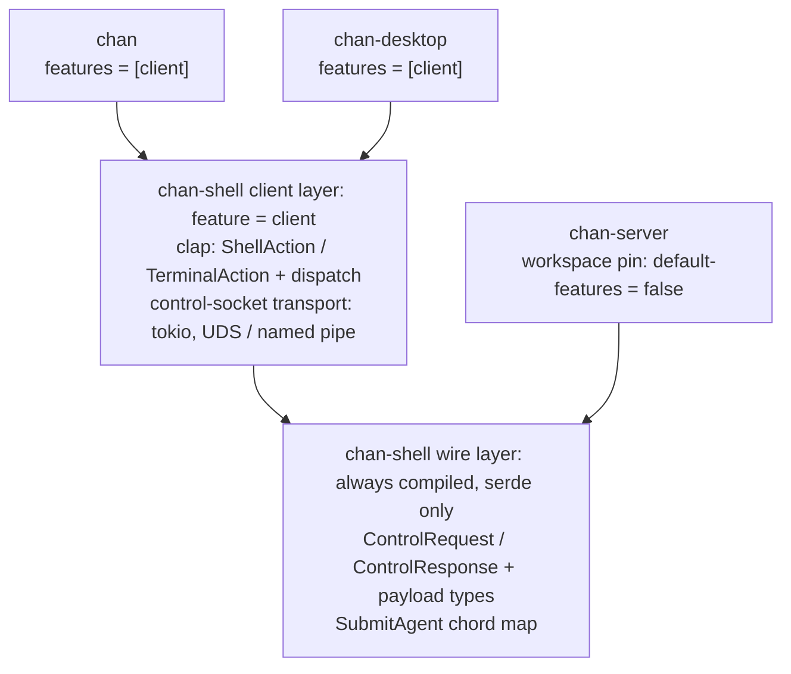
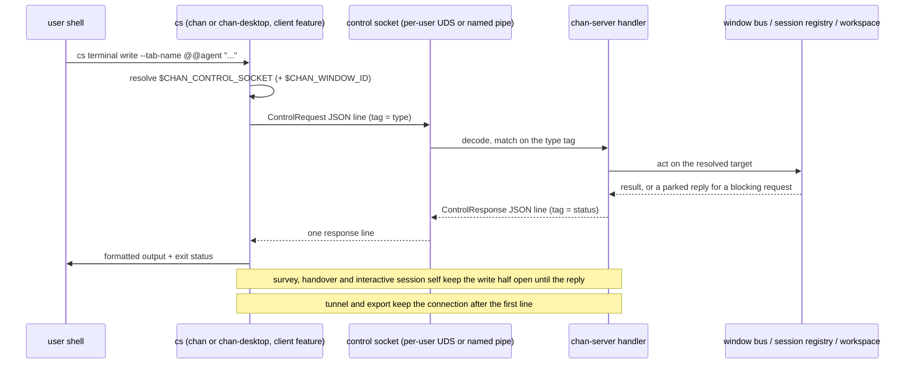
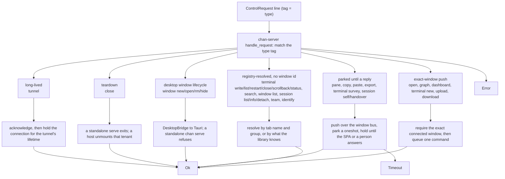

# chan-shell design

chan-shell is the crate behind `cs`, the control client a chan terminal uses to drive the server it runs under. `cs open notes.md`, `cs terminal write`, `cs pane new right`, `cs window list` and `cs terminal survey` reach the serving process over its control socket and act on the window, the live terminal sessions, or the workspace that process owns. The crate owns both halves of that conversation: the wire contract (the request and response types) and the client that speaks it. Defining the contract once is the point. The same `ControlRequest` and `ControlResponse` types are linked by the `cs` client and by chan-server's socket handler, so a renamed tag or field moves on both sides in one edit instead of compiling green on one side and breaking every `cs` command at runtime.

The second reason the crate exists is packaging. The `chan` binary and chan-desktop both ship `cs`. Lifting the `cs` surface and transport out of the `chan` binary lets the desktop drive the identical command tree, and the MCP discovery it carries, without a separate `chan` install on the PATH.

`cs --help` and the long help in `src/help.rs` are the authoritative reference for every action, flag, environment variable and example, and `chan dump-skill` renders the agent manual from them. This document stays at the level of the wire shape, the connection lifetimes, the discovery and queueing models, and the decisions behind them.

## Scope

In scope:

- The wire types: `ControlRequest`, `ControlResponse` and the payload types they carry (tab destinations, pane operations, survey specs and replies, team operations, the serving identity, the shared workspace-search request). Serde only, no transport, no clap, always compiled.
- The `cs` clap surface (`ShellAction`, `TerminalAction` and their subtrees) and the `dispatch` that turns each parsed action into a control-socket exchange.
- The transport: one JSON request line, one JSON response line, over a per-user Unix-domain socket on Unix and a named pipe on Windows, with the three connection lifetimes described below.
- The agent submit-chord map: the per-agent byte sequences that make a coding agent submit its compose buffer hands-free, and the derivation from a spawn command to an agent. Compiled even without the client feature, because chan-server applies the chord server-side.
- The in-band program-status reporter (`cs terminal status`), which writes OSC 7501 to the terminal and needs no chan server.
- The typed client errors that carry a distinct exit status to the dispatch edge, and the `argv[0]` stem checks (`invoked_as_cs`, `invoked_as_chan`) so the alias is recognized identically by `chan` and by the desktop, including under an AppImage shim that re-execs without preserving `argv[0]`.

Out of scope, owned by [chan-server](../chan-server/design.md) and [chan-library](../chan-library/design.md): every handler (the server decodes a request, resolves the target window, session or workspace, does the work and encodes the reply); the PTY, the window bus, the terminal write queue and the workspace store; and the control socket's creation, lifetime and access, since the server binds it and `cs` only reads its path from the environment a chan terminal exports.

## Where it sits

*The server links only the wire layer; the two binaries that ship `cs` link the client on top of it.*

chan-shell has two layers behind one `client` Cargo feature. The wire types and the submit map compile with serde alone; `client` adds clap, tokio and the rest of the CLI and transport. The crate's own default is `client`, so a standalone build and its tests get the full surface, while the workspace dependency pin sets `default-features = false`: every consumer starts wire-only and opts the client back in. chan-server takes the bare pin and links the serde types and nothing else; `chan` and chan-desktop add the feature. The split exists so the server can share the contract without linking clap or a client it never uses. The submit module is deliberately not behind `client`, because the wire, the terminal queue and chan-server's team spawner share one map; only the `ValueEnum` parse for the `--submit` flag is gated, inside the module.

`cs dump-skill` is offline. The manual renderer belongs to the `chan` crate, which owns the help text, so `run_cs` and `dispatch` take it as a function pointer; both `chan` and the desktop supply the same one, and chan-shell never depends on `chan`.

## A cs invocation

*One request line, one response line; a few requests keep the connection open longer, for the reasons given below.*

A `cs` command is normally one synchronous line-framed exchange. The client reads the environment a chan terminal exports, serializes a `ControlRequest` as one JSON line, writes it and reads back one `ControlResponse` line, which it formats for the user. The environment contract is printed by `cs --help`. The two values every window command needs are `$CHAN_CONTROL_SOCKET` (which server to reach) and `$CHAN_WINDOW_ID` (the window to act on by default). Tab openers and `cs pane` can override the window with `--window`; session-scoped actions (`cs terminal list`, `cs search`, `cs window list`, `cs session list`) need only the socket, because the server resolves their target through its own registry. `$CHAN_SESSION_ID` lets survey, export and tunnel mark the asking terminal's own status while they wait. Outside a chan terminal, a window command errors in plain words rather than guessing; inside one whose server failed to bind its socket, `cs` quotes the bind failure the spawn environment recorded. Relative paths are made absolute against the client's cwd before they cross the wire, so `cs open .` and `cs upload sub/` resolve where the user typed them, not where the server runs.

The connection has three lifetimes, chosen per request because the server reads the client's EOF differently in each:

- **One shot.** The client writes the line, half-closes its write side and reads the reply. This is every ordinary action. The newline frames the request, so the half-close is a courtesy rather than load-bearing.
- **Held.** A survey, a requester-side `cs session handover` and an interactive `cs session self` keep the write half open until their reply and set `cancel_on_eof`, so a client that exits while the server has the request parked cancels it (the overlay is dismissed, the pending handover withdrawn) instead of leaving it waiting. The flag is opt-in on the wire, so an omitted field keeps the one-shot behaviour under version skew.
- **Streaming.** `cs tunnel` and `cs export` do not half-close and keep the connection after the first response. For a tunnel the first line is the acknowledgement naming the bound listeners, the connection's lifetime is the tunnel's, and a second line arrives only if the tunnel dies first; the client's EOF (Ctrl-C, a killed shell) is the teardown signal. An export holds the same shape while the renderer reports progress, with a client-side absolute bound in case it reaches a server without export deadlines.

A parked request that is never answered must surface as a typed timeout rather than a dropped connection; that is why the response vocabulary has a `Timeout` variant and why the client maps it to an exit status of its own.

## The wire model

`ControlRequest` is one internally tagged enum (`#[serde(tag = "type", rename_all = "snake_case")]`); `ControlResponse` is another, tagged on `status`. The serde tags are the wire format: the `type` string is what the server matches a request on, and the `status` string is what the client matches a reply on. Both sides are the same Rust type, so the tags move in lockstep, and a test module pins the exact bytes of the core variants so a rename that drifts them fails a test rather than breaking at runtime.

Two serde conventions recur because byte compatibility with the SPA and the server matters. Optional request fields carry both `default` (the server tolerates an omitted key) and `skip_serializing_if` (the client omits `None`), keeping the emitted JSON minimal and the decode loss-tolerant. The SPA-facing payloads (`SurveySpec`, `SurveyReply`, the pane operations) use camelCase or the SPA's own tag names, because the SPA's TypeScript types mirror them field for field; a nullable field the SPA expects as `string | null` serializes as an explicit `null`.

Rather than enumerate every variant, the requests group into families by how the server resolves their target:

*Each family resolves its target differently, and only a parked request can answer `Timeout`.*

- **Open a tab in one exact window.** The openers carry a window id and an optional pane and side, and `cs terminal team new|load` accept the same placement. The server requires that exact window to be connected, queues one command to it and returns; it does not wait for rendering. Queued means queued to a window that was live at dispatch, not guaranteed delivery.
- **Act on the server's registry.** No window id: sessions are selected by tab name and group, and the rest by what the serving library knows. `chan ps` uses the same family's `Identify`.
- **Parked until a reply.** The layout and the clipboard live only in the frontend, so `cs pane`, `cs copy`, `cs paste`, `cs export` and `cs terminal survey` push a command over the window bus, park a oneshot and hold the connection until the SPA replies or the window elapses; `cs session self` with several viewers and a pending handover park the same way for a person's answer. Pane operations are atomic: one invocation, one query or mutation, one result. Copy and paste block rather than fire and forget so a browser clipboard denial surfaces as a real error instead of a silent no-op.
- **Desktop window lifecycle.** `cs window new|open|rm|hide` reach the Tauri app through the in-process bridge the embedded server installs; a standalone `chan serve` has no desktop and refuses them.
- **Teardown.** `chan close` sends `Close { path, remove }` over the same socket, and the server decides scope from its own kind: a standalone serve exits, a multi-tenant host unmounts that tenant and, with `remove`, forgets it from its library too. A host that would end live terminals answers with a structured refusal the CLI reads the count from.
- **Long-lived.** `cs tunnel`, as above.

The response side is narrow: `Ok`, `Error`, `Timeout`, `QueueFull`, `Export` and `SubmitRefused`. `QueueFull` is a survey refused outright because its target's queue is full, so nothing waits server-side and the caller may retry. `Export` carries the output path because that path is the whole result. `SubmitRefused` is kept so a current `cs` still decodes an older devserver's answer; a current server never sends it. Structured replies (the `Identity` for `chan ps`, window and session rows, search hits, the pane layout, the team bootstrap script) ride as JSON inside `Ok.message`, and the CLI formats them: Markdown by default, `--json [--pretty]` for machines. `Timeout` is split from `Error` so the client never infers a timeout from a dropped socket.

`Identity` names the serving kind (standalone, desktop or devserver), the version and the pid, plus the workspace root and metadata key for a mounted workspace tenant and the library id for a devserver. The pid is there because a devserver's stable-named sockets carry none in their filename, so `chan ps` and `chan close` find a lock holder's socket by asking each candidate who it is.

## Exit status

`cs` tells three outcomes apart by exit status because scripts and agents branch on them: a delivered answer, a failure, and no answer in time. The timeout status, 124, matches GNU `timeout(1)`, so a caller already knows it. `cs terminal survey`, `cs copy`, `cs paste` and `cs tunnel` exit with it; `cs export`, `cs session self` and `cs session handover` receive the same typed timeout but pass it up as an ordinary error, so their timeout takes the failure status. A fourth, accepted into the queue but not submitted, exists only for an older devserver that derived the chord itself and could refuse; a current server always encodes the agent the sender named. Each of these is a typed error that the transport produces from the response variant and the dispatch edge downcasts, so no code parses prose to decide an exit status. Everything else is the ordinary failure status.

## The transport and discovery

`send_control_request` is platform-neutral over a small `transport` module, the only `#[cfg]`-split surface: Unix connects a `UnixStream`, Windows opens a named-pipe client with a short bounded retry for a busy or momentarily absent pipe, so a genuinely missing server still fails fast. Above that split the protocol is identical.

On Unix, every connection validates the socket's directory before connecting: a real directory, not a symlink, owned by the effective user, mode exactly 0700, and any existing socket node a real socket owned by that user. A refused directory or node is named with the reason and nothing is contacted, so another user cannot plant a socket where `cs` would find one. With no usable `XDG_RUNTIME_DIR`, the server binds under a private per-user directory in `/tmp` and `cs` looks there. The checks do not pin the directory or its ancestors: under a user-writable ancestor the path can be swapped between validation and use, which a systemd runtime directory under `/run/user` rules out.

A connect refused, or on a missing node, means the window or server that spawned the terminal has exited, leaving a stale `$CHAN_CONTROL_SOCKET`, which is common after a devserver restart. The client says so in plain words instead of surfacing a raw connect trace for a path the user never set.

One case is recoverable. A devserver can restore a terminal in a tenant mounted under another prefix than the one it was spawned under (see [chan-library's design](../chan-library/design.md)), so the terminal's socket is gone while its server is not. When the gone socket has a devserver's stable name and the environment names a workspace, `cs` asks the other stable sockets beside it who they serve and sends the request to the sole devserver tenant whose root is the canonical path of `$CHAN_WORKSPACE_PATH`; a `$CHAN_LIBRARY_ID` that disagrees with the candidate's removes it. Each command searches at most once, the move is announced on stderr only when stderr is a terminal, and zero or several matches give the stale-server result. Desktop and `chan serve` sockets belong to their own process and are never searched for.

## Command availability by tenant

The control socket serves two tenant kinds, a workspace and the standalone terminal, and a command's availability follows from what it needs. The server enforces it in one chokepoint, so the policy is table-testable and reaches every client at once. Commands that act on terminals, panes, the clipboard, uploads and downloads, client sessions and the window registry run on both. `open PATH` and `terminal new PATH` need a served filesystem. The graph, search, export, leadership handover and every `terminal team` form need a workspace and refuse on a standalone terminal with one message family. The desktop window verbs and `cs tunnel` are a separate axis: they need chan-desktop viewing the window, and `tunnel` additionally needs a devserver or desktop host. No environment variable distinguishes the two tenants; a workspace-only command's refusal is the check. The lists are in `cs --help`.

## Client sessions and leadership

`cs session` reads and manages the clients attached to the serving library. A client is a frontend holder (a desktop process, a browser window and the windows it opened, a direct tab through reloads) with one or more live connections; `list` and `info` expose them across every tenant. `self` resolves the client behind `$CHAN_WINDOW_ID`; several viewers of one shell share its environment, so an interactive caller asks the frontend to identify itself and a script passes an explicit id. `--name` and `--reset` label the client and, in a workspace window, its participant, with clashes refused by case-folded comparison. `detach` is an operational disconnect, not a credential revocation: it ends the holder's connections, keeps windows, layouts and PTYs, and the frontend offers Reconnect. Workspace leadership (`handover`, `takeover`) rides the same request family; a handover parks until the leader answers from its own `cs` or its window. The limits and the exact fields are in the help text.

## Program status

`cs terminal status` is the one action, beside the manual, that targets no window. It builds and validates one OSC 7501 report (state, kind, progress, app, id, title, message) before any byte is written, then emits it on stdout when stdout is a terminal, else on the controlling terminal, and only with neither hands the body to the server over the control socket for the session `$CHAN_SESSION_ID` names. In-band output needs no chan variable and no running server, so the same command works over ssh in any terminal that understands the sequence; the control route exists for a program whose output is redirected. A refused report writes nothing and is never resent on another route. The record semantics (what replaces what, how long a record lives) belong to the terminal and are described in `cs terminal status --help`.

## The agent submit map

A coding agent in a chan terminal submits its compose buffer on a different byte sequence depending on which agent it is, so the hands-free poke (`cs terminal write --submit=<agent>`) has to use the right one. The submit module owns that map and the command-to-agent derivation, and is the single source of truth the SPA's TypeScript detection mirrors.

`SubmitAgent::derive` maps a spawn command, with an optional `CHAN_AGENT` override read from the target session's spawn environment, to an agent. The override wins when it names a known agent or an explicit shell; otherwise a whole-word sniff of the command decides, so wrappers and paths still resolve and near-miss names do not. Each agent has a templated chord whose built-in default reproduces live-probed bytes. Claude takes a modifier-key Enter sequence. agy, codex, kimi and opencode take the text wrapped in bracketed paste followed by a carriage return, because a bare trailing CR is coalesced into the paste burst and lands as a newline. gemini and muse take a bare CR that must arrive as its own later write, because a closely following Return is read as Shift+Return. Agents whose bytes happen to agree keep separate templates so one client can change without the others. The template is overridable at runtime: `CHAN_SUBMIT_<AGENT>` in the environment beats `<config>/chan/submit.toml`, which beats the default, with C-style escapes so a config value can express control bytes as text.

The sender names the agent; the server owns the encoding. `cs terminal write` carries logical text plus the sender's request (submit or not, and for which agent) over the wire, and the server resolves that agent's template in its own environment at enqueue time, so an override in the writer's environment has no effect. The server still derives each matched session's own agent, but only to report a disagreement beside the queue position; it does not override the request. Derivation cannot be authoritative because it reads the string a session was spawned with, not the program running in it: a shell in which someone started an agent by hand derives nothing, for as long as it lives. Making the sender authoritative is what lets that session be reached at all, at the cost that a wrong name delivers a wrong chord instead of being corrected silently. One chord is encoded per command, so a mixed-agent group is targeted per session.

Writes are queued per target and delivered when the target's visible output has gone quiet. Every logical message is capped at a few kilobytes by both the CLI and the queue, refused rather than truncated, because the queue is a bus for short pokes and longer content belongs in a file named by one. The queue counts entries, and a gemini or muse message costs two (the body, then the bare CR, separated by the idle gate), while depth reports logical messages, the number the SPA badge, `cs terminal list` and a write's acknowledged position all agree on. At one idle opportunity the drainer frames the longest run of consecutive submitted messages that share the target's proven built-in encoding as one chronological prompt, so a burst of notifications costs one agent turn instead of one each; a raw write, a gemini or muse target, a Rich Prompt turn and a runtime override each end that run. `plan_submitted_input` is the drain-time byte source of truth: a non-empty body is normalized to exactly one trailing newline before the chord, an empty body is chord-only, a raw write is byte-identical end to end, and a batched Claude message is delivered as two atomic parts so paste handling cannot swallow the chord. The queue's capacity and the message cap are stated in the `cs terminal write` help.

## Interface contracts

- The wire contract is always compiled and independent of the `client` feature: request tags under `type`, response tags under `status`, SPA-facing payloads in camelCase. A new request field is optional on the wire, so a `cs` and a server of different releases still answer each other.
- The submit map is wire-layer state: chan-server applies the same derivation and write splitting the `cs` client exposes, so server-spawned teams and `cs terminal write --submit` stay byte-compatible.
- The `client` feature owns the clap surface and transport. Its flag names, prefix matching, the `$CHAN_*` environment contract, path absolutization before send, and the `cs` and `chan` alias detection are runtime-visible behaviour, documented by `cs --help` and the long help in `src/help.rs`.
