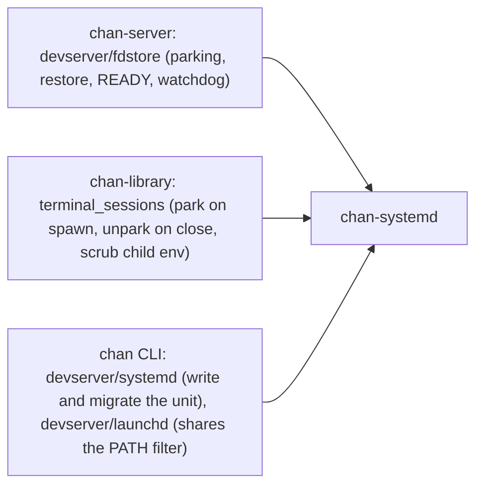
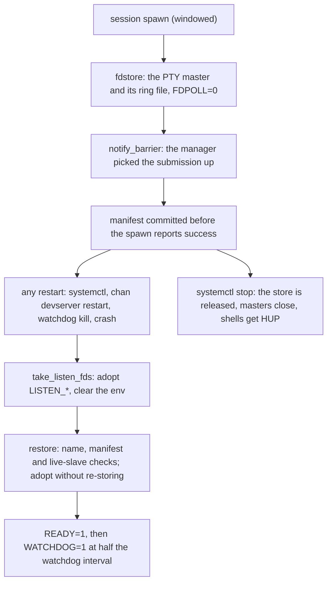

# chan-systemd design

chan-systemd is the systemd boundary: the only place in chan that adopts inherited descriptors, the only code that speaks to `NOTIFY_SOCKET`, and the single owner of the canonical `chan-devserver.service` unit text. Everything systemd-shaped (readiness, the watchdog, the file descriptor store, `LISTEN_*` adoption, unit rendering and classification) goes through here, so the rest of chan handles typed descriptors and plain functions. It exists for one flow: a devserver under systemd keeps every terminal alive across a restart of the devserver process by parking the PTY masters in the manager's store and picking them up in the new process. The crate depends only on rustix, `unsafe_op_in_unsafe_fn` is denied, and the single unsafe block is the adoption of a raw descriptor into an `OwnedFd`.

## Where it sits

chan-server's devserver module owns the parking flow and the manifest beside the store, and sends READY and the watchdog pings. chan-library drives parking from the session lifecycle through a parker hook the devserver installs, and strips the supervision variables from every child it spawns. The chan CLI writes the user unit, classifies an installed one before overwriting it, and shares the search-path filter with its launchd plist writer. The user-visible restart story (what survives a bounce, what resets) is in the root [design.md](../../design.md); this crate is the mechanism.

## What it provides

- **Notifications.** `notify_ready` (`READY=1`), `notify_watchdog` (`WATCHDOG=1`) and `notify_barrier`, which sends one end of a socket pair with `BARRIER=1` and blocks until systemd closes it, so the caller knows every earlier message was consumed. Transport is an unbound datagram socket to `NOTIFY_SOCKET`, abstract names included; with no socket every notification is a silent no-op, so the same binary runs unsupervised.
- **Watchdog cadence.** `watchdog_interval` is half of `WATCHDOG_USEC`, and none when the variable is unset or zero or `WATCHDOG_PID` names another process; the ping loop lives in the consumer and starts only after READY.
- **The store.** `fdstore` sends a descriptor with `FDSTORE=1`, its name and `FDPOLL=0`, which stops systemd from closing an active PTY master when it polls readable; `fdstore_remove_many` sends best-effort removals by name. `own_unit_fdstore_max` reads the unit's `FileDescriptorStoreMax` back from the manager when it exports no `$FDSTORE`, so a park can refuse past the cap instead of being refused by the manager.
- **Adoption.** `take_listen_fds` turns `LISTEN_FDS` and `LISTEN_FDNAMES` into named `OwnedFd`s with close-on-exec set. It refuses on a `LISTEN_PID` mismatch, and when `LISTEN_PIDFDID` is present it must match the process's own pidfs inode (absent passes, so older managers still adopt). All four variables are removed unconditionally so a child cannot re-adopt the same descriptors.
- **Hygiene.** `scrub_child_supervision_env` strips `WATCHDOG_PID`, `WATCHDOG_USEC` and `NOTIFY_SOCKET` from a child's environment, and `pty_master_has_live_slave` checks through `/proc` that a restored master still has a live slave before it is served again.
- **The unit.** `DevserverUnit` renders the canonical user unit; callers own only `ExecStart` and the environment assignments, and the supervision directives live in the renderer. `with_search_path` adds a `PATH` built from the installing process's own, because a user service otherwise runs with the user manager's default and the extensions the devserver spawns resolve their helpers through it; `service_search_path` is the entry filter on its own (absolute entries only, first occurrence wins, entries a definition cannot carry raw dropped), which the launchd writer shares, and `recorded_search_path` reads an installed unit's value back so a rewrite from a run without a terminal keeps it byte for byte. `classify_installed` compares an installed unit against the renderer's known shapes: `Current` is left alone, `KnownLegacy` (an earlier chan-owned shape, a unit without a `PATH` line or with another one, or one with the earlier store maximum) is migrated, and `Foreign` is refused. Whitespace and comments are inert; `ExecStart` must be a chan devserver invocation and the environment keys are limited to the ones chan sets, each at most once.

The unit's shape is itself a set of decisions: `Type=notify` with `NotifyAccess=main`, so only the devserver process, and no PTY child, can feed the watchdog or touch the store; a store large enough for two descriptors (the PTY master and its ring file) for each of 512 parked terminals; `KillMode=process`, so a restart kills only the devserver process and the shells behind the parked masters survive it; `Restart=on-failure` and a watchdog, so a hung devserver is replaced and its terminals restored; and a start timeout long enough to outlive the bounded restore.

## The parking flow

Parking is continuous: every windowed terminal parks at spawn, so any restart flavor preserves it and only a stop ends it.

*A terminal is parked the moment it is spawned, every restart flavor restores it, and only a stop releases the store.*

The consumer's side of this lives in chan-server. A park checks the store cap against the descriptors already stored, stores the session's two descriptors, barriers so the manager provably has them, and commits the manifest (the sessions, their names and ring files, the library id) before the spawn reports success; a session's end sends the removal immediately; and a graceful shutdown refuses new parks, freezes the parked set and writes one final manifest marked sealed, detaching that write on a bound without killing children. On the next start the restore adopts inherited descriptors before any route is exposed, validates each name against the manifest and the library id, checks that the slave is still alive, hands each session its ring file, keeps the retained store entries instead of re-storing, and cleans orphans. The ring file is a sealed memory file every PTY read writes through, so a restart, a crash included, rebuilds the scrollback and the screen state as they stood at the last byte read.

The stop and restart asymmetry is entirely systemd's default `FileDescriptorStorePreserve=restart`: the devserver never guesses stop versus restart at SIGTERM. A plain `chan devserver restart --service=systemd` is a preserved bounce; `--force` drains every session through the devserver's drain route first and falls back to stop then start when the drain cannot be confirmed, so it stays destructive; `stop` drains best-effort and always stops, and the released store ends whatever a drain could not reach.

## Platform split

`linux.rs` implements everything and `unsupported.rs` keeps the other targets honest: the notification helpers are silent no-ops, `watchdog_interval` is none, and `scrub_child_supervision_env` still strips the variables. `NamedFd`, `take_listen_fds`, the store functions and `pty_master_has_live_slave` do not exist off Linux, so a consumer cannot compile a fake restore path: chan-server's non-Linux parker never engages and no session is parked.

## Boundaries

- No `STOPPING=1` is sent; stop semantics ride `KillMode=process` and `Restart=on-failure`.
- Real-systemd coverage has two layers: `CHAN_SYSTEMD_FDSTORE_E2E=1` runs the in-crate store and watchdog end-to-end tests against transient `systemd-run --user` units that re-invoke the test binary, and `scripts/e2e/devserver-fdstore.sh` drives a real `chan-devserver.service` through the terminal-survival matrix (restart flavors, a watchdog kill, crash restore, drain and stop teardown, store-count invariants).
