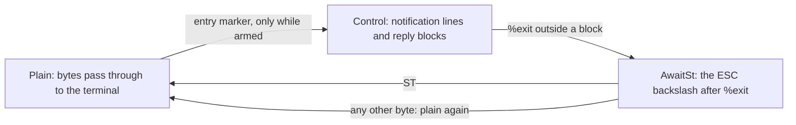

# chan-tmux design

chan-tmux is the tmux control-mode protocol (`tmux -CC`, and `tmux -C`) as a pure state machine. The crate reads no socket, spawns no process and keeps no clock: a caller feeds it the bytes tmux wrote and writes back the bytes it returns, so one implementation serves a PTY on a server, a pipe in a test and a replayed capture. It exists so that the parsing, the framing and the quoting rules, which are where a control-mode integration goes wrong, can be tested exhaustively without a tmux, and so that the library that owns terminals never reasons about bytes. Its only dependency is `serde_json`, for tmux's JSON layout form.

## Where it sits

chan-library is the one consumer. Its tmux gate holds a `Client` for a PTY session and arms it only while the user's policy allows control mode, so the entry marker is recognised exactly when the user asked for it; its tmux connection drives the client once a session is in control mode, turning tmux's windows and panes into chan's and asking tmux for every split, resize and new window. The product-level story (the banner, the Computers card, who owns the layout) is in the root [design.md](../../design.md); this document is the protocol.

## The stream

*The decoder's three states; a program printing the marker into an unarmed decoder never leaves Plain.*

`Decoder` turns bytes into frames: passthrough bytes, the entry, notification lines, completed reply blocks and the exit. Any split of the stream decodes the same. Entry is the `DCS 1000 p` marker and is recognised only while the decoder is armed, because a program that prints the marker into an ordinary terminal must not be able to start a session; a marker split across reads still matches, and one half-matched when the decoder is disarmed is not continued. Every plain byte passes as it arrives, the marker's own included, so a read that ends inside the marker holds nothing back from the terminal and a parked session loses nothing; the terminal is shown an empty DCS, which the caller closes on entry, and both terminal engines drop an unknown DCS unseen. Outside control mode only an ESC can start the marker, so an armed decoder passes everything up to the next ESC in one piece and walks bytes only from there, and a disarmed one passes each read whole; the decoder is not where a terminal's output time goes. The stream ends with `%exit` and its ST; a byte after `%exit` that is not that ST returns the stream to plain bytes.

## Notifications, output and commands

`parse_message` reads the `%` lines into a `Message`. Names and layout strings are untrusted text; a known notification whose fields do not parse is an error that names the notification and carries none of the line, and a notification this crate does not interpret is kept by keyword only. `%output` data has every byte below 0x20 and the backslash as a backslash and three octal digits, which is what keeps a pane's output from ever containing the line break that frames the stream; the decoder is lenient, so one damaged byte costs one byte and not the connection.

A pane's name comes from a subscription, which tmux has from 3.2 on. `SubscribePaneNames` asks tmux to look at every pane of the attached session once a second and to send a `%subscription-changed` line for each one, first and whenever its value is another; a pane that joins another window is sent again. The value says whether the pane's title is the one tmux gives a new pane, its host's name, then states the byte lengths of the foreground command's name and of the title, then gives the two texts. Only tmux can tell a default title, since the host is the server's and not the client's. The parser picks the title, or the command while the title is that default or blank, and reports it as `Message::PaneName` with control characters removed and the ends trimmed; the name is empty when tmux has neither. The lengths are there because both texts are a program's. tmux refuses a title that holds a control character, but a tmux as old as 3.2 prints a command's name as the process gave it, a line break included, and a break ends the line early and leaves the rest of the name to be read as lines of tmux's own. A line whose texts are not exactly as long as tmux counted is therefore an error, which ends the stream before anything after it is read. A format cannot state the length of a conditional's result, so the choice between the texts is the parser's and not tmux's. No reply carries a name: a reply block ends on a line a pane's program could write, and a notification is one line the parser checks whole. A subscription line under any other name is kept by keyword only.

Commands are a closed enum. Ids are typed, formats are constants, and the only free text a command carries (a window name, a directory) is single-quoted, refused if it holds a control character, and has every `#` doubled, because tmux expands formats in names and directories and `#(...)` in a format runs a shell command; a positional name goes after `--`, since tmux reads a quoted word that starts with `-` as flags. Keystrokes go as `send-keys -H` hex, chunked to a bounded size per command. Reply parsers cover the formats the commands ask for: the window and pane listings, the pane state, the id a creating command prints, and the version.

`CapturePane` is one line of two commands, the pane's state and then the rows of the screen the pane shows, which tmux runs together; the state sizes the rows and the client answers both as one capture event. The screen tmux keeps under an alternate screen is never asked for, because its capture is one row when no alternate screen is on and keeps its old height after a resize, so no promise fits it.

`parse_layout` reads the text form, checking tmux's checksum, and the JSON form a newer tmux prints once a client asks for new layouts. Depth, cell count and dimensions are bounded, and floating panes are refused.

## The client

`Client` is a `Decoder` plus the queue that pairs each reply with the command that asked for it. `submit` returns the bytes to write and a token; `feed` returns events. Commands wait for the first session announcement. Any error from `feed` poisons the client, since a stream that lost its framing cannot vouch for what it already produced; a refused `submit` (not ready, the queue full, a bad argument, a capture past the block bound) queues nothing and leaves the client as it was, so a caller with more keystrokes than the queue holds waits and retries rather than losing the connection. A submitted command is owed its reply from the moment `submit` returns, so a caller whose write of the bytes failed or stopped short calls `fail`, which ends the client, rather than letting every later reply pair with the wrong command.

## Reply blocks are untrusted

A reply to `capture-pane` carries the pane's rows verbatim, so a program in a pane can print any line into one: `%exit`, a `%output` for another pane, or a copy of the block's own terminator. The decoder therefore never reads a notification inside a block, ends a block only on a `%end` or `%error` whose header equals the `%begin` header exactly, and, for a command that promised a row count, only after exactly that many rows. `Expect` is the promise: any rows, for a reply tmux generates from numbers and symbols, which holds no pane content; an exact count; and the pair of a pane state followed by the capture it sizes, which `CapturePane` registers. Because the two commands share one line, tmux runs them back to back, so a resize or a shorter history cannot leave the reply short of its promise. A reply with more rows than promised, or a promised terminator that never arrives, ends the stream. A capture whose pane is gone fails at its state and its rows cannot be sized, so the stream ends rather than believing a terminator that pane content can forge; that is a reconnect, the one benign event the framing cannot absorb.

tmux strips control characters from window names and pane titles, so neither can carry a line break into a notification or a reply. It does not strip them from a foreground command's name in every version, which is why the pane names line states the lengths of its texts and no reply asks for one.

Two things the framing cannot settle lie outside the crate. A reply tmux generates for a command the client did not send (the first reply after entry, a user's hook) carries no promise and ends on its header alone, so a user hook that prints pane content is forgeable and nothing here can tell. And `%exit` is believed only outside a block: a server that dies while a reply is open leaves its exit as rows and the decoder in control mode, so the owner of the tmux process ends the session on the process's exit or the PTY's end, never on the decoder alone.

## Bounds

`Limits` caps a line, a reply block's bytes and its lines; the line bound is sized for a capture row of the widest pane a size command may ask for, with the escapes a hyperlinked cell can carry beside every character. The command queue, the free-text arguments, the keystrokes per command and a layout's depth, cell count and dimensions are bounded too. A capture whose rows could exceed the block bound at any pane height is refused at `submit`, since the bound would otherwise end the stream when the reply arrived; the caller keeps the history it asks for small enough that the rows fit the byte bound as well. Exceeding a bound is an error, never a truncation.

## Tests

`tests/replay.rs` decodes real tmux captures at every chunk size, a split window's pane names among them; `tests/hostile.rs` holds the forged-terminator streams, the sized captures, the pane name lines a text cut short, the bounds, marker handling and a deterministic noise run that must never panic; `tests/commands.rs` covers escaping, layouts, rendering and injection; `tests/live.rs` drives a real tmux over `tmux -C`, once for the protocol and once for the pane names subscription with a command whose name holds a line break, and runs only when `CHAN_TMUX_BIN` names one, so the default `cargo test` skips it.
