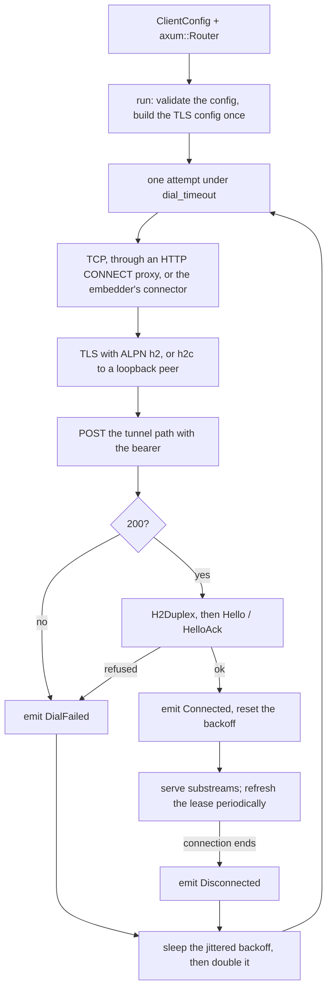

# chan-tunnel-client design

chan-tunnel-client is the dial side of the gateway tunnel. `chan devserver run --tunnel-url` with a personal access token hands this crate the devserver's axum router, and the crate dials the gateway, registers, serves every request the gateway forwards, keeps the registration's admission lease alive, and redials with backoff whenever the connection drops. It exists so a devserver on a machine with no inbound port, no DNS and no TLS of its own can be published by a gateway, with the devserver only ever dialing out. The wire contract is [`chan-tunnel-proto`](../chan-tunnel-proto/design.md), whose design holds the cross-crate sequence; the other end is [`chan-tunnel-server`](../chan-tunnel-server/design.md).

## Where it sits

chan-server's devserver mode is the one real caller: it builds a `ClientConfig` from the tunnel URL, the token and a display name, and runs `run(cfg, router)` as a long-lived future beside the local listener. The router is the devserver's own router, so a request through the tunnel is served by the same routes as a request over `ssh -L`, with one difference: the registration is attached to every request as an extension, and the devserver checks each request's gateway assertion against the owner id and devserver id it carries. The crate depends on chan-tunnel-proto and chan-tls and on hyper, axum (without optional features, since the gateway workspace also builds it), rustls and yamux. It owns no token acquisition and no server-side policy.

## The connection lifecycle

*Validate, connect, handshake, serve; any failure or disconnect backs off and redials.*

`run` validates the configuration first (a token is present, the workspace label is valid, the URL scheme is allowed) and returns only on an error retrying cannot fix. Everything transient (TLS, h2, a refused dial, the network) is reported as an event and retried. Dropping the future cancels the dial, the h2 driver and the yamux session at once, which is how the devserver shuts the tunnel down.

## Dialing

The dial is one attempt and the testable unit; `run` adds the retry loop. The TLS configuration is [chan-tls](../chan-tls/design.md)'s trust decision with ALPN forced to h2: the platform verifier on macOS and Windows, and elsewhere the system's CA bundle beside the bundled Mozilla roots, so a public CA verifies with an empty bundle and a gateway behind a private CA verifies once that CA is in the store. It is the decision the desktop's sign-in and feeds make, so a gateway the tunnel trusts is one they trust. `SSL_CERT_FILE` and `SSL_CERT_DIR` replace the system bundle on Linux and the other Unixes only; on macOS and Windows the platform verifier reads neither, and a CA is trusted through the keychain or the certificate store. `run` builds the config once, before its reconnect loop, and reuses it across attempts; a trust decision that cannot be built is a configuration error.

Cleartext h2 is allowed only when the connected TCP peer is a loopback address, which is what a local gateway stack dials. The check is on the peer, not the host name: a private DNS name is not proof of a protected route. Userinfo in the tunnel URL is refused because the token is the credential; accepting both would create an ambiguous credential channel. A URL with no path gets the tunnel path filled in, so a caller can pass a bare base and the wire constant stays single-sourced, while an explicit path is kept verbatim so a typo surfaces as a visible 404 instead of being corrected silently.

An outbound HTTP proxy is optional and explicit: when configured, the client issues an HTTP/1.1 CONNECT to the proxy with Basic credentials from the proxy URL's userinfo, then runs TLS and h2 inside the tunnel. The response headers are read byte by byte up to their terminator so no bytes of the upstream (the TLS ClientHello or the h2 preface) are consumed by a buffered reader. Credentials are only ever sent to a proxy named by a loopback IP literal whose connected peer is loopback, and a failed CONNECT reports its status without echoing the proxy's text, so a hostile proxy cannot reflect credentials into logs. `HTTP_PROXY` and friends are not honoured automatically: the embedder decides, so the client's behaviour never depends on its environment.

An embedder can replace the TCP leg with a `Connector`: the dial asks it for a byte stream to the tunnel URL's host and port and runs TLS and h2 inside it unchanged. A connector declares whether it is protected, meaning it authenticates its peer and encrypts what it carries. Only then may an `http://` tunnel URL run cleartext h2 over it, the allowance a loopback peer has, and the decision is made before any bytes move, so an unprotected connector is never asked to connect for a cleartext dial. A WireGuard tunnel inside the process is the kind of transport that qualifies: its peer is pinned by a static key and every byte is encrypted. A connector and an HTTP proxy are refused together, since each is a whole transport.

The bearer header is marked sensitive, which makes h2 send it as a never-indexed HPACK literal: no decoder on the path may add the token to a compression table, and an intermediary that re-encodes the request must keep that representation.

The dial timeout wraps the whole attempt, proxy CONNECT to HelloAck included. Without it an unreachable host would hang each attempt for the OS TCP timeout and defeat the backoff.

## The handshake

Over the `H2Duplex` the client writes `Hello` (protocol version, its version string, the workspace label, the display name) and reads `HelloAck`. A refusal becomes `ClientError::RemoteRefusal` with the server's stable code and message preserved, so the devserver can report a specific cause; an unsupported protocol in the acknowledgement is a handshake error. The yamux session is then opened in client mode with the shared stream cap and receive window, matching the terminator so bulk transfer is tuned identically on both peers.

## Serving substreams

Each inbound yamux substream is one HTTP/1.1 request from the public side. The client wraps it for hyper, runs hyper's h1 server with upgrades enabled so a WebSocket's 101 keeps the substream alive, and dispatches the request to the router. HTTP/1.1 over yamux is the right shape because the substream is already multiplexed; h2 inside it would be mux on mux.

How much work runs at once is bounded by a permit pool, and the ordering is load-bearing: the loop polls yamux for the next inbound stream unconditionally and the spawned task acquires its permit before serving. `poll_next_inbound` is the only entry point that drives the yamux connection (reads, writes, flushes and keepalives for every substream in flight), so gating it on a free permit would stall every request already being served the moment the pool saturated. Excess substreams are therefore accepted and parked waiting for a permit, and how many can exist at all is yamux's own stream cap. The pool size is configurable and never below one.

## Lease refresh

After registration the client keeps the token and periodically opens one outbound yamux stream carrying `LeaseRefreshRequest`. The terminator revalidates the token for the existing registration and answers refreshed or refused; a failed refresh retries on a jittered, doubling, bounded delay before the lease expires. This is the only stream the client opens. It keeps the gateway's admission authority shorter-lived than the TCP connection without the token ever living in the gateway's control plane, and the request's `Debug` output redacts the token.

## Reconnecting

The backoff doubles per attempt up to a cap and is reset only after a successful registration, not after the TCP connect, so a server that answers 200 and then closes still backs off. Each sleep is jittered by a fifth either way so a fleet disconnected by one gateway restart does not reconnect as a thundering herd; the jitter is seeded from the clock, which avoids a random-number dependency.

Lifecycle events (connected with the registration, disconnected, dial failed with the retry delay) go to an optional channel with a non-blocking send: a slow consumer drops events rather than stalling the dial loop, since they are for logs and a UI, not for correctness.

## Errors

`ClientError` is one flat enum. `RemoteRefusal` is the structured variant and keeps the server's code; transport, TLS, frame and serialization details collapse into strings before crossing the crate boundary, so `h2`, `rustls` and `serde_json` types never leak. `run` itself fails only on configuration; everything else is an event.

## Open questions

- Per-leg dial timeouts would say which step stalled (proxy, TCP, TLS, h2, Hello), at the cost of more configuration surface.
- No TLS session resumption: every reconnect runs a full handshake. A small in-process store would save a round trip for a host that flaps.
- No HTTP/2 PING keepalive: a long idle tunnel relies on traffic to stay up through intermediaries that drop quiet TCP.
