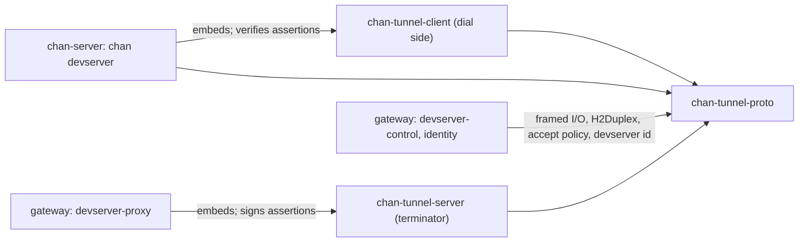
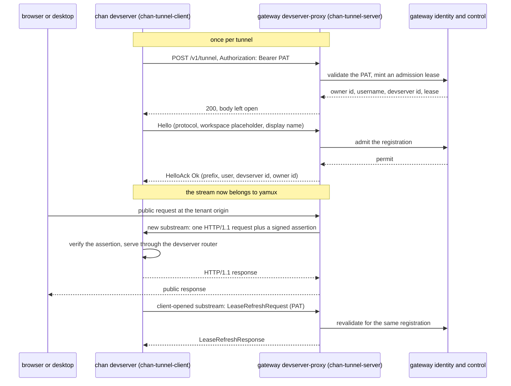

# chan-tunnel-proto design

chan-tunnel-proto is the wire contract of the gateway tunnel: the control frames a devserver and a gateway exchange once per connection, the framing those frames use, the identifier rules both ends check, the adapter that turns one HTTP/2 stream into the byte stream yamux multiplexes, the signed caller assertion the gateway attaches to every request it forwards, and the accept-failure policy the gateway's raw accept loops share. It exists so that the dial side and the terminating side cannot drift apart: both depend on this crate, and a change to the bytes is made here, never in an I/O crate. The crate is mostly data and pure functions; the few async helpers run on the caller's tokio runtime and never start one.

## Where it sits

[`chan-tunnel-client`](../chan-tunnel-client/design.md) is the dial side `chan devserver` embeds, and [`chan-tunnel-server`](../chan-tunnel-server/design.md) is the terminating side the gateway's devserver-proxy embeds. Both build their handshake, their yamux session and their error types on this crate. Two other consumers use parts of it without the tunnel: the devserver (chan-server) verifies the gateway assertion on each request a gateway forwards, and the gateway's devserver-control runs its proxy control listener on the same framed reads and writes, `H2Duplex` and accept-failure policy. The gateway's identity service derives the devserver id with the same function the devserver uses to check it.

*Every tunnel crate and both gateway services that touch the tunnel depend on the contract; nothing depends on an I/O crate for its bytes.*

## The tunnel end to end

A devserver reaches a gateway with one long-lived HTTPS request. It POSTs to the tunnel path with its personal access token as the bearer; the gateway validates the token before answering; the request and response bodies then carry one control frame each, `Hello` and `HelloAck`; and from there both sides hand the HTTP/2 stream to yamux, with the gateway opening one substream per public request. The devserver keeps the token and periodically refreshes its admission lease over a stream it opens itself. The constraint behind this shape is that the devserver machine may sit behind NAT with HTTP-only egress, and must need no inbound port, no DNS and no TLS of its own.

*One control handshake per tunnel, then a substream per public request and a periodic lease refresh in the other direction.*

A refusal before the 200 is an HTTP status with no body, so a bad or scopeless token looks the same to a caller probing it. A refusal after the 200 is a `HelloAck` refusal frame with a stable code, so the client can tell policy from a dropped transport.

## Control frames

`Hello` carries the protocol version, the client's version string for logs, a workspace name, and an optional display name for the gateway roster. The workspace name is a placeholder: the devserver sends a fixed label, the gateway keys the registration on the devserver id it resolves from the token, and one registration carries the devserver's whole library, with the `{workspace}` path segment routing between tenants inside it. The field stays in the type so the protocol itself does not assume a devserver on the other end.

`HelloAck` is either the registration (the assigned path prefix, the username, the devserver id in the workspace slot, and the immutable owner id) or a refusal with a machine-readable code and a human-readable message. Codes are additive: a client matches the ones it knows and falls back to the message for the rest.

The protocol version travels inside `Hello`, so the path never changes with it. Only version 1 exists; a bump is reserved for incompatible changes, while additive fields use serde defaults and need no bump, which is how the optional display name rides along: a client that omits it decodes as none, and a server that does not know it ignores it.

There is no anonymous mode. Every tunnel is authenticated by the token, and a viewer is authorized by the gateway's per-devserver access check, where one grant covers the whole library.

### Why a length-prefixed JSON body, not headers

The handshake fields could ride on the request line or in custom headers. They do not, for three reasons. A TLS edge that forwards h2 (nginx with `grpc_pass`) may strip or rewrite request headers, while the body is opaque to it. The reply needs structure of its own (a prefix and ids, or a code and a message), and a body keeps the two directions symmetric and additive instead of a header-name negotiation. And JSON in a body is testable without standing up h2.

The frame is a big-endian `u32` length followed by that many JSON bytes. The prefix lets the decoder size its buffer before reading, instead of scanning for the end of a JSON document. The length is capped (`MAX_CONTROL_FRAME_BYTES`) and the cap is checked before any body bytes are read or allocated, because a hostile or broken peer could otherwise declare a gigabyte frame and either exhaust memory or hang the reader. Real frames are a few hundred bytes; the cap leaves room for additive growth.

The sync codec (`encode_frame` and `decode_frame` over a `BytesMut`) is separate from the tokio helpers (`read_frame` and `write_frame`) on purpose: the codec is reusable from any I/O loop, and the helpers exist because both real callers run on tokio. `Incomplete` is the one recoverable decode error; everything else ends the handshake.

## Identity and naming rules

The devserver id is the lowercase hex SHA-256 of the raw token (`devserver_id_from_token`). The token is the secret and the digest is a public handle: identity returns it when it validates a token, the registry keys on `(username, devserver id)`, its first characters name the devserver in the tenant host `{owner}--{disc}.{proxy}.proxy.{domain}`, and it is the `drv` claim of every assertion. Both the gateway and the devserver compute it, so the encoding is a cross-service contract. Token rotation therefore yields a new devserver.

The assigned prefix is `/{devserver id}`. The username is not in the path because the host carries the owner; the devserver ignores the prefix, since each tenant already prefixes itself at its own path.

Two validators live here so both ends apply the same rule. `is_valid_workspace_name` accepts a short lowercase label with inner hyphens; the client refuses to send an invalid one (a local configuration error needs no round trip) and the server refuses to accept one (it does not trust clients). `is_valid_username` is the terminator's defence in depth on the name the validator returns: it rejects path separators, whitespace and leading punctuation, because the username flows into the public host label, while the gateway enforces its own stricter host-safe shape.

## H2Duplex

h2 exposes a request or response as a `SendStream` plus a `RecvStream`; yamux wants one `AsyncRead + AsyncWrite + Unpin`. `H2Duplex` is the glue, and it is symmetric: on the server the receive side is the request body and the send side is the response body, on the client the reverse, and the adapter does not care which.

Three details are load-bearing. Reads release flow-control capacity for every chunk as soon as it is pulled, so the peer's window keeps moving; a zero-length DATA frame (padding, a proxy keepalive) is skipped rather than reported as end of stream, because an end of stream here ends the whole tunnel. Writes loop when h2 grants zero capacity, because returning Pending after a zero grant would leave no waker registered and hang the writer. Shutdown sends one empty end-of-stream frame to half-close the write side.

Both peers also advertise the same, larger-than-default HTTP/2 stream and connection windows and the same yamux stream cap and connection receive window, all defined here as shared constants: the h2 default window throttles bulk transfer over any real RTT whatever yamux does above it, and the windows are per direction, so both ends must raise them.

## Lease refresh

`LeaseRefreshRequest` carries the token, and only the token, on a yamux stream the client opens; `LeaseRefreshResponse` is refreshed or refused with a message. It reuses the control framing and is never interleaved with public substreams. The request's `Debug` output redacts the token, since the terminator logs errors around it. Why a refresh exists at all is the terminator's decision: admission authority expires on its own clock, independently of TCP liveness, without the token ever being stored on the gateway's control plane.

## The gateway assertion

The gateway has already authenticated a browser or desktop session before it forwards a request through the tunnel. `gateway_assertion` lets the devserver bind that request to a caller and to its own exact owner without trusting any client-supplied header. The key is derived from the raw token on both sides (`derive_assertion_key`), so no second secret is distributed: holding the tunnel's token is what makes a gateway able to speak for it.

The signed claims are the caller's user id, the immutable owner id, the audience (the host the browser hit, canonicalised), the devserver id, the client type the session was minted for, and a short issue and expiry window. `verify` checks the signature in constant time, then the audience, the devserver id, the owner id, that the issue time is not in the future beyond a small skew, that the assertion has not expired, and that its lifetime is within the cap. Display identity is excluded on purpose: credentials carry immutable authority only, and cosmetic data comes from a separate lookup.

`ClientType` records whether the session was minted for the desktop app or a browser. A missing or unrecognised value verifies as unknown rather than failing the request, and is never the desktop, so a route that is desktop-only (the reverse tunnel legs) stays closed to anything a newer or older gateway did not explicitly mark. `canonical_audience` lower-cases the host and strips a port only when it is the default for the actual scheme, so a cross-default port stays authority-bearing.

## Accept failures

`accept(2)` fails for reasons that say nothing about the listening socket, and both gateway services that run a raw accept loop (devserver-proxy's tunnel listener and devserver-control's proxy control listener) take their whole service down when that loop returns. `AcceptFailure::classify` sorts a failure into three classes and `accept_next` applies the policy:

- **Connection**: one pending connection failed before it was handed over (the peer reset or aborted, a firewall hook refused it, a network error was already pending on the new socket). Logged at debug and retried at once, because pausing here would let a flood of such connections throttle every other accept.
- **Exhausted**: the process or the kernel is short of something a new socket needs (descriptors, buffers, memory), plus any failure not recognised. Logged at error and retried after a one-second pause, the same pause hyper and axum use: the pending connection stays queued, so an immediate retry fails the same way and spins, and an unknown error costs a second of accepts rather than a spin.
- **Listener**: the listening socket itself is unusable. The loop ends and the supervisor replaces the service.

Errnos without a stable `io::ErrorKind` are read through `libc` on unix; elsewhere only the kinds apply, so nothing is classified as a listener failure and every unrecognised failure pauses. The policy lives in this crate because it is the one both loops already depend on: pulling the terminator's yamux and hyper stack into the controller for one function would be the wrong trade.

## Errors

Errors are flat: `FrameError` from the codec, `IoFrameError` from the async helpers, and `AssertionError` for the assertion. The client and server crates convert the first two into their own umbrella enums through `Display`, so `h2::Error` and `serde_json::Error` never cross a crate boundary.
