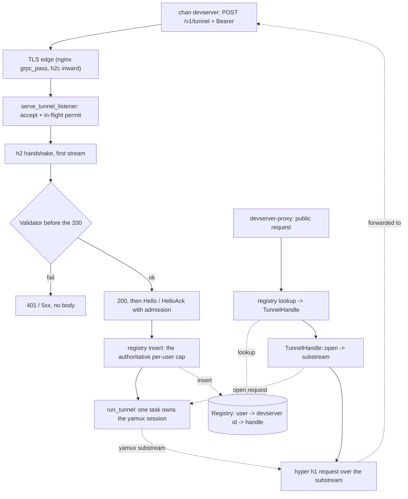
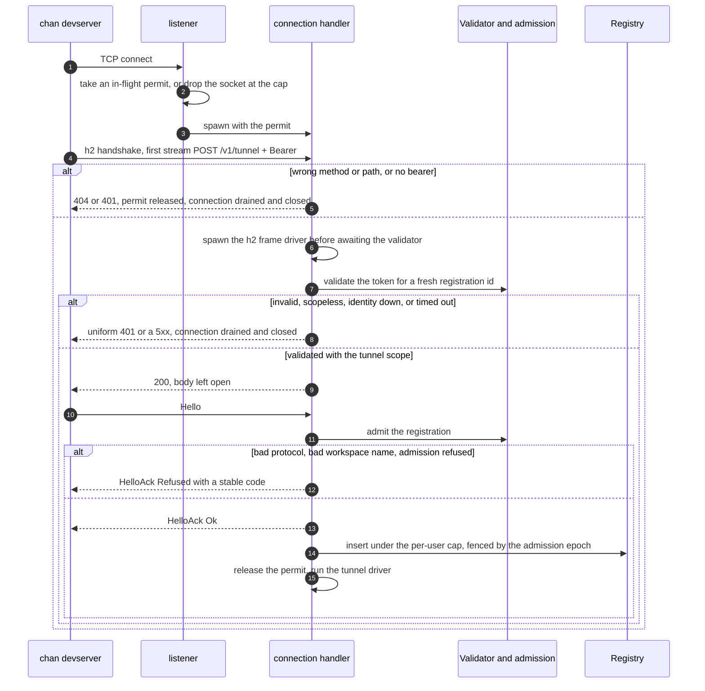

# chan-tunnel-server design

chan-tunnel-server is the terminating side of the gateway tunnel: the library the gateway's devserver-proxy embeds to accept the long-lived h2c POSTs that `chan devserver` dials, authenticate them, run the `Hello` / `HelloAck` handshake, register each devserver in a shared registry, drive its yamux session for the life of the connection, and hand out one substream per public request. It exists so that a gateway can publish a devserver that only ever dials out, and so that the public-side proxy needs nothing from a devserver but a handle to open a substream on. The wire contract is [`chan-tunnel-proto`](../chan-tunnel-proto/design.md), whose design holds the cross-crate sequence; the dial side is [`chan-tunnel-client`](../chan-tunnel-client/design.md).

## 1. Where it sits

devserver-proxy supplies three things and consumes one. It supplies a TCP listener bound to a tunnel-only port behind the gateway's TLS edge, a `Validator` that turns a bearer token into an identity (the proxy's identity-service client), and a `RegistrationAdmission` that asks the fleet controller for a permit. It consumes `TunnelHandle::open`, the one operation a registered tunnel exposes, and builds everything public on top of it: host routing, the viewer gate, forwarded-header hygiene, body and time limits, WebSocket bridging. Out of scope here: TLS termination (the edge does it; this listener is h2c only), token issuance, persistence (the registry is in memory, so a proxy restart drops every tunnel and the clients redial), and the wire format.

The model is per devserver and always authenticated. The registry is keyed by `(username, devserver id)`, where the devserver id is resolved from the token, never from the client's `Hello`: its workspace label is validated and otherwise ignored, and one registration carries the devserver's whole library, with the `{workspace}` path segment routing between tenants inside it. The public tenant origin is `{owner}--{disc}.{proxy}.proxy.{domain}`, with the discriminator taken from the devserver id. There is no anonymous mode; a viewer is authorized by the gateway's single per-devserver access check, and one grant covers the library.

## 2. Architecture

*The dial path from the edge into the registry, and the public request path back out over a substream.*

## 3. Components

### The listener

*The ordering the listener guarantees: authenticate before the 200, refuse in-band after it, insert last.*

Several of these steps are invariants rather than conveniences.

- **Validate before the 200.** The token and the tunnel scope are checked before the response is sent, so an authentication failure is an HTTP status and not a transport error the client cannot tell from a network fault. Every authentication failure is the same empty 401, invalid token or missing scope alike, so a candidate token reveals neither; the internal error keeps the exact cause for logs.
- **The frame driver is spawned before the validator is awaited.** h2 only makes progress while polled, and validation is a network round trip to identity; without a driver the connection would stall. The same task drives the admitted tunnel's h2 connection for its whole life. It answers any further stream on the connection with 409 (a correct client opens exactly one) and shuts the connection down after a bounded number of them.
- **Refusals are drained and bounded.** h2 writes nothing unless polled, so a refused dial keeps the connection polled long enough for the final frame to reach the peer; and `h2::server::Connection` has no idle timeout, so that drain has a deadline, after which the connection is shut down. No credential is needed to reach the pre-auth branches, so anything a refused peer can park on is something any peer can exhaust. The handler reports its outcome to the driver over a channel it sends on only as the last step before the tunnel driver takes over; every earlier return, a panic included, drops the sender, which the driver reads as a refusal. A refusal path added later ends the connection without having to remember to.
- **The in-flight permit covers only the handshake.** A bounded number of connections may be in the authenticate-and-handshake stages at once; above that the TCP socket is dropped at accept, so a flood of half-open or slow peers cannot exhaust memory. A pre-auth refusal releases the permit before its drain, and a registered tunnel releases it before the driver runs, so neither a refused peer sitting on an open connection nor a long-lived tunnel holds an accept slot. Each stage (the h2 handshake, the first stream, validation, the Hello read) has its own deadline, so a peer that completes one stage and stalls on the next is bounded by the next.
- **Policy refusals after the 200 are in-band.** A bad protocol, a bad workspace name or an admission refusal is written as a `HelloAck` refusal with a stable code before the stream is dropped, so the client sees policy rather than a disconnect. A refusal at the registry insert comes after the acknowledgement and can only close the transport.
- **The registry insert is the authoritative cap.** Local admission counts a user's registrations as a friendly pre-acknowledgement check; two parallel dials can both pass it. The registry repeats the count and the insert under one lock, so they cannot both succeed.
- **Accept failures do not end the loop.** The accept loop uses the shared policy in [`chan-tunnel-proto`](../chan-tunnel-proto/design.md#accept-failures): a failure that concerns one connection is retried at once, resource exhaustion is retried after a pause, and only an unusable listening socket ends the loop, because the embedding proxy treats the loop ending as the listener dying and stops every tunnel on the node.

### The driver

One task per registered tunnel owns the yamux connection. A single `poll_fn` merges its five sources in priority order: the shutdown signal (an explicit send, or the registry dropping the sender on eviction), a finished lease refresh, the lease deadline, open requests from the public side, and inbound streams from the peer. One `poll_fn` rather than `select!` because two of the branches need the same mutable borrow of the connection.

Open requests are drained into a local queue and answered with `poll_new_outbound`. Inbound streams are the client's lease refresh; at most one refresh runs at a time, any further inbound stream is dropped, and the refresh itself is handled outside the poll so identity validation does not stall outbound allocation. On exit the driver closes yamux under a deadline (the close is a write that waits on the peer's h2 window, and yamux's closing state has no timer, so a peer that stops granting window would otherwise hold the task forever), answers every queued open with `Disconnected`, and deregisters itself only if it still owns the registry slot, so a driver shutting down after eviction cannot remove its successor. Its return drops the sender that tells the h2 driver to close the connection.

### Admission and the lease

With controller-backed admission, identity returns an opaque signed lease bound to the exact registration (owner, user, devserver id, registration id, proxy), and the proxy asks the controller to verify it and reserve capacity before acknowledging. The handler generates the registration id and passes the same id to validation and admission, so the lease and the permit name one registration. A synchronous epoch fence is checked immediately before and after the registry insert: losing the controller invalidates the epoch, so an already-admitted but stalled handshake cannot register after a fail-closed eviction has run.

The lease expires on its own clock, independently of TCP or yamux liveness. Before it does, the client sends its token in a `LeaseRefreshRequest` on a stream it opens; the terminator revalidates it for the same registration under one absolute deadline covering the read, the identity round trip, the registry update and the reply. The refreshed identity must keep the same user id, username and devserver id, and the token is dropped the moment validation returns. A success updates the handle's lease and publishes a registry event the proxy forwards to the controller; reaching the deadline without one closes and deregisters the tunnel.

### The registry

The registry is a two-level map, user to devserver id to entry, under a mutex, with `Arc<str>` keys so a public-request lookup borrows plain strings without allocating. Each entry holds the handle and the driver's shutdown sender, so removing an entry is what ends a tunnel. The collision policy is last writer wins: a dial for a key already held evicts the previous entry (logging its age so flap is visible), which is how a restarted devserver reclaims its registration without waiting for a TCP timeout. The per-user cap counts distinct devserver ids and is skipped for a key the user already holds. Every insert and removal increments a generation and publishes an event, and `snapshot_and_subscribe` returns the current rows with the generation and a receiver, which is how the proxy keeps the controller's view contiguous. Admin views are sorted snapshots carrying the peer address and connect time; `evict` forces a tunnel offline.

### The substream budget

`TunnelHandle::open` sends an open request to the driver and awaits the stream, holding a permit from a per-tunnel semaphore for as long as the returned `TunnelStream` lives. The budget is well under yamux's own stream cap on purpose: asking yamux for a stream past its cap returns an error that has already put the whole session into cleanup, taking every other substream with it, so the count must never get there. A dropped substream frees its permit at once while yamux only drops it from its map on the driver's next poll, and the driver serves queued opens before that poll, so a burst of completions can leave up to twice the budget counted; the budget is therefore half of what the cap leaves after headroom for the streams the peer opens. A caller past the budget waits, bounded by its own request deadline, and nothing else on the tunnel notices. The single failure of `open` is `Disconnected`, which the proxy maps to a bad-gateway response.

### Why h1 over yamux, and why h2c on the listener

A substream is already a multiplexed channel; one substream is one request, HTTP/1.1 maps onto it directly, WebSocket upgrades work with hyper's upgrade support, and bodies stream through yamux's flow-control window. The listener speaks h2c because the deployment in front owns transport security: the gateway's edge terminates TLS and forwards the tunnel path as h2c, and running rustls here would duplicate trust configuration and complicate rotation.

## 4. Embedding contracts

The listener is the only path that inserts into the registry; registration is crate-private, so an embedder cannot mint a handle that bypassed validation. `Validated` carries the authenticated user id, username, devserver id, scopes, the per-tunnel assertion key and, in controller deployments, the lease and its expiry; its `Debug` output redacts the secrets. A `Validator` may also receive the display name the client announced, as a best-effort follow-up that never fails the tunnel. The registry exposes lookup for forwarding, sorted snapshots and events for the controller, and explicit eviction. Public-side routing, authentication, caps and upgrade bridging belong to the embedder; this crate exposes no public router and no public configuration.

## 5. Wire notes

The 200 is sent after the validator and the scope gate and before the `Hello` is read, which is why the handshake function takes an already-validated identity. The acknowledged prefix is `/{devserver id}`; the devserver ignores it, since tenants prefix themselves, and the username travels in the public host. Policy errors map to the stable refusal codes in chan-tunnel-proto (the local cap and the fleet limit to the same code, an unavailable controller to its own, anything else to `internal` with the error's text). The yamux and h2 windows are the shared constants from the proto crate, so both peers are tuned identically.

## 6. Trust boundaries

- **The validator is the identity authority.** It must never log, echo or persist the token, in any error variant or URL; the listener logs its errors, so this seam is the only place that guarantee can break. Validation and the scope check run before the 200; after it, failures are in-band refusals.
- **The controller is the capacity authority.** The proxy must hold a current permit before acknowledging or inserting; control loss invalidates permits and refuses new admissions, and there is no local fallback in the gateway deployment.
- **What the proxy holds of the token, and for how long.** The handler holds a dial's raw token from the method and bearer gates through validation (whether or not it then refuses), the Hello read, admission and the registry insert, and when the Hello carries a display name a detached task holds it until the announcement returns. Each lease refresh holds the token only until validation returns. Separately, h2's HPACK decoder keeps the dial header's decoded value for the life of that h2 connection, so a memory capture of the proxy process can hold the token of every connected tunnel. The admission lease is not a trusted-execution boundary: a fully compromised proxy node can capture and reuse a token until identity revokes it or it expires, and node isolation plus token rotation and revocation are the incident response.
- **What a captured tunnel token reaches.** The devserver id is the digest of the token and identity derives it on every validation, so a second dial with the same token arrives with the same registry key. Last writer wins and the per-user cap is skipped for a held key, so the second dial evicts the first, the controller classifies it as a reconnect, and public routing does not move: the tenant host and every entry credential name the same devserver id and owner. The owner's and every grantee's browser is served by whichever peer holds the registration, and two holders of one token displace each other for as long as both dial. A display name the second dialer announces also rewrites the roster label. The token carries the tunnel scope and not the desktop scopes the desktop's own credential carries, and a registration opens substreams only against its own connected peer, so nothing on this path reaches the real devserver's files or shell.
- **Names.** The username the validator returns is checked for host-safety before it flows into public routing, and every `Hello` workspace label is checked even though clients check first.
- **Floods.** The in-flight cap, the per-stage deadlines, the bounded refusal drain and the 409-then-shutdown treatment of extra streams bound what an unauthenticated peer can hold; the substream budget bounds what a public visitor can open on one tunnel; the per-user cap bounds registrations.
- **Public-side controls** live in devserver-proxy: host routing accepts only the configured apex and wildcard, forwarded headers from the public side are stripped and re-injected, request and response bodies are capped, one deadline covers the open, the h1 exchange and the body, and a bridged WebSocket is cut after both directions go quiet. Per-visitor rate limiting is left to the edge, since behind it every visitor shares the proxy's peer address. The detail is in the gateway's devserver-proxy design.

## 7. Errors

`ServerError` is one flat enum; frame and I/O errors from chan-tunnel-proto are flattened through `Display`, so `h2`, `serde_json` and `yamux` types stay inside. Before the acknowledgement, policy errors additionally map to the stable refusal codes. `OpenError::Disconnected` is the single failure of `TunnelHandle::open`: either the driver has exited or it could not allocate the stream because yamux is closing.

## 8. Open questions

- A persistent registry would let the public side say "offline since" during a proxy restart instead of a bare bad-gateway response.
- An application-level health probe over a control substream would detect a dead peer faster than waiting for yamux to error or an open to fail.
- Nothing caps a tunnel's total bandwidth or request rate; the substream budget bounds concurrency only.
