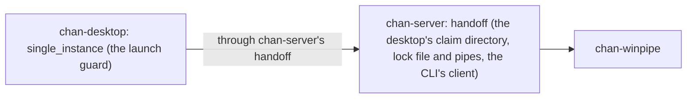

# chan-winpipe design

chan-winpipe is the Win32 boundary of chan's named pipes and claim directories: the only place in chan that reads the account a process runs as, builds their security descriptors, or asks which account serves a pipe a client reached. It exists because every named pipe on a Windows machine shares one namespace, and a pipe created with the default security descriptor grants LocalSystem and the Administrators group besides its creator: a pipe meant for one account is reachable from an elevated process of another, and any local user can create a pipe of its name first. The crate depends on windows-sys and tokio on Windows and on nothing elsewhere, `unsafe_op_in_unsafe_fn` is denied, and every `unsafe` block is one Win32 call or the read of what one returned, so the crates that serve and dial chan's pipes keep `#![forbid(unsafe_code)]`.

## Where it sits

chan-server's handoff module names the desktop's endpoint by the account's SID, creates the claim directory, its lock file and both pipes through this crate, validates the owner and grants of the directory and the lock file, and checks the server's account on every client it opens. The guard in chan-desktop reaches the crate only through those handoff calls. The contract they implement (one desktop per account, a client that never writes to another account's desktop) is in [crates/chan-server/design.md](../chan-server/design.md); this crate is the mechanism.

## What it provides

- **The account.** `current_account_sid` reads the user SID from the process token once and keeps its text form (`S-1-5-21-...`). A SID names one account across a machine and a domain, where a user name does not: `first.last` and `firstlast` filter to one pipe name, and a local and a domain account may share a name.
- **Owner-only pipes.** `owner_only_sddl` is the descriptor `O:<SID>D:P(A;;GA;;;<SID>)`: the account owns the pipe, and a protected DACL with one entry grants it full access, so no default entry for LocalSystem, Administrators or Everyone applies. `create_owner_only` creates a pipe instance under a tokio `ServerOptions` with that descriptor; `create_with_sddl` takes any descriptor, which the tests use to stand in for another account's pipe. Creating the pipe needs no entry for LocalSystem. Another account's process meets access denied opening the pipe or creating an instance of it, elevated or not.
- **Owner-only directories.** `create_owner_only_dir` applies that descriptor at creation through `CreateDirectoryW`, without changing an existing directory. `open_dir` opens the final component without following a reparse point and requests the rights to read its metadata, owner and DACL. It also requests directory listing access so the handle participates in share-access checks; denying delete sharing then prevents that directory from being renamed or deleted until the handle closes. The caller checks the handle's metadata rejects a reparse point and anything other than a directory, then validates its actual descriptor before use. Ancestor paths remain the caller's responsibility.
- **Owner-only files.** `open_owner_only_file` uses `CreateFileW` with the same explicit descriptor when creating a lock file; the process token's default DACL never supplies its initial grants. It opens an existing file without truncating or changing its descriptor, refuses delete sharing, and does not follow a reparse point at the final component. The caller checks it is a regular file without a reparse point and validates its actual descriptor before taking the lock.
- **The server's account.** `server_account_sid` takes a client's end of a pipe, reads the server's process id (`GetNamedPipeServerProcessId`), opens that process for limited query and reads the user SID from its token. A process or token this account may not open is an error, which callers read as an account other than theirs.
- **Reading a descriptor back.** `security_sddl` returns the owner and the DACL of a kernel object behind a handle, as SDDL, so a test reads what a pipe grants. `file_security_sddl` reads file and directory handles with the file object type. The text names a well-known account by the two-letter alias SDDL has for it rather than by its SID: the built-in Administrator's own pipe reads `O:LAD:P(A;;FA;;;LA)`, where another account's reads `O:S-1-5-21-...D:P(A;;FA;;;S-1-5-21-...)`. So callers do not compare the text: `owner_only_parts` splits the owner-only shape into its owner, rights and trustee, `sddl_sid` resolves a SID or an alias to the SID's text form, and `grants_account_alone` holds when the owner and the one entry resolve to the account and the entry allows full access (`GA` as written, `FA` as a file or pipe reads it back).

## What it does not do

It reads and writes nothing through a pipe; the transport is tokio's named pipes, and the handoff protocol, its timeouts and its retries belong to chan-server and the desktop. It does not cover chan's other pipes: the control socket's and the devserver handoff's pipes keep the default descriptor.

## Claim ownership

The desktop claim is a `File::try_lock` lock on `%LOCALAPPDATA%\chan\run\desktop.lock`. Handoff creates `run` with `create_owner_only_dir` and the lock file with `open_owner_only_file`, holds both open without delete sharing through `open_dir` and the file's handle, and on every claim refuses either node when it is a reparse point, is not a directory or a regular file, or has a descriptor `grants_account_alone` rejects. The lock depends on no pipe, so a pipe another account creates under the boot marker's name cannot hold it. An elevated process that can write another account's profile or end its processes remains outside this boundary. The boot marker, the endpoint pipe, and the launch's retries, timeouts and compatibility with an older desktop are chan-server's and the desktop's, in [crates/chan-server/design.md](../chan-server/design.md) and [desktop/design.md](../../desktop/design.md).
