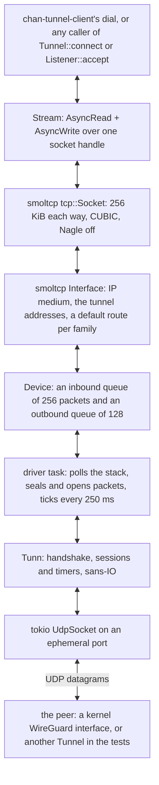
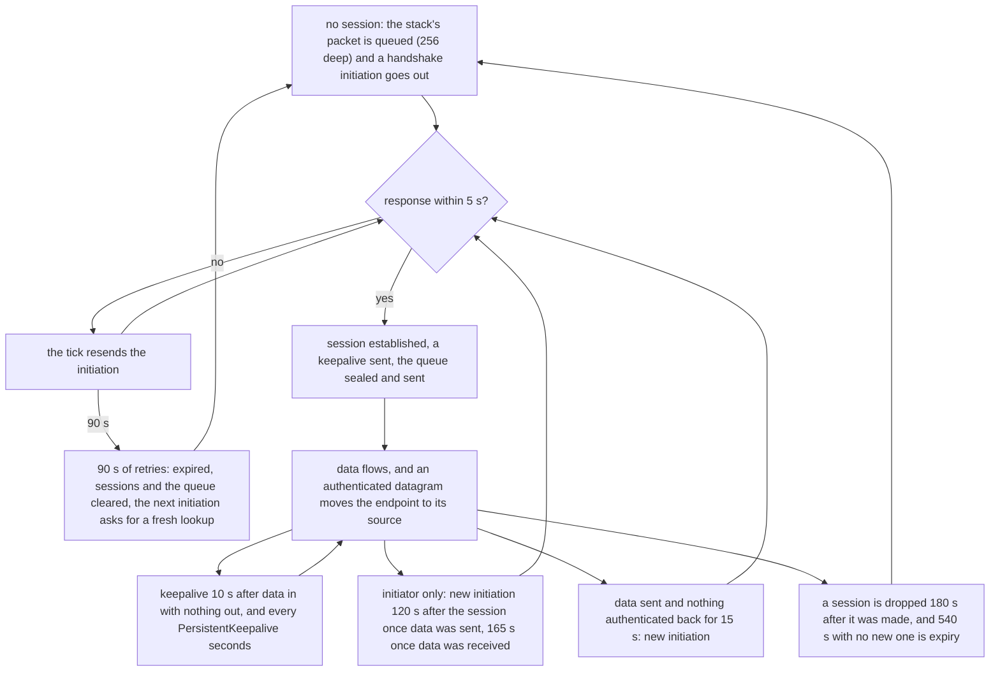

# chan-wireguard design

chan-wireguard is one peer of a WireGuard tunnel and a TCP/IP stack over it, both inside the process. `Tunnel::start` takes a parsed configuration and starts a driver task without performing DNS or waiting for a handshake; `Tunnel::connect` opens a TCP connection to an address inside the peer's AllowedIPs and resolves to a tokio `Stream`. Nothing on the host is created, routed or elevated for it: no interface, no route, no resolver change, no privilege. It lets the devserver and desktop reach gateway hosts that sit behind an ordinary kernel WireGuard peer from any operating system with no VPN software installed, with the peer pinned by its static key and every byte encrypted before it leaves the process. The `noise` module and the clock derive from Cloudflare's boringtun under BSD-3-Clause (the notice is the crate's `LICENSE`, the `noise` files keep their SPDX headers, and the manifest's license is `Apache-2.0 AND BSD-3-Clause`); the code is owned here rather than tracked as a dependency because the protocol is frozen, Noise_IKpsk2 over Curve25519, ChaCha20-Poly1305 and BLAKE2s with no wire versioning, while the crate API upstream is not.

## Where it sits

The first caller is chan-server's devserver mode. `chan devserver run --tunnel-wireguard FILE` makes the `chan` crate read the wg-quick file through `config::read_file` into a `DevserverWireguard`; chan-server's `spawn_devserver_tunnel` starts a `Tunnel` from it and wraps the tunnel in `WireguardConnector` (`crates/chan-server/src/wireguard_connector.rs`), its implementation of [chan-tunnel-client](../chan-tunnel-client/design.md)'s `Connector`. The tunnel client then runs its h2 dial through `Tunnel::connect` instead of a TCP connect, and because the connector reports itself protected the tunnel URL may be an `http://` address inside the tunnel. The adapter lives in chan-server, not in chan-tunnel-client, so the gateway workspace builds the client without this crate; the gateway depends on nothing here, since its end of the tunnel is the kernel's WireGuard. On the proxy node that end is an ordinary `wg` peer: the devserver's public key is one `wg set ... peer` entry with its tunnel address as AllowedIPs, and devserver-proxy's `TUNNEL_BIND_ADDR` listens on the node's WireGuard address under the gateway's protected-overlay assertion, so the tunnel ingress needs no edge, no certificate and no public name. `chan`, `chan-server` and chan-desktop depend on chan-wireguard: the desktop reads a gateway row's wg-quick file through `config::read_file` when the row is added or updated, starts a `Tunnel` per such gateway at its start and binds one `ConnectProxy` over them, through which its HTTP clients, its window feed and its webviews reach the gateway ([`desktop/design.md`](../../desktop/design.md), the WireGuard fabric). The crate depends on tokio, smoltcp and socket2 for the stack, on ring (ChaCha20-Poly1305), x25519-dalek, blake2, hmac and chacha20poly1305 (the XChaCha20 of cookies) for the protocol, on base64 for keys, on hyper, hyper-util and http-body-util for the proxy, and on rustix for the clock on Unix. It forbids unsafe code.

Of the operating system the crate takes the host resolver, the clock, and up to two UDP sockets, one per endpoint address family, bound to ephemeral ports as needed. Everything else a VPN client asks the OS for, an interface, addresses, routes, a resolver, a firewall mark, is done inside the stack or not at all.

## What is owned and what is depended on

The `noise` module is boringtun 0.7.1's protocol core: the Noise_IKpsk2 handshake in both roles, transport sessions with the replay window, the whitepaper's timer machine, mac1 verification and the cookie mechanism, behind the sans-IO `Tunn`. Its device layer (TUN, epoll and kqueue, the allowed-IPs table, the UAPI socket) and its FFI are not here; the stack, the driver, the configuration and the proxy are chan's own. The adaptations to the core are small and stated in the code: std atomics in place of portable-atomic, the clock through rustix instead of nix so the crate forbids unsafe code, subtle for constant-time compares, a test-only clock offset in place of upstream's mock-instant feature, and timer comparisons that hold at the 250 ms tick's resolution. The trade is that upstream fixes arrive by reading boringtun's changelog rather than by `cargo update`, and the core is small enough that such a fix is a diff to read. The alternatives were a dependency on boringtun, whose crate API changes between releases that are years apart, and a fresh implementation from the whitepaper, the same size with no inherited tests.

The dependencies are chosen so the tunnel adds as little as possible to the binary: ring provides ChaCha20-Poly1305 because rustls already links it; x25519-dalek, chacha20poly1305 (for the XChaCha20 cookie reply only), blake2 and hmac are pure Rust and build on every chan target; smoltcp is the one dependency with an API of its own, reached through its `Device` trait, `Interface` and `tcp::Socket`, and it is the embedded Rust community's TCP stack rather than something to own. The crypto crates are watched like every other dependency; the protocol code itself does not move.

## The stack

*Bytes written to a stream become TCP segments in smoltcp, IP packets in the device's queue and sealed datagrams on the UDP socket; the reverse path opens, queues and polls them back into a socket buffer.*

The interface, the device, the sockets and the port allocator form `Stack`, held under one `parking_lot::Mutex` in `Shared` beside a `tokio::sync::Notify` kick. The driver loop locks it, polls the interface (which also reaps released sockets and returns smoltcp's next timer), drains the outbound queue, unlocks, seals each packet with `Tunn::encapsulate` and sends it. When the outbound queue filled during the poll the driver yields and polls again, so one poll never takes more than 128 packets of memory and a reader sharing the thread gets its share; otherwise it waits on the first of these events: a datagram, a kick, the 250 ms tick, smoltcp's timer, a lookup result, or the lookup deadline. A datagram wakes a burst: up to 32 are read with `try_recv_from` before the stack is polled once, so a window of packets costs one poll rather than one each. `Tunn` and the current endpoint sit under a second mutex, held for one call at a time, so `Tunnel::status` never waits for a poll. The kernel is asked for 4 MiB send and receive buffers on the UDP socket, best effort: the defaults (64 KiB on Windows, about 200 KiB on Linux) hold less than one window of sealed packets arriving while the driver is busy. The MTU is the configuration's or 1420, wg-quick's default of 1500 less the IPv4, UDP and WireGuard headers.

Cryptokey routing holds on both sides. `connect` refuses a destination outside AllowedIPs with `NetworkUnreachable` before a byte leaves; a decrypted packet whose source is outside AllowedIPs is dropped whatever it says. The interface holds the tunnel's addresses, each of which must be unicast, in smoltcp's two address slots, and a default route per family through the tunnel's own address: the IP medium never uses a gateway value, but without a default route a socket to a prefix outside the local addresses sends nothing. The crate's own tests build two `Tunnel`s on loopback UDP sockets, each the other's peer at 10.7.0.1 and 10.7.0.2, and run streams through both ends.

## The session

*A new handshake every two minutes while traffic flows, a keepalive when one side goes quiet, and a fresh start after 90 s of unanswered initiations.*

The timers are the whitepaper's, in `noise/timers.rs`: `REKEY_AFTER_TIME` 120 s, `REJECT_AFTER_TIME` 180 s, `REKEY_ATTEMPT_TIME` 90 s, `REKEY_TIMEOUT` 5 s, `KEEPALIVE_TIMEOUT` 10 s. `Tunn::update_timers` is the whole machine; the driver calls it every 250 ms from a tokio interval that delays rather than bunches missed ticks, the rate the core expects. The stamps it compares have the tick's resolution, so a session established, its first data packet and the answer can all share one stamp (chan's connect queues the SYN before the handshake and sends it the moment the session is up, so they always do), and every rule that asks whether one event followed another counts equal stamps: the passive keepalive and the fifteen-second re-handshake carry the order in a flag, and the initiator's rekey at `REKEY_AFTER_TIME` and its early rekey on receive near `REJECT_AFTER_TIME` fire with data sent or received at the establishment stamp. With a strict comparison the rekey fired only when a tick happened to split the first exchange, which read as a client that rekeyed on some runs and not others. Time comes from the crate's own clock (`clock.rs`): `CLOCK_BOOTTIME` on Linux, so a laptop's sleep counts and a stale session is seen as expired on wake instead of being used until the peer rejects it; the monotonic clock on the other Unixes, which have no portable equivalent through this interface; std's `Instant` on Windows, which already counts sleep. A guest paused by its hypervisor is another matter, measured once under QEMU/KVM: the Windows guest's counter stood still for a 60 s pause, the peer saw 60 s of silence, and the session carried on afterwards as if no time had passed, which the peer's `REJECT_AFTER_TIME` bounds; a pause longer than that leaves a session the peer has expired, and the client replaces it only when its next data goes unanswered for `KEEPALIVE_TIMEOUT` plus `REKEY_TIMEOUT`.

`Tunn::encapsulate` with no session queues the packet and returns the initiation; while one is in flight further packets queue without a second initiation. A response establishes the session and the initiator answers with an empty data packet, a keepalive, so the responder learns the session works; the driver then drains the queue with empty-datagram `decapsulate` calls, the core's convention for "hand me the next queued packet". The core also answers an initiation from the peer, since a kernel peer rekeys from its side when it has traffic to send; a session the peer made becomes current with the first data packet on it. Eight sessions ring, indexed by the low bits of the session index.

Expiry is the one state the driver acts on. After 90 s of unanswered initiations, or 540 s without any new session, the core reports `ConnectionExpired` and drops its sessions and the queue; the driver discards any pending initiation and invalidates its resolution freshness. The next packet from the stack starts a fresh handshake. The core's expiry and retry lines log at debug. Once an initiation has left or a handshake has completed, the driver warns once per loss and once on recovery, naming the configured endpoint, the address in use and, on loss, the age of the last completed handshake (or `never`); repeated expiries and expiries before any attempt log at debug. Its handshake record survives the core's session cleanup: `Status::handshake` distinguishes never handshaken, live and lost, with the last handshake's age in the latter two states. Nothing above is torn down: TCP connections inside keep retransmitting and resume if the peer comes back.

The endpoint is initially unknown unless the caller supplies it through `start_on`, and roams: every datagram the core accepts (a handshake message, a data packet, a keepalive) moves it to the datagram's source, as the protocol specifies, so a peer behind a changing NAT mapping is followed. The exception is a cookie reply in either direction: the one the core itself sends in answer to a handshake message it has not authenticated yet, when its `RateLimiter` is under load, and the one the peer sends in answer to an initiation, which is sealed under a key derived from the peer's public key with the on-wire mac1 as associated data, so anyone who saw the initiation can produce one. The driver recognizes both by type and length and leaves the endpoint alone, as the kernel does. Each `Tunn` carries its own limiter (ten handshake messages a second); it stays because the same code verifies mac1 on every handshake message received, and its cookie half runs only past that rate, which one peer never reaches. On the other side, when the peer answers an initiation with a cookie reply the core keeps the cookie, puts its mac2 on the retry 5 s later, and forgets it after 120 s.

## Endpoint resolution

Construction performs no lookup. The driver starts one resolver task, and a lookup runs on each handshake initiation (the first, each retry, each rekey and the attempts after expiry), unless an endpoint is known and one ended no more than `REKEY_TIMEOUT` (5 s) ago. With an endpoint known the initiation does not wait for its lookup: it leaves at once, so a slow, failing or hung resolver never delays a handshake with a peer the tunnel can still reach, and a failure stays in `Status::resolution_error`. When the answer arrives and the endpoint rule below moves the endpoint, or a live session's answer differs from the previous one, that address gets an initiation of its own at once rather than at the next retry. With no endpoint known the initiation is held until a lookup ends with an answer; a failure keeps it held, and the tick starts the next lookup once 5 s have passed since the last one started. The driver generates a held initiation afresh when it leaves, so its retry clock starts at transmission; expiry or an authenticated handshake response cancels it. Resolution uses the host's `getaddrinfo` through tokio, with no DNS crate or independent cache; record TTL and caching belong to the host resolver. IP literals use the same path without a DNS query.

There is at most one outstanding lookup per tunnel and starts are at least 5 s apart. At 10 s the driver records a timeout but retains the lookup until it finishes: an OS resolver call cannot be cancelled, and replacing it could accumulate blocking calls. While a timed-out lookup holds the OS call no other lookup can start: initiations to a known endpoint leave as always, with no endpoint known the tunnel waits for that call to return, and `Status::resolution_stalled` says which state it is in. The driver keeps receiving, transmitting and polling the stack throughout. Dropping the tunnel aborts its async resolver task, but an OS call already running on tokio's blocking pool finishes on the host resolver's schedule.

A lookup answer moves the endpoint only when no endpoint is known or the latest handshake is older than 135 s. While a younger session lives, the data stays on the address the peer last authenticated from: an answer that differs from the previous one gets a handshake initiation and nothing else, and the endpoint moves to it only when the peer answers from there, through roaming. A record changed before its new host is up, or a name whose addresses rotate (see the open questions), so costs an initiation to an address that may not answer, never the session's data. An answer equal to the previous one, or to the endpoint in use, sends nothing, so a record that has not changed cannot undo roaming, whether its lookup started before the roam or after it; this also keeps a responder with a placeholder endpoint, such as the `wg-peer` example, sending only to the address its client authenticated from and never to the placeholder its own lookups answer. The 135 s is `REKEY_AFTER_TIME` plus three `REKEY_TIMEOUT`s: a session that old has gone unanswered through three rekey retries, so its path is presumed dead and any answer is taken. wireguard-tools' `reresolve-dns.sh` uses the same 135 s for the same decision, and it sits below `REJECT_AFTER_TIME`, so the name takes over before the session is rejected. An authenticated datagram still moves the endpoint to its source. The endpoint `start_on` is given stands as the previous answer: it is used while lookups fail, and a later lookup answering it is no change. The driver binds the answer's family socket as needed and retains both sockets once created, so IPv4/IPv6 changes and replies on the previous family remain usable. `Status::endpoint` is optional until an address is known. `Status::resolution_error` names a failed lookup, a timeout, or a failed socket bind for an answer (`binding a UDP socket for ...`), whose answer is then not used, and clears with the next usable answer. A failure logs at warn when it starts or changes and at debug while it repeats, since a lookup that fails is retried every 5 s while initiations keep coming; a timed-out lookup logs that it is stalled, waiting for the system resolver, since nothing retries it. The first usable answer after a logged failure logs the recovery at warn, once, so a log filtered at warn, as the devserver's is by default, shows both ends.

A connect before any endpoint is known marks the outcome already published as seen and waits for the next one: a lookup that ends after the connect started. A failure fails the connect with that lookup's reason, and a successful answer lets it carry on to the handshake, so the first connect after a failed lookup is not refused by the old failure. While a timed-out lookup holds the OS call no outcome can come, and the connect fails at once with the timeout. Other connection waits keep their caller's bound.

## Streams and backpressure

A `Stream` is a handle to one socket in the shared stack. `poll_read` locks the stack, copies out of the socket's receive buffer, and when nothing is there registers the task's waker with the socket and returns pending; `poll_write` does the same with the transmit buffer. The lock makes the check and the registration one step, so a state change between them cannot be missed, and smoltcp wakes the registered waker when a poll moves the socket. Every successful read or write kicks the driver: a write so the segment leaves now rather than at the next tick, a read because the window grew and the peer may be waiting on it. Backpressure is the socket's own buffers, 256 KiB per direction: a full transmit buffer parks the writer, an empty receive buffer parks the reader. The size lets a connection over a 100 ms WAN path move a few MiB/s, more than the h2 tunnel above needs. Sockets run CUBIC, because without congestion control a socket sends its peer's whole window in one burst, which overran the kernel's UDP buffer even on loopback, and Nagle off, because the h2 frames above are request and response and holding a small frame for a full segment adds a round trip to every one.

`poll_flush` kicks and returns ready: bytes leave at the next poll, and waiting for the peer's acknowledgement would add a round trip per flush that an OS socket's flush does not. `poll_shutdown` closes the socket, so the FIN follows the queued bytes, and returns at once. A peer's FIN reads as 0; a reset after establishment reads as `ConnectionReset`; a write once the peer is gone fails with `BrokenPipe`, and, as in TCP, the first write after a FIN is legal and is sent, and the peer's reset makes the next one fail. Dropping a `Stream` closes the socket, or aborts it with a reset when unread data sits in its receive buffer, as a closed OS socket does, and releases it: the driver removes a released socket once it is closed and its endpoints are cleared (the reset has to leave first), and aborts one that the peer never finishes closing after a 15 s linger, or at once when data arrives for a reader that is gone, so a silent peer cannot pin the socket and its port. Ports are ephemeral, 49152 to 65535 from a random start, counted per socket so a listener's backlog shares one.

`Tunnel::connect` picks the first tunnel address of the destination's family as the local address, opens the socket (SYN-SENT; the kick makes the driver send the SYN) and returns a future that resolves when the socket leaves SYN-SENT: established, or `ConnectionRefused` when a reset closed it. Dropping the future drops the stream inside it, which closes the half-open socket. `Tunnel::listen` opens four listening sockets on the port (`BACKLOG`) so SYNs arriving together each find one instead of a reset; `Listener::accept` hands out an established one and replaces it with a fresh listening socket, and a listening socket reset before it was accepted is listened again.

`Tunnel` handles are clones of one `Arc`. Dropping the last aborts the driver and marks the stack closed, which aborts every socket and wakes every waiter, so each stream operation and every new `connect` fail with `ConnectionAborted` instead of waiting for a poll that never comes. The driver also ends when the UDP socket fails (an ICMP unreachable that surfaces as `ConnectionReset` or `ConnectionRefused` on receive is logged and ignored), and a guard marks the stack closed on that path too.

## The loopback proxy

`ConnectProxy::bind_routed` takes a table of routes, each a tunnel under an id its caller chooses, and a loopback address, binds a TCP listener there (port 0 picks one; `local_addr` reports it) and serves HTTP from it until it is dropped: CONNECT, and the forwarding of plain-HTTP requests. `ConnectProxy::bind` is the same over a plain list of tunnels, one route per tunnel under its index. It exists for the dialers that cannot call `Tunnel::connect` themselves. chan-desktop has three legs to a gateway, the SPA in the webview, the identity and tenant requests through reqwest and the window feed through tokio-tungstenite, and each already knows how to dial through an HTTP proxy (tauri's `proxy_url` and wry's `with_proxy_config` for the webviews, reqwest's proxy support, a CONNECT written by hand before the feed's TLS upgrade), so one proxy on loopback is the one adapter that puts all three inside the tunnels without a TUN device and without a change to any of them. The gateway keeps its public certificates, so the TLS inside the tunnel is the TLS the legs speak today. chan-desktop is the proxy's caller, through the fabric its design describes.

The routing table is a live list of routes, and what a route routes is its tunnel's AllowedIPs, read through `Tunnel::allowed_ips`, and the host names it maps (`ProxyRoute::hosts`, each a `HostRoute` of a name and tunnel addresses). The caller edits the table while the proxy serves: `add_route` appends a route under a new id (an id already in the table is `AlreadyExists`), `replace_route` puts a route in the place of the one under its id, or at the end for a new id, `remove_route` takes one out, and `routes` counts them. The table sits behind a `parking_lot::RwLock` that a request holds only to find its route and clone the tunnel handle out, never across an await, and a change holds only for one edit of the list, so the next request sees a change and no change waits on an open connection. A name authority is matched first against the host maps, route by route in table order, without regard to ASCII case: an entry is an exact name, or `*.` and a suffix, which matches a name with one or more labels in front of the suffix and never the suffix alone. A match connects through that route's tunnel to the first of the entry's addresses whose family the tunnel has an address of, with no lookup on the host, and an entry with none of the tunnel's families answers 502; this is how a gateway whose names resolve publicly, or not at all, on the client is reached at its tunnel address without split DNS or a hosts entry. `bind_routed`, `add_route` and `replace_route` refuse with `InvalidInput`, and leave the table as it was, an entry whose name is not a DNS name or `*.` and one, or whose address lies outside the tunnel's AllowedIPs, so a mapped name can never take the direct path. Every other request resolves its authority on the host, every time and with no cache, so a name whose record moves is followed by the next connection: an IPv4 literal or a bracketed IPv6 literal is taken as given, a name goes through the system resolver. The first route, in table order, whose tunnel's AllowedIPs contain a resolved address carries the connection through `Tunnel::connect` to that address; a destination inside none of them is connected directly on the host, trying the resolved addresses in order. An open connection keeps the stream it opened when its route is replaced or removed, so a change of route never cuts it; it ends with its tunnel, once the last handle of that tunnel is dropped, which is the route's own and whatever handles the caller keeps. `replace_route` drops the route it replaces only after the new one is in the table, so the next connection already goes through the new tunnel while the old one carries what it carries until its caller lets it go. The pass-through is load-bearing, not a convenience. A webview told to use a proxy sends every origin through it, and on Linux wry sets the proxy on the shared WebContext with an empty ignore-hosts list, so the loopback windows of local workspaces go through the proxy too: a proxy that refused everything outside the tunnels would take them down with it. Routing by destination keeps only gateway traffic inside the tunnels while everything else, public hosts included, reaches the host's own network as before.

The proxy has no authentication, which is why `bind_routed` refuses any address that is not loopback with `InvalidInput` before binding. Any process on the host may connect to it and open a connection into a tunnel, the same reach a kernel WireGuard interface on the host gives every local process, and the loopback bind keeps that reach on the host: nothing beyond it can use the proxy. A `Proxy-Authorization` header, which a client may send out of habit, is ignored since there is nothing to check it against.

Each connection is served by its own task running hyper's HTTP/1 server with upgrades enabled, so one client connection carries any number of requests to any number of destinations, with keep-alive and framing hyper's. A transparent splice after the first request line would bind the connection to its first destination, which a browser's connection to a proxy is not. hyper bounds the request head at 64 KiB, answering `431 Request Header Fields Too Large` past it, and answers a head it cannot parse (a version it does not speak among them) with `400 Bad Request`; a connection that sends no request head for 60 s, idle between requests or mid-head, is closed without a response, and a browser reopens a connection it finds closed as it does with any server's keep-alive timeout.

`CONNECT host:port` (HTTP/1.1 or 1.0) opens the destination and answers `200 Connection Established`. hyper hands the client connection over once the response is written, with the bytes a client sent early for the destination still in its read buffer, and the two connections are spliced with `copy_bidirectional`: a close on one side becomes a shutdown of the other, and once both directions have ended, or either fails, both are dropped.

An absolute-form request, `GET http://host[:port]/path HTTP/1.1` with any method, is what a browser sends a proxy for a plain `http://` origin, and on Linux the local workspace windows at `http://127.0.0.1:PORT` are such origins, so the forward path is what keeps them lit; `https://` and `wss://` origins reach the proxy as CONNECT in Chromium and WebKit alike. WebKitGTK (libsoup) sends a WebSocket upgrade to a plain origin the same way with the `ws` scheme in the request target (`GET ws://host:port/path`), so `ws://` is forwarded exactly as `http://` is, port 80 by default, and the local windows' sockets depend on it. The request is forwarded over a connection opened for it, through a tunnel or direct by the same routing, with hyper's HTTP/1 client. The target is rewritten to origin-form (`GET /path`); `Host` is set to the target's authority, replacing one the client sent, as RFC 7230 has a proxy do; the hop-by-hop headers are removed, `Connection` and every header it names, `Keep-Alive`, `Proxy-Connection`, `Proxy-Authorization`, `Proxy-Authenticate`, `TE`, `Trailer`, `Transfer-Encoding` and `Upgrade`, since hyper frames each hop itself; and the destination hop is marked `Connection: close`, since nothing reuses it. The request body and the response body stream through hyper's bodies with nothing buffered whole; the response's hop-by-hop headers are removed the same way and the rest reach the client as the destination sent them, with its status, in the HTTP version the client spoke. A request that asks for a protocol upgrade (an `Upgrade` header named by `Connection`, on HTTP/1.1) keeps `Upgrade` and `Connection: upgrade` across the hop, and when the destination answers `101 Switching Protocols` the 101 is relayed with its `Upgrade` and the two upgraded connections are spliced as a CONNECT is, which carries a WebSocket handshake and the frames after it end to end. A 101 to a request that asked for no upgrade is the destination's error and answers 502.

Origin-form (`GET /path`, a request to the proxy itself), `OPTIONS *`, an absolute-form target with any scheme but `http` or `ws` (`https://` and `wss://` reach a proxy as CONNECT, and the rest the proxy does not speak), a bare IPv6 literal (which has no unambiguous port), a port of 0 or one that is not a number, an authority with userinfo, and a CONNECT target without a port or with a path all answer `400 Bad Request`. Resolution and the connect run together under a 30 s deadline: a resolver error or an empty answer, a refused connect on either path and a tunnel without an address of the destination's family answer `502 Bad Gateway`, as does a destination that closes or answers unparseably before a response head, and the deadline answers `504 Gateway Timeout`, which is the only bound on a connect through a tunnel whose peer is silent. A refusal is the status with `Content-Length: 0` and `Connection: close`, with nothing from the request echoed into it, and the connection is closed after it. The accepted socket and a direct destination socket run with Nagle off, since the frames inside are request and response, as a tunnel stream already does. At most 256 connections are served at once; past that the accept loop waits for one to end and the kernel's listen backlog holds the overflow, so a runaway local client cannot take every descriptor the process has. The connection tasks live in a `JoinSet` the accept task owns, and each waits for the tasks a request leaves behind (a splice, a destination connection's driver) before it ends, so dropping the proxy aborts the accept task, ends every connection and splice through it and releases the tunnel handles it holds. Outcomes are logged at debug with the resolved target and the status, never with the request text, and `Debug` on the proxy prints its address and the number of routes the table holds when it prints.

## Configuration

`Config::parse` reads the wg-quick file format because it is the one `wg genkey`, `wg-quick` and every how-to use: an operator writes the client's file the way they write the server's, and `wg showconf` output parses as is (section and key names matched without regard to case, `#` comments, quoted values). The subset is what an in-process client can honour: `[Interface]` with `PrivateKey`, `Address` (one or more, comma separated, a bare address meaning a host prefix) and an optional `MTU` (576 to 65535); exactly one `[Peer]` with `PublicKey`, an optional `PresharedKey`, `Endpoint` (a name or an address with a port, IPv6 in brackets), `AllowedIPs` and an optional `PersistentKeepalive` (`off` or 0 is none). Keys are base64 as `wg` prints them or 64 hex digits. Lines may end in CRLF and a leading UTF-8 byte order mark is skipped, since Windows editors and PowerShell 5.1's `Out-File -Encoding utf8` write both; the mark is an encoding artifact, not a setting. The settings wg-quick implements by configuring the operating system are refused by name with the reason rather than ignored: `DNS` (the stack has no resolver), `Table` (it installs no routes), `FwMark` (it owns no interface), `PreUp`, `PostUp`, `PreDown` and `PostDown` (hooks run nothing here), `SaveConfig` (the file is never written back) and `ListenPort` (the client binds an ephemeral port and never listens for peers). A file that asks for them is a file written for a different client, and running with part of it ignored would mislead. A second `[Peer]` is refused, since a chan tunnel speaks to exactly one peer, and so is a peer without `Endpoint` or `AllowedIPs`: the client must know whom to dial and what to route.

The private key is held as an x25519-dalek `StaticSecret`, which zeroes itself when dropped. `Config` and `Peer` implement `Debug` by hand so the private key and the preshared key print as redacted and only the public key prints; `ConfigError` names the line and the key, never a value, since a value may be a key; `Config::public_key` gives the operator the key to paste into the peer's configuration, which chan-server logs when the tunnel comes up. `Config` is not `Clone`.

`config::read_file` is the way from a path to a `Config`, shared by every consumer: it reads the file's metadata first and on Unix refuses a file the group or others can read (mode bits `077`), naming the `chmod 600`, as ssh treats a private key; only then does it read and parse the contents, and a refusal (`ReadError`) names the path and the parser's line and key. The `chan` crate calls it at the command line, before anything starts, with the flag named in front of the message. `run` reads it; the `--service=chan` daemon child is handed the path on argv and reads it itself; a systemd unit records the path as `--tunnel-wireguard=` in ExecStart (`SystemdTunnel.wireguard`), the install verbs read the file first so a bad one is refused there rather than by a restart loop, and the service reads it at every start. The flag needs a tunnel token, and `--no-tunnel` drops both. The path is not a secret; the contents are.

## Boundaries

- No TUN or TAP, no interface, no routes, no privileges. The TCP connections chan opens through `Tunnel::connect` (and the ones a peer opens to a `Listener`) are the only traffic; nothing else on the host is carried.
- No DNS inside the tunnel. The endpoint name is resolved on the host on each initiation, with at most 5 s of freshness; chan-server's connector resolves the tunnel URL's host on the host too and refuses a name that resolves outside AllowedIPs rather than dialing it in the clear; the loopback proxy resolves every authority on the host at each request and connects one that resolves outside AllowedIPs directly, which is its purpose. A name a proxy route maps is the exception by configuration: it is connected to its mapped tunnel address with no lookup at all.
- No routing policy beyond AllowedIPs: inside them, through the tunnel; outside, `connect` refuses and the loopback proxy connects directly. Which destinations a tunnel carries is its peer's configuration, and which tunnels a proxy consults, in which order, is its caller's decision, at bind and at any time after.
- One peer per tunnel, and the tunnel is the initiator in practice: it binds an ephemeral port, never a `ListenPort`, though it answers a handshake the peer starts. The responder's cookie reply is kept only because the same code verifies mac1.
- UDP only, with no TCP fallback. A network that blocks UDP leaves the tunnel dark, and the public tunnel ingress stays available for that case; the choice is per devserver.
- IPv4 and IPv6 both inside and outside: the UDP socket's family follows the endpoint, the stack holds at most two tunnel addresses (smoltcp's slot count), one per family in practice, and `connect` needs a tunnel address of the destination's family.
- TCP inside the tunnel has no keepalive and no idle timeout of its own; liveness comes from the layers above, chan-tunnel-client's dial timeout and lease refresh.
- Not a general stack: no UDP, ICMP or raw sockets through the tunnel, no Ethernet, no DHCP. smoltcp is built with exactly the IP medium, both IP protocols, TCP with CUBIC and the async wakers.

## Errors

The public API returns `io::Error` with the kinds a TCP caller already handles. `connect` gives `NetworkUnreachable` for a destination outside AllowedIPs, `AddrNotAvailable` when the tunnel has no address of the destination's family, `AddrInUse` when no ephemeral port is free, `ConnectionRefused` for a reset in SYN-SENT and `ConnectionAborted` once the tunnel is closed; `listen` adds `AddrInUse` for a port in use. Streams read 0 at EOF, `ConnectionReset` after a reset, `BrokenPipe` on a write to a gone peer, and `ConnectionAborted` for everything once the tunnel is closed. `start` validates the stack configuration without DNS; lookup errors are exposed through status and through `connect` before any endpoint is known. `start_on` gives `InvalidInput` for a socket and an endpoint of different families, a non-unicast tunnel address or a third address. `ConnectProxy::bind_routed` and `bind` give `InvalidInput` for a non-loopback address, `AlreadyExists` for two routes under one id and otherwise the listener's error, `add_route` gives `AlreadyExists` for an id already in the table, and `bind_routed`, `add_route` and `replace_route` give `InvalidInput` for a host entry with a malformed name or an address outside its tunnel's AllowedIPs; a served connection's errors are the HTTP statuses of its section (400, 431, 502, 504), never an `io::Error` to a caller. `ConfigError` carries a line number (0 for a whole-file problem) and a message that names the key, never the value. `WireGuardError` is the protocol core's flat enum (an invalid MAC or AEAD tag, a wrong index, a replayed counter, an expired connection, under load, and the rest); it never crosses `Tunnel`'s API, since the driver logs a rejected datagram at trace and acts only on `ConnectionExpired`.

## Open questions

- `connect` to a resolved but silent peer never fails on its own: smoltcp retransmits the SYN on a doubling timeout with no retry limit, and the core keeps queueing it and re-initiating; the caller's timeout (chan-tunnel-client's dial timeout) is the only bound. A connect timeout inside the crate would name the cause.
- The crate builds for MSVC as part of the signed Windows desktop installer. Its client interoperates with kernel WireGuard from a Windows guest, as exercised by `scripts/e2e/wireguard-windows.sh`. The desktop's fabric runs on Windows too: in the signed installer against a kernel peer, the tunnel starts, the loopback proxy listens, WebView2 takes it through `--proxy-server`, and a window loads a page and opens its WebSocket at a tunnel address through it, while a wrong peer key fails the same requests, as exercised by `scripts/e2e/desktop-wireguard-windows.sh`; a real gateway's TLS and identity and the window feed's WebSocket are not exercised there. The Windows GNU check reaches the crate as a dependency of `chan` and `chan-server`, and ring's C sources need a C compiler for that target; on a Linux host without MinGW, `cargo zigbuild --target x86_64-pc-windows-gnu` builds the example and `chan.exe` with zig as the compiler and linker.
- smoltcp runs on one task under one lock. The crate's test moves 1 MiB each way on loopback and nothing has been measured over a real path, so bulk transfer throughput through the tunnel is unknown.
- A name that resolves to several addresses, some inside a tunnel and some outside, is routed by the first address inside a tunnel and that one connect decides; the direct path tries every resolved address in turn.
- An endpoint name with several addresses is answered by the first one `getaddrinfo` returns. A resolver that rotates their order gives each lookup a different answer, which the endpoint rule takes as a changed record: while a session lives each costs one initiation to the address it names and the endpoint stays on the peer's authenticated source, but once the latest handshake is older than 135 s the endpoint follows whichever address the lookup answered, which may be one the peer does not answer on. An endpoint behind one address is unaffected.
