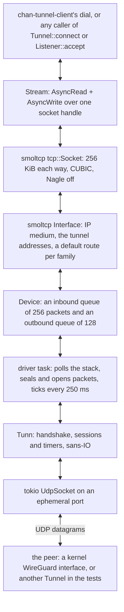

# chan-wireguard design

chan-wireguard is one peer of a WireGuard tunnel and a TCP/IP stack over it, both inside the process. `Tunnel::start` takes a parsed configuration, binds one UDP socket and runs one driver task; `Tunnel::connect` opens a TCP connection to an address inside the peer's AllowedIPs and resolves to a tokio `Stream`. Nothing on the host is created, routed or elevated for it: no interface, no route, no resolver change, no privilege. It exists so that a devserver, and later the desktop, can reach gateway hosts that sit behind an ordinary kernel WireGuard peer from any operating system with no VPN software installed, with the peer pinned by its static key and every byte encrypted before it leaves the process. The `noise` module and the clock derive from Cloudflare's boringtun under BSD-3-Clause (the notice is the crate's `LICENSE`, the `noise` files keep their SPDX headers, and the manifest's license is `Apache-2.0 AND BSD-3-Clause`); the code is owned here rather than tracked as a dependency because the protocol is frozen, Noise_IKpsk2 over Curve25519, ChaCha20-Poly1305 and BLAKE2s with no wire versioning, while the crate API upstream is not.

## Where it sits

The one caller is chan-server's devserver mode. `chan devserver run --tunnel-wireguard FILE` makes the `chan` crate read and parse the wg-quick file (`read_wireguard_config` in `crates/chan/src/devserver/foreground.rs`) into a `DevserverWireguard`; chan-server's `spawn_devserver_tunnel` starts a `Tunnel` from it and wraps the tunnel in `WireguardConnector` (`crates/chan-server/src/wireguard_connector.rs`), its implementation of [chan-tunnel-client](../chan-tunnel-client/design.md)'s `Connector`. The tunnel client then runs its h2 dial through `Tunnel::connect` instead of a TCP connect, and because the connector reports itself protected the tunnel URL may be an `http://` address inside the tunnel. The adapter lives in chan-server, not in chan-tunnel-client, so the gateway workspace builds the client without this crate; the gateway depends on nothing here, since its end of the tunnel is the kernel's WireGuard. `chan` and `chan-server` are the two crates that depend on chan-wireguard; chan-desktop links it only through chan-server and has no code that uses it. The crate depends on tokio, smoltcp and socket2 for the stack, on ring (ChaCha20-Poly1305), x25519-dalek, blake2, hmac and chacha20poly1305 (the XChaCha20 of cookies) for the protocol, on base64 for keys, and on rustix for the clock on Unix. It forbids unsafe code.

Of the operating system the crate takes one UDP socket, bound to an ephemeral port of the endpoint's address family, and the clock. Everything else a VPN client asks the OS for, an interface, addresses, routes, a resolver, a firewall mark, is done inside the stack or not at all.

## The stack

*Bytes written to a stream become TCP segments in smoltcp, IP packets in the device's queue and sealed datagrams on the UDP socket; the reverse path opens, queues and polls them back into a socket buffer.*

The interface, the device, the sockets and the port allocator form `Stack`, held under one `parking_lot::Mutex` in `Shared` beside a `tokio::sync::Notify` kick. The driver loop locks it, polls the interface (which also reaps released sockets and returns smoltcp's next timer), drains the outbound queue, unlocks, seals each packet with `Tunn::encapsulate` and sends it. When the outbound queue filled during the poll the driver yields and polls again, so one poll never takes more than 128 packets of memory and a reader sharing the thread gets its share; otherwise it waits on the first of four events: a datagram, a kick, the 250 ms tick, or smoltcp's timer. A datagram wakes a burst: up to 32 are read with `try_recv_from` before the stack is polled once, so a window of packets costs one poll rather than one each. `Tunn` and the current endpoint sit under a second mutex, held for one call at a time, so `Tunnel::status` never waits for a poll. The kernel is asked for 4 MiB send and receive buffers on the UDP socket, best effort: the defaults (64 KiB on Windows, about 200 KiB on Linux) hold less than one window of sealed packets arriving while the driver is busy. The MTU is the configuration's or 1420, wg-quick's default of 1500 less the IPv4, UDP and WireGuard headers.

Cryptokey routing holds on both sides. `connect` refuses a destination outside AllowedIPs with `NetworkUnreachable` before a byte leaves; a decrypted packet whose source is outside AllowedIPs is dropped whatever it says. The interface holds the tunnel's addresses, each of which must be unicast, in smoltcp's two address slots, and a default route per family through the tunnel's own address: the IP medium never uses a gateway value, but without a default route a socket to a prefix outside the local addresses sends nothing. The crate's own tests build two `Tunnel`s on loopback UDP sockets, each the other's peer at 10.7.0.1 and 10.7.0.2, and run streams through both ends.

## The session

*A new handshake every two minutes while traffic flows, a keepalive when one side goes quiet, and a fresh start after 90 s of unanswered initiations.*

The timers are the whitepaper's, in `noise/timers.rs`: `REKEY_AFTER_TIME` 120 s, `REJECT_AFTER_TIME` 180 s, `REKEY_ATTEMPT_TIME` 90 s, `REKEY_TIMEOUT` 5 s, `KEEPALIVE_TIMEOUT` 10 s. `Tunn::update_timers` is the whole machine; the driver calls it every 250 ms from a tokio interval that delays rather than bunches missed ticks, the rate the core expects. Time comes from the crate's own clock (`clock.rs`): `CLOCK_BOOTTIME` on Linux, so a laptop's sleep counts and a stale session is seen as expired on wake instead of being used until the peer rejects it; the monotonic clock on the other Unixes, which have no portable equivalent through this interface; std's `Instant` on Windows, which already counts sleep.

`Tunn::encapsulate` with no session queues the packet and returns the initiation; while one is in flight further packets queue without a second initiation. A response establishes the session and the initiator answers with an empty data packet, a keepalive, so the responder learns the session works; the driver then drains the queue with empty-datagram `decapsulate` calls, the core's convention for "hand me the next queued packet". The core also answers an initiation from the peer, since a kernel peer rekeys from its side when it has traffic to send; a session the peer made becomes current with the first data packet on it. Eight sessions ring, indexed by the low bits of the session index.

Expiry is the one state the driver acts on. After 90 s of unanswered initiations, or 540 s without any new session, the core reports `ConnectionExpired` and drops its sessions and the queue; the driver, once per expiry, resolves the endpoint name again under a 10 s timeout so a peer that moved in DNS is found, and the next packet from the stack starts a fresh handshake. Nothing above is torn down: TCP connections inside keep retransmitting and resume if the peer comes back.

The endpoint starts as the resolved configuration endpoint and roams: every datagram the core accepts (a handshake message, a data packet, a keepalive) moves it to the datagram's source, as the protocol specifies, so a peer behind a changing NAT mapping is followed. The exception is a cookie reply the core itself sends in answer to a handshake message it has not authenticated yet, when its `RateLimiter` is under load; the driver recognizes that reply by type and length and leaves the endpoint alone. Each `Tunn` carries its own limiter (ten handshake messages a second); it stays because the same code verifies mac1 on every handshake message received, and its cookie half runs only past that rate, which one peer never reaches. On the other side, when the peer answers an initiation with a cookie reply the core keeps the cookie, puts its mac2 on the retry 5 s later, and forgets it after 120 s.

## Streams and backpressure

A `Stream` is a handle to one socket in the shared stack. `poll_read` locks the stack, copies out of the socket's receive buffer, and when nothing is there registers the task's waker with the socket and returns pending; `poll_write` does the same with the transmit buffer. The lock makes the check and the registration one step, so a state change between them cannot be missed, and smoltcp wakes the registered waker when a poll moves the socket. Every successful read or write kicks the driver: a write so the segment leaves now rather than at the next tick, a read because the window grew and the peer may be waiting on it. Backpressure is the socket's own buffers, 256 KiB per direction: a full transmit buffer parks the writer, an empty receive buffer parks the reader. The size lets a connection over a 100 ms WAN path move a few MiB/s, more than the h2 tunnel above needs. Sockets run CUBIC, because without congestion control a socket sends its peer's whole window in one burst, which overran the kernel's UDP buffer even on loopback, and Nagle off, because the h2 frames above are request and response and holding a small frame for a full segment adds a round trip to every one.

`poll_flush` kicks and returns ready: bytes leave at the next poll, and waiting for the peer's acknowledgement would add a round trip per flush that an OS socket's flush does not. `poll_shutdown` closes the socket, so the FIN follows the queued bytes, and returns at once. A peer's FIN reads as 0; a reset after establishment reads as `ConnectionReset`; a write once the peer is gone fails with `BrokenPipe`, and, as in TCP, the first write after a FIN is legal and is sent, and the peer's reset makes the next one fail. Dropping a `Stream` closes the socket, or aborts it with a reset when unread data sits in its receive buffer, as a closed OS socket does, and releases it: the driver removes a released socket once it is closed and its endpoints are cleared (the reset has to leave first), and aborts one that the peer never finishes closing after a 15 s linger, or at once when data arrives for a reader that is gone, so a silent peer cannot pin the socket and its port. Ports are ephemeral, 49152 to 65535 from a random start, counted per socket so a listener's backlog shares one.

`Tunnel::connect` picks the first tunnel address of the destination's family as the local address, opens the socket (SYN-SENT; the kick makes the driver send the SYN) and returns a future that resolves when the socket leaves SYN-SENT: established, or `ConnectionRefused` when a reset closed it. Dropping the future drops the stream inside it, which closes the half-open socket. `Tunnel::listen` opens four listening sockets on the port (`BACKLOG`) so SYNs arriving together each find one instead of a reset; `Listener::accept` hands out an established one and replaces it with a fresh listening socket, and a listening socket reset before it was accepted is listened again.

`Tunnel` handles are clones of one `Arc`. Dropping the last aborts the driver and marks the stack closed, which aborts every socket and wakes every waiter, so each stream operation and every new `connect` fail with `ConnectionAborted` instead of waiting for a poll that never comes. The driver also ends when the UDP socket fails (an ICMP unreachable that surfaces as `ConnectionReset` or `ConnectionRefused` on receive is logged and ignored), and a guard marks the stack closed on that path too.

## Configuration

`Config::parse` reads the wg-quick file format because it is the one `wg genkey`, `wg-quick` and every how-to use: an operator writes the client's file the way they write the server's, and `wg showconf` output parses as is (section and key names matched without regard to case, `#` comments, quoted values). The subset is what an in-process client can honour: `[Interface]` with `PrivateKey`, `Address` (one or more, comma separated, a bare address meaning a host prefix) and an optional `MTU` (576 to 65535); exactly one `[Peer]` with `PublicKey`, an optional `PresharedKey`, `Endpoint` (a name or an address with a port, IPv6 in brackets), `AllowedIPs` and an optional `PersistentKeepalive` (`off` or 0 is none). Keys are base64 as `wg` prints them or 64 hex digits. The settings wg-quick implements by configuring the operating system are refused by name with the reason rather than ignored: `DNS` (the stack has no resolver), `Table` (it installs no routes), `FwMark` (it owns no interface), `PreUp`, `PostUp`, `PreDown` and `PostDown` (hooks run nothing here), `SaveConfig` (the file is never written back) and `ListenPort` (the client binds an ephemeral port and never listens for peers). A file that asks for them is a file written for a different client, and running with part of it ignored would mislead. A second `[Peer]` is refused, since a chan tunnel speaks to exactly one peer, and so is a peer without `Endpoint` or `AllowedIPs`: the client must know whom to dial and what to route.

The private key is held as an x25519-dalek `StaticSecret`, which zeroes itself when dropped. `Config` and `Peer` implement `Debug` by hand so the private key and the preshared key print as redacted and only the public key prints; `ConfigError` names the line and the key, never a value, since a value may be a key; `Config::public_key` gives the operator the key to paste into the peer's configuration, which chan-server logs when the tunnel comes up. `Config` is not `Clone`.

The `chan` crate reads the file at the command line, before anything starts. `read_wireguard_config` reads the file's metadata first and on Unix refuses a file the group or others can read (mode bits `077`), naming the `chmod 600`, as ssh treats a private key; only then does it read and parse the contents, and a refusal names the path and the parser's line and key. `run` reads it; the `--service=chan` daemon child is handed the path on argv and reads it itself; a systemd unit records the path as `--tunnel-wireguard=` in ExecStart (`SystemdTunnel.wireguard`), the install verbs read the file first so a bad one is refused there rather than by a restart loop, and the service reads it at every start. The flag needs a tunnel token, and `--no-tunnel` drops both. The path is not a secret; the contents are.

## Boundaries

- No TUN or TAP, no interface, no routes, no privileges. The TCP connections chan opens through `Tunnel::connect` (and the ones a peer opens to a `Listener`) are the only traffic; nothing else on the host is carried.
- No DNS inside the tunnel. The endpoint name is resolved on the host, at start and after an expiry, and chan-server's connector resolves the tunnel URL's host on the host too; a name that resolves outside AllowedIPs is refused rather than dialed in the clear.
- No routing policy beyond AllowedIPs: inside them, through the tunnel; outside, refused. Which destinations go through a tunnel is the caller's decision.
- One peer per tunnel, and the tunnel is the initiator in practice: it binds an ephemeral port, never a `ListenPort`, though it answers a handshake the peer starts. The responder's cookie reply is kept only because the same code verifies mac1.
- UDP only, with no TCP fallback. A network that blocks UDP leaves the tunnel dark, and the public tunnel ingress stays available for that case; the choice is per devserver.
- IPv4 and IPv6 both inside and outside: the UDP socket's family follows the endpoint, the stack holds at most two tunnel addresses (smoltcp's slot count), one per family in practice, and `connect` needs a tunnel address of the destination's family.
- TCP inside the tunnel has no keepalive and no idle timeout of its own; liveness comes from the layers above, chan-tunnel-client's dial timeout and lease refresh.
- Not a general stack: no UDP, ICMP or raw sockets through the tunnel, no Ethernet, no DHCP. smoltcp is built with exactly the IP medium, both IP protocols, TCP with CUBIC and the async wakers.

## Errors

The public API returns `io::Error` with the kinds a TCP caller already handles. `connect` gives `NetworkUnreachable` for a destination outside AllowedIPs, `AddrNotAvailable` when the tunnel has no address of the destination's family, `AddrInUse` when no ephemeral port is free, `ConnectionRefused` for a reset in SYN-SENT and `ConnectionAborted` once the tunnel is closed; `listen` adds `AddrInUse` for a port in use. Streams read 0 at EOF, `ConnectionReset` after a reset, `BrokenPipe` on a write to a gone peer, and `ConnectionAborted` for everything once the tunnel is closed. `start` surfaces the resolver's error, or `NotFound` when nothing usable resolves; `start_on` gives `InvalidInput` for a socket and an endpoint of different families, a non-unicast tunnel address or a third address. `ConfigError` carries a line number (0 for a whole-file problem) and a message that names the key, never the value. `WireGuardError` is the protocol core's flat enum (an invalid MAC or AEAD tag, a wrong index, a replayed counter, an expired connection, under load, and the rest); it never crosses `Tunnel`'s API, since the driver logs a rejected datagram at trace and acts only on `ConnectionExpired`.

## Open questions

- `connect` to a silent peer never fails on its own: smoltcp retransmits the SYN on a doubling timeout with no retry limit, and the core keeps queueing it and re-initiating; the caller's timeout (chan-tunnel-client's dial timeout) is the only bound. A connect timeout inside the crate would name the cause.
- The endpoint re-resolution after an expiry runs inside the driver loop, under its 10 s timeout; while it runs no datagram is read or sent and the stack is not polled. Running it on its own task would keep the loop moving.
- A received cookie reply resolves as `TunnResult::Done`, the same result as a keepalive, so the driver counts it as authenticated and moves the endpoint to its source. Its key derives from the peer's public key and its associated data is the mac1 on the wire, so anyone who saw the initiation can produce one; moving the endpoint only on a session packet would close that.
- smoltcp runs on one task under one lock. The crate's test moves 1 MiB each way on loopback and nothing has been measured over a real path, so bulk transfer throughput through the tunnel is unknown.
- `Config` is not `Clone`, since it holds the private key, so a caller that retries the endpoint's resolution cannot retry `start`: chan-server resolves and binds itself and calls `start_on`. A `start` that retried resolution inside the crate would remove that duplication.
