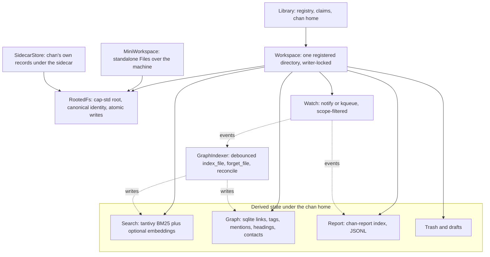
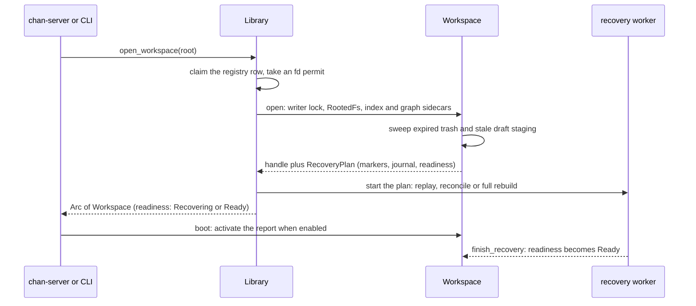
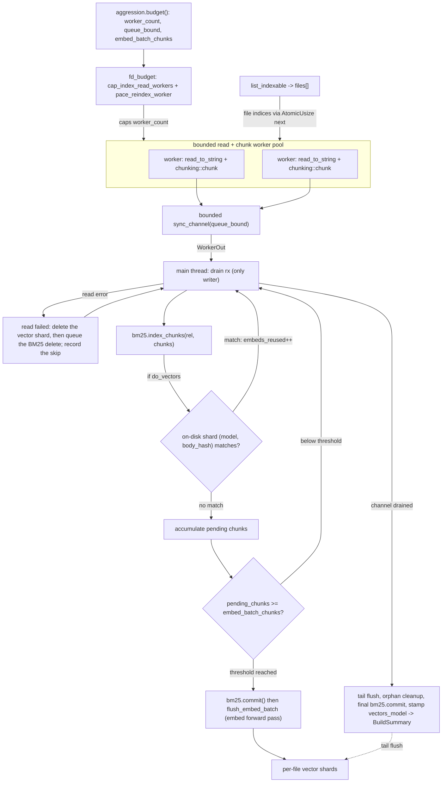
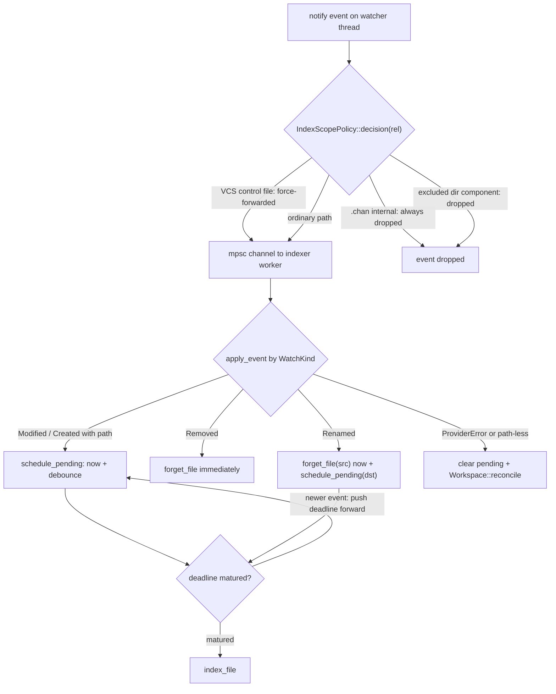
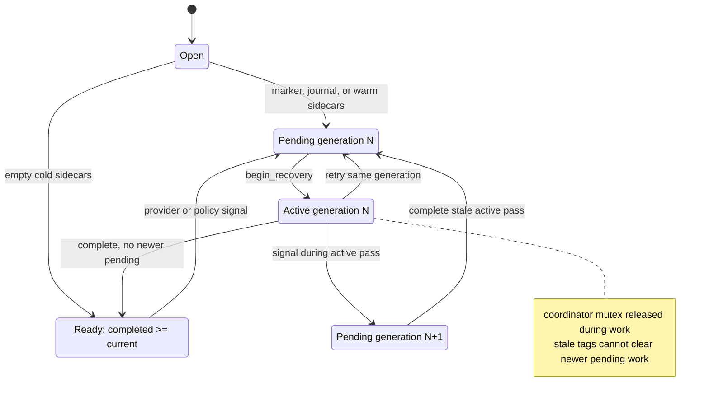

# chan-workspace design

`chan-workspace` is the core of chan's workspace layer: a sandboxed filesystem over a directory, the per-machine registry of workspaces, and the state chan derives from a workspace (search index, link graph, code report, trash, drafts, session blobs) kept under the chan home. Everything above it, the library, the server, the CLI, the desktop app and the MCP tool sandbox, reaches user content through this crate and nothing else. It knows nothing of HTTP or any frontend, and its API is synchronous, so each embedder drives it from threads it owns.

## What it is and where it sits

chan turns any directory into a workspace. The directory stays the user's: chan writes nothing inside it except the files the user edits and requires no manifest, hidden directory or layout. Everything chan computes about the directory lives under the chan home, keyed by the workspace, and is regenerable from the directory's content.

The crate sits at the bottom of the stack. `chan-library` composes workspaces and terminals into a host, `chan-server` wraps a workspace in routes, and `chan`, `chan-desktop` and `chan-llm` drive the same handles. `chan-report`, the per-file language and line counter the report subsystem wraps, is the one crate below it. The dependency direction is a hard line: nothing library-shaped (windows, sessions, tenants) belongs here, and nothing here reimplements what a consumer owns.

In scope: filesystem primitives rooted at a directory; the registry and the machine-wide indexing policy in the chan home's `config.toml`; the per-workspace index, graph, report, trash, drafts and session blobs; the watcher and a built-in graph indexer; the writer lock; and the smaller services the CLI and server need (metadata archives, contact import, a bootstrap snapshot, VCS detection). Out of scope: HTTP and the frontend (`chan-server`), agents and MCP (`chan-llm`), editor preferences, authentication and multi-user state (the gateway), and cross-workspace linking. A workspace is one directory; nothing here reaches across two.

## Architecture



*Three public facades share one crate-private capability core; only `Workspace` carries derived state and the writer lock.*

`Library` is the per-machine handle an app constructs at startup and keeps alive; it owns the registry and the chan home and opens workspaces. `Workspace` is one registered directory, shared as `Arc<Workspace>`, holding the writer lock for its lifetime. `MiniWorkspace` and `SidecarStore` are the other two faces of the same core.

## The facades and the capability core

Every user-path operation runs inside `RootedFs`, a crate-private value holding the root, its canonical form and identity, a cap-std `Dir` handle opened at the root, and the byte ceiling for opaque writes. cap-std opens each component beneath the handle and refuses to leave it, so a symlink swapped in between validation and open cannot escape. The sandbox check, the regular-file gate, the atomic writer, the bounded reader and the rename and copy primitives are implemented once, here.

`Workspace` is the facade for a registered directory. It adds the registry row and metadata key, the writer lock, the index, the graph, the report, the trash, drafts, sessions and the watcher; its remove is a soft delete, its rename rewrites Markdown links, and its writes feed the index and the graph.

`MiniWorkspace` is the metadata-free facade behind the standalone Files window, the terminal window with no workspace behind it. It opens a capability root (normally the machine's own root) with a protected start directory, registers nothing, takes no lock, starts no indexer and opens no graph. Because it serves the whole machine its dialect is stricter: paths are UTF-8, POSIX-relative and never absolute; the root and the start directory cannot be deleted or moved; deletion reaches only regular files and empty directories; symlinks are inert everywhere, listed but refused by every read, write, copy, move and delete; and moves and copies never clobber. A write through it is an external write to any `Workspace` covering the same file.

`SidecarStore` is the same core opened at one directory of a workspace's sidecar, for records chan keeps about the workspace rather than in it (chan-server's editor recovery records). A record gets the same bounded reader and atomic writer as a user file and cannot leave the store, without passing through the facade that serves the user's tree.

The invariant the facades exist for: no code in chan touches user content with `std::fs` directly; it goes through a facade, and the tenant a window was built with decides which facade it gets, never the caller. One core under all three means a guard added to the core cannot be missing from any of them.

## Paths, the sandbox and file classes

The API speaks one path form: workspace-rooted, POSIX, no leading slash, no `..`. The same spelling keys the graph, the index, the report, the watcher's events and the MCP tools, so a name found by one subsystem is found by every other. Markdown bodies keep hrefs in the form the renderer expects; the normalizer in "Link resolution" bridges the two and the on-disk text is never rewritten.

Resolution is lexical first (`..`, absolute paths and Windows prefixes are rejected), then canonical: the deepest existing ancestor must still resolve under the canonical root, which catches a mid-path symlink pointing outside. Three rules keep the layer from hanging on, following or mutating a non-regular file:

- A symlink as the final component is refused by every content read and write: an atomic rename would replace the link with a file and break the user's alias, and a read would traverse off the root.
- FIFOs, sockets and devices are refused by an `lstat`-based gate, never `stat`, so a target cannot hide behind a link; opening a FIFO blocks and opening a device never returns.
- Walks never follow symlinks and stay on the root's filesystem, so loops cannot occur and a workspace spanning onto a network mount does not drag the indexer into it.

Every file has one class from `fs_ops::classify`, a pure function of the path that consumers switch on instead of re-deriving extension rules:

| Class        | Members                           | Treatment                |
|--------------|-----------------------------------|--------------------------|
| EditableText | .md, .txt                         | text I/O, indexed, graph |
| Text         | source, config, script, basenames | text I/O, not indexed    |
| Image        | png jpg gif webp svg avif bmp     | bytes; embeds link to it |
| Pdf          | .pdf                              | bytes; dedicated viewer  |
| Other        | everything else                   | bytes; listed, trashable |

Two gates sit on this axis. The editor gate decides what `read_text` and `write_text` accept: EditableText and Text by extension, plus a content sniff of the first bytes for paths the classifier does not know, which lets the editor open `.zshrc` or a `Kconfig`; the classifier stays I/O-free so index walks never pay the sniff. The indexer gate is narrower: only EditableText is indexed and parsed, because `#include` in a source file read as a `#tag` would pollute the graph, and within it `#tag` and `@@mention` extraction is Markdown-only. Byte reads and writes route around both gates.

## Writes

Every write chan makes, to user content and to its own records, is atomic: bytes go to a reserved same-directory temporary named `.chan-write-...`, the file is synced, renamed into place, and the directory synced. The writer preserves the target's mode and extended attributes and never touches the published target after the rename; scoped walks and the watcher exclude the reserved names, so a crash leaves at most a stray temporary, never a half-written note.

`write_atomic_stream` is the canonical progressive path and the other write methods delegate to it: the caller feeds chunks into a sink that enforces the budget and validates UTF-8 as it goes, and the workspace commits only after the feed returns cleanly; any error, cancellation or panic drops the temporary and leaves the target as it was.

Two budgets bound a write. New editable text is capped at `TEXT_WRITE_LIMIT` (2 MiB): notes are human-authored, and anything larger is a bug, a mislabelled binary or a runaway tool. Opaque bytes are bounded by the transfer ceiling in the registry's `[transfer]` table, captured once when the `Library` opens and reported to clients as one value. Both apply the same rule to a file already over budget: the budget rises to its existing size, so a large file stays editable without being allowed to grow.

The editor's optimistic concurrency is `read_text_with_stat` and `write_text_if_unchanged`. The token is the nanosecond mtime; because a timestamp does not advance on every write, the save may also carry a hash of the text the writer loaded, compared with the file's current bytes before writing. A mismatch answers `WriteConflict` and the editor offers reload, merge or overwrite. Plain `write_text` remains for the crate's own helpers, imports and tool calls where last write wins is the intent.

Reads are bounded the same way: a bounded read freezes its byte window from the open handle's stat and streams chunks on the caller's thread, so growth after open is excluded and a shrink mid-stream is an error rather than a short success. Renames and copies refuse an occupied destination and a destination inside the source, and commit with a rename that itself refuses an existing entry, so a file created after the check is kept and answered as a conflict; renaming EditableText rewrites the links in other notes that point at the old path. `remove` is a soft delete into the trash, so recursive directory removal is allowed: the restore path is the guard against an accidental recursive delete.

## State placement

The chan home is `~/.chan`, or the directory `CHAN_HOME` names in its place; when no home directory resolves, a fallback chain that cannot fail picks a per-user directory and logs the choice. Everything per workspace lives under `workspaces/<metadata_key>/`:

```text
~/.chan/
  config.toml                 registry, index_excluded_dirs, [transfer]
  workspaces/<metadata_key>/
    index/                    tantivy segments, index config, embeddings/ shards
    graph/graph.sqlite        the link graph
    graph/                    rebuild.inprogress, pending_writes.json, rename log
    report/report.jsonl       the code report
    dashboard.toml            per-workspace toggles: semantic, reports, screensaver
    sessions/                 opaque host blobs (window and session state)
    editor-sessions/          chan-server's editor recovery records (SidecarStore)
    Drafts/  drafts-trash/  drafts-staging/
    trash/                    soft-deleted files
    locks/                    the writer lock and its holder record
    tokens/                   chan-server's bearer token (allocated here, not read)
```

The metadata key is a readable slug of the canonical root plus the first eight hex digits of the sha256 of that path. It is assigned at first registration and preserved by `Library::move_workspace`, so moving a directory is a registry-only change and every sidecar follows with no file motion. Registering the same path again is idempotent, and a path forgotten and registered again derives the same key, which is why unregistering wipes the sidecar.

`reset_workspace` wipes the regenerable state (index, graph, sessions, tokens, report) and keeps the row, the trash, drafts and recovery records; `ResetMode::Everything` and `unregister_workspace` also drop the row and remove drafts and recovery records. The trash is user data, owned by the user even after the workspace is forgotten, so no reset touches it, and `sweep_orphans` reclaims unregistered sidecar keys only when they hold no recovery records or drafts. The embedding model is not workspace state: it lives in a per-machine cache under the OS cache directory.

## The registry, the library and claims

`Library::open` reads the default registry under the chan home; `Library::open_at` takes an explicit config path and places sidecars beside it, so an explicitly located library never falls back to the ambient home. Each row stores the canonical root, the metadata key, an optional display name and timestamps, and one directory has one row.

A `Library` keeps an in-process ledger of exclusive claims and shared uses on rows, so a registration, open, move, reset or unregister in one process cannot race another on the same workspace; a conflict answers `WorkspaceAlreadyOpen`. The ledger is never persisted; the cross-process guard is the writer lock. The registry mutex is never held across a filesystem call on a workspace root, so a hung network root cannot block the registry for every other workspace. Opening a workspace also takes a process-wide file-descriptor permit, answering `WorkspaceFdPressure` at capacity: the crate runs inside the editor process, where a low `nofile` limit plus a sqlite pool and tantivy's fan-out can exhaust the table on a large workspace, and the same budget paces the index workers.

## The writer lock

One process holds a workspace's writer lock for the lifetime of its `Workspace`. It is a file-based advisory lock (`flock` on Unix, `LockFileEx` on Windows) under the sidecar's `locks/`, with a JSON holder record (pid, canonical root, start time) beside it. The record lets a contender tell a live holder, which it refuses, from a stale record a dead process left, which it steals, and lets `chan close` find the process serving a path; an admission lock serializes acquiring, publishing and stealing so two contenders cannot both create a writer. A second opener is refused at once with `WorkspaceLocked`; nothing blocks on a holder, and the desktop hands a `chan serve` to the running host instead of racing it. `probe_foreign_holder` is the read-side probe for status surfaces, answering present, absent or unknown, because a probe can fail to establish anything.

The lock is released last in teardown, after the index, the graph and the recovery worker are gone, so an open admitted for a root never meets the previous handle's index writer. Every lock the crate holds, tantivy's included, is released by an explicit unlock rather than by closing the file, because a descriptor inherited by a child process would otherwise keep the lock held until the child execs.

Reads take no cross-process lock: tantivy is multi-reader safe and sqlite in WAL mode serves readers beside the writer. Inside the process the graph writer sits behind a mutex, graph reads come from a pool, and one `write_serial` mutex is the boundary for every mutation of derived state; filesystem reads and bounded streams never take it.

## Opening a workspace



*An open returns a usable handle at once; derived state catches up on its own worker and `readiness()` says when it has.*

The index and graph sidecars open during construction so readiness can be classified without visiting the tree. The plan is metadata-only: a stale rebuild marker, or a populated graph beside an empty index, schedules a full rebuild; a pending journal schedules replay; a warm populated pair schedules reconcile; an empty cold pair skips the tree. The report stays lazy until `boot()`.

## Root availability

A root is in one of three states, and the difference is load-bearing. Healthy is the ordinary case. Gone (`WorkspaceRootMissing`) is terminal: the directory was deleted or replaced by something that is not the same directory, and the user clears it by turning the workspace off and on. Unreachable (`RootUnavailable`) is a transport failure: a network filesystem whose client stalled, died or was remounted answers `ENOTCONN`, `ESTALE` or `EIO`, not `ENOENT`, which says nothing about whether the content still exists. Folding that into "gone" would tell an editor its file was deleted when the file is fine and the mount is not, so callers hold their state and retry.

`ensure_root_available` checks the live path, because the capability handle stays usable after its directory is removed and a host about to publish a tenant cannot infer availability from the handle alone. `revalidate_root` adopts a remount in place: a dead FUSE connection answers `ENOTCONN` forever on the retained descriptor even after a fresh mount appears at the path, and reopening is refused because this process still holds the writer lock. A remount is adopted only when the root resolves to the same path with the same inode on a new device; a different directory stays gone. chan-library's health probe drives it, so a workspace recovers without a restart.

## The watcher

`Workspace::watch` returns an owned `WatchHandle` over a supervised watcher. The consumer implements `WatchCallback`, a `Send + Sync` trait object called from the watcher's threads; events are owned, serializable values a consumer can forward across a socket unchanged. The handle reports health (starting, healthy, degraded, stopped), retries a partial registration with growing spacing, and reclaims its thread synchronously on stop or drop.

Registration follows the scope policy. On Linux and FreeBSD the supervisor walks the tree itself, never registers an excluded subtree, and picks up directories created later; on macOS and Windows each root takes one native recursive watch and dispatch mutes excluded paths. FreeBSD runs chan's own kqueue backend because kqueue holds a descriptor per watched path and notify's backend re-adds directories recursively past any policy; chan's holds descriptors against a process-wide budget and polls files that do not fit.

Dispatch applies the active policy with two deviations: `.chan` and VCS internals are never configurable, and `.git/HEAD`, `.git/index` and `.hg/dirstate` are forwarded although their directories are pruned, because the indexer keys checkout-storm detection off them. Every event carries the policy generation sampled at dispatch, so a consumer can discard work tagged with a replaced policy. A `ProviderError`, or an event whose path maps into no root, means the stream is no longer trustworthy and the consumer reconciles. When the report is active, events fan into its index before the user's callback runs.

The standalone Files window serves the whole machine from `/`, where a recursive watch is unacceptable; its per-directory watch lives in chan-server, scoped to live subscriptions, and is the one watcher outside this crate.

## The scope policy

`IndexScopePolicy` is one immutable value per policy generation, sampled by every walk the crate makes: bootstrap, filtered listings, the graph and index builds, reconcile, the report and watch registration. It encodes hard exclusions (`.chan`, VCS internals, the reserved atomic-write names), gitignore exclusions, and configured exclusions: the registry's `index_excluded_dirs` unioned with the workspace's own additions, matched by directory basename at any depth. Changing the setting swaps a new policy and requests a reconcile. The raw `list` and `list_tree` stay unfiltered, so a user can open a file inside `node_modules` on purpose.

## The search index

tantivy backs BM25 over per-heading chunks (`Headings` is the default chunking, one chunk per ATX section; `WholeDoc` and `Fixed` are the alternatives). Each chunk stores its path for delete-by-path and its body so snippets need no second read of the source. The index config persists the schema version, the embedding model id, the chunking strategy, the workspace's excluded directories and the model that produced the vectors on disk. Toggles that are not search cache (`semantic_enabled`, off by default; `reports_enabled`, on by default; the screensaver) live in `dashboard.toml`, so a reindex or a vector wipe cannot reset them.

With the `embeddings` feature (on by default) the index also keeps per-chunk dense vectors from candle running BGE-small, one shard per file. `SearchMode` is `Bm25`, `Semantic` or `Hybrid`; hybrid runs both and fuses with reciprocal-rank fusion. Hybrid is effective only when the workspace opts in and the configured model resolves from the per-machine cache; otherwise the query degrades to BM25 and the result says so, which a `--no-default-features` build always reports. Embedding runs on the CPU by default because the Metal backend exhausts GPU memory on large workspaces; `CHAN_ENABLE_GPU=1` opts into the accelerator at runtime.

A full build fans reads and chunking across a bounded worker pool and funnels chunks to the single main-thread writer:



*`build_all` reads in parallel but writes from one thread, commits BM25 per embed flush, and skips the embed pass for files whose shard already matches.*

`SearchAggression` (conservative, balanced, aggressive) sizes the worker count, the queue and the embed batch, and cores are held back so the server's runtime and the UI thread keep breathing during a reindex. One writer thread keeps tantivy contention and embed ordering simple, and each flush commits BM25 before the forward pass so the vector count, the progress events and the BM25-to-hybrid upgrade advance in visible steps during a long cold build. Embedding dominates the cost of a rebuild, so it is checkpointed per file: a shard carries a hash of its chunk bodies, and a rebuild skips the embed pass when the shard's model and hash match a fresh re-chunk, since identical chunks under one model produce identical vectors.

`Workspace::workspace_search` is the unified retrieval contract the transports share: one owned request combining optional content retrieval, lexical matching of files, directories, tags, mentions, contacts and languages, exact typed selectors, and bounded breadth-first traversal of the graph, with normalization and hard caps applied once here. It never initializes a cold report or triggers a rebuild, and during recovery it returns an explicit not-ready envelope rather than partial rows.

## The graph

sqlite (rusqlite, bundled) backs the graph. `nodes` are Markdown documents and contacts keyed by path, with title, basename, stat stamp, and a contact's emails and aliases; `edges` are `(src, dst, kind, anchor)` with kind `Link`, `Mention` or `Tag`, the anchor in the primary key so one file can link the same target through two anchors; `headings` are the in-file anchors; `text_files` stamps non-Markdown text for reconciliation without making it a node. A tag is an edge destination, never a node. Directories and the report's languages are not stored: the workspace search joins them in memory from the tree walk and the report.

One writer connection sits behind a mutex and reads come from a pool of WAL readers, so the per-keystroke `[[` typeahead never waits on a reindex write. A full rebuild stages each file into `staging_*` tables, each file its own committed transaction, and swaps staging into the live tables in one transaction; readers see the old graph until that commit, and a crash mid-rebuild resumes from the staging cursor.

`replace_file` writes a file's node, outgoing edges and headings; `forget_file` removes them. Neither touches the edges other files own into a removed path: those describe the linking file's body, which still carries the link, so backlinks keep naming the notes that point at a removed or renamed path and the links are in place when the path returns.

### Link resolution

Two path forms coexist on purpose. The API speaks workspace-rooted paths; a Markdown body keeps hrefs in the form the renderer expects, which for GitHub-style Markdown is relative to the file containing the link, so the note keeps rendering outside chan. `markdown::normalize_href(href, source_dir)` is the bridge, applied before an edge is written:

1. A fragment-only `#anchor` is intra-document and yields no edge.
2. A URL scheme (a `:` ahead of any `/`, `#` or `?`) is external and yields no edge.
3. A trailing `?query` and `#anchor` are stripped; the anchor is kept on the edge's own column.
4. An href starting with `/` is workspace-rooted; otherwise it is joined to the source file's directory.
5. `.` and `..` collapse lexically; a `..` past the root yields no edge.

Wiki links keep the picker's convention: `[[Contacts/Jane]]` and `[[/Contacts/Jane]]` are workspace-rooted, and a target starting with `./` or `..` opts into source-relative resolution. The same normalizer is hand-ported to TypeScript for the editor's click handler, so on-disk edges and in-editor navigation agree on every target.

### Link autocomplete and contacts

`link_targets` backs the `[[` typeahead from the graph alone: an empty query returns the most recently edited files, and a non-empty query ranks in four tiers (basename prefix, basename substring, title substring, heading substring), with heading hits capped at half the limit so one heading-heavy file cannot drown the file matches.

A contact is any Markdown file whose frontmatter carries `chan: { kind: contact }`, wherever it sits; `Contacts/` is only the importer's default destination. The graph stamps such a node `Contact` and keeps its emails and aliases as columns, so the `@` picker and the `@@alias` mention resolver query sqlite instead of re-parsing frontmatter. The importer (Google Contacts CSV) writes one note per contact through the ordinary write path, with the contact data in the body so an editor that shows frontmatter still shows a note; imported notes are user-owned the moment they land, and re-import skips or overwrites, never merges.

## The built-in graph indexer

`start_graph_indexer` returns a `GraphIndexer` owning a watcher subscription and one worker thread. chan-server runs its own indexer over the same watcher; this one serves the CLI and tests.



*Edits debounce per path on the trailing edge; deletions flush at once; a loss of the event stream reconciles.*

Removals and the source side of a rename skip the debounce because a stale graph row pointing at a missing file is the user-visible failure. A rename reported with a single path (as FSEvents does) is checked on disk first: a file is scheduled like a create, a directory asks for a reconcile because the files under it raise no events of their own. The worker is the only thread touching the graph and the index.

## Recovery of derived state

The graph and the index are two stores with no shared transaction, so the crate keeps them convergent with a journal, a marker and a diff pass, all under `write_serial`:

- `pending_writes.json` records each per-file operation before either store is touched and clears it after both commit; a crash between the two leaves the entry, and `replay_pending_writes` re-runs it against current disk truth on the next open.
- `rebuild.inprogress` is written before a full rebuild and removed after the index commits; its presence at open means the two stores may disagree, so the open seeds a full rebuild while `needs_rebuild` keeps readiness truthful.
- `reconcile` walks the live tree, compares each indexable file's `(mtime, size)` against its graph stamp, indexes only the deltas and forgets rows whose paths are confirmed gone or excluded. It is the convergence path for a cold open after offline edits, for watcher overflow, and after a replay. `index_file` stats before it reads, so a concurrent writer leaves the stamp older than the content and the next reconcile catches it; the opposite order would stamp new metadata onto old content and the drift would persist until a full reindex.

A small coordinator tracks this work as generations. `request_recovery` coalesces repeated signals into one pending pass and upgrades the action by dominance (`FullRebuild` over `Reconcile` over `Replay`); a signal during an active pass creates exactly one newer pending generation, so completing stale work cannot clear it. `begin_recovery` and `finish_recovery` bracket a pass, and `readiness()` projects the snapshot as `Ready` or `Recovering` for every consumer. A host may install a `RecoveryDriver` to claim passes itself, as chan-server does; otherwise the workspace's startup worker runs the open plan.



*Durable markers seed recovery, monotonic generations keep a stale completion from hiding newer work, and coalescing bounds repeated provider loss to one follow-up pass.*

Progress is the push side of the same story: long operations (reindex, rename with link rewrite, contact import, reset, model load) report through one `ProgressCallback` with a stage, counts, an optional label and an advisory ETA. Events are best-effort hints fired on the producer's thread; the on-disk state and `recovery_status()` are the authority.

## Drafts

Scratch work (the editor's new untitled document) lives outside the user root under the sidecar's `Drafts/<name>/`, one directory per draft so pasted images stay beside the primary file, with discards in a flat `drafts-trash/` and drafts in flight under `drafts-staging/`. Nothing enters the user's directory until promotion, so drafts do not travel through git or a sync client. An older `.Drafts/` inside a user root is ordinary content.

The `drafts` module is a path-parameterized primitive layer with no root of its own. `DraftStore` supplies the root: the embedder's state directory for the standalone Files window (only the embedder knows whether that is the desktop's chan home or a devserver's state directory), the metadata-key sidecar for a workspace. The store owns lifecycle only; promotion targets are resolved by `Workspace` or `MiniWorkspace`, never by the store, so the path guards stay in the facades instead of growing a third copy. A workspace draft's content is served through a draft-only capability root with a per-draft lifetime marker, so a reset or discard retires the identity and a stale writer cannot reach the directory through a cached handle. A draft is built in staging and published into `Drafts/` by one rename that refuses an existing name, so readers that list `Drafts/` without a lock see a draft complete or not at all.

## The trash

`remove` is reversible until the user purges or the retention window elapses. An entry is a directory under the sidecar's `trash/` holding the moved payload and a metadata file written last, so a half-written entry has no metadata and the next sweep reclaims it as junk. On the same filesystem the move is one rename; across filesystems it is copy then remove, with the metadata written between the two so a failure leaves a complete entry plus a partial source rather than data loss. Restore refuses to clobber a live entry with `TrashOccupied`.

Retention is 30 days and collection is lazy: workspace open and every trash call sweep expired entries, with no background thread, matching the crate's synchronous rule. A trash root holds entry directories only, since anything else inside a swept root would be reclaimed as junk. The one entry the sweep must keep is marked: when a move already took the content out of the workspace and neither the metadata write nor moving it back succeeded, the payload is the only copy, and a `recover-me.txt` beside it names the original path for manual recovery.

## The report

The code report wraps `chan-report`'s incremental index. chan-workspace owns the persisted JSONL and the load-else-rescan open (any load failure falls back to a full scan that replaces the file), a writer thread that debounces flushes and writes the JSONL atomically, and the watcher fan-in that keeps the index current per file. The walk applies the index's scope policy, so a source tree does not roll up its dependency directories. The subsystem is opt-in per workspace and activated by `boot()`. A persisted report owes a rescan on the next recovery pass after an open or a watcher loss, because the incremental index cannot tell which rows the lost events touched.

## Smaller components

- Bootstrap snapshot: `bootstrap()` is a stat-only, scope-filtered walk returning the tree shape, counts and sizes, so the file browser and graph render before any index exists; deeper levels load lazily per directory.
- Session blobs: `put_session` and friends store opaque host JSON under `sessions/` by flat key with atomic writes; the schema is the host's.
- Metadata archive: export and import of the `index`, `graph`, `report` and `sessions` subtrees as a zstd tar with a versioned manifest, so caches move between machines without re-deriving; drafts, recovery records, locks, tokens and trash are excluded. The graph is snapshotted through `VACUUM INTO` and the index from one published commit, with the journal and rebuild marker captured between the two, so an imported workspace whose index lags its graph replays or rebuilds on open. Entry paths and sizes are bounded on import.
- Teams config: a schema-only module so the server and the CLI serialize team files identically; no team behaviour lives here.
- VCS detection: a pure stat walk that tells `chan serve` when a path sits inside a git, Mercurial or Subversion checkout and would be better served at the repository root. It never runs a VCS binary and stops at a mount boundary, at `$HOME` and at the filesystem root.

## Schema versioning

- Graph: `PRAGMA user_version`, with idempotent migrations applied on every open; each wraps its schema change and the version bump in one transaction so a crash mid-migration re-runs cleanly, and an older binary skips unknown higher versions.
- Search: the index config's schema version is persisted with the model id and chunking strategy; a mismatch wipes the index and rebuilds on the next open. A configured model that differs from the model stamped on the vectors wipes only the vectors, since BM25 is model-independent.
- Vector shards: each shard carries its own format version; a mismatch skips that shard alone, leaving BM25 and the healthy shards available, so a shard-format bump never invalidates the whole index.
- Report: `chan-report`'s schema version is checked on load; a mismatch discards the cache and rescans.

A bump in any store destroys only chan-managed cache. The user's files are never touched.

## Error model

The three facades return one umbrella `ChanError`, so a caller matches a single enum, and its payloads are strings, paths and integers: a dependency error converted into it keeps only its display text, which keeps the public type free of dependency types. Lower-level modules (`index`, `metadata_archive`) keep their own error types, and `IndexError` converts into `ChanError`. Foreign I/O errors preserve the not-found kind as `NotFound`, so the server maps it to a 404 without parsing platform text.

The variants group as sandbox and gate refusals (`PathEscape`, `SymlinkEscape`, `SpecialFile`, `NotEditableText`); registry and lock state (`WorkspaceLocked`, `WorkspaceAlreadyOpen`, `WorkspaceFdPressure`); root availability (`WorkspaceRootMissing`, `RootUnavailable`); write outcomes (`WriteConflict`, `PathAlreadyExists`, `WriteTooLarge`); budgets (`ListingTooLarge`, `ArchiveLimit`); trash and draft state; streamed request bodies that ended or stalled before a write was made (`IncompleteBody`, `BodyStalled`), which are the client's failure rather than the workspace's; subsystem errors carrying display text (`Search`, `Graph`, `Watch`, `Report`, `Io`); and `Cancelled`.

## API shape

The interface is synchronous: no public `async fn` and no runtime dependency, so a caller without a runtime calls it directly and an async caller offloads to a blocking thread. `Library` is a cheap clone, `Workspace` is shared as `Arc<Workspace>`, and watch and progress events arrive through callback traits as owned, serializable values rather than streams or channels, so a consumer can forward them across a WebSocket without an intermediate type. The CLI, the server and the desktop link the same crate and share its atomic-write, sandbox and blob semantics instead of reimplementing them.
