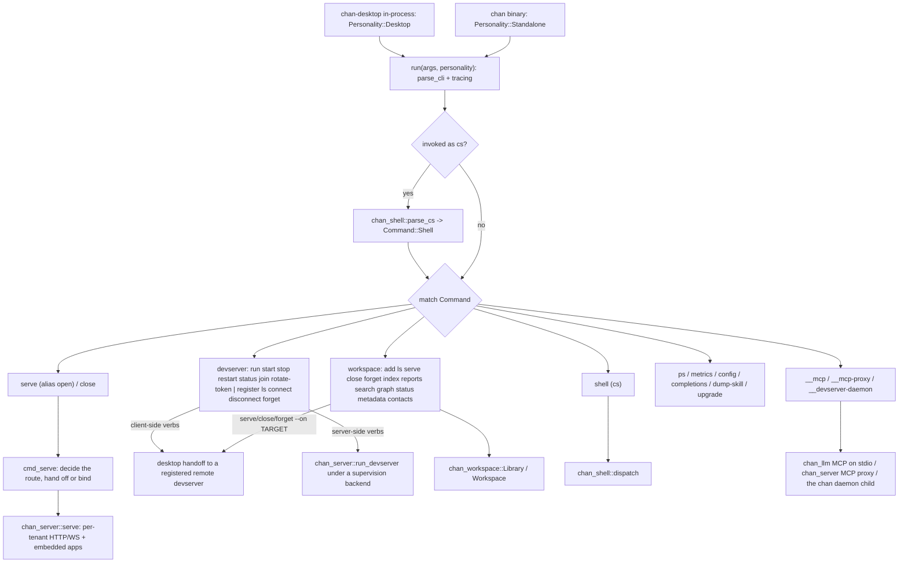
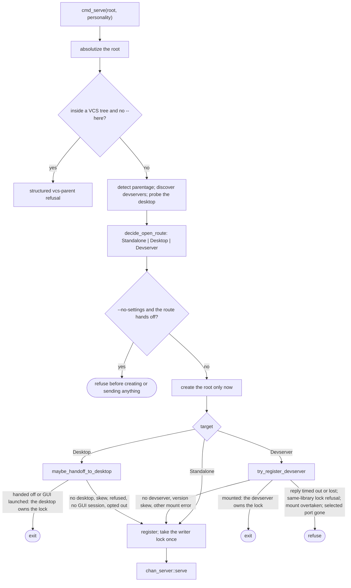
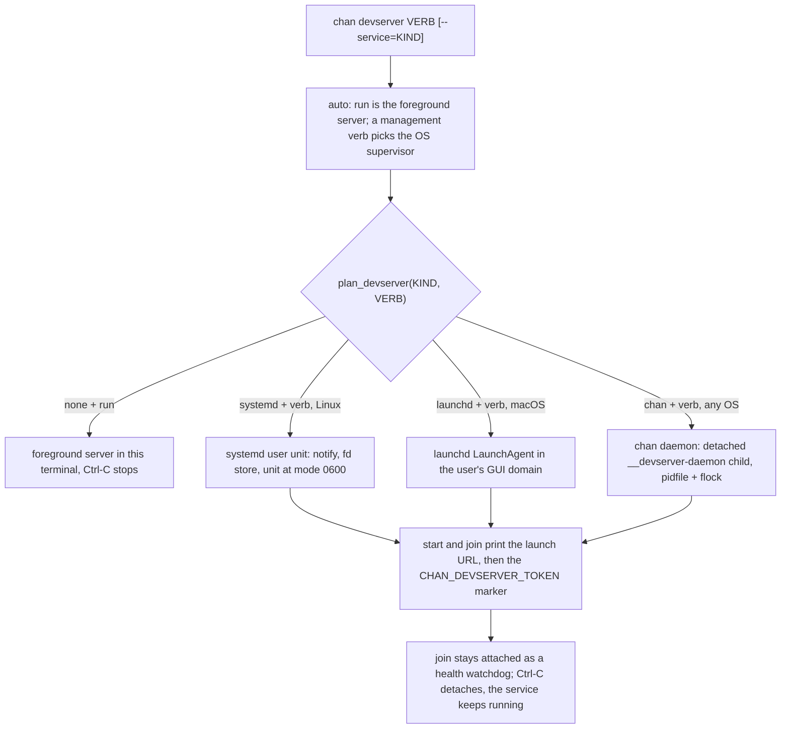

# chan design

`chan` is the binary crate at the top of the Cargo workspace: the command line of the product. It parses arguments, sets up tracing, dispatches one subcommand and exits, except for the two subcommands that become a resident server, `chan serve` and `chan devserver`. It owns almost no domain logic of its own. Every registry mutation and workspace-content operation goes through `chan_workspace::Library` and `Workspace`; every HTTP, WebSocket and embedded-app concern goes through `chan-server`; MCP goes through `chan-llm`; the `cs` control client is `chan-shell`. This crate is the thin seam that wires those libraries to a command line and to a process lifecycle.

The help text in `src/help.rs` and the clap doc comments in `src/cli.rs` are the authoritative reference for every command, flag and example, and `chan dump-skill` renders the agent manual from the same text. This document stays at the level of the dispatch model, the handoff order, the supervision backends and the decisions behind them.

## Scope

In scope:

- The clap surface: `Cli`, `Command`, the per-noun sub-enums and the help text.
- One async entry point, `run(args, Personality)`, dispatched in-process by both the standalone `chan` binary and chan-desktop.
- The per-subcommand handlers, one module each: orchestration that resolves a workspace, calls a library and prints a result.
- Mounting `chan-server` for a standalone `chan serve PATH` and for the headless `chan devserver`.
- The devserver supervision backends (systemd, launchd, chan's own daemon) and the token they hand to a connecting client.
- Self-upgrade: the startup banner and probe, and `chan upgrade`.

Out of scope, owned by the libraries this crate drives: the filesystem sandbox, registry, search, graph and watcher ([chan-workspace](../chan-workspace/design.md)); routes, the embedded web apps, the in-process MCP host, the devserver builder and the handoff transports to the desktop and to a devserver ([chan-server](../chan-server/design.md)); MCP tool schemas and the stdio server ([chan-llm](../chan-llm/design.md)); the `cs` actions and the control-socket client ([chan-shell](../chan-shell/design.md)); the native window, the webview and the desktop updater ([chan-desktop](../../desktop/design.md)).

## Where it sits

Two binaries drive the same CLI. The standalone `chan` binary (`src/main.rs`) is a shim that builds the tokio runtime and calls `chan::run` with `Personality::Standalone`. chan-desktop links the `chan` library and calls `run` with `Personality::Desktop` when it is invoked through a `chan` name, which is how a desktop install is also the CLI. The whole command surface lives in the library so the two front ends cannot drift.

The standalone shim makes three choices at the process edge, each for a reason. It runs the CLI on a thread with an explicit 8 MiB stack, because the main thread's stack is the linker's choice and the debug-profile future of `run` does not fit the 1 MB Windows default. It builds one multi-threaded runtime with a small worker ceiling and a declared blocking-thread ceiling, because chan is a loopback single-user server whose heavy work (index walks, file transfers) runs on the blocking pool, and more async workers only make a thread dump unreadable. On exit it calls `shutdown_background()` so an uncancellable reindex in `chan-workspace` cannot hold the process after Ctrl-C. The runtime is built outside `run` because `run` is async and a runtime cannot be built from inside one.

## Dispatch

*Every front end reaches one `run`; each subcommand is orchestration over a library.*

The top-level surface is deliberately narrow. The noun families `chan workspace` and `chan devserver` are the structural layer. Exactly two family verbs carry elevated top-level spellings, `serve` (with `open` as a visible alias) and `close`, each a flattened args struct shared with its family form so the two spellings cannot drift, and a test pins the elevation list so it does not grow by habit. `chan close --forget` dispatches to the same teardown-then-drop handler as `chan workspace forget`. Every noun family turns on `infer_subcommands`, so an unambiguous prefix resolves iproute2 style (`chan de status`, `chan w ls`), the same grammar `cs` speaks.

`cs` is the same binary under another name. `parse_cli` reads the invocation name (`argv[0]`, or the `$ARGV0` a Windows shim passes) and, when its stem is `cs`, parses the argv with chan-shell's own `cs` parser and dispatches it as `Command::Shell`; `chan shell <action>` and `cs <action>` are one command with one help rendering.

The families:

- `serve PATH` registers a workspace and serves it, or hands it to a running desktop or devserver (next section). `--on TARGET` instead mounts the path on a registered remote devserver through the desktop handoff. A URL-shaped argument is refused with a pointer at `chan devserver register`, because reading it as a relative directory would serve nothing.
- `close PATH` stops serving; `--forget` and `chan workspace forget` also drop the registration and chan's metadata for it, never the files. Both take `--on TARGET` for a workspace mounted on a remote devserver.
- `devserver` is one noun with two faces, told apart by argument shape. The server-side verbs manage this machine's devserver, a per-chan-home singleton, so they take no target. The client-side verbs manage chan-desktop's registry of remote devservers over the CLI-to-desktop handoff socket, so each needs a URL or label and a running desktop.
- `workspace` holds the registry and content operations, every one routed through `chan_workspace` so the sandbox, atomic writes, special-file refusal and the cross-process writer lock apply uniformly.
- `shell` is the `cs` surface, dispatched to `chan_shell::dispatch`. `ps`, `metrics`, `config`, `completions` and `dump-skill` are the served-workspace listing, the serving process's own readings (below), the preferences that live outside any workspace, shell completions, and the agent manual. `upgrade` is self-upgrade, forked by `Personality`.
- Three hidden commands exist only to be spawned by chan itself. `__mcp` runs chan-llm's MCP server on stdio against a registered workspace. `__mcp-proxy` bridges an agent's stdio to the MCP server a running `chan serve` hosts in-process, so an agent child reaches the live workspace without reopening it and deadlocking on the writer lock. `__devserver-daemon` is the child of the `chan` supervision backend.

Each handler opens a `Library`, resolves a `Workspace` when it needs one, calls into the owning library and prints text or `--json`. Handlers do not re-implement library invariants; they depend on them. `metrics` is the exception: it opens no `Library` and reads a running server over HTTP.

### Who serves a workspace

`chan ps`, `chan workspace status`, `chan close` and `chan workspace forget` all need to know which process holds a workspace, and they read the same two facts. The writer lock's record names the holder's pid, and a control socket of that pid, found in the validated runtime directory, answers an `Identify` with its serving kind: standalone, desktop or devserver. A window-spawned server's sockets carry the pid in their name; a devserver's are stable-named so that `$CHAN_CONTROL_SOCKET` survives its restarts, so each candidate is asked who it is with a bounded round trip. A lock whose state cannot be determined is reported as such rather than guessed free or held.

`chan close` sends the `Close` request over that socket and the server decides the scope: a standalone serve exits, a desktop or devserver unmounts just that tenant. A host that would end live terminals refuses, and the refusal carries the count. Under the desktop personality the close goes through the desktop's own handoff socket first, because the embedded host's control socket closes the window but never updates the desktop's runtime map. A desktop that does not serve the workspace answers so, distinctly from a close, and the CLI goes on to the writer lock's holder as it does with no desktop running, since a standalone serve may hold it. A close is reported done only once the writer lock is free: a lock still held at the bound after the desktop or the holder accepted the close is a failure that names the holder's pid. A host still releasing an earlier close answers so, and the CLI reports that as a temporary failure distinct from a refusal, leaving the registry as the host holds it. A forget whose holder has let go drops the registry row and the metadata directory; a held lock keeps everything intact.

### Local devserver HTTP

The CLI's local devserver requests use `http_client::local_devserver`: workspace activity for `chan ps` and `chan workspace status`, terminal drain, token rotation, daemon readiness, the health watchdog and local metrics. Proxy lookup is disabled even when environment or system proxy settings include loopback; otherwise a local bearer would go to the proxy. Redirects are disabled so the request stays at the selected listener, and each caller supplies a timeout. `http_client::explicit_url` keeps proxy lookup for `chan metrics --url`, with the same redirect policy, and verifies a TLS server with [chan-tls](../chan-tls/design.md)'s trust decision, since the URL can name a remote devserver behind a gateway. Self-upgrade has its own remote client in `update.rs` and keeps the user's proxy settings. A source guard restricts raw reqwest client construction to those two modules.

Authenticated local calls share `local_listener::resolve`: the preferred address is the one the launchd plist pins on macOS or the systemd unit pins elsewhere, else the last recorded port on loopback; the terminal drain takes the address selected by its supervisor. Wildcard binds are dialed on loopback. On Linux the resolver reads `/proc/net/tcp` and `/proc/net/tcp6` and requires every socket that could accept the connection to belong to the caller's effective uid. When the preferred address has no listener of the caller's, it tries the recorded port when different, under the same check. Neither a foreign listener nor an unreadable table receives a bearer. With no eligible listener, metrics and drain report the refusal; activity prints one diagnostic and leaves its columns empty. Token rotation rewrites only the persisted file when no candidate has any listener, but leaves the file unchanged on foreign ownership or unreadable tables. macOS, FreeBSD and Windows send to the first candidate unverified. Tokenless readiness and join/watchdog probes watch the address selected by their own backend or live daemon record, without a global-address fallback.

### metrics

`chan metrics` is a reader, not a collector. It reads `GET /api/metrics` from a chan server and prints the view as text or JSON, and `--watch` repeats the read about once a second, with a complete first output and, in each later one, only the samples newer than the last one sent. Collection belongs to the serving process (see [chan-server](../chan-server/design.md)), and [docs/metrics.md](../../docs/metrics.md) is the reference for the readings and the flags. The command never starts a server.

With `--url` the target is whatever server the URL names, read with `--token`, else `CHAN_METRICS_TOKEN`, else the URL's own `?t=`, and through the user's proxy settings, which a remote server may need. Without it the read uses this chan home's devserver bearer and the shared local address resolver and HTTP policy above, including Linux listener ownership checks and the recorded-port fallback.

`chan metrics --varlink` is the same reader behind the Varlink interface `io.chan.Metrics` (`metrics/varlink.rs`, built on Unix), for a systemd socket unit that hands it one connected client on stdin and stdout. It resolves the address and the bearer afresh on every read, never starts the devserver, and answers `io.chan.Metrics.Unavailable` when a read fails. How a client leaves is not a failure of the adapter: a closed connection, sixty seconds with no call, and ten seconds without reading a reply each end the process with status 0, and only a frame that breaks the protocol, or an I/O error that is not the client leaving, ends it with an error. The plain command treats its own reader the same way: a closed pipe ends the output with status 0, while a failed read ends `--watch` with the error.

### dump-skill

`chan dump-skill` renders the agent-facing manual live from the two clap trees, so every byte it emits is reachable from some `--help` and the manual cannot drift from the commands. The default output is an installable topic index; a topic over the output budget is served as numbered parts that concatenate byte for byte to the whole page. The budget exists because an agent reads the manual through a tool call of bounded size; `--full` is the one unbounded export. `cs dump-skill` is the same renderer, passed into chan-shell as a function so the manual stays with the crate that owns the help text.

## chan serve: one writer per workspace

A workspace has exactly one writer-lock holder, and `chan serve` has to cooperate with whatever may already own that lock on the machine: chan-desktop, or a devserver. `cmd_serve` therefore does more than bind a socket. It decides one route first, and every handoff path returns early, so only the standalone tail ever takes the lock.

*One route is settled before any side effect; the standalone tail is the only path that takes the lock.*

The order of operations:

1. **Absolutize and gate.** The root is made absolute against the CLI's cwd, because the desktop handoff runs with cwd `/` and the registry is keyed by canonical path. Unless `--here` is given, a root inside a Git, Mercurial or Subversion working tree is refused with a structured marker line on stderr that a wrapping shell parses to offer the repository root instead; the repository root is almost always the better workspace boundary for links, the graph and search.
2. **Decide the route.** `decide_open_route` is a pure function over the explicit target flags (`--standalone`, `--desktop`, `--devserver`), the parentage of the shell (which chan instance spawned it, read by an `Identify` on `$CHAN_CONTROL_SOCKET`), the binary's personality, and a snapshot of live instances. An explicit flag wins. A devserver parent registers with that devserver, which beats a forced-desktop variable leaked into the shell; a desktop parent hands off. With no parent, a sole live kind wins; with both live, the desktop personality keeps its desktop and the standalone personality prefers the devserver; with neither, the desktop personality launches the GUI and the standalone personality serves itself. `--devserver` from inside a devserver shell is refused, because a devserver nested in a devserver is not a shape the registry models. Every probe lives in the caller, so the decision table is unit-tested without a desktop or a devserver.
3. **Select the devserver.** With several devservers live, the shell's parent pid is a stronger signal than the CLI's library root, which is stronger than candidate order. A parent that is not among the candidates refuses rather than adopting the only one visible, and an explicit `--devserver=PORT` must name exactly one.
4. **Create the root only now.** A refused route leaves no empty directory behind.
5. **Desktop handoff.** A same-user chan-desktop in a GUI session is asked to open the workspace in a native window and the CLI exits; the desktop owns the lock. Only a forced-desktop invocation (the desktop personality, or the Windows console `chan.exe` carrying `CHAN_DESKTOP_HANDOFF=1`) launches the GUI when none is running, and only on Unix, because only its own executable is the desktop. No desktop, a desktop of another version, a refusal, no GUI session, or the `CHAN_NO_DESKTOP_HANDOFF` opt-out fall through to the standalone tail.
6. **Devserver registration.** The selected devserver is asked to mount the workspace; if it does, the CLI prints a note and exits, leaving one lock owner. This path runs for the standalone binary too and needs no GUI, because devservers are exactly where SSH-only machines live; `CHAN_NO_DEVSERVER_HANDOFF` opts out. Version skew, a definite mount error and no devserver fall back to standalone. Four outcomes refuse instead: a sent request whose reply timed out or never arrived, because the mount may still complete and a standalone open would race it; a lock refusal from a devserver of this same library, because a standalone open would meet the same lock; a mount that a later request in the devserver overtook, because the directory was just turned off or forgotten there; and an explicitly selected devserver that is no longer live.
7. **Standalone serve.** The CLI registers the workspace, takes the writer lock once and calls `chan_server::serve`. The update banner and probe fire here. A non-loopback bind prints a plaintext-exposure warning, because there is no TLS and only a bearer token. `--no-settings` is enforced only by a server this command binds, so a route that would hand the workspace to a desktop or a devserver is refused under it before anything is created or sent.

`chan serve` and `chan devserver` share one default port, single-sourced so the two cannot drift. A bind collision on it is recognized and turned into a hint that names the user's own devserver on that port, or says that none of theirs was found, instead of a bare "address in use".

## The Personality split

`Personality` exists because the same CLI runs from two binaries that must differ in exactly two places, and threading one enum is cheaper and clearer than two code paths or a build flag. `Standalone` is the `chan` binary from the install scripts, and its `cs` alias; `Desktop` is chan-desktop dispatching `chan` in-process through its shim.

- `chan serve`: `Standalone` serves itself or registers with a local devserver and never launches a desktop; `Desktop` hands the workspace to the running desktop or launches it.
- `chan upgrade`: `Standalone` replaces its own archive in place; `Desktop` drives the desktop's `tauri-plugin-updater`, since a desktop install is not a loose binary it may overwrite. The Windows NSIS install's console `chan.exe` is the standalone binary marked with `CHAN_DESKTOP_HANDOFF=1`, so it follows the desktop arm for both verbs; Windows publishes no CLI tarball for it to replace.

Everywhere else the two personalities run identical code. Keeping the fork down to one threaded value is why the desktop shares the entire subcommand surface without forking the dispatcher.

## The devserver verbs and supervision

`chan devserver` runs the headless multi-workspace server that `chan_server::run_devserver` builds. The server-side verbs take one `--service` backend, and a pure plan validates the `(backend, verb)` pair before any service manager is touched.

*`--service=auto` is the default: a bare `run` is the plain foreground server on every host, and a management verb resolves to the OS supervisor.*

- `none` is the foreground server; `run` is its only form and it takes no management verb.
- `systemd` installs a user unit on Linux and is what `auto` picks there. The unit is `Type=notify` with an fd store, so a plain `restart` keeps every live PTY: the masters and scrollback are parked in the store and picked up by the new process. `restart --force` is the destructive form; it drains every terminal through the management API first and falls back to stop-then-start, so a wedged devserver restarts without resurrecting its terminals. `stop` also disables the unit, and linger is enabled so the service outlives the login session. Tunnel mode is supported here because the unit is written at mode 0600 and carries the token in its environment; a flagless `restart` reads the token, the endpoint and the address pins back out of the installed unit, so the service comes back as the registration it went down as, and `--no-tunnel` is the deliberate way back to a local devserver.
- `launchd` installs a LaunchAgent in the user's GUI domain on macOS and is what `auto` picks there. Tunnel mode is refused under it, because the plist would persist the token world-readable.
- `chan` is chan's own daemon: the portable backend where no OS supervisor exists, chosen by `auto` on Windows and FreeBSD, and an explicit choice everywhere. It spawns a detached `__devserver-daemon` child with stdout and stderr redirected to the devserver log under the chan home, and guards it with a single-instance pidfile and flock (`chan-workspace`'s `daemon_lock`). `stop`, `restart` and `status` corroborate the recorded pid against the lock's owner before signalling, so a recycled pid is never signalled: on Linux the kernel's lock table is the witness, elsewhere lock contention plus process identity.

Under `auto`, an OS that resolves to no supervisor, or a Linux host without a running systemd, fails with a message pointing at `--service=chan`. Explicit `systemd` and `launchd` each require a management verb and refuse off their OS.

### The token contract

A devserver listens on loopback behind a persisted bearer token, and the point of supervision is to hand that token to whoever connects. Every backend's `start` and `join`, and `rotate-token`, print the same block on stdout: the launch URL when the bound address is known, then the `CHAN_DEVSERVER_TOKEN=` marker line last. The token is read from the persisted config under the chan home, stored at mode 0600 and polled briefly after a start, and never from the unit's journal, which a user may not be able to read. The desktop's control terminal scrapes the last marker to authenticate; the line above it is for a person to open in a browser. The foreground `run` prints the marker itself. An active service whose token cannot be surfaced is reported as a failure, because a devserver nobody can reach is worse than a loud one.

`join` is the form connect scripts use. It starts the service if it is down, prints the token, then stays attached as a health watchdog (the backend's own liveness probe plus the health endpoint) until Ctrl-C, or until a non-terminal stdin reaches EOF, and detaches without stopping the service. The watchdog tolerates a restart bounce and, for the `chan` backend, re-pins to a restarted daemon on the same address.

`rotate-token` reaches the running devserver's management API so the old token stops authorizing at once, or rewrites the persisted config when no server answers.

### Tunnel mode

`--tunnel-url` with a personal access token, preferably from the environment so the secret stays out of `ps`, puts the devserver in tunnel mode: it dials the gateway and publishes every mounted workspace behind one registration, named by `--tunnel-devserver-name` or the hostname. In tunnel mode the loopback listener is off by default, since the gateway is the surface, except under systemd notify, where it stays on so a restart can reach the local management API; `CHAN_DEVSERVER_LISTEN` overrides either way.

`--tunnel-wireguard` names a wg-quick file and the dial to the tunnel URL then runs through an in-process WireGuard tunnel (`chan-wireguard`), so the URL may be an `http://` address inside the tunnel and the ingress needs no public name or certificate. The CLI reads the file before anything starts and refuses one it cannot parse, naming the path and the line but never a value, or one the group or others can read, since it holds the tunnel's private key; a daemon child and a systemd unit carry only the path, which is not a secret, and read the file themselves. The flag needs a token and `--no-tunnel` drops it with the rest.

## Self-upgrade

The upgrade path keeps the running CLI current without a package manager. It has three pieces, all pointed at the maintainer's release metadata in production builds; a compile-time seam exists only for the native Windows installer smoke.

- **Banner.** `chan serve` prints a one-line stderr notice from a cached state file when a newer release is known. No network access, so an air-gapped host pays nothing.
- **Probe.** A detached task on `chan serve` fetches the latest release metadata with short timeouts, refreshes the cache and prints the banner inline when the fetched version is newer. It runs at most once a day across restarts, and failures are swallowed at debug level. `CHAN_UPDATE_CHECK=0` disables it.
- **`chan upgrade`.** Resolves the running binary through `current_exe`, reads the metadata (latest, or a pinned `--version`), downloads the archive for the current target into a sibling temp file while hashing it, verifies the SHA-256 against the metadata, extracts only the `chan` binary beside the executable, and installs it. Unix renames the staged binary over the running one atomically. Windows cannot rename over a mapped executable, so it renames the old image aside, installs the staged one, rolls back if that fails, and schedules the old image for deletion after exit. The download is size-capped and honours the standard proxy variables, and a binary directory that is not writable is refused before anything is downloaded.

A build a package manager owns (the distro packages export a build-time marker) refuses `chan upgrade` and names the package manager's own command, and its banner and probe stay silent, because the check cannot name an update that build could install. The refusal is decided before the personality, so neither install path can skip it.

On the desktop route, `chan upgrade` asks the running desktop over the handoff socket to check for or start its updater, and launches the desktop first when none is running. `--check` does not launch one, since opening a window to answer a question is not what a check means.
