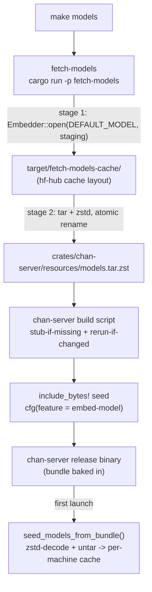

# fetch-models design

`fetch-models` is a build-only helper binary, never part of the runtime. It downloads chan's default embedding model once and packs it into the tarball that a release build of chan-server bakes into the binary, so a shipped chan is search-ready at first launch with no download. It exists as its own crate so that a contributor's plain `cargo build` never pays for that model.

## What it is and where it sits

Two crates bracket it. `chan-workspace`, its only real dependency, supplies the embedder and the `DEFAULT_MODEL` constant: fetch-models downloads through the same `Embedder::open` the runtime uses, so the staged bytes land in exactly the hf-hub cache layout the runtime later resolves, and the model id has one definition. `chan-server` consumes the artifact: its build script tracks the tarball, and its embed seeder bakes the bytes in with `include_bytes!` under the `embed-model` feature. fetch-models writes the file; chan-server decides whether to embed it.

The helper runs only when something names it: `make models` (which `make build-release` runs first) or `cargo run -p fetch-models`.

## Why it exists

Hybrid search runs dense vectors from BGE-small. chan-workspace loads the model from a per-machine cache; populating that cache is an explicit `chan workspace index download-model`, on the order of 130 MB. A release should not stall on that at first run, which argues for baking the bytes into the binary. Baking unconditionally would punish every contributor: a plain `cargo build` would pull the download and the dev binary would roughly triple for a capability most local builds never exercise.

fetch-models resolves the tension with two independent off switches. The download lives in a crate outside the default build graph, and the embed is a cargo feature that is off by default. A contributor who never asks for the model never pays for it, in download bytes, build time or binary size; a release build asks for both.

## Pipeline

*The top of the spine is build time and runs once per release; the last edge is runtime and runs once per machine. fetch-models owns only the first two arrows.*

Stage one downloads through the runtime embedder into a stable staging directory under the repository's `target/`. hf-hub populates it on a cold run and skips the network when it is populated; `cargo clean` wipes it and the next run downloads again. Reusing the embedder rather than a hand-rolled fetch is what guarantees the staged layout is the one the seeder validates.

Stage two encodes the staging tree as a tar stream through a zstd encoder at a high compression level, the point past which more ratio costs far more encode time for a one-shot blob of this size. The walk drops hf-hub's lock and bookkeeping files and the `blobs/` subtree: tar follows the snapshot symlinks into the same bytes, so keeping both would double the archive. The output is written to a sibling temporary, both archive layers are finished, the file is synced and closed, and only then renamed into place; a failure removes the temporary, so an incomplete bundle can never pass for a finished one.

Between the stages sits an mtime gate: when the bundle exists, is non-empty and is newer than every file the encoder would include, the slow re-encode is skipped and the run is a no-op. The gate applies the encoder's own skip filter, so a freshly arrived lock file or blob does not force a rebuild. Forcing one is a matter of deleting the bundle. The helper honours `HTTPS_PROXY` and `HTTP_PROXY` through hf-hub's HTTP client and logs which is in effect with any credentials redacted.

## The handshake into chan-server

The artifact crosses into chan-server at two seams, both gated by `embed-model`, which implies `embeddings` because bundling a model is meaningless without the code to use it.

At compile time, chan-server's build script makes the embed correct rather than performing it. When the feature is on and the bundle is absent, it writes an empty stub so the build compiles without a prior `make models`; the seeder treats an empty bundle as "no embedded model", so the stub is a valid, inert placeholder. It then pins the link step to the bundle's mtime so a later `make models` forces a relink instead of silently shipping a stale bundle. With the feature off, the whole seeder module compiles out and the bytes never enter the binary.

At runtime, `seed_models_from_bundle` runs once on server launch. It decodes and untars the bundle into the per-machine model cache unless the default model is already laid out there, checked against the snapshot files the embedder will load rather than "any file exists". An empty bundle, a corrupt archive or an extraction error never blocks startup: the server falls back to the same not-downloaded state a dev build starts in, BM25-only search until an explicit `chan workspace index download-model`.

## Why a separate crate

A build script runs on every `cargo build` of its package, so folding the fetch into chan-server's build script would drag the download into every contributor's first compile and every CI job, the exact cost the design exists to avoid. A standalone binary crate runs only when invoked. The embed is a separate feature for the same reason: even with the bundle present on disk, the dev binary should not carry it. The crate boundary and the feature flag are the two switches that together hold the lean-dev invariant.
