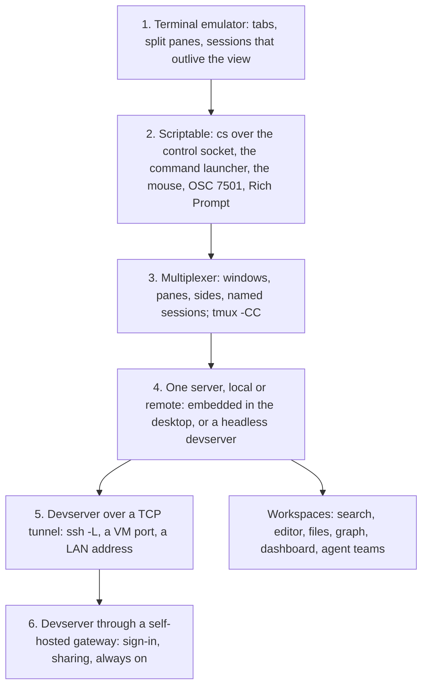
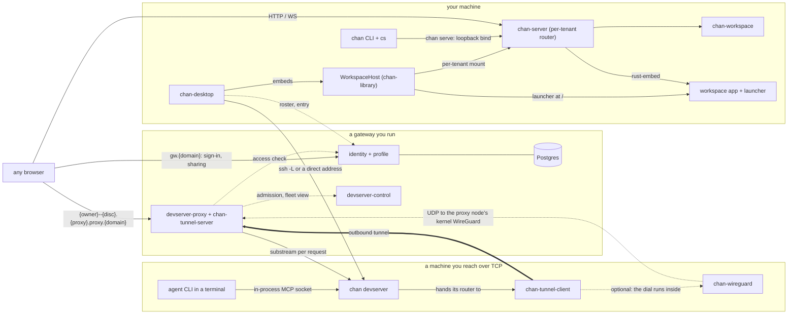
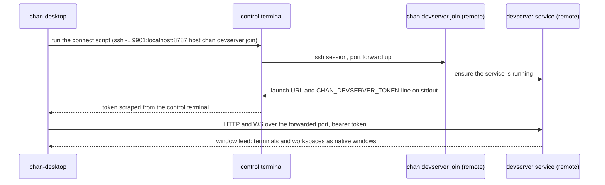

# chan design

chan is a supercharged terminal emulator. This is the whole-system reference: what the product is, which components build it, the shapes it runs in, and the invariants that hold across all of them. It stays above the level of routes, flags and timeouts; those live in the code and in each crate's own design document, indexed in the root [README.md](README.md).

## What chan is

The product reads as layers. Each one builds on the previous, and the same binary carries all of them.

1. **A terminal emulator.** Terminals open in tabs and split panes inside windows. The terminal core is Ghostty's libghostty-vt compiled to WebAssembly and drawn by ghostty-web's renderer, whose sources chan carries as the workspace package `@chan/ghostty-web-ng`, with xterm.js as the fallback backend. The session behind a terminal, its program and its scrollback, lives in the server process rather than in the view, so a window can reload, close, or attach from another machine and the shell keeps running.
2. **Scriptable, from the shell, the keyboard and the mouse.** Every chan terminal carries a control socket and the `cs` command, so a shell can drive the window that spawned it: open a file, split a pane, start a named terminal, type into another tab and read its scrollback, raise a survey, put bytes on the viewer's clipboard, upload and download files, export a document to PDF. The same actions sit behind the command launcher and configurable shortcuts for the keyboard, and behind pane menus, tab drag and drop and context menus for the mouse. Programs report back through the terminal too: the Program Status Protocol (OSC 7501) marks a tab as working, done or blocked, and the Rich Prompt composes Markdown and images into a program's input.
3. **A multiplexer of its own, and tmux.** chan's multiplexer is windows, panes with two sides, tabs, and named sessions that outlive their views and are listed, grouped and addressed by name. It also speaks tmux control mode: a `tmux -CC` run in a chan terminal, locally or through ssh, turns that tmux server's windows and panes into chan windows and panes, with tmux keeping the geometry.
4. **Local and remote, the same.** The process that owns terminals and workspaces is a server with an HTTP and WebSocket API. The desktop app embeds it for local work; `chan devserver` runs it headless on another machine. Browsers and desktop windows attach to either, and several viewers can share one session.
5. **A devserver over a TCP tunnel.** A devserver binds loopback by default and is reached over whatever TCP path already exists: an `ssh -L` port forward, a VM's or container's published port, a LAN address. The desktop stores the address and a connect script, runs the script in a control terminal, and opens the devserver's terminals and workspaces as native windows. Disconnecting leaves everything running there.
6. **A devserver through a gateway.** For an always-on, team-wide setup, a devserver dials out to a chan gateway with a personal access token, and the gateway publishes it at an origin of its own behind sign-in, to the owner and to the accounts the owner shares it with, from any browser or desktop. The gateway is a set of services you deploy on your own infrastructure. Nothing about chan is an online service, and chan itself is free and open source under the Apache 2.0 license.

Around the terminal, chan turns any directory into a workspace: content search, a Markdown editor with diagrams, slide decks and PDF export, a file browser with transfers, a graph of the project's links, tags, mentions and code, a dashboard, and teams of coding agents provisioned into named tabs. A workspace is commonly a git repository. A terminal window with no workspace behind it still browses and edits the machine's own filesystem and has a Dashboard with Metrics and About.

## Components

One repository builds everything: a Cargo workspace for the binaries and libraries, a separate Cargo workspace for the gateway, and an npm workspace for the web apps.

| Component | Role |
|---|---|
| `chan-workspace` | The core: a sandboxed filesystem facade, the workspace registry, the search index, the link graph, the watcher, and the per-workspace state under the chan home. |
| `chan-report` | Per-file language and line counts with COCOMO roll-ups, maintained incrementally and fed into the core. |
| `chan-metrics` | Fixed-cardinality process counters and metered I/O shared by serving and transport code. |
| `chan-library` | The host: workspace tenants and the shared terminal tenant under one server, the window registry, terminal sessions and their scrollback, and tmux connections. |
| `chan-server` | The serving layer: per-tenant HTTP and WebSocket routes, the embedded web apps, the control socket `cs` speaks, the MCP bridge, the devserver and its supervision. |
| `chan-shell` | `cs`: the control-socket wire contract and the client, shared by `chan` and the desktop. |
| `chan-llm` | The MCP server that exposes a workspace's files and search to agent CLIs. |
| `chan-tmux` | The tmux control-mode protocol: framing, notifications, commands and layouts, with no I/O. |
| `chan-systemd` | The systemd boundary: readiness and watchdog notifications, the fd store, unit rendering. |
| `chan-tunnel-proto`, `chan-tunnel-client`, `chan-tunnel-server` | The gateway tunnel: the wire contract, the dial side the devserver embeds, and the terminating side the gateway embeds. |
| `chan-wireguard` | The in-process WireGuard peer and TCP/IP stack the devserver's tunnel dial runs through when a wg-quick file is given, with no interface or privilege on the host. |
| `chan-revtunnel` | Reverse port forwarding from a devserver to the connected desktop (`cs tunnel`). |
| `chan-tls` | The one TLS trust decision of the Rust clients that reach a gateway: the platform verifier on macOS and Windows, the system bundle beside the bundled WebPKI roots elsewhere. |
| `chan` | The CLI binary: argument parsing, `chan serve`, the devserver verbs, workspace management, self-upgrade. |
| `desktop` | chan-desktop, the Tauri shell: native windows, the launcher, devserver and gateway connections. The same binary is the CLI when invoked as `chan` or `cs`. |
| `web/packages/workspace-app` | The workspace SPA: terminal, editor, file browser, graph, dashboard, search, settings. |
| `web/packages/launcher` | The launcher SPA: the Computers screen that lists machines, workspaces and windows. |
| `web/packages/marketing` | The chan.app site and the user manual. |
| `gateway` | The gateway services: identity, profile, devserver-control, devserver-proxy, and the admin CLI. |

The dependency direction is the point of the split. `chan-workspace` knows nothing of HTTP; `chan-library` composes workspaces and terminals without a frontend; `chan-server` wraps a tenant in routes and the embedded bundle; `chan` and `chan-desktop` drive the stack. The gateway consumes the core only through the tunnel protocol, so the single-binary build never links Postgres or OAuth.

## Runtime shapes

### Local

chan-desktop embeds a `WorkspaceHost` and serves every local workspace from one loopback listener, each tenant under a path prefix keyed to its directory, each window a native webview opened on a tokened URL. The launcher is a second webview toggled over the content of any window, not a window of its own. Without the desktop, `chan serve PATH` serves one workspace to a browser on loopback behind a per-workspace bearer token. When a desktop or a devserver of the same user is already running, `chan serve` hands the workspace to it and exits instead of binding a second server, so a workspace has exactly one serving process.

### A devserver over a TCP tunnel

`chan devserver start` installs the devserver as a user service, systemd on Linux, launchd on macOS, chan's own daemon elsewhere, listening on loopback with a persisted bearer token. It hosts a library of workspaces and standalone terminals and keeps them running whether or not anyone is connected. The desktop's Computers screen stores a devserver as an address plus a connect script. Connecting runs the script in a control terminal (`ssh -L`, `limactl shell`, `wsl`, or nothing for a LAN address), reads the token the supervisor prints, and from then on the devserver's windows appear beside the local ones. Under systemd, a restart of the devserver keeps every terminal alive: PTYs and scrollback are parked in the fd store and picked up by the new process. Reverse port forwarding (`cs tunnel`) rides the same connection, so a port on the devserver can be reached from the desktop machine without a second ssh session.

*Connecting to a devserver: the connect script runs in a control terminal, the join supervisor prints the token, and the desktop attaches over the forwarded port.*

### A devserver through a gateway

With `--tunnel-url` and a personal access token, the devserver dials out to a gateway and holds one long-lived connection. The gateway validates the token, admits the registration, and publishes the devserver at an origin of its own, `{owner}--{disc}.{proxy}.proxy.{domain}`, where the launcher and every workspace tenant are served exactly as they are locally. Browsers sign in at the gateway's identity origin; the desktop signs in once per gateway and lists the account's own and shared devservers on the Computers screen. A share grants a whole devserver. The devserver machine needs no inbound port, no DNS and no TLS of its own; the gateway terminates TLS and fronts the tunnel. The devserver's tunnel dial, the desktop's HTTP clients, WebSocket feeds and updater, and the gateway's WireGuard agent verify the gateway with one trust decision, built in `chan-tls` ([crates/chan-tls/design.md](crates/chan-tls/design.md)): the operating system's verifier on macOS and Windows, and on Linux the system's CA bundle beside the bundled Mozilla roots, so a gateway behind a private CA verifies once that CA is in the machine's store. The gateway is self-hosted: its services ship as Debian packages and container images, and the maintainer's deployment at chan.app is an experimental instance of the same code with sign-in off by default, not a hosted product. The system design is [gateway/design.md](gateway/design.md).

The desktop and devserver can reach a gateway through an in-process WireGuard tunnel. Endpoint resolution runs in the background and is refreshed before handshake attempts; neither starting the tunnel nor binding the desktop's proxy waits for DNS. The desktop stores enrolled gateway tunnel parameters separately from one owner-only private-key file, builds one tunnel per enrolled ingress in memory with the shared client key and address set, and retains the active tunnels and their connection state for the launcher. Each ingress routes its own host names. Connect discovery reconciles the public parameters and atomically updates the routes without a new sign-in or a private-key write, retaining unchanged tunnels. Hand-written WireGuard files retain their single-tunnel meaning. The tunnel's resolver and retry contract is in [crates/chan-wireguard/design.md](crates/chan-wireguard/design.md), and the desktop routing and startup contract is in [desktop/design.md](desktop/design.md#the-wireguard-fabric).

## The terminal

A terminal session is a PTY the library spawns, or a tmux pane it mirrors, registered under the tenant that owns it, named, grouped and listed. The session keeps its own scrollback ring in the server, so attaching a view replays what was missed, and several views can be attached at once with the visible ones deciding the size. `cs terminal` creates, lists, writes into, restarts, closes and reads sessions by name or group; writes are queued and delivered when the target is idle, with a submit chord chosen per agent so a message to a coding agent becomes one turn.

The library also owns an ordinary PTY's transient program reading: an OSC 0/2 title and the local foreground command name, with the shell included and Windows limited to titles. A tenant-owned sampler covers quiet sessions; the title expires on observed foreground or command changes, subject to the attribution limits of a byte stream with no writer identity. The server sends the retained pair in the terminal socket's session snapshot and coalesces changed pairs into generation-tagged `program` frames, including a clear before exit. The reading is independent of terminal names, rename acknowledgements, tmux names and OSC 7501 records, and is neither persisted nor reconstructed from replay. The sources, cadence and attribution contract are in [chan-library's design](crates/chan-library/design.md#terminal-sessions).

Programs speak to the tab through the Program Status Protocol (OSC 7501): one record per reported id, with working, done, blocked and error states, shown as marks on the tab and readable from `cs terminal list`. The Rich Prompt is a Markdown editor over the terminal for prompts longer than a line, with pasted images carried as attachments and queued like any other write. `cs copy` and `cs paste` reach the clipboard of the machine viewing the window, and `cs upload` and `cs download` move files between the viewer's machine and the terminal's host, wherever each is.

tmux control mode is off by default. Once enabled, a `tmux -CC` marker from a tmux run directly in the terminal is accepted at once; one printed by another foreground program, such as ssh to a remote tmux, raises a banner the user answers. From then on the connection is a card on the Computers screen, each tmux window is a chan window labelled with its tmux name until the user labels it, each tmux pane a session of the same tenant named by the pane's own title or, under the title tmux gave it, its foreground command, and tmux owns the layout: chan asks tmux for every split, resize and new window and draws what tmux reports. The protocol lives in `chan-tmux`; the gate and the connection in `chan-library`.

Teams put a configured set of agents into named tabs of one group from a single TOML config, with a generated bootstrap document and task and journal directories inside the workspace. Agents coordinate through `cs`: pokes into each other's tabs, scrollback reads, surveys to the host. The in-process MCP server exposes the workspace's files and search to agent CLIs through a socket, discovered from environment variables that are off by default. See [.agents/orchestration/README.md](.agents/orchestration/README.md).

Extensions are local programs declared under the chan home. chan spawns each when serving starts, reverse-proxies its loopback HTTP app into a sandboxed iframe tab, and lists it under Apps; the program never holds chan's API authority. See [docs/extensions.md](docs/extensions.md).

## The workspace

Any directory can be registered as a workspace; the registry lives in `~/.chan/config.toml`, or under `CHAN_HOME`. Everything chan derives from a workspace, the search index, the graph, the reports, window layouts and drafts, lives under the chan home keyed by the workspace, never inside the directory. One process holds a workspace's writer lock at a time, which is why `chan serve` hands off to a running host rather than racing it.

`chan-workspace` is the core. Every read and write of user content goes through its facade: paths are sandboxed under the registered root through a capability directory handle, writes are atomic, and symlinks, FIFOs, sockets and devices are refused. The same core backs the standalone terminal window's view of the whole machine (`MiniWorkspace`, rooted at `/` with the home directory protected, stricter on deletes and moves) and chan's own sidecar records. The index is tantivy BM25, with optional dense embeddings behind the `embeddings` feature; the graph is sqlite, built from Markdown links, wiki links, tags, mentions and contacts, plus directories and the code reports' languages. A recursive watcher keeps both current and publishes change frames to every window.

A workspace root has three states, and the distinction matters: healthy, gone (deleted or replaced, a terminal condition the user clears by turning the workspace off and on), and unreachable (a network filesystem answering transport errors). Nothing is torn down on an unreachable root: open documents keep their buffers, the launcher row reads `unavailable`, and a remount at the same path is adopted in place once the directory proves to be the same one.

The apps over a workspace are the editor (CodeMirror 6, Markdown rendered live with Mermaid and Excalidraw diagrams, slide decks, JSON and CSV views, PDF export), the file browser with drafts and transfers, the graph, the dashboard, search, and settings. The editor's design is [web/packages/workspace-app/src/editor/design.md](web/packages/workspace-app/src/editor/design.md); the core's is [crates/chan-workspace/design.md](crates/chan-workspace/design.md).

## The web apps and the desktop shell

chan-server embeds two Svelte SPAs through rust-embed: debug builds read them from disk per request, release builds bake them into the binary. The workspace app is the per-tenant fallback; the launcher is served at the root of every host. Asset URLs are relative, and the served shell carries the tenant's path prefix in a meta tag, so the same bundle works on the desktop loopback, on a devserver under a tenant prefix, and through the gateway, which forwards paths unchanged. Misses on `/api/*` and `/ws` are real 404s, never the SPA shell. The desktop appends what it knows about the WebKit process's renderer and GPU to each window's URL so the terminal and the empty-pane animations choose the right path on Linux.

chan-desktop is a Tauri shell. It owns windows, the launcher webview, the devserver and gateway registries, the control terminals, native clipboard and file dialogs, and the CLI handoff socket a terminal `chan serve` reaches, whose endpoint also keeps one desktop per user: a second launch asks the running desktop to come forward and exits. A desktop install is also the CLI: invoked as `chan` or `cs` it dispatches the CLI before any GUI init and owns the `~/.local/bin` shims. Its design is [desktop/design.md](desktop/design.md); the frontend's is [web/packages/workspace-app/src/design.md](web/packages/workspace-app/src/design.md).

## Process metrics

The outer server router owns a metrics runtime shared by its launcher and all tenants. One worker samples process and subsystem counters every second into a bounded ten-minute memory history; a separate worker scans chan-home storage while someone reads it. Dashboard, `chan metrics`, and an optional socket-activated Linux Varlink adapter read the same cache. The adapter queries the running devserver and never owns collection or starts that devserver. Measurement scopes, the HTTP contract, and example user units are in [docs/metrics.md](docs/metrics.md).

## State and ownership

| State | Owner |
|---|---|
| Workspace registry, index, graph, reports, trash, drafts, window layouts | chan-workspace, under the chan home |
| Window records, terminal sessions, scrollback, tmux connections, client sessions | chan-library, in memory, with window records persisted |
| Workspace bearer tokens, server and editor preferences, extension declarations | chan-server, under the chan home, secrets at mode 0600 |
| Devserver token and enabled workspace set | the devserver's config under the chan home |
| Desktop config: devservers, gateways, window placement, viewer privacy | chan-desktop, under the chan home |
| Browser viewer privacy | localStorage per origin; individual reveals in sessionStorage per tab |
| Launcher screen and badge positions | sessionStorage per browser tab or native launcher webview |
| Accounts, tokens, grants, policy, audit | the gateway's profile service, in Postgres |

Every app-level write uses the same atomic-write discipline as workspace content.

Privacy mode is a viewing-client policy, controlled in Settings > Global. Desktop windows share the desktop's persisted policy across local and remote origins; browser tabs share it only within one origin. It conceals connection details in the Computers UI and connection/retry screens, and the host name and chan home path on the Dashboard's Metrics slide and the workspace root path on its Workspace slide, with explicit per-field reveals; it names windows and workspaces generically in the workspace app's command launcher, and can opt into the existing terminal secret masker. It does not modify the serving tenant's preferences or detect recording automatically. The bridge and presentation contract are described in [desktop/design.md](desktop/design.md#privacy-mode).

## Invariants

- **The workspace is the boundary.** No code touches user content with `std::fs` directly; it goes through a `chan-workspace` facade, and the tenant decides which facade a window gets.
- **One binary, no runtime dependencies.** No Node.js, Python or daemons at runtime; the web apps embed at build time; the Linux CLI tarball is statically linked.
- **Local first, remote by opt-in.** Servers bind loopback by default behind bearer tokens stored at 0600, with no TLS at the local hop. A non-loopback bind and the gateway tunnel are explicit flags. Through the gateway, local bearer auth is bypassed only for requests the gateway authenticated and forwarded with a signed caller assertion.
- **One serving process per workspace.** The writer lock, the desktop handoff and the devserver's discovery socket exist so that `chan serve`, the desktop and the devserver never serve the same directory twice.
- **Agents connect over MCP, nothing else.** There is no in-app chat, no agent HTTP surface, and chan writes no agent CLI's config files.
- **Errors stay local to their crate.** Each request-handling crate has its own error enum mapped to precise HTTP statuses, with short public messages and the detail in logs; there is deliberately no error type shared between the core and the gateway.

## Further reading

The per-crate and per-surface design documents are indexed in the root [README.md](README.md). The user manual at [chan.app/manual](https://chan.app/manual/) describes the same product from the outside and links back here. Contributor standards start at [.agents/README.md](.agents/README.md).
