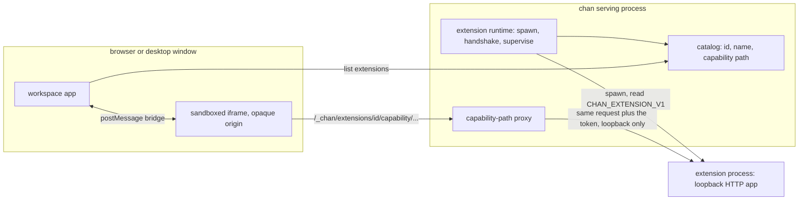
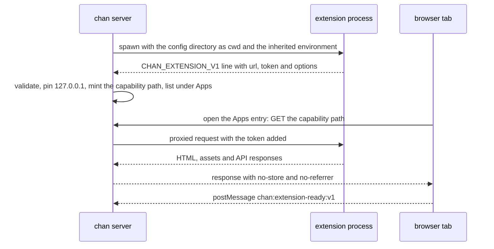

# chan extensions

How chan runs extensions, and how to write one. This is the design and the authoring guide; the field-level contract for the declaration file and the proxy's header, redirect and timeout rules are in the [configuration reference](config-reference.md). The mechanism lives in `crates/chan-server/src/extensions.rs` (discovery, spawn, handshake, supervision) and `crates/chan-server/src/routes/extensions.rs` (catalog and reverse proxy); the tab and the host bridge are in the workspace app's `ExtensionTab.svelte`.

## What an extension is

An extension is a local program declared by one TOML file under `<chan-home>/extensions/` (`~/.chan/extensions/` by default). chan spawns it when serving starts, the program serves an ordinary HTTP app on loopback, and chan reverse-proxies that app into a sandboxed iframe tab with an entry under Apps in the command launcher.

The design is a separate process behind a narrow web contract rather than a plugin ABI, for four reasons. chan stays one binary. An extension can be written in any language that can serve HTTP. It can crash without taking chan down. And it never inherits chan's API authority: all it gets is its own loopback port and a `postMessage` channel. Declaring an extension is an explicit grant to run local code as the serving user, so the declaration file is the security decision, and every file in that directory deserves the same care as a shell profile.

## The model

Four pieces carry the design.

- **A declaration.** One `.toml` per extension; the lowercase file stem is the stable id. `name` titles the tab and the launcher row, `command` and `args` say what to spawn (a bare name resolves through the serving process's `PATH`, `./name` resolves from the config directory, installers write absolute paths), and `capabilities` lists the host grants the extension asks for. A malformed declaration, a failed spawn or a failed handshake is logged and skipped; it never fails chan's startup.
- **A handshake.** The child prints one line on stdout, `CHAN_EXTENSION_V1={...}`, naming its loopback URL and an unguessable token, and optionally `singleton` and a static list of `commands`. The URL must be plain HTTP on `127.0.0.1` or `localhost`; chan pins it to `127.0.0.1` after validation so a hosts-file entry cannot re-target the proxy. The handshake is bounded in time and in lines, and a child that does not produce it is terminated and ignored.
- **A capability-path proxy.** Each ready extension gets a random, unguessable path segment under `/_chan/extensions/<id>/<capability>/` inside the tenant that serves it. The browser only ever sees that path. The loopback address and the token stay inside the chan process, and the proxy appends the token on the upstream leg only. Because the proxy rides chan's own port, one route works unchanged in every deployment shape: `chan serve`, chan-desktop, a devserver over a TCP tunnel, and a devserver through a gateway.
- **A sandboxed tab.** The iframe runs with `allow-forms allow-scripts` and without `allow-same-origin`, so the extension's scripts execute at an opaque origin: they cannot read chan's DOM, storage or bearer token even though their requests share chan's port. The only host channel is `postMessage`, and chan accepts bridge messages only from that tab's own `contentWindow`.



*The browser sees only the capability path; the upstream address and the token never leave the serving process.*

The proxy is the trust boundary in both directions. Toward the extension it strips the browser's credentials (the chan bearer, cookies, origin and referrer, forwarding headers) and stamps every upstream request with a scope header naming the serving instance. Toward the browser it drops upstream cookies, applies a no-store and no-referrer policy, and strips redirects that point at loopback. Through a gateway the proxy routes are reachable only by signed-in callers, the owner and grantees alike: the gateway never forwards a bare capability link but binds it to the signed-in user on the iframe navigation that loads it, which it recognises by the browser's Fetch Metadata request headers. A leaked capability link alone therefore reaches nothing, a browser that sends no Fetch Metadata gets the gateway's not-found page instead of the extension, and a devserver refuses a tunnel request that names no user. Served without a gateway, an extension tab does not depend on those headers.

One word about vocabulary: "capability" means three unrelated things in chan. An extension's declared `capabilities` are host grants (`session-context`, `presentation`); the proxy path capability is the unguessable URL segment above; and window capabilities decide which surfaces a window family may mount. This document uses only the first two.

## Lifecycle

chan discovers and starts extensions once per serving process, not once per workspace tenant, so a devserver with many workspaces runs one copy of each. Children live until chan shuts down, when each child's process group receives TERM and then KILL after a grace period. A child that exits is not respawned: a crashed extension stays down until the serving chan process restarts. That keeps supervision simple and makes a flapping extension visible instead of hiding it behind retries. Extension stderr is inherited, so an extension's own logs land in chan's stderr stream, which is what you watch while developing one; a child that fails before its handshake is logged once as `extension ignored` with the cause.



## The environment

An extension is spawned without a shell, so nothing reads a shell profile for it: it inherits the serving chan process's environment as is, and a bare `command`, like every helper the extension runs by name, resolves through that process's `PATH`. A chan started from a terminal passes on the terminal's `PATH`.

A devserver running as a service (the systemd user service on Linux, the launchd agent on macOS) runs with the `PATH` its service definition records, and that `PATH` is also the one every terminal the service opens starts from. `chan devserver restart` rewrites the definition, and `start` and `join` do when the service is not running; a run from a terminal records that shell's `PATH` (absolute entries only), while a run with no terminal on standard input, such as a desktop connect script, keeps the `PATH` already recorded. So after adding a directory an extension needs, run `chan devserver restart` from a plain shell that has it: a restart from inside an activated virtualenv or a `nix develop` shell records that environment's `PATH` for every terminal the service opens.

Two service definitions chan does not write record no `PATH`, so their extensions see the service manager's default: the distro packages' `/usr/lib/systemd/user/chan-devserver.service` when it is enabled with `systemctl --user` directly, and the unit `packaging/sdme/chan-devserver-provision.sh` writes into an sdme container. For those, and for any `PATH` the recorded copy should not decide, a systemd drop-in sets it: run `systemctl --user edit chan-devserver.service`, add

```ini
[Service]
Environment=PATH=/home/you/.local/bin:/usr/local/bin:/usr/bin
```

and restart the service. systemd reads a drop-in after the unit, so its assignment wins over the unit's own, and chan never writes or inspects drop-ins. The launchd agent has no drop-in: its `PATH` is the one the plist records.

## The host bridge

All host communication is `postMessage` between the iframe and its parent. Messages from the host arrive on `window`; messages to the host are posted to `window.parent`.

| Message                             | Direction | Meaning                                        |
|-------------------------------------|-----------|------------------------------------------------|
| `chan:extension-host-keymap:v2`     | host->ext | The shell chords chan claims, as key tokens    |
| `chan:extension-keydown:v2`         | ext->host | A matched keydown's raw fields                 |
| `chan:extension-ready:v1`           | ext->host | The UI accepts commands; unblocks queued ones  |
| `chan:extension-command:v1`         | host->ext | A declared command was invoked                 |
| `chan:extension-command-result:v1`  | ext->host | The command's outcome                          |
| `chan:extension-session-context:v1` | host->ext | Participant snapshots (`session-context` only) |
| `chan:extension-view-state:v1`      | host->ext | The tab's visibility state                     |
| `chan:extension-presentation:v1`    | ext->host | Enter, exit or toggle full-surface mode        |

Declared commands register under Apps as `extension.<id>.<command-id>` beside the base `extension.<id>` Open command. They have no default chords and are assignable through the shortcut settings. A `singleton` extension's commands focus or create its one tab and queue delivery until that exact iframe posts `chan:extension-ready:v1`.

### The keyboard relay

Keyboard events inside an iframe never bubble to the parent document, which is why the keymap relay exists. chan advertises the chords its shell owns, each as a key token with the four modifier booleans. The extension resolves every keydown to a token the way chan does (the token names what the active keyboard layout types, not where the key sits), matches only the advertised chords, calls `preventDefault()` for a match, and posts the event's raw fields back as `chan:extension-keydown:v2`. chan resolves those fields itself, checks the result against the chords it advertised, and ignores any token or command a message carries, so a relay that matches too much only costs itself keystrokes. An extension that skips the relay works, but swallows shell shortcuts while it has focus. The in-tree fixture's relay is a complete implementation of the resolution rules; copy it rather than deriving them again.

### The grants

The two grants are deliberately narrow. `session-context` streams participant snapshots with opaque ids, display names, chan roles, statuses and the receiving window id; the labels are informational, not authenticated identities. `presentation` lets the extension ask for its iframe wrapper to be promoted into the browser top layer without reparenting, so the browsing context, and any WebGL or WASM state in it, survives entering and leaving full-surface mode; chan supplies the Restore and Close controls and leaves Escape to the extension. No grant exposes workspace files, native APIs or a general host message bus.

## Creating an extension

The in-tree fixture is the smallest complete example: `crates/chan-server/examples/echo-extension.rs` with its `echo-extension.html`. The walkthrough is the same shape in any language.

1. **Serve a loopback app.** Bind `127.0.0.1` on an ephemeral port, mint an unguessable token, and serve your UI and API from one HTTP server. Reject requests whose `t` query parameter does not match the token: the proxy appends it on every upstream request, and checking it means a stray local process cannot drive your extension.
2. **Print the handshake.** Emit `CHAN_EXTENSION_V1={json}` on stdout, newline-terminated, before anything else you might print there, and promptly after spawn. Everything after the handshake can go to stderr.
3. **Declare it.** Write `<chan-home>/extensions/<id>.toml` with `name`, `command`, and any `args` and `capabilities`, then restart the serving chan process. Your launcher entry appears under Apps; opening it loads the iframe tab through the capability path.
4. **Write the frontend against relative URLs.** The app is served under the capability path, so an origin-rooted `/asset.js` targets chan's tenant root, not your extension; every asset and API URL must be relative. Implement the keymap relay if you want shell shortcuts to keep working while your extension has focus, and post `chan:extension-ready:v1` when your UI can accept commands.
5. **Drive chan through `cs`.** An extension backend that wants to act on chan (open terminals, write to them, run surveys) shells out to the `cs` control client rather than speaking any private API; `cs`'s command semantics and exit codes are the contract. This is the pattern both published extensions use, and it keeps the extension honest about what the operator could do themselves.
6. **Prove the contract in your own tests.** Assert that your handshake line parses under chan's validation rules (marker prefix, URL shape, token bounds, command id grammar), so a contract drift fails your suite instead of your users' startup.

To exercise the fixture end to end: `cargo build -p chan-server --example echo-extension`, point a declaration's `command` at the built binary's absolute path, and restart chan. chan releases ship no extension binaries or declarations; the example compiles only when a developer builds it explicitly.

## Packaging and distribution

chan has no marketplace or installer, so distribution is the extension repository's job. The published extensions share one convention, and new extensions should follow it:

- The repository is named `chan-ext-<name>` and carries its extension id as the file stem it installs.
- `packaging/chan-extension/<id>.toml` is the declaration template. Its `command` is a placeholder: the installed declaration wants the real absolute path, and only the installer knows it.
- An `install.sh` detects OS and architecture, verifies the release archive against `SHA256SUMS` before extracting, installs under `~/.local/lib/<name>`, writes `<chan-home>/extensions/<id>.toml` with the path it just installed (honouring `CHAN_HOME`), and leaves the chan restart to the operator.
- The repository carries its own gate (fmt, lints, tests) and the contract tests from the walkthrough above.

## Reference extensions

- [chan-ext-doom](https://github.com/fiorix/chan-ext-doom): DOOM, embeddable; an engine fork with browser and native targets and a Rust server role. The only extension exercising both grants, and the worked example for `presentation`: full-surface play with engine state surviving enter and restore.
- [chan-ext-mobile-chat](https://github.com/fiorix/chan-ext-mobile-chat): a chat surface for driving agents from a phone through the desktop's chan. A single Rust binary serving hand-written assets, `session-context` for the roster, and every action on chan delegated to `cs`.

## Boundaries

There is no marketplace, installer, remote fetch, lazy start, or `cs` opener for extensions. Extensions are per-machine operator declarations: chan starts what the directory declares, contains it behind the proxy and the sandbox, and nothing else. A crashed extension stays down until the operator restarts chan, and an extension's authority over chan is exactly the authority of a local process run by the same user, which is why the declaration itself is the security decision.
