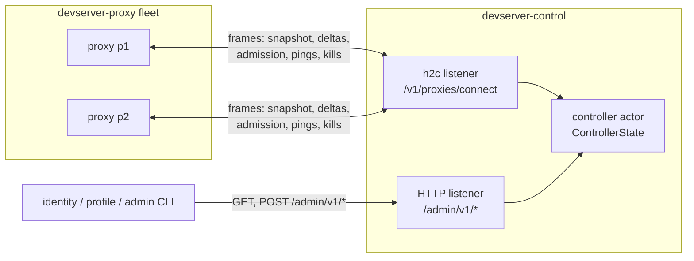
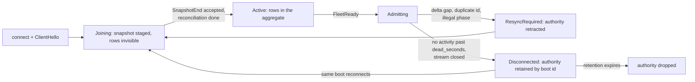

# devserver-control design

devserver-control is the singleton, database-free control plane for the devserver-proxy fleet. It owns the dynamic proxy directory, the aggregate tunnel and tenant-session inventory, fleet admission under identity-signed leases, and command routing back to the proxies that hold the tunnels. It carries metadata and commands only; no tenant byte crosses it. How to run it and its route and configuration catalogs live in [README.md](README.md); the frame types it speaks live in `devserver-control-proto`.

## Why it exists

A devserver-proxy node keeps its registrations in a process-local registry. That works for one node and breaks with two. Nothing can answer fleet-wide questions: which proxy holds the tunnel for `(owner, devserver_id)`, how many devservers an owner runs across nodes, which proxies are alive. The per-user devserver cap is unenforceable when each proxy sees only its own registrations. And operator actions (evict one devserver, drop every tunnel of a blocked user) would need a query-time fan-out, which has no safe answer when one proxy is unreachable: a partial read presented as fleet truth.

A shared database does not fix this. A database cannot serialize a yamux handle, the owning proxy process is the only authority that can refresh a row, and rows retained after a process failure report stale ownership as truth. The fleet needs one owner for the dynamic directory that treats the view as a liveness signal, plus a command channel back to the proxies. The decision record with the rejected alternatives is [ADR-0002](../../docs/adr/0002-control-plane-owns-proxy-fleet-state.md); this document describes the design as built.

## Where it sits

Callers: every devserver-proxy node, which dials out and holds one authenticated h2c control session; identity, profile and the admin CLI, which read the aggregate `/admin/v1/*` tree and issue kills and revocations under separate scoped bearers. Callees: none. The controller initiates no connection; it only answers sessions and sends commands down them. It holds no database, no PAT, no signing key and no tenant credential; it verifies admission leases under identity's public-key ring.

## Architecture

One process, two listeners, one actor.

- `PROXY_BIND_ADDR` is raw h2c. Each proxy opens `POST /v1/proxies/connect` with a proxy-id-scoped bearer and holds the response stream for the life of its control session. The stream carries length-prefixed JSON frames in both directions.
- `BIND_ADDR` is plain HTTP. `/healthz` and `/readyz` are unauthenticated; `/admin/v1/*` uses separate rotating operator, identity and profile credentials with route-level scopes.

All fleet state lives in `ControllerState`, owned by a single actor task. Mutations arrive over a bounded channel from the session tasks and the HTTP handlers; fleet reads come from coalesced watch snapshots the actor republishes on a tick, and owner reads come from a maintained owner index that materializes only that owner's rows. There are no locks: the actor is the only task that touches the state, so no lock is ever held across an await. State transitions return effect values (send a frame, retire a session, settle a kill or revocation waiter) that the actor applies after the transition, which keeps the state machine synchronous and unit-testable. Tunnel, browser-session and proxy views track separate generations, so a heartbeat updates the directory without rebuilding inventory and a lease refresh rebuilds the tunnel view without cloning session rows.

*One actor behind two listeners: proxies push state and take commands over their control session; the admin callers read the aggregate and issue commands over HTTP.*

The controller carries metadata and commands only. Tenant HTTP and WebSocket traffic never crosses it; proxies keep owning the yamux handles and the whole data path. A control session loss therefore never strands data-plane capacity by itself: it stops new admission on the affected proxy and starts that proxy's reconnect grace.

## Control transport

One h2 stream per connection, a versioned content type, and a per-proxy credential allowlist that assigns one or two bearers to each exact proxy id, compared in constant time. Frames are length-prefixed JSON with a hard size cap. The frame types, limits, signed-lease contract and id and origin validators live in `devserver-control-proto` so client and server cannot drift.

The first frame must be a `ClientHello` carrying the protocol version, the package version, the proxy id, the proxy base URL and a boot id. Three checks run before a session exists: the protocol version must match; the package version must equal the controller's own, because all gateway services and proxies run one package version and a mismatched deploy should fail loudly at the handshake rather than corrupt the fleet view; and the base URL must equal the configured origin template expanded with the presented proxy id, so a proxy cannot claim an origin that does not match its provisioned id. On pass the controller answers a `ServerHello` that announces the heartbeat, dead and grace intervals the proxy must honour.

Connection hygiene follows the shared accept-failure policy of `chan-tunnel-proto`: a per-connection failure is retried at once, a resource failure is logged and retried after a pause, and only an unusable listening socket ends the listener, and with it the process, since this is the fleet's only controller. Each connection runs in its own task, and a panic in one ends only that proxy's session. The handshake and every write to a proxy are bounded, because an h2 write stays pending until the peer grants flow-control window and a parked write would otherwise stop a session's deadlines from being polled. A proxy that opens extra streams, floods frames or stops reading costs its own session, never the actor. One framed-reader task owns the inbound side, because a length-prefixed read is not cancellation-safe mid-frame.

## Session lifecycle

A session is `(proxy_id, incarnation)` plus the process boot id. A second live connection for the same proxy id is rejected rather than replacing the incumbent. Disconnected authority is retained by `(proxy_id, boot_id)` through the convergence window, so a changed-boot reconnect cannot make the prior unreachable authority disappear; once the fleet is ready, a changed boot may join empty, but a non-empty snapshot from it is quarantined until the prior authority is settled, because connection recency is not proof that the old process and its tunnels are gone.

*A proxy session: staged while joining, authoritative once active and fleet-ready, retracted on any delta gap, and retained for a bounded window after a disconnect.*

While **joining**, the proxy stages one snapshot: a start frame, bounded tunnel and browser-session chunks, then an end frame with the matching base generation. Duplicate tunnel registration ids and tenant admin-session ids are rejected, and staged rows are invisible to the aggregate until the snapshot completes. Once **active**, the session owns aggregate rows, and once the controller sends `FleetReady` it participates in admission.

After the snapshot, the proxy publishes tunnel and browser-session up and down events under one generation, and every delta must extend it by exactly one. A gap, a duplicate id, an unknown down or an illegal phase triggers `ResyncRequired`: the controller retracts both tunnel and tenant-session authority, drops the proxy back to joining, clears fleet readiness, and waits for a fresh combined snapshot on the same stream. The session remembers registrations the controller removed before their proxy published a down (lease expiry, a kill, a refused publication), so the proxy's own later down for them advances the generation instead of resyncing.

A lease the controller cannot verify costs that one tunnel, never the session. The session task verifies every tunnel row and every lease refresh against the verifying ring and the binding the frame claims. A row that fails never enters the aggregate, since it carries no authority the controller can check and counting it would bypass the signed limit; its registration is commanded killed through the ordinary kill path. Ending the session instead would not help: the proxy's reconnect snapshot carries the same row, so the session would flap until the proxy's grace evicted every tunnel on the node. Structural checks keep their meaning: a gap, duplicate id, snapshot limit or illegal phase resyncs or closes the session exactly as for a row that verifies.

## Fleet admission

Admission is synchronous and controller-owned. The proxy's tunnel listener holds the handshake after token validation while the control session asks, and the client sees `HelloAck::Ok` only after an `Admit` decision. The decision vocabulary is `Admit`, `AtCapacity`, `ControlWarming` and `Stale`; the proxy maps `AtCapacity` to the client's capacity refusal and the others to its control-unavailable refusal.

The rules, in order:

1. The controller must be ready and the asking session active and fleet-ready; otherwise `ControlWarming`.
2. A re-request of the exact same claim (same session, request id, registration id) refreshes the claim and re-answers `Admit`, so a proxy that lost the first answer can retry idempotently.
3. Reconnect neutrality: a key that is already live or already claimed does not count against the cap. A proxy reconnecting its existing tunnels after a controller restart can never be refused for capacity it already holds.
4. Capacity is the smaller of the deployment ceiling (`MAX_DEVSERVERS_PER_USER`) and the signed per-user limit. The count covers distinct devserver ids per owner across live rows, staged rows, retained disconnected authority and pending claims. Requests are serialized by the actor, so exactly one request wins the final slot.
5. A different pending claim for the same `(owner, devserver_id)` key is superseded: the old holder gets `Stale` and the new claim wins.
6. On `Admit` the controller records a pending claim with a short TTL. The matching `TunnelUp` must arrive with that claim's registration id; one without a matching claim is killed. An `AdmissionCancel` (a proxy-side handshake failure after the decision) drops the claim early.

Safety caps also bound admission: live plus pending rows must fit the asking session's and the fleet's row and byte limits, with a conservative reservation per pending claim. A `TunnelUp` that nevertheless exceeds a cap releases its claim and kills only that registration; the session stays active.

Each request carries the identity-signed admission lease bound to `(owner_user_id, username, devserver_id, registration_id, proxy_id)` with a positive finite connected-devserver limit. The controller verifies the lease before reserving capacity, again on snapshots and deltas, and at refresh. A request whose lease does not verify, or is bound to anything but the request, is answered `Stale` before the rules above run and reserves nothing; `Stale` rather than `ControlWarming`, because what is not current is that request's authority, not the controller. When one owner presents several still-valid limits, admission and reconciliation use the minimum. A live tunnel refreshes by re-presenting its PAT to identity over a dedicated stream; the proxy forwards only the resulting lease, so the controller never sees a PAT, and an expired or unrefreshable lease closes the tunnel.

## Tenant browser-session inventory

Each published session row contains a random admin UUID, the subject user, the devserver owner, the devserver id, creation and expiry. Cookie ids, entry replay ids, audiences, peer addresses and transport internals never enter the protocol or the admin view. Inventory is visible only after the owning proxy is active and fleet-ready; a disconnected row stays visible through the same authority grace as its tunnel rows, and revocation stays partial while that authority is unreachable. A session row that exceeds a cap is left out of inventory and revoked at its proxy by admin id, which also revokes every extension binding of that principal; the control session stays up.

`SessionRevocation` supports exact subject/owner/devserver, subject, admin session id, owner and all. The controller fans each request to every connected or warming authority. Success requires every command acknowledgement, no retained unreachable authority and a ready fleet; otherwise the answer is an explicit partial failure with confirmed counts, never an authoritative zero.

These controls limit honest retention and controller authority; they do not make an assigned proxy a trusted execution environment. A fully compromised proxy can capture and reuse the PAT of every tunnel connected to it until identity revokes it; the residual is described in `gateway/design.md` under Devserver publication and in `crates/chan-tunnel-server/design.md`.

## Reconciliation

Snapshots can disagree with the aggregate: two proxies may report rows for one `(owner, devserver_id)` key, or a snapshot may push an owner over capacity. Reconciliation picks winners and commands the losers down before the new view becomes visible, and only one reconciliation runs at a time; a joining snapshot that arrives while another runs is accepted and queued in arrival order, with the proxy still taking deltas and revocations in the meantime.

**Routine join, live-first.** While the controller is ready, every live row is an immutable winner: it was admitted during this controller lifetime, so its recency is known and a joining snapshot must never outrank it. Joining rows that duplicate a live key lose, each owner's live rows are reserved against the limit first, and only novel keys that fit the remaining slots are admitted. If a loser kill fails or times out, the joining session is removed and its proxy reconnects and retries the whole join.

**Initial reconciliation.** After a controller start, recency is unavailable while the fleet is reconstructed. The controller waits a convergence window from the first accepted snapshot, treats two signed rows for one immutable key as a conflict in which every row loses (neither proxy id nor registration id is grounds to elect a winner from attacker-controlled identifiers), and trims each owner's rows under the minimum signed limit its snapshots represent. Readiness flips only after every loser is confirmed gone; if a kill fails or times out, the window restarts instead of publishing a view with known conflicts.

Reconciliation kills and routine eviction kills are the same mechanism: one `KillRegistrations` command per owning session with a bounded timeout, and a result that must account for every targeted registration exactly once as killed, missing or failed.

## Failure semantics

- **Heartbeat.** The controller pings on the announced interval, any inbound frame counts as activity, and a silent session is disconnected: its pending claims are dropped and its published rows enter disconnected-authority grace.
- **Readiness.** The controller is unready from boot until initial reconciliation completes. While unready, readiness and every admin read and watch fail closed and every admission request answers `ControlWarming`. If the last active session is lost, the controller drops back to unready and clears the aggregate: a view with no live sources is worth nothing.
- **Fail-closed proxies.** A proxy whose control session is down refuses new admissions immediately and evicts every local tunnel when its grace expires; recovery requires a fresh snapshot and `FleetReady`. Those behaviours live in devserver-proxy; the controller's side is to never admit for, or publish rows of, a session that is not current.
- **Retained disconnected authority.** A disconnected proxy's rows remain visible and keep consuming row, byte and capacity authority through the convergence window, and its `(proxy_id, boot_id)` marker outlives the proxy's longest retained-authority path. Every same-boot disconnect extends the marker; only successful same-boot convergence through `FleetReady` clears it early. Admin revocation reports that proxy unreachable while the marker exists and no session from the same boot is connected.
- **Bounded queues and rates close sessions.** Per-session outbound queues, the actor queue, the inbound queue and the per-session frame rate are all bounded. A slow, stuck or flooding proxy costs its own session, not the fleet actor.
- **Command settlement.** A kill settles as confirmed (with killed and missing counts), failed, timed out, or session-lost. Runtime kills report to the waiting admin request; reconciliation kills feed the reconciliation's success or retry.

## Admin tree

All routes are bearer-gated with constant-time comparison. Operator credentials may use the whole tree. Identity credentials can read owner rows and issue owner, exact and fleet-wide tunnel and session mutations. Profile credentials can read owner rows and redacted snapshots and issue owner and exact tunnel kills plus exact and subject session revocation; the generic revocation handler checks the decoded variant, so a profile credential cannot select identity-only forms. Credentials are distinct across scopes and each scope accepts at most two rotation values. The route catalog is in [`README.md`](README.md#routes).

The tunnel snapshot sorts by `(owner, devserver_id)` and each row carries its owning proxy id and base URL; the proxy directory carries each node's status, package version, boot id and tunnel count. The per-owner read returns an empty list for a well-formed owner with nothing live rather than not-found, so callers do not special-case the steady state. A malformed owner id answers the same not-found as an unknown one, so the tree does not distinguish invalid identifiers from absent authority to a prober.

Kills address aggregate keys but execute by registration id read at issue time, so a delayed command cannot kill a successor registration for the same key. The exact kill issues one command to the owning session and awaits it; any outcome short of confirmed is a partial-kill failure, because the proxy may have executed the kill without the controller learning of it. The owner-wide kill first cancels pending claims, then fans out by owning proxy and awaits every confirmation. Both are idempotent and expose only confirmed counts.

Session revocation fans out to every active or warming proxy and refuses to report complete while controller authority is warming or any retained proxy authority is unreachable. A proxy deactivates matching sessions, stops their transports and acknowledges only after they have drained; a drain that times out stays as a tombstone so a retry cannot mistake an undrained transport for an empty match. A signed entry credential minted before a revocation remains exchangeable for its lifetime, so account-deletion settlement waits that window and performs a second acknowledged revocation before treating the operation as final.

The watch routes stream server-sent events: a full snapshot on connect, a full snapshot on every change, periodic keep-alives, and termination the moment the controller leaves readiness. Watches require readiness at connect, so a consumer never mistakes an empty warming view for an empty fleet.

## Key decisions

### Singleton, database-free

Fleet state is a liveness view that is worthless when stale, and the owning proxy process is the only authority that can refresh it; durability would preserve exactly the rows that should not survive. The trade-off, fleet-wide admission stops when the controller is down and recovery is the convergence window, is settled in ADR-0002 and accepted: controller HA, durable control state, leader election and cross-region replication are out of scope.

### Proxies keep the data path

The controller never proxies a byte of tenant traffic. Its cost is one small stateless process, and its failure cannot strand capacity that is otherwise healthy: existing tunnels keep serving through the grace window.

### One actor, effects instead of locks

`ControllerState` is a plain synchronous state machine mutated by one task. Side effects are returned as values and applied after the transition, and kill waiters are registered before the send effect runs, so a command that settles immediately still resolves its waiter. HTTP handlers and session tasks never touch shared state directly; this is why the system has no lock ordering to get wrong.

### Version-locked handshake

The control session refuses a peer with a different protocol or package version and an origin that does not match the proxy id's template expansion. The fleet view is only meaningful if every node speaks the same semantics; a partial upgrade fails at connect time, loudly, instead of drifting.

### Synchronous admission with claims

Holding the tunnel handshake for one controller round trip makes the cap and single-owner decisions atomic, at the cost of coupling admission availability to the controller. That coupling is deliberate: a proxy that cannot ask must not guess. The claim TTL bounds how long an abandoned reservation can hold a key.

### Reads are watch snapshots

Admin reads and SSE watches are served from republished watch snapshots rather than by querying the actor per request. Read load from dashboards and CLIs scales without adding pressure on the single actor, and every reader sees the same coherent sequence of full snapshots.

## Invariants

- Aggregate rows are published only from active sessions and retained disconnected authority; `ResyncRequired` retracts both tunnel and tenant-session rows immediately.
- Kills route by the registration id read at issue time, never by key.
- A joining session's staged rows are invisible to every read and watch until its reconciliation completes.
- Admission decisions and their capacity reservations happen in one state transition, and claims expire.
- One reconciliation runs at a time.
- Readiness implies at least one active session; losing the last one retracts the whole aggregate.
- The actor holds no locks and performs no blocking I/O; every queue, snapshot, frame and aggregate is bounded, and the offender is retired on overflow or flood.
- Bearer comparisons (admin and proxy credentials) run at constant time.
- The controller never receives a PAT; it verifies leases under identity's public keys only.

## Error model

`StateError` is session-scoped. Only the not-ready, authority-temporarily-unavailable and invalid-revocation variants reach HTTP, as unavailable; every other variant rejects the offending frame and closes or resyncs the control session. A lease that fails verification is not an error variant: it costs its one tunnel. While the controller warms, the entire admin tree fails closed; there is no partial view. Kill outcomes map confirmed to success, every shortfall to a partial-kill failure carrying the confirmed count, and no match to not-found. On the proxy listener, handshake failures answer plain HTTP statuses before the stream exists; everything after that is a `Shutdown` frame with a reason string.

## What is not wired

- Controller HA, durable control state, leader election, cross-region replication (ADR-0002 consequences).
- Any tenant data path.
- In-process TLS or mTLS: both listeners must bind loopback unless `CHAN_GATEWAY_INTERNAL_TRANSPORT=protected-overlay` asserts a protected overlay; bearers authenticate peers but do not make h2c confidential.
- Per-proxy or regional admission policy.
- Delta-based watch streams (watches carry full snapshots).
