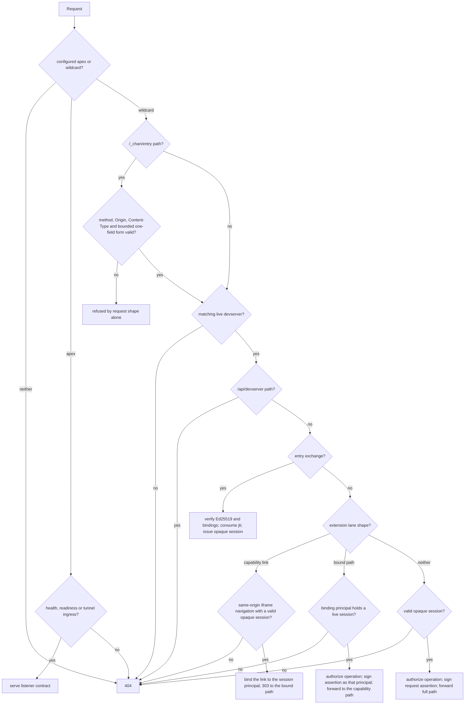
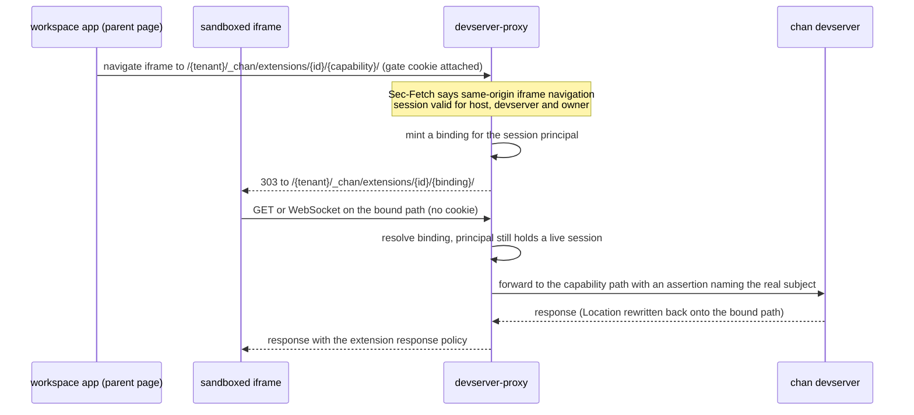

# devserver-proxy design

devserver-proxy is the public data-plane edge for tunneled `chan devserver` instances. It has four jobs: validate a tunnel PAT and obtain an identity-signed admission lease; hold the tunnel handshake until devserver-control admits the exact owner, devserver, registration and proxy tuple; exchange a short-lived identity credential for a revocable, proxy-local browser session; and forward authenticated HTTP and WebSocket traffic to the exact live tunnel with a per-request assertion the devserver verifies on its own.

The service has no database, no SPA, no OAuth credential, no profile policy and no local admin API. identity owns entry decisions, profile owns durable denial and revocation jobs, and devserver-control owns fleet state and command routing. A proxy node is deliberately credential-poor so that a compromised node can be isolated and deprovisioned rather than trusted. How to run it and its configuration live in [README.md](README.md).

## Where it sits

Callers: `chan devserver` clients dialing the tunnel listener, browsers and chan-desktop on the public listener, and devserver-control sending commands down the control session. Callees: identity's internal listener (PAT validation, Hello-name announcement, lease refresh) and devserver-control (one outbound h2c control session). The proxy embeds `chan-tunnel-server` for the tunnel itself and `gateway-common` for the entry credential, the token bucket and the transport checks. It never talks to Postgres or profile.

## Listeners and routing

One process owns two listeners and one in-memory registry.

- `BIND_ADDR` is the public HTTP listener. The tunnel apex host serves health and readiness; the wildcard hosts serve authenticated devserver content. Readiness is true only after the control session has reached `FleetReady`.
- `TUNNEL_BIND_ADDR` is raw h2c tunnel ingress for `POST /v1/tunnel`. A TLS edge exposes that path with h2 in production. Cleartext is accepted only on loopback or under the explicit protected-overlay assertion.

A single router dispatches on the raw `Host` header, never on the `Host` extractor, which would honour a spoofable forwarded host. The wildcard host is `{owner}--{disc}.<node base>`, where `disc` is a fixed-length prefix of the devserver id. A bare `{owner}` host remains a bounded compatibility path: an ordinary request may resolve one live devserver, but entry exchange is refused unless exactly one candidate exists. The `/{workspace}/...` path is tenant routing owned by chan-server; the proxy never uses the workspace segment as an authorization key.

*The gate order on the public listener: request shape is checked before the registry, the management API is never forwarded, and every unknown, unauthenticated or mismatched case shares one not-found.*

The public wildcard routing is deliberately small. `/_chan/entry` validates method, exact `Origin`, exact `Content-Type` and a bounded form with exactly one `credential` field before consulting the registry. `/api/devserver/*` is always not-found because that management API is local-only. An extension capability link is never forwarded; a bound path forwards only while its principal holds a live session. An ordinary path requires a valid gate cookie. An unauthenticated bare `/` redirects to the identity dashboard, because the proxy renders no UI. Everything else answers the same not-found shape. The aggregate `/admin/v1/*` tree exists only on devserver-control.

## Tunnel registration and admission

The tunnel listener runs a throttling validator in front of the identity validator before any controller admission. Identity returns the immutable owner id, the canonical username and devserver id, a short-lived admission lease bound to the proposed registration and this proxy, the signed connected-devserver limit, and the per-tunnel assertion authority. The proxy verifies the lease locally under the admission verifying ring twice: before it asks devserver-control to admit, and again before it publishes the row. It sends the raw PAT only to identity and never retains it as a proxy-wide credential. The contact inventory is in [Devserver publication](../../design.md#devserver-publication).

The listener generates the registration id. A lease the proxy cannot verify, or one bound to anything but this registration, this proxy and the validated owner and devserver, is refused without reaching the controller, which would otherwise reserve capacity for a tunnel the proxy could never publish. Otherwise the control session sends the lease and the exact tuple to devserver-control and waits. Only an `Admit` decision permits `HelloAck::Ok` and registry insertion; `AtCapacity` maps to the client's capacity refusal and warming, stale or unavailable authority to its control-unavailable refusal. There is no local admission fallback.

The registry keys live rows by owner plus devserver id and retains the registration id. A snapshot plus contiguous deltas feed the control session; controller kills address registration ids, so a predecessor's teardown cannot remove its successor. A registration whose row cannot be published or whose refreshed lease no longer verifies costs that one registration and nothing else: the proxy evicts it, logs why, and keeps the stream up. Ending the control stream would not help, because the registry still holds the tunnel and every reconnect's snapshot would meet the same row until the reconnect grace evicted everything on the node.

Admission leases expire unless the client re-presents its PAT over a dedicated refresh stream and identity returns a fresh lease. The proxy forwards a refreshed lease after checking it as the controller will; it cannot renew one from any proxy-held secret.

## Browser entry exchange

identity performs the binary owner-or-grantee access check and signs a short-lived Ed25519 entry credential whose claims bind the purpose and version, the caller and the owner, the client it was minted for (`desktop` or `browser`), the exact devserver id, canonical audience and provisioned proxy id, a random single-use replay id, and the relative clean navigation path.

The browser or the desktop posts one `credential` field to the fixed exchange path. Before reading registry state, the proxy requires the method, exactly one canonical content type, exactly one `Origin` equal to identity's configured public origin, a bounded body and exactly one nonempty field. Those refusals therefore depend only on request shape, never on whether zero, one or several devservers are live, and every entry-specific not-found is the same JSON body regardless of `Accept`. Credentials in query strings are not accepted.

The proxy verifies the signature under a one-or-two-key rotation ring, checks every binding against the live tunnel and the inbound host, and retains the replay id through the credential's acceptance window; a replay, or replay-cache pressure, fails closed. A credential without a recognisable client claim opens a session whose client is `unknown`, so identity and the proxy can deploy in either order without refusing credentials in flight. Success answers a redirect to the signed path and sets two host-only cookies: `__Host-devserver_gate` (HttpOnly, Secure, SameSite=Lax, the opaque session id) and `__Host-devserver_csrf` (Secure, SameSite=Lax, readable by same-origin JS). The credential never appears in browser history, a redirect or the clean URL.

## Opaque sessions and revocation

The gate cookie is an opaque lookup key, not a self-contained token. A session record holds a separate random admin session id, the immutable caller, owner, devserver and audience, the client its credential was minted for, creation and expiry, a cancellation token and the set of transports admitted under it. The client is an attribute of the session, not of its principal: a user's desktop and browser sessions on one devserver are the same `(subject, owner, devserver, audience)` principal, share its quota and extension bindings, and every revocation that reaches the principal reaches both.

Bounds are fail-closed: a process-wide active-session cap, a per-subject cap, a per-principal cap, an absolute lifetime that cannot exceed one hour, and a restart that clears every session. The store publishes a redacted snapshot and up/down events to the control supervisor; snapshot chunks and tunnel and session deltas share one connection-local generation, so a gap retracts both authorities and forces a resync. The published view contains only the admin id, subject, owner, devserver id, proxy id, creation and expiry.

Revocation supports exact `(subject, owner, devserver)`, subject, admin session id, owner and all. The proxy first makes matching records lookup-dead and cancels their tokens, then stops their transports: an HTTP task is aborted at once, a WebSocket bridge is left to send its close frame and is aborted only at a short drain deadline. The proxy acknowledges only after every registered operation guard has dropped, within a bound that stays inside the controller's command timeout. A drain that times out leaves a tombstone, so a retried command cannot observe zero records and falsely confirm. Expiry stops a session's transports the same way. New session issuance is suspended during control-loss cleanup and resumes only after a fresh `FleetReady`.

Profile persists revocation work transactionally with each grant delete, block, PAT revoke or account delete, and its worker makes two confirmed cuts across the entry-credential quiet window. The controller reports partial failure while any connected proxy has not confirmed or any disconnected proxy authority marker remains. The absolute one-hour expiry is the final backstop once the bounded retry window is exhausted and audited.

## Request authorization

For an ordinary request the proxy resolves the opaque session against the exact live tunnel and the canonical audience, on every HTTP request and every WebSocket upgrade. An expired, cancelled, wrong-host, wrong-owner or wrong-devserver record takes the indistinguishable not-found path. Before transport starts, the request registers an operation guard with the session, and no operation may register after revocation.

Every forwarded request carries `X-Chan-Gateway-Assertion`, a short-lived HMAC assertion naming only the immutable caller, owner, audience and devserver, plus the session's client type. Its key is derived independently from the tunnel PAT by the client and by the proxy's validation path, so chan-server can verify it without any shared gateway secret; a missing assertion fails closed there.

This is intentionally not owner-equals-caller authorization. A grantee's subject differs from the owner, and the gate never compares the two; that would lock out every accepted grantee. identity already ran `devserver_access` before minting, so a validly signed credential with the right audience and devserver is the authorization assertion, and the audience is what enforces user-to-user isolation.

## Browser boundaries

All methods except `GET`, `HEAD` and `OPTIONS` require `X-Chan-CSRF` to match the readable CSRF cookie in a timing-safe comparison, extension methods included. The mirror is needed because `SameSite` is site-based and sibling tenant origins under one proxy node are same-site. The header and all inbound cookies are stripped before the tunnel hop.

A cookie-authenticated WebSocket additionally requires exactly one `Origin` equal to the canonical externally visible origin; missing, multiple, opaque, wrong-scheme, wrong-port and sibling origins are rejected before a substream opens. The bridge closes on session cancellation, absolute expiry or a both-directions idle deadline that also bounds the substream open and the upstream handshake. A revoked or expired session ends the client socket with a policy-violation close whose reason names the case; an upstream that cannot be reached or refuses the upgrade ends it with a server-error close whose reason names which.

Every credentialed response receives `Cache-Control: private, no-store`, `X-Content-Type-Options: nosniff`, `Referrer-Policy: no-referrer` and a `frame-ancestors 'none'` policy. The sole framing exception is the extension namespace below, which receives `frame-ancestors 'self'` so the owning tenant can host it in a sandboxed iframe. Upstream cookies with a `Domain` attribute, or names reserved for the gate and CSRF cookies, are dropped; other upstream cookies pass so tenant content can set its own host-only cookies.

## Extension links

A workspace tenant's extension tab is an iframe with `sandbox="allow-forms allow-scripts"`, so its document has an opaque origin and its requests carry no cookie. chan-server gives each ready extension a path capability, and the workspace app points the frame at `/{tenant}/_chan/extensions/{id}/{capability}/...`. The proxy never forwards that capability link and nobody reaches an extension without signing in. Instead it binds the link to the signed-in user on the frame's navigation, which needs nothing from the workspace app, so a devserver serving any version of it works behind this proxy.

*Binding a capability link: the parent page's navigation carries the cookie, the proxy swaps the capability for a principal-bound token, and the cookieless frame uses that token from then on.*

- A `GET` carrying the Fetch Metadata of a same-origin iframe navigation, plus a session cookie valid for the host, devserver and owner, mints a binding for that session's principal and is answered with a redirect to the bound path, keeping the rest of the path and the query. The parent page starts that navigation, so the browser attaches the `SameSite=Lax` cookie despite the sandbox. Page script cannot set Fetch Metadata, so the frame's own fetches, subresources, WebSockets, top-level opens, navigations the sandboxed document starts itself, frames on sibling tenants and browsers that send no Fetch Metadata all get the ordinary not-found, cookie or not.
- A binding token is a lookup selector plus a verifier compared in constant time. It resolves to the principal, the tenant, the extension id and the devserver capability, and the path's tenant, extension id and host must match. A bound request is forwarded to the capability path with an assertion naming the principal's real subject. It needs no cookie, CSRF header or WebSocket `Origin`, none of which the frame can present.
- A binding belongs to its principal rather than to the session that minted it, so an open extension tab survives the user signing in again. It lives only while the principal holds a live session without a gap: when the principal's last session is removed, by expiry or revocation, its bindings go with it, and every revocation that reaches the principal deletes its bindings and drains their transports with the same tombstone-on-timeout rule as sessions.
- A path on either shape that holds a dot segment, raw or percent-encoded through repeated decoding, is answered with the lane's not-found before any session or binding is consulted and is never forwarded. The check reads at least as much into a path as the devserver's own extension route does, so a bound path stays inside its extension whatever the devserver does with it. No browser sends a dot segment, so this refuses only hand-built requests.
- Bindings are bounded per principal, with least-recently-used eviction so reloading frames rotates rather than accumulates, and bounded per process, answering unavailable rather than evicting another principal's binding.

Every response on either shape carries the extension response policy (`Access-Control-Allow-Origin: null`, no-store, nosniff, no-referrer, no `Set-Cookie`), refusals included, so the frame reads true statuses. Both shapes keep the extension's path depth, so the frame's relative URLs resolve as they would on the capability path, and the trace span redacts either credential segment.

## Reverse-proxy hygiene

The proxy strips the fixed hop-by-hop set on both legs and every header named by every `Connection` field value. It removes the inbound `Host`, `Cookie`, `Authorization`, `X-Chan-CSRF` and any client-supplied gateway assertion. `X-Forwarded-For` is the socket peer only, `X-Forwarded-Proto` comes from the configured edge scheme and `X-Forwarded-Host` from the host the proxy itself routed on; inbound forwarded headers are never routing authority, because the edge may not scrub them. The upstream is reached over a yamux substream owned by an authenticated tunnel, so there is no SSRF surface: the upstream is never user-supplied.

Request and response bodies and the end-to-end request deadline are bounded by configuration, and a dropped or timed-out response aborts its upstream task. The sanctioned transfer routes (multipart upload, file or archive download, server-side copy) receive explicit long bounds and deadlines so large transfers are not cut by the general policy; classification requires the exact method and path. A response whose declared length exceeds its cap is refused before body forwarding. The full inbound path and query are forwarded unchanged except that the entry exchange is handled locally.

The proxy opens a fresh yamux substream for each HTTP request or WebSocket. WebSockets perform their handshake directly on that substream and share one both-directions idle deadline refreshed by traffic in either direction.

## Control failure semantics

The proxy has one authenticated h2 control session using its provisioned per-proxy credential. It refuses new admissions the moment that session is unavailable, while existing authority has bounded retention: a healthy-session disconnect arms a reconnect grace; a reconnect whose snapshot is accepted but not yet `FleetReady` runs under a distinct, hard convergence deadline; a disconnect in that state cannot extend authority indefinitely. Grace expiry atomically suspends session issuance, evicts every tunnel, cancels every session and waits for admitted bridges to drain. Only `FleetReady` cancels cleanup and resumes admission and session issuance.

The controller retains a disconnected proxy's authority marker for longer than every proxy-side retention path, so session revocation cannot report full confirmation during the window in which a proxy could still be serving old authority.

## Trust boundary and residuals

A proxy node is credential-poor relative to identity and profile, but it is still a data-plane trust boundary. A fully compromised assigned proxy can capture the PAT of every tunnel currently connected to it and reuse it until identity revokes it or it expires, because the proxy process holds those PATs at dial, at the Hello-name announcement and at refresh, and inside the h2 connection's header decoder for the life of the connection; `crates/chan-tunnel-server/design.md` has the detail. It can also mint per-request assertions for tunnels currently assigned to it. The protocol prevents that node from joining as another provisioned proxy, fabricating an identity-signed admission or entry credential, or turning one node credential into fleet authority. Node isolation, deprovisioning and PAT rotation remain the incident response; this design is not a trusted execution environment.

An extension bound path carries its binding in the URL, because the opaque-origin frame can present no cookie. A leaked bound path is therefore usable as that user, from any client, until the user holds no live session or a revocation reaches them. The capability link on its own grants nothing.

The replay cache, opaque sessions, extension bindings, registry and controller fleet view are memory-only by design. Restart fails tunnels and sessions closed. Controller HA, durable fleet state, automatic DNS and certificate provisioning, and proxy-to-proxy traffic are outside this component.

## Invariants

- No tunnel enters the registry before identity validation and synchronous controller admission of its signed immutable tuple.
- Entry credentials are body-only, single-use, short-lived and bound to the exact proxy, audience, owner, devserver, caller and clean path.
- Entry method, Origin, Content-Type, body-limit and form-shape failures are answered before registry lookup, and every entry-specific not-found has one shape, so the responses reveal no live-devserver state.
- Browser sessions are opaque, bounded, revocable, lookup-checked on every request, and expire absolutely within one hour.
- Session publication never contains the cookie id, replay id, audience, assertion, peer address or cancellation internals.
- Revocation acknowledgement means every registered matching transport has stopped; timeouts remain visible to retries.
- Every tunnel-bound HTTP request and WebSocket carries a fresh per-tunnel gateway assertion; the client cannot supply one.
- Unsafe browser methods require CSRF and cookie-authenticated WebSockets require exact Origin; the cookieless extension bound path is the one exception, and it requires a live binding instead.
- No request reaches a tunnel without a signed-in principal, and every assertion names that principal's real subject; a capability link is never forwarded, and a bound path forwards only while its principal holds a live session.
- No extension lane path with a dot segment, raw or percent-encoded, is forwarded or mints a binding.
- The public wildcard never exposes `/api/devserver/*` or an admin route.
- Request paths remain segment-preserving; chan-server is the sole workspace tenant router.
- Control loss cannot retain data-plane authority past its hard deadline, and the controller's disconnected-authority markers outlive proxy retention.
