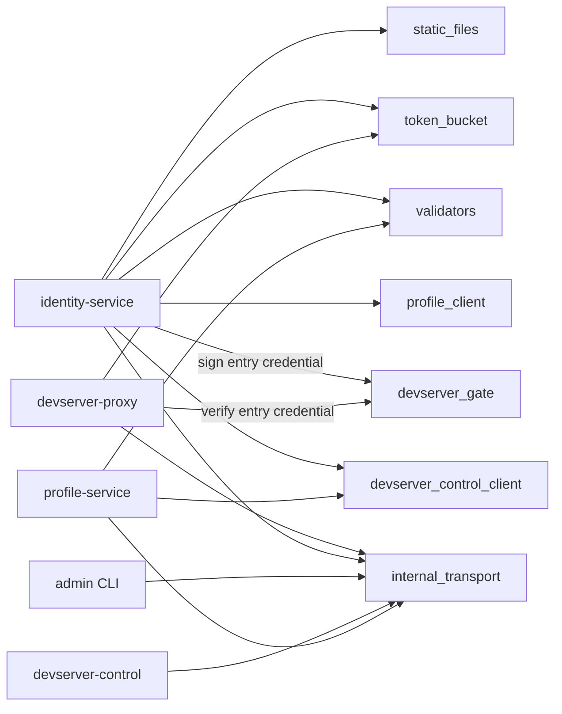

# gateway-common design

gateway-common is the internal library the gateway services share. It exists so that the security-sensitive contracts between services have exactly one implementation: the typed clients for profile-service and devserver-control, the Ed25519 entry credential for the identity-to-proxy browser handoff, the internal-transport rule, username validation, the token-bucket throttle, embedded static-file serving and shutdown plumbing. Keeping these in one crate prevents wire shapes, timeouts and validation rules from drifting between services.

## Where it sits

Every gateway service depends on it: identity, profile, devserver-proxy, devserver-control and the admin CLI. It depends on no gateway service and on no axum response semantics; its clients and credential types carry their own error enums, and each consumer maps those onto its local error at its own API boundary. The admission lease type is not here but in `devserver-control-proto`; this crate's controller client carries the lease as an opaque field of its tunnel row for consumers to verify.

*Who uses which module: identity signs and the proxy verifies the entry credential; identity and profile share the controller client; every service runs the internal-transport check.*

The module contracts:

- `profile_client`: a typed reqwest client with a bounded request timeout and its bearer redacted from `Debug`. Idempotent reads retry once on connection failure, timeout or a server error; writes never retry, because a retry after a write that may have landed is not safe.
- `devserver_control_client`: a typed client over the controller's `/admin/v1/*` tree. Each service constructs it with its own scope-specific controller bearer. Tunnel rows include their signed admission lease and owning proxy identity.
- `devserver_gate`: identity signs a short-lived Ed25519 entry credential whose claims bind the caller, owner, devserver, exact audience, target proxy, client type, signed clean path, purpose and version, and a random single-use replay id. The target proxy verifies through a one- or two-key public-key ring and consumes the replay id before creating an opaque proxy-local session.
- `internal_transport`: the repository-wide rule for internal listeners and URLs: HTTPS always, cleartext only to a loopback literal or under the explicitly declared protected overlay.
- `token_bucket`: a bounded per-fingerprint bucket shared by both PAT-validation throttles. A new fingerprint begins with one token rather than a full burst, so a cold brute-force attempt gets no head start.
- `validators`: the canonical username shape and the lifetime rename cap, shared by identity and profile.
- `wireguard`: canonical public-key and ingress-host validation, enrollment response types and the active peer list. The profile client's conditional peer-list response retains the original bytes and ETag so a relay preserves the validator's meaning.
- `static_files`: the generic embedded-SPA fallback used by identity.
- `shutdown`: the common SIGTERM and Ctrl-C graceful-shutdown future.

## Key decisions

### Asymmetric, single-use browser handoff

Identity alone holds the entry signing key; proxy nodes receive only the verifying ring, with at most a two-key rotation overlap. A credential is accepted only at the fixed body-only `POST /_chan/entry` endpoint from the exact configured identity origin. It is never a standing browser session and never appears in a URL. The proxy stores only an opaque random cookie in the browser; session state stays proxy-local, has an absolute maximum lifetime and can be cancelled immediately by a fleet revocation.

### Admission leases are verified at the consumer boundary

Controller tunnel rows are not trusted as unsigned routing data. Identity verifies the admission lease and its immutable owner, devserver, registration, proxy and expiry bindings before a row can authorize an entry or appear in the desktop roster.

### Scoped controller clients

The operator CLI, identity and profile use different controller bearer rings. Possession of one service credential does not grant another service's admin surface.

### Internal transport fails closed

An internal bearer authenticates the caller but does not make cleartext private. Startup validation therefore permits cleartext only on loopback and requires HTTPS or an explicitly protected network for non-loopback service traffic.

### No framework coupling in the data layer

`ProfileError`, `DevserverControlError`, `DevserverGateError` and the credential claims are plain `thiserror` and serde types. The `User` struct is the superset of what profile returns; consumers ignore the fields they do not need rather than forking the struct.

## Invariants

- Entry credentials use Ed25519 only; there is no HMAC or algorithm fallback.
- Entry credentials are short-lived with a small clock-skew allowance.
- The signed purpose, version, issuer, type, proxy, owner, devserver, audience and clean path are all verified before exchange.
- Entry verifier rings contain one or two distinct canonical public keys.
- Bearers held by typed clients are omitted from `Debug` output.
- Internal cleartext HTTP cannot be configured on an unprotected non-loopback boundary.

## Error model

`ProfileError` distinguishes not found, bad request, conflict, other upstream status and transport failure. `DevserverControlError` distinguishes upstream status and transport failure, and keeps the request path, status and a bounded slice of the response body in its diagnostics. `DevserverGateError` collapses malformed wire or signature failures into one decode error while keeping explicit expiry, binding, owner, proxy and context mismatches for local handling and tests; public proxy responses still collapse every authorization failure to not-found.

## Deliberate limits

- Profile responses are not cached.
- Client pooling uses reqwest defaults.
- Writes are not automatically retried by the shared clients; durable mutation retry belongs to profile's revocation outbox.
- Consumers own their response mapping and operational retry policy.
