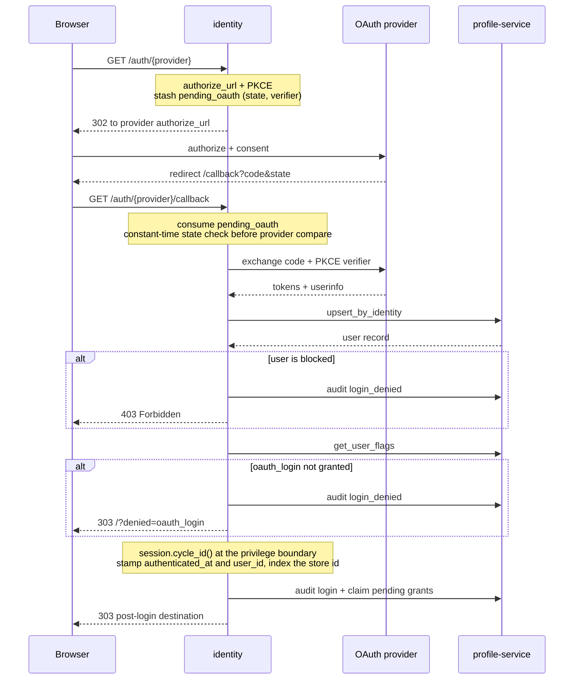
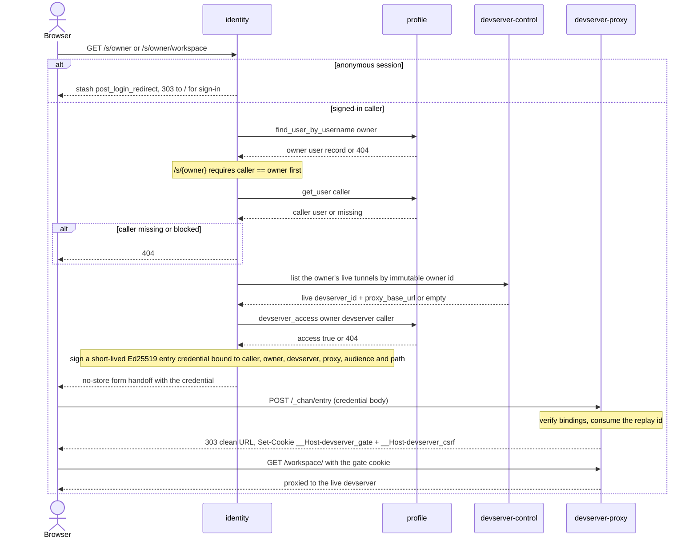

# identity-service design

identity is the public sign-in surface of the gateway and its only user-facing UI. It runs OAuth2 sign-in with PKCE against GitHub, Google and GitLab, holds the one browser session cookie in the suite, mints and validates personal access tokens, serves the account SPA, and mints the short-lived entry credential that hands a signed-in user off to a devserver's exact proxy origin. This document covers its boundaries, flows, invariants and the reasons behind them. How to run it and its exact route and configuration catalogs live in [README.md](README.md).

## Where it sits

Callers: browsers (the SPA, OAuth callbacks, share landings), chan-desktop (discovery, authorize, roster, entry, token self-revoke), devserver-proxy (PAT validation and admission leases on the internal listener), and the admin CLI (the operator admin tree). Callees: the OAuth providers, profile-service for every user, grant, flag and policy question, and devserver-control for live-tunnel reads and for tunnel kills and session revocations.

identity owns only its own auth artifacts: the `tower_sessions` rows, the `identity_session_index` and the `api_tokens` tables. It does not own user data. The canonical user record, identities and audit live in profile-service and are reached over HTTP; because identity and profile share one Postgres, the PAT queries join the shared `users` table directly. identity never applies schema changes at serve time; migrations are the dedicated `CHAN_GATEWAY_MIGRATIONS=only` step, run by the same binary under the database-owner credential.

The packaged identity database role reads `users` and `devserver_fleet_policy` and has column-level UPDATE only on their `updated_at` fields. PostgreSQL requires UPDATE on at least one column for the PAT mint's user `FOR UPDATE` and fleet `FOR SHARE` locks, which serialize minting with profile's account and admission-policy writes. This also permits identity to assign those timestamps; account state and admission-policy columns remain read-only to identity.

## Surfaces

Two routers on two listeners. The public listener carries the session layer at its outermost edge; the internal listener never mounts it and never loads caller cookies.

1. `/auth/*`: the pre-session OAuth flow. It stashes the CSRF state and PKCE verifier in the anonymous session; the callback consumes them and either upgrades the session to authenticated or fails.
2. `/api/*`: the session-gated JSON API for the embedded SPA: `me`, profile management, PAT lifecycle, owned and incoming devservers, and sharing grants.
3. Public discovery and the desktop surface: `/.well-known/chan-gateway`, the `/desktop/authorize` consent flow, the PAT-gated roster, entry and token self-revoke routes. The account SPA reads discovery's `tunnel_url` for its devserver setup hints.
4. `/s/{owner}` and `/s/{owner}/{workspace}`: the share landings that mint the browser entry credential.
5. `/internal/v1/*` and `/admin/v1/*` on the internal listener: PAT validation for the proxies, OAuth-session `whoami` for the account caller, active WireGuard peers for the node agent, and the operator and account-composite admin trees, each behind its own bearer.

The SPA is baked in at build time with `rust_embed` and served by the shared static-file handler; unmatched paths without an extension fall through to `index.html`. HTML responses carry an application-layer CSP and `X-Frame-Options: DENY`; the production edge adds `nosniff` and a referrer policy.

## Flows

### OAuth sign-in

*Sign-in: the stash is consumed on first read, the state check and the `oauth_login` gate run before the session id rotates, then the user is upserted and pending grants are claimed.*

The callback consumes `pending_oauth` on first read, so a reloaded callback is a bad request, not a fresh flow. The constant-time state comparison runs before the plain provider comparison so timing on the provider field cannot oracle the session's expected provider. A blocked user is refused with an audit row. A user whose `oauth_login` flag resolves false is refused before the session id rotates, so a denied callback never carries an authenticated session; the SPA reads the `denied` marker and explains that sign-in is closed. The optional `return_to` is accepted only as one same-origin, origin-relative path and is consumed exactly once.

After the upsert, identity asks profile to claim pending grants for the user's primary email and the provider's email. The claim is best-effort: a failure logs and continues so an unhealthy profile call does not block sign-in.

### Personal access tokens

A PAT is `chan_pat_` followed by random bytes from the OS. Identity stores only its SHA-256 digest and emits the plaintext exactly once: in the SPA or admin creation response, or the desktop redemption response. Each token carries a scope list; `tunnel` (dial the tunnel) is the default and the only scope the SPA can mint. The desktop-authorize flow and the operator mint issue the `desktop.*` scopes. The audit row records which path minted the token.

Validation (`/internal/v1/tokens/validate`) is what the proxy calls at dial, for the Hello-name announcement and at every lease refresh. One statement joins the token, the user, the fleet policy singleton and the optional per-user policy while bumping `last_used_at`. Every failure (unknown, revoked, expired, blocked user, paused fleet, disabled or missing-but-required policy) is the same unauthorized answer, so the outside cannot tell them apart. A successful admission validation signs the user's connected-devserver limit into a short-lived Ed25519 admission lease bound to owner, devserver id, registration id and proxy id. It also ensures the owner's `devservers` row in profile on a task the response does not wait for, so a row the sweeper removed while the devserver was offline is back on the next dial, and no profile failure can fail a validate.

Validation runs behind a per-token-fingerprint throttle of its own, mirroring the proxy's. Throttled requests are indistinguishable from an unknown token. The proxy's throttle catches the typical case; this one catches a leaked internal bearer being used to brute-force PATs directly.

Revocation is a composition. Profile atomically verifies ownership, marks the row revoked, writes the audit row and reserves a durable revocation generation; identity then makes a best-effort immediate cut of the owner's live tunnels and browser sessions through devserver-control and answers accepted. Identity cuts every tunnel the owner has rather than the revoked PAT's alone: the revoke path does not map the token to its devserver id, although the id is derivable from the same digest and devserver-control exposes an exact kill. Other PATs simply redial. Profile's worker confirms the cut again after the entry-credential quiet window. The operator revoke is the same composition without a session and writes a distinct audit action so the owner's history does not attribute it to them. A desktop giving back a PAT it never used is not this composition: it soft-revokes the presented token alone, as [Desktop token self-revoke](#desktop-token-self-revoke) describes.

Minting runs the same policy projection as validation and locks the user and fleet rows, so a concurrent block, suspend or pause has one serialization point. The credential digest and its creation audit commit together; a failed audit rolls back the mint, so a failed mint cannot leave an undelivered active credential.

### Desktop authorize

chan-desktop obtains its PAT through an OAuth-style consent flow rather than copying a token by hand. The desktop is an RFC 8252 loopback client: it binds an ephemeral `127.0.0.1` listener and opens the system browser at `/desktop/authorize` with that loopback `redirect_uri` and a PKCE S256 challenge. An unauthenticated entry bounces through the SPA sign-in and resumes at the consent page. On allow, identity mints the PAT and navigates the browser to the loopback callback with a single-use redemption code, not the PAT secret; the desktop exchanges code plus verifier at `/desktop/authorize/redeem`, and the PAT is released only when the verifier hashes to the stored challenge. The PAT secret never rides the browser.

The handoff to the loopback listener is a page the browser navigates from, not a redirect answering the form post, because a redirect chain off a form post falls under the page's `form-action` policy in Chrome. Deny and blocked outcomes reach the loopback target with a stable `error` reason. The redirect URI is validated structurally as a loopback URI (loopback host, `http`, the fixed callback path, a port, nothing else) rather than as a literal, the lifetime is required and clamped, and the scopes must come from a strict allowlist with `desktop.account` only ever alone. PKCE binds the redemption to the requesting process but does not close the login-CSRF residual on a shared multi-user host, which is why the consent copy presents the requester as an unverifiable local app; the `desktop_authorize` module doc carries the full hardening posture.

When enrollment is configured, discovery includes the kernel ingress endpoint and public key. An optional padded-base64 `wireguard_public_key` rides the authorize session stash and appears on the escaped consent page with the endpoint. Allow mints the PAT, then asks profile to enroll the key for that token and host. An enrollment failure soft-revokes the undelivered token locally and returns `wireguard_enroll_failed` without creating a redemption code; no fleet cut is needed for a credential that never left identity. Success stores the allocated addresses and configured routing parameters beside the PAT in the redemption payload. Requests without a key retain the same consent and response shapes.

The peer agent reads `/internal/v1/wireguard/peers?host=<label>` through the internal listener under `WIREGUARD_AGENT_TOKEN`. Identity validates the host and relays profile's response bytes, quoted ETag and 304 without reserialization. A profile failure answers 502 so the agent keeps its last set. Enrollment values form one optional configuration; all required values must be present together, mapped addresses must belong to the allowed CIDRs, and mapped names are limited to the configured proxy and tunnel hosts and the proxy wildcard. The identity host cannot be mapped into the tunnel.

Redemption delivers the PAT once even when its audit write fails: the code stays consumed and the failure is logged without the secret, so audit availability cannot strand an already-minted credential.

### Desktop roster

`GET /desktop/v1/devservers` (PAT with `desktop.account`) lists every devserver the account may enter, owned and shared, each with its immutable identity, label, liveness and exact proxy origin while online. The body carries an `ETag` and an unchanged roster answers not-modified. Only a dead or wrongly scoped PAT is a terminal failure for the desktop; an upstream failure tells it to keep the last roster, and a degraded all-offline roster is never served. Roster polls validate the PAT without writing `used` audit rows, since a poll every few seconds is not a use worth recording.

### Desktop token self-revoke

`DELETE /desktop/v1/token` is how a desktop gives back a PAT it will not keep: one whose redeem answer it refused, whose store failed, or whose sign-in was cancelled while its credentials were being committed. The bearer is the whole request. The route reads no token id, no body and no session, so it can revoke only the token presented, a signed-in browser without the header gets 401, and a cross-site page cannot forge the header, which leaves it nothing to protect with CSRF. The token must be live (not revoked, not expired, its owner not blocked) and carry a desktop scope; the lookup skips the fleet and per-user admission policy that gates use, because a paused fleet or a disabled policy must not keep a holder from giving a token back. Anything else answers the same 401 as the roster and the entry mint, which the desktop reads as nothing left to revoke.

The revoke is the soft one every other path does: `revoked_at` set and the row kept, with a `revoked` audit row written in the same transaction, through the same service call that revokes a PAT whose WireGuard enrollment failed before delivery. Like that path it fires no tunnel or session cut, since the desktop gives back only a token it never presented anywhere else; the token's WireGuard peer leaves the agents' list in the same update. A token in use is revoked from the account page, whose path reserves profile's durable cut of the owner's live surface. The route has no rate limit of its own, as neither neighbouring PAT route has, and its logs carry the user and never the token.

### Entry credential mint

The entry credential is how a signed-in principal crosses from `gw.{domain}` to a devserver's exact tenant origin without any cookie sharing. Two routes mint it: the share landings for the browser and `POST /desktop/v1/devserver/entry` for the desktop. Both follow the same order.

*Share-landing handoff: resolve the owner and a live devserver, run the profile access check, mint the credential, and let devserver-proxy exchange it for its own host-only cookies.*

1. Validate the path and sanitize the optional `?d=` devserver selector. Without a session, stash the share URL and send the caller to sign-in; the callback consumes the stash and lands the user back here.
2. Resolve the owner handle through profile. `/s/{owner}` is owner-only: the caller must be the owner, otherwise the answer is the same not-found as an unknown handle, so ownership is not revealed. The per-workspace landing admits an owner or a grantee. A missing or blocked caller gets the same not-found.
3. Resolve the owner's live devservers from devserver-control by immutable owner id, never by username. Pick the `?d=` match, the single live one, or the first the caller can access; an ambiguous selector is refused. Every controller row must carry a lease that verifies under the admission ring and the owning node's base URL.
4. Ask profile `devserver_access(owner, devserver, caller)`. The owner or an accepted grantee passes; anything else is the uniform not-found. A grant is whole-devserver, so the `{workspace}` segment never enters the check.
5. Sign the credential. Its subject is the caller, not the owner, so the opaque session minted on the next leg carries the right identity for upstream attribution. Its audience is the exact tenant origin `{owner}--{disc}.<node base>`, built from the controller row's node base after checking that the base sits exactly one DNS label below the configured proxy apex with the same scheme and port; a row that fails that check is an upstream error, never a fallback to the shared apex. Its `client` claim names the route that minted it, `browser` or `desktop`; the proxy keeps it on the session and signs it into every gateway assertion, and chan-server opens the reverse-tunnel legs only to the owner on a `desktop` session. Every mint states its client in code, so a new mint cannot omit it.
6. Return a no-store handoff. The browser gets an auto-submitting form whose nonce-bound script posts the credential to `{tenant origin}/_chan/entry`; the desktop gets JSON with the proxy origin, the exchange URL and the credential, and performs the post itself. The credential never appears in a navigation URL.

The desktop entry may name an explicit target (owner id, owner, devserver id), its own or one shared with it; absent, the caller's own live list resolves as above. An explicit foreign target is authorized before any live-tunnel lookup, so an absent grant reads the same whether the devserver is online or not. Because the desktop surface is self-scoped (a PAT-authenticated caller asking about its own account), its not-found answers carry a stable reason the desktop can narrate (`no_devserver`, `devserver_offline`, `access_denied`); the cross-user share landings stay uniform on purpose.

### Dashboard and sharing

`/api/me` returns the user, the per-user resolved feature-flag map, and the live-devserver list read from devserver-control by immutable owner id. A controller outage empties the list with a log line rather than failing the dashboard. The dashboard renders one card per devserver; its Open action navigates to the whole-devserver share landing, so the credential is minted at click time, not at page render.

Grants are managed from the dashboard and forwarded to profile over the service bearer; identity does only a cheap shape check before the round trip. A devserver is not created or deleted from the dashboard: its row appears when a tunnel-scope PAT is minted and it goes online when a `chan devserver` registers over the tunnel.

### Feature flags

identity reads the per-user resolved flag map from profile at two points: the OAuth callback (`oauth_login`, the sign-in allowlist) and `/api/me` (the full map, so the SPA can gate affordances such as the Devservers tab behind `share_workspaces`). The map is re-read on every `/api/me`, so a rollout takes effect on the next dashboard load. A profile failure degrades to an empty map, which is the safe default: every flag off means no sign-in and no UI features, and the denial audit distinguishes an unavailable lookup from an explicit policy denial.

### Composite account mutations

identity is the composition boundary for product mutations that span durable state and the live fleet. Each one persists the denial in profile first and then cuts live authority through devserver-control: a stricter user policy or a fleet pause revokes the affected tenant sessions and kills the affected tunnels; access revoke durably revokes PATs and then cuts OAuth sessions, tenant sessions and tunnels; account delete establishes a pending-delete denial, performs the same live cut, and lets profile's quiet-window worker remove the row after a second confirmed cut. Durable state is never rolled back after a partial drain. An unconfirmed downstream cut is reported as an upstream failure carrying only the durable projection and the confirmed counts, which makes a retry convergent without exposing a downstream body.

Every authenticated OAuth session also has a public admin session id mapped to its secret store id. Operators list and revoke sessions by that id, exactly or user-wide; both are idempotent and prune expired rows lazily.

## Key decisions

### Pluggable providers, two deliberately absent

A small `Provider` trait (authorize URL, code exchange, user info) backs each provider; adding one is a new file under `providers/` plus wiring in `providers_from_vars`, which `Config::from_env` calls. Microsoft is not wired because tenant admins can mint accounts whose verified email is unverifiable from the outside, and email-based linking would let those accounts attach to existing users. Apple is not wired because its setup friction (signing key, team id, key id, JWT rotation) outweighs the projected share.

### Email-based identity linking lives in profile

identity passes the provider email along; profile's `upsert_by_identity` decides, in one transaction, whether to link to an existing user. A server-side decision is what stops two concurrent first-time logins from racing on the link.

### Username rules

Usernames are shared validators in `gateway_common::validators`: lowercase alphanumerics and single hyphens, with `--` forbidden because it is the `{owner}--{disc}` separator in tenant host labels. A reserved list blocks anything that could collide with a top-level path under `gw.{domain}/`, and a profanity filter blocks the rest heuristically, with an operator allowlist for false positives. Renames are capped for life so the public namespace (`/s/{username}`, the host labels) does not churn, and a rename kills the caller's live tunnels before profile persists the new handle, because registrations under the old name would fail the owner check and mint origins that no longer resolve to the caller.

### Session contract

The cookie is `__Host-id_session` (`id_session_insecure_dev` when `COOKIE_SECURE=false`, because browsers reject `__Host-` names without `Secure`), host-only on `gw.{domain}` with no `Domain` attribute, `HttpOnly`, `SameSite=Lax`, with an inactivity expiry. devserver-proxy never reads it; cross-service authority is the entry credential. The session id rotates at the privilege boundary, immediately before `user_id` is stored, which closes session fixation. Authenticated sessions are indexed only after that rotation, and every authenticated request checks the store id, user and authentication time against the index and flushes a mismatch; the index's store id is database-only and never serialized or logged. Logout always flushes, even when index resolution fails.

### Constant-time everywhere

OAuth state, every internal bearer and every PAT digest comparison use a timing-safe comparison. Wrong-scope and unknown bearers share one failure shape.

### Entry credential mint, not session sharing

identity alone holds `DEVSERVER_ENTRY_SIGNING_KEY`; proxy nodes receive only the verifying ring. The credential is signed after the profile authorization and the controller lease check, lives seconds, succeeds once, and is accepted only in the body of `POST /_chan/entry`. The proxy replaces it with its own opaque, proxy-local session.

### Disjoint internal bearers

The proxy's validate bearer, the account caller's session-lookup bearer, the peer agent's list bearer, the operator bearer and the account-composite bearer are separate variables. Validation is required; each narrow bearer is optional and an empty value disables its scope. Every configured value must be pairwise distinct or identity refuses to start, so a leaked service-scope token never grants the operator tree.

### Public origins are explicit configuration

`BASE_URL`, `DEVSERVER_PROXY_ORIGIN` and `DEVSERVER_TUNNEL_ORIGIN` are each required and validated as canonical origins at startup; nothing is derived from a base domain. identity never builds a tenant host from the apex alone: entry origins come from the controller-reported node base, checked against the apex. The credential's audience is the exact inbound authority, so if identity and the proxies disagreed on the namespace the handoff would fail closed. The origins are coupled to DNS, the per-node wildcard certificates and the controller's node base template, so they are deploy-time configuration, not runtime knobs.

## Invariants

- A signed-in session always carries a user id and an authentication time matching its indexed store id, and the session id rotates on every successful sign-in.
- The OAuth stash is consumed on first read; a reloaded callback is refused.
- Blocked accounts and accounts without `oauth_login` cannot start a session; both write `login_denied`.
- PATs are stored as digests only; plaintext leaves identity once.
- PAT mint and validation both require readable, enabled fleet and user policy; required-mode absence fails closed.
- The session cookie has no `Domain` attribute and never spans subdomains.
- Every entry credential states its client, its exact audience and its devserver.
- Bearer comparisons run at constant time.

## Error model

`identity::Error` is a `thiserror` enum mapped to precise HTTP statuses with short public messages; detail goes to the log. Sibling-service client errors (`ProfileError`, `DevserverControlError`) convert into it so handlers can `?` straight through. The desktop entry's not-found carries a reason body; the share landings' not-found is uniform.

## What is not wired

- WebAuthn or passkeys, and magic-link sign-in.
- Device flow (RFC 8628) for browserless clients: the desktop still rides the user's browser.
- Transparent browser-only renewal of share-link sessions; chan-desktop refreshes its opaque session from its PAT before expiry.
