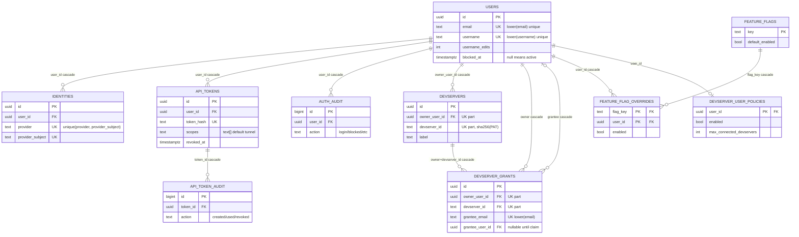

# profile-service design

profile is the gateway's single authoritative store for who a user is: the canonical user record, linked OAuth identities, devservers and the grants that share them, feature flags, durable per-user and fleet devserver policy, and the authentication audit. It is an internal axum service in front of Postgres, called only by identity-service and the operator CLI. This document covers its boundaries, invariants and rationale; the route and configuration catalogs live in [`README.md`](README.md).

## Why a separate service

Three problems need one owner with one transaction boundary. Two writers must not race when a user signs in for the first time on two providers at once. An admin block must revoke every live PAT and durably schedule the fleet-wide cut of the user's tunnels and browser sessions in the same transaction, so a down control plane delays the cut but never loses it. And renames must be capped so the public username namespace (`gw.{domain}/s/{username}`, the `{owner}--{disc}` host labels) does not churn. Putting the rows behind one service with a small HTTP API gives identity, the CLI and the background workers the same serialization points.

## Where it sits

Callers: identity-service over the service bearer for every user, grant, flag and policy question, and the admin CLI over the admin bearer. Callee: devserver-control, through the shared scoped client, for the revocation worker's tunnel kills and session revocations and for the registry sweeper's live-tunnel snapshot. profile holds no sessions (identity owns the only `tower_sessions` table) and renders nothing.

## Schema

One Postgres database, migrated only by the dedicated `CHAN_GATEWAY_MIGRATIONS=only` step; the serving mode never touches DDL. The tables, by role:

- `users` and `identities`: the canonical record and its provider identities, unique per `(provider, provider_subject)`. Email and username are unique case-insensitively.
- `api_tokens` and `api_token_audit`: PATs by digest with their scopes, and the per-token history. identity writes these directly; profile serves the admin views over them.
- `auth_audit`: login, logout, denial, block and similar events per user.
- `devservers`: an owner's shareable devserver, keyed by `(owner_user_id, devserver_id)`, where the id is the digest of the owner's PAT. It is the FK target for grants and lets the dashboard list a devserver that has no grant and no live tunnel yet.
- `devserver_grants`: one binary, whole-devserver grant per `(owner, devserver, grantee email)`, with the grantee user filled in when a matching sign-in is observed. There is no role column.
- `feature_flags` and `feature_flag_overrides`: named flags with a default and per-user overrides.
- `devserver_user_policies` and `devserver_fleet_policy`: durable per-user tunnel policy (enabled, connected-devserver limit) and the seeded fleet singleton for a persistent admissions pause.
- `control_revocation_jobs`: the durable outbox the revocation worker drives.
- `identity_session_index`: identity's own index of authenticated sessions, stored here because the two services share the database; profile never reads it.

*The user-centred tables and their cascades; the migrations under `gateway/migrations/` hold the columns and constraints.*

## Routing and authentication

Two tiers behind two bearers. The service tier (`/v1/users/*`, `/v1/auth-audit`) admits either `PROFILE_AUTH_TOKEN` or `PROFILE_ADMIN_TOKEN`; the admin tier (`/v1/admin/*`) admits only the admin token. Both checks always run, in constant time, so a wrong token cannot oracle which leg matched. The service tier accepting the admin token is what lets a single-token deployment work without code changes, while deployments that want independent rotation just set different values.

## Background work

Two workers start with the HTTP server and stop with it: the revocation worker and the devserver registry sweeper. `http::app` builds the router alone and starts no background work, so tests compose the router without them.

### Durable revocation

Every denial mutation (block, pending delete, PAT revoke, claimed-grant delete, access revoke) writes its primary state, its audit row and a durable revocation-outbox generation in one transaction, then answers. The worker claims the job and runs the data-plane cut against devserver-control: owner-wide tunnel kills and subject session revocation for a subject or account-delete job, an exact revocation for a single-grant job. It confirms a first post-commit cut, waits the entry-credential quiet window (the credential lifetime plus clock skew, so a credential minted just before the denial cannot create a session after the cut), then requires a second confirmed cut before settling. Each cut retries with backoff to a deadline; exhaustion writes one audit row and drops subject and exact jobs.

An account-delete job is never dropped: an exhausted one is reset and rescheduled, and the user row is deleted only after both cuts are confirmed, at which point the foreign-key cascades remove identities, indexed sessions, tokens and grants. While that job exists, generic unblock refuses the account. Every worker write is one statement or one transaction, so an abort, a crash or a SIGKILL leaves each job as it was claimed or as its last finished step left it, and a claim pushes the job's next attempt out, which is how a job claimed by a process that died is picked up by the next one.

### Registry sweeper

The sweeper marks `devservers` rows from the controller's live-tunnel snapshot once a minute and deletes rows that have been offline longer than the configured retention. Rows carrying grants are never swept, and a tick that cannot fetch the snapshot deletes nothing. identity recreates the row on the next validate a dial or lease refresh drives, so a swept devserver is back as soon as it dials again.

## Key decisions

### Atomic upsert by identity

`POST /v1/users/upsert-by-identity` is one transaction: find the identity by `(provider, provider_subject)`; else find the user by email and attach a new identity; else create the user and the identity together. The single transaction closes the orphan window when two browser tabs race a first-time login. Concurrent calls can still collide on the unique indexes; the handler retries on a unique violation and converges on an earlier branch. identity calls only this endpoint, and new code that reaches across users and identities should use the same shape rather than a multi-step dance.

### Email rewrite is admin-only

The service-tier update accepts only display name and avatar. Email is the identity-linking key in the upsert's second branch: a service-bearer holder that could rewrite an email could pivot account ownership to any account whose verified OAuth email matched. Email mutation therefore lives behind the admin bearer, in one transaction with an audit row that records the old and new addresses.

### Deterministic placeholder usernames and a lifetime rename cap

A new user gets `u` plus the first twelve hex digits of its row id, so never-renamed accounts are trivially identifiable and cannot collide with real handles. Renames are capped at four for life. The compare-and-swap update and the no-op "rename to the current value" case run in one statement, and a follow-up select distinguishes "user not found" from "cap reached" only when the statement touched no row, which closes the window a concurrent rename could otherwise exploit. identity renames on first sign-in.

### Devservers are first-class rows

A devserver is a row keyed on `(owner_user_id, devserver_id)`, where the id is the digest of the owner's PAT ([ADR-0001](../../docs/adr/0001-devserver-is-the-sharing-unit.md)). identity creates the row when it mints the PAT, since it holds the raw token to compute the id, so the offline state is always representable before any grant lands or any tunnel registers. Creation is idempotent, and a blank label on a re-issue leaves the stored label untouched and writes no row, so the once-a-minute ensure behind a live tunnel costs no tuple churn. A grant upserts its parent row in the same transaction, so pre-seeding a grant before the devserver registers still produces a valid graph. Token rotation mints a new PAT and therefore a new devserver id, so grants do not survive rotation; that trade-off is settled in the ADR.

### Whole-devserver grants, one access question

A grant gives a collaborator the whole devserver, never a single workspace; the `{workspace}` path segment is tenant routing only. The owner pre-seeds grants by email from the dashboard, before or alongside running the devserver. The grantee user is filled in either at grant time, when a user with that email already exists, or at the grantee's next OAuth callback, when identity asks profile to claim pending grants for the user's verified emails. Re-adding the same email is idempotent and never re-pends a claimed grant.

`GET .../devservers/{devserver_id}/access?as=<caller>` is the single authorization assertion the gate needs. It answers true for the owner or a claimed grantee and the same not-found for every other case, so neither it nor the share landing leaks which devservers an owner shares. The owner passes for any well-formed devserver id, with or without a registry row, so a swept or not-yet-recreated row never denies its owner; identity only ever asks about an owner's own access with an id taken from that owner's live tunnels, so the owner rule opens no path to a devserver that is not live.

Email matching folds both sides with PostgreSQL `lower()`, so a verified address claims a grant made to any case variant of it. Unicode lowering is not injective (the Kelvin sign lowers to `k`), and the gateway accepts that residual rather than fold one side ASCII-only, which would miss genuine non-ASCII case variants. Because `lower()` follows the database's `LC_CTYPE`, the non-ASCII promise holds only on a UTF-8 locale.

### Durable policy, with the drain owned by identity

User policy is one lock-coupled upsert on the canonical user row, so it serializes with block and PAT minting. The fleet singleton always exists after migration, and an unreadable row is an authorization failure, never "enabled". Profile only persists policy; the product-facing drain that follows a stricter policy or a fleet pause is identity's composition, which persists first and then confirms owner-session revocation and tunnel eviction. A failed drain cannot roll policy back, and an equal or stricter retry repeats the drain until the fleet converges.

### Block and delete use the outbox

Block sets the block marker and reason, revokes every live PAT, appends the audit row and reserves the revocation generation in one transaction, then answers accepted; the worker performs the fleet cut, so a down devserver-control delays the cut but never rolls back the block. Unblock clears only the marker and reason: tokens revoked at block time stay revoked, and unblock is refused while an account-delete job is pending. Account deletion blocks the user and revokes PATs but retains the row until the worker's quiet-window cuts settle, so FK cascades fire only at that confirmed finalization point.

### Feature flags resolve closed

A flag resolves to its per-user override when present, else its default, else off, so unknown flags are closed. Neither seeded flag is enforced inside profile: `oauth_login` gates identity's OAuth callback and `share_workspaces` is an SPA-only toggle served through `/api/me`. Both ship default-off, so a fresh deployment refuses every sign-in until an operator grants `oauth_login` to a first user. Override-or-default keeps the rollout knob simple: flip the default once a feature is ready for everyone; revoke an override for a deny rule.

### All SQL is parameterized

Column lists are constants formatted into queries; user input always rides through bound parameters, including the substring search on email in the admin list.

## Invariants

- `users.email` is required and unique case-insensitively; `identities` is unique per `(provider, provider_subject)`.
- `users.username_edits` only increases and is never reset.
- A null `blocked_at` means active.
- Block always revokes every active PAT, appends one audit row and reserves durable fleet revocation in the same transaction.
- Policy writes serialize with PAT mint and block on the canonical user row.
- The fleet policy singleton always exists after migration; an unreadable row is never read as enabled.
- Access revoke and pending delete establish durable denial before any data-plane acknowledgement.
- A grant's `accepted_at` and `grantee_user_id` are null together and flip together at claim time.
- Bearer comparisons run at constant time.

## Error model

`profile::Error` is a `thiserror` enum mapped to precise HTTP statuses with generic public messages; a unique violation surfaces as a conflict and a database failure is logged at error level and answered as an internal error. An unreadable fleet policy is answered as unavailable.

## What is not wired

- mTLS (auth is bearer only).
- Soft deletes (delete cascades via FK after the quiet window).
- Rate limiting on the service API (mitigated at the network layer; the admin tree is bearer-gated by a separate token).
