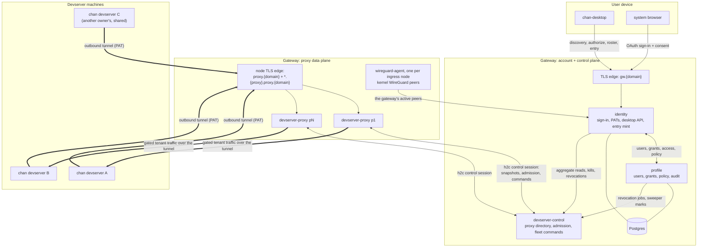
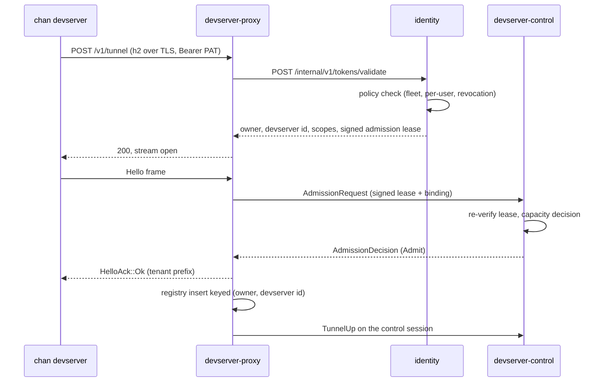
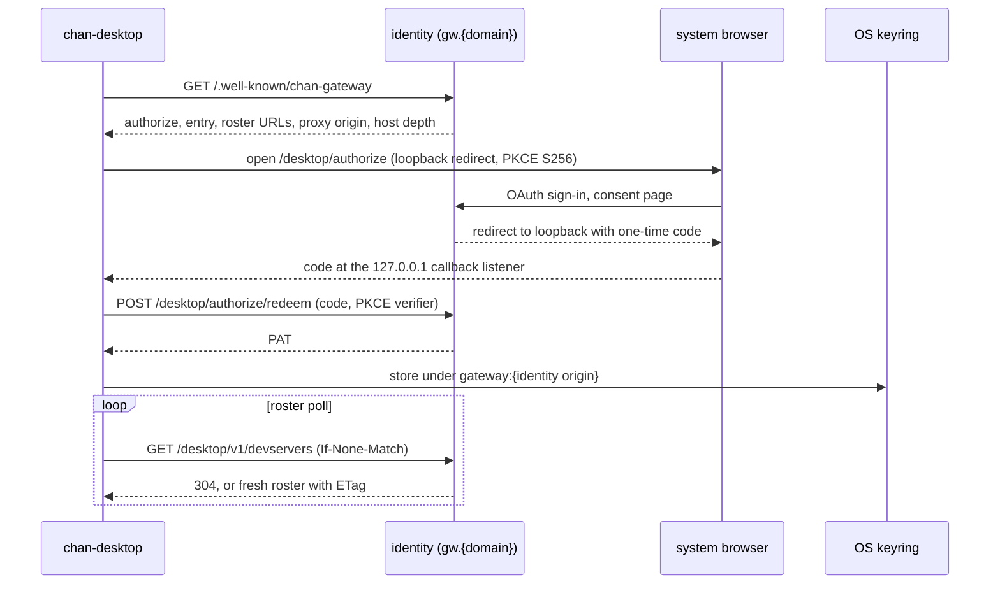
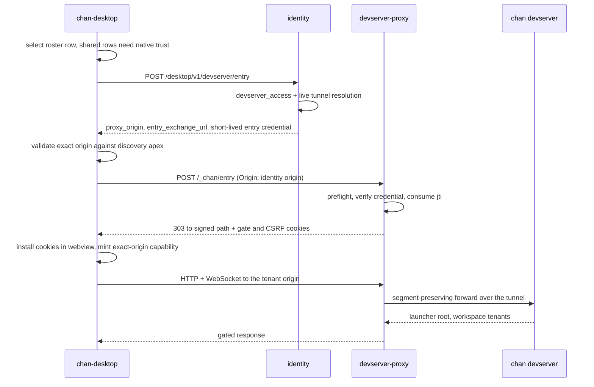

# Gateway design

The chan gateway is the sixth layer of chan: a devserver dials out to a gateway you run, and the gateway publishes it behind sign-in, to its owner and to the accounts the owner shares it with, from any browser or desktop. This is the whole-gateway reference: the deployment boundaries, how a devserver publishes itself, how a desktop account signs in and enters a devserver, how a desktop reaches the proxy nodes through WireGuard, how the control and data planes relate, and the isolation model that holds across all of it. Component contracts (routes, configuration, CLI surface) live in each crate's `README.md`; component boundaries and rationale live in each crate's `design.md`. This document ties them together and does not repeat their catalogs.

The gateway is self-hosted. Its services ship as Debian packages and container images, and nothing about chan is an online service. The maintainer's deployment at chan.app is an experimental instance of the same code with sign-in off by default, not a hosted product.

The unit the gateway exposes, gates and shares is the **devserver**: one `chan devserver` process, identified by the owner's personal access token (PAT), hosting a library of workspaces. An account may own several devservers and hold grants on several more; every rostered devserver is reachable at the same time, capped only at tunnel admission. The `{workspace}` path segment is tenant routing inside a devserver, never a permission key. [`CONTEXT.md`](CONTEXT.md) fixes this vocabulary and [`docs/adr/0001-devserver-is-the-sharing-unit.md`](docs/adr/0001-devserver-is-the-sharing-unit.md) records the decision.

## Deployment boundaries

The gateway splits into an account and control plane and a proxy data plane:

- **identity** answers the public browser origin `gw.{domain}`: OAuth sign-in, the account SPA, PAT lifecycle, the desktop API (authorize, roster, entry) and the share-landing routes. A separate internal listener serves PAT validation to the proxies and the scoped admin trees; it is never published.
- **profile** is internal only and is the only crate that touches the sharing tables. It owns users, OAuth identities, devservers and grants, durable per-user and fleet policy, feature flags and the auth audit, all in Postgres.
- **devserver-control** is a singleton, database-free control plane: the dynamic proxy directory, signed-lease admission, the aggregate tunnel and tenant-session inventory, and command routing. No tenant data crosses it.
- **devserver-proxy** nodes are the data plane. Each node terminates outbound devserver tunnels on an h2c listener behind its TLS edge and serves gated tenant traffic on one public listener that dispatches the configured tunnel-origin host (`proxy.{domain}`) and the node's tenant wildcard (`*.{proxy}.proxy.{domain}`) on the raw `Host` header. A proxy holds no database and no signing keys.
- **wireguard-agent** runs on each proxy node that offers a WireGuard ingress: a kernel WireGuard interface of the node's own, in front of its devserver-proxy. It reads the gateway's active peers from identity's internal listener, the same list on every node, and applies them to that one interface with `wg`, adding and removing only the peers it added itself. It holds no database, no listener and no signing keys.
- **Postgres** backs identity and profile only.
- **admin** is the operator CLI. It holds no state and calls the scoped admin trees of profile, identity and devserver-control.

Every service listener binds loopback by default. A cleartext non-loopback bind requires an explicit assertion (`CHAN_GATEWAY_INTERNAL_TRANSPORT=protected-overlay`) that an authenticated, encrypted overlay carries the traffic; a bearer authenticates a caller but does not make cleartext private. TLS edges front exactly two surfaces: the identity public origin and each proxy node (the namespace tunnel ingress and its own tenant wildcard). Database migrations are a dedicated step (`CHAN_GATEWAY_MIGRATIONS=only`, run with the owner credential); every runtime service boots with `=external` and never applies DDL.

*The two planes and who talks to whom: browsers and desktops reach identity, devservers dial the proxy nodes, and only metadata crosses the controller.*

## Devserver publication

A devserver publishes itself with nothing but an outbound connection and a PAT: no inbound port, no DNS and no TURN or STUN stack. The PAT is the only credential the devserver holds, and the devserver id is the SHA-256 digest of the raw PAT (`chan_tunnel_proto::gateway_assertion::devserver_id_from_token`), so one token identifies one devserver. The same digest is what identity stores for the token, in a different encoding; identity emits a plaintext PAT exactly once, in the creation or desktop-redemption response, and persists only the digest.

The devserver presents its PAT once per dial in the tunnel `Authorization` header and again, periodically, in lease-refresh frames for the life of the tunnel. The proxy forwards the PAT to identity for dial validation, for a bounded number of Hello-name announcement attempts, and for every lease refresh; it never sends it to devserver-control. While a tunnel is connected the proxy process also holds the PAT inside the h2 connection's header decoder; `crates/chan-tunnel-server/design.md` covers that residual. The client requires HTTPS to the tunnel URL unless its cleartext peer is verified loopback. chan-desktop separately presents its own stored PAT directly to identity on every roster request and entry mint, and presents a PAT it will not keep once more, to revoke it.

The ordered gates:

1. **Tunnel dial.** The devserver opens TLS with ALPN h2 to the configured tunnel ingress, `proxy.{domain}`, and sends one stream, `POST /v1/tunnel`, with the PAT as bearer.
2. **PAT validation.** Before any success, the proxy asks identity's internal listener, throttled per token fingerprint. Identity checks the token digest and the durable policy (fleet admissions, per-user enabled flag, suspension), then returns the owner, the devserver id, the scopes and a short-lived Ed25519 admission lease. The lease binds owner, devserver id, registration id and proxy id and carries the signed per-owner connected-devserver limit.
3. **Admission.** The proxy admits nothing unless its control session is at `FleetReady`. devserver-control re-verifies the lease signature and binding, then decides `Admit`, `AtCapacity`, `Stale` or `ControlWarming`. The capacity rule is the smaller of the controller's deployment ceiling and the signed per-user limit. Refusals reach the client as `HelloAck::Refused` with a machine-readable code.
4. **Registration and readiness.** On `Admit` the client sees `HelloAck::Ok` with its tenant prefix, the registration enters the proxy registry keyed by `(owner, devserver id)`, and the tunnel becomes a yamux transport. The proxy publishes the row to devserver-control, so the fleet view and the entry path agree on liveness.

The whole path fails closed: a proxy whose control session is down admits nothing, and when the controller stays unreachable past a bounded grace window the proxy evicts every tunnel and clears every browser session rather than serve stale authority. Once registered, the devserver serves the launcher SPA at its root and each workspace tenant at `/{slug}-{8hex}/`; the proxy forwards the tenant host's path unchanged.

## Desktop account lifecycle

A desktop learns everything it needs from one discovery document; no gateway URL is compiled in. Gateways are user-added entries in the desktop configuration, each holding the public identity origin.

- **Discovery.** `GET {gateway}/.well-known/chan-gateway` returns the desktop authorize, entry and roster URLs, the devserver proxy origin and its host depth, and, on a gateway that enrolls WireGuard keys, its ingresses ([WireGuard ingress](#wireguard-ingress)). The desktop rejects any answer whose URLs are not same-origin with the configured gateway and requires HTTPS outside loopback.
- **Browser authorization with PKCE.** Sign-in opens the system browser at `/desktop/authorize` with a loopback redirect, a PKCE S256 challenge and a scope request (`desktop.account` for account mode; `tunnel` for a CLI PAT). The user completes ordinary OAuth sign-in, which the `oauth_login` feature flag gates, and a server-rendered consent page. Approval yields a one-time, short-lived code delivered to the loopback listener, never a URL fragment or a registered scheme. The PAT secret never rides the browser.
- **Redemption and storage.** The desktop redeems code plus verifier at `/desktop/authorize/redeem` for a scoped PAT and stores it in the OS keyring keyed by the gateway's identity origin. A PAT the desktop will not keep, because it refused the answer or could not decode it past the token, its store failed, or the sign-in was cancelled while the redeem or the credential commit ran, is revoked at `DELETE /desktop/v1/token` with the token as its own bearer; the desktop reads the route's 204 as revoked, a 401 as nothing left to revoke, and any other answer (an identity from before the route answers its sign-in page) as a failed revoke.
- **Roster polling.** The desktop polls the roster URL with the PAT bearer and the last seen ETag. The roster lists every devserver the account may enter, owned and shared, each with its immutable identity (owner user id, owner username, devserver id), a label, liveness and its exact proxy origin while online. A rejected credential is terminal and the desktop clears it; any other failure keeps the last roster, and repeated failures mark the gateway unreachable. The server never degrades to a partial roster.

## Entering a selected devserver

Entry is where the desktop's explicit, immutable roster identity meets the proxy's exact-origin gate. The browser never sees a credential in a URL, and the Tauri webview never performs the exchange itself.

1. **Selection and shared-devserver trust.** The roster row's identity is explicit and immutable: owner user id, owner username and full devserver id. Entering a devserver owned by someone else first requires persisted native trust keyed by that owner id and devserver id, never by labels or origins, which can change.
2. **Entry authorization.** The desktop posts the target to the entry URL. Identity runs the profile `devserver_access` check, resolves the named live devserver, and mints a single-use, short-lived Ed25519 entry credential for the desktop client: it names the devserver id, the exact tenant origin as audience, the proxy node, a random replay id and the signed redirect path. The response carries the proxy origin and the exchange URL and is never cacheable.
3. **Exact-origin validation.** Before using the answer, the desktop verifies the proxy origin against the discovery document: same scheme and effective port as the proxy apex, exactly two labels below it, and a first label equal to `{owner}--{disc}` where `disc` is a fixed-length prefix of the requested devserver id. The exchange URL must be exactly `{proxy_origin}/_chan/entry`, and a later entry for the same devserver may not move the pinned origin.
4. **Cookie exchange.** The desktop's Rust side, not the webview, posts the credential as the single field of a bounded form to `/_chan/entry` with the identity origin as the exact `Origin` header. The proxy preflights the request shape before consulting its registry, so probes learn nothing, verifies the credential against its public key ring, consumes the replay id in a proxy-local cache, and answers a redirect to the signed path with two host-only cookies: `__Host-devserver_gate` (HttpOnly, the opaque proxy-local session) and `__Host-devserver_csrf` (readable by same-origin JS, mirrored into `X-Chan-CSRF` on unsafe methods).
5. **Capability minting.** The desktop installs both cookies into the webview's cookie store, mints a runtime Tauri capability whose remote URLs are exactly that one origin, and navigates the window to the clean path.
6. **The data path.** Every request to the tenant origin passes the proxy gate in order: a live session record matching the audience, the devserver id and the owner; an exact-Origin check on WebSocket upgrades; the CSRF mirror on unsafe methods. What passes is forwarded unchanged over the yamux tunnel with a per-tunnel HMAC gateway assertion carrying the session's client type, and the devserver routes the tenant internally. Sessions re-mint on expiry by repeating the exchange.

The browser counterpart shares the same machinery. The dashboard's Open action, on the user's own devservers and on the ones shared with them, and the share links mint the same credential for the browser client at click time and hand the browser an auto-submitting form that posts the same exchange, so the credential never rides a URL there either. Both share links, the whole-devserver root `/s/{owner}` that the dashboard's Copy link copies and `/s/{owner}/{workspace}`, admit the owner and every accepted grantee and answer anyone else with the not-found an unknown handle gets; the `?d=` selector names one devserver when several are live, and an ambiguous selector is refused, not guessed.

## WireGuard ingress

A gateway can also let desktops reach its proxy nodes through WireGuard. The offer is optional and absent until the operator configures it, and identity stays on its public origin either way: a desktop reads discovery and signs in before and without any tunnel.

Each proxy node that offers it terminates WireGuard in a kernel interface of its own, under its own key and endpoint. That interface is the node's **ingress**, and its id is the node's proxy id. Every ingress interface answers on the same tunnel addresses, where the node's TLS edge serves the node's names as it does on the public path, and the endpoint, a UDP port on the node, is the only listener an ingress adds. No ingress forwards for another node. A tenant origin names its node (`{owner}--{disc}.{proxy}.proxy.{domain}`), so the tunnel that carries a tenant name ends on the node that holds that devserver's tunnel, and WireGuard traffic takes the direct path every other tenant byte takes ([ADR 0004](docs/adr/0004-one-wireguard-ingress-per-proxy-node.md)).

identity holds the list of ingresses (an id, a public key and an endpoint per node, in the operator's order), the tunnel addresses they share and the CIDRs a desktop routes through a tunnel. It derives each ingress's host map from them: the node's name and every name below it, mapped to the tunnel addresses, so a tenant name is carried only by its own node's tunnel. profile holds the address pool and the peer table: one peer per public key across the gateway, tied to its user and to the PAT that last enrolled it, with one address set that every ingress accepts. A proxy node holds neither. Its wireguard-agent reads the active peers through identity's internal listener and applies them to the node's interface.

Enrollment rides the desktop sign-in. Discovery lists every ingress with its endpoint, key and host map, beside the allowed CIDRs and the keepalive they share. A desktop that holds a WireGuard key sends the public half with its authorize request, and the consent page names every ingress the key is enrolled with. On approval identity mints the PAT, asks profile to enroll the key against it, once for the whole gateway, and only then issues the one-time code; a failed enrollment revokes the undelivered PAT and fails the sign-in. The redeem answers the PAT with the peer's address set and the same ingress list.

Every agent polls the same list, so every ingress accepts every enrolled key and nothing restricts a peer to a node. With enrollment configured, identity answers 404 to an agent whose host id is not in its ingress list. The list is the same for every host, so serving that agent could not wipe or misplace a peer; the 404 flags that the agent's host id and identity's list disagree. An agent applies nothing but a served list, so it keeps the peers it has: a PAT revoked, expired or blocked meanwhile stays a kernel peer on that node until its host id is configured or its interface is taken down. A node taken out of the list therefore has its agent stopped and its interface taken down. A gateway with no enrollment configured has no list to disagree with, and identity relays profile's list to any well-formed host id.

Discovery and the redeem also describe the first ingress of the list on its own, in the fields a desktop that reads no list uses. chan-desktop is such a desktop: it enrolls against the first ingress and runs one tunnel, which carries that node's names, and it reaches a name on any other node outside the tunnel, on the public path. The order of the list is therefore the operator's choice of the node desktops reach through WireGuard. The variables, the wire shapes and the route are in [`crates/identity/README.md`](crates/identity/README.md#wireguard-enrollment), the pool and the peer table in [`crates/profile/README.md`](crates/profile/README.md), and the agent in [`crates/wireguard-agent/README.md`](crates/wireguard-agent/README.md).

## Control plane and data plane

devserver-control owns everything about the fleet that must be coherent: the proxy directory (each proxy node dials out to it and holds one authenticated h2 control session), admission authority, the aggregate tunnel and tenant-session inventory, and command routing. Proxies push a full snapshot plus generation-stamped deltas; after a convergence window the controller declares `FleetReady`, and only then do proxies admit. Version lockstep is enforced at the control handshake. Tenant bytes never cross the controller: it carries metadata and commands only, which is why a singleton suffices ([ADR 0002](docs/adr/0002-control-plane-owns-proxy-fleet-state.md)).

identity, profile and the admin CLI read the aggregate `/admin/v1/*` view from the controller under per-caller scoped credentials, never through a query-time fan-out to proxy-local state. Revocation rides the same authority:

- **PAT revocation** durably revokes the token in profile, then identity makes a best-effort cut of the owner's live tunnels and browser sessions through the controller. Identity cuts all of the owner's tunnels rather than only the revoked PAT's, because the revoke path does not map the token to its devserver id; other PATs simply redial. Profile's durable worker confirms the cut again after the entry-credential quiet window, so a credential minted just before the revoke cannot outlive it.
- **A desktop's self-revoke** soft-revokes the presented PAT in identity under an audit action of its own. A token never used cuts nothing; a used one, a stolen token or one another reader of the desktop's credential store picked up before a cancelled sign-in took it back, also gets the PAT revocation cut above.
- **Blocking a user** is one profile transaction (block marker, every PAT revoked, audit row, durable outbox job); a background worker retries the fleet cut to a deadline and settles before reporting completion. Unblocking restores none of it: tokens stay revoked.
- **Operator session and tunnel commands** are acknowledged distributed operations: the controller answers only when every addressed proxy has confirmed the kill or the session drain, and reports a partial failure explicitly instead of pretending coherence.

A WireGuard peer needs no revocation path of its own. The list the agents read holds only the peers whose PAT is live and unexpired and whose user is not blocked, so every path above drops the peer from the list in the same transaction that denies the token. Every node's agent reads that one list, so the peer leaves every ingress, each at the next poll identity serves its agent. An agent that identity does not serve, because identity is unreachable or answers it 404 ([WireGuard ingress](#wireguard-ingress)), keeps the last list it read, the denied peer included; it never reads an unknown list as an empty one. The peer's addresses stay held until profile's sweeper releases them, after a grace of five minutes by default.

## Isolation model

Cross-tenant isolation rests on three pillars, all visible in the lifecycles above:

- **No shared cookies.** identity's `__Host-id_session` is host-only on `gw.{domain}`; the proxy's gate cookies are host-only on the exact tenant origin. No parent-domain cookie exists, so a browser never auto-attaches an account session to a sibling tenant. The gate cookie's whole-host `Path=/` scope is safe precisely because a grant covers the whole devserver: there is no non-granted tenant on the same host to isolate it from.
- **Signed, bound credentials.** The entry credential binds subject, owner, devserver id, exact audience and proxy id, is short-lived and succeeds once. The admission lease binds the tunnel registration the same way. Proxies hold only verifying keys; a compromised node cannot mint entries or admissions.
- **A hostile-network proxy.** The proxy trusts no inbound forwarding header, strips hop-by-hop headers and the inbound `Host`, `Cookie`, `Authorization` and `X-Chan-CSRF` before forwarding, recomputes `X-Forwarded-*` itself, and answers the unknown, the unauthenticated and the unauthorized with one negotiated not-found shape so probes cannot enumerate registrations.

## Documentation map

| Document                         | Role                                      |
|----------------------------------|-------------------------------------------|
| `gateway/README.md`              | Front door: overview, components, dev     |
| `gateway/design.md`              | This document: design and lifecycles      |
| `gateway/CONTEXT.md`             | Glossary of current terms                 |
| `gateway/docs/dev-setup.md`      | Production-shaped local stack             |
| `gateway/docs/adr/`              | Decisions and rejected alternatives       |
| `gateway/crates/*/README.md`     | Run, config, route and CLI contracts      |
| `gateway/crates/*/design.md`     | Boundaries, invariants, rationale         |
| `packaging/gateway/scripts/dev/` | Local runner (canonical dev stack)        |
| `packaging/kube/README.md`       | Kubernetes and sdme deployment            |
