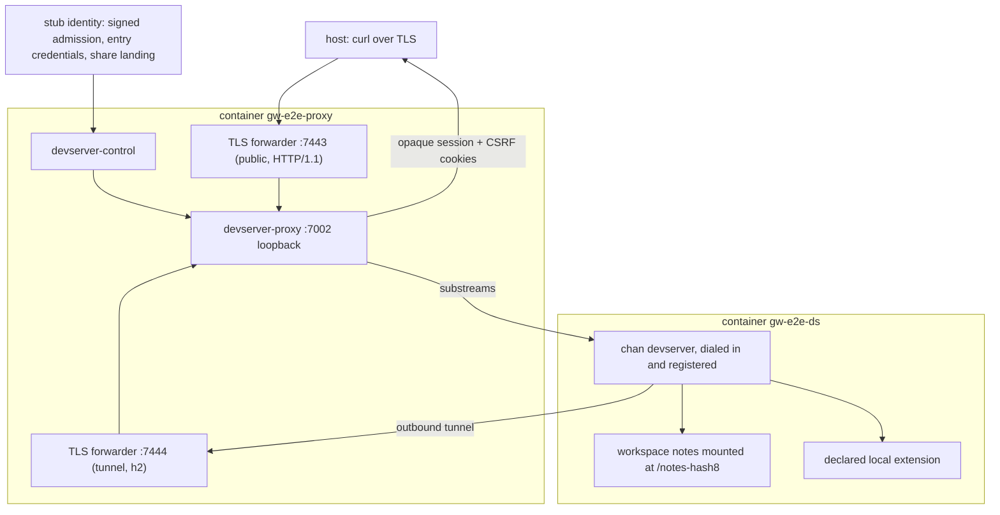

# devserver tunnel e2e (cross-container, sdme)

An end-to-end test that drives authenticated desktop entry handoffs through a real `devserver-control-service`, `devserver-proxy-service`, and `chan devserver run --tunnel-url`, running in two separate sdme containers, over the gateway tunnel, into a mounted workspace. An authenticated `200` from the mounted workspace's `/api/health` is the data-path proof, so debug builds do not need a separately staged SPA bundle. The same owner and grantee sessions exercise both native-trust mutation routes, and both reach the desktop-bridge guard: a grant is all-or-nothing on the devserver.

## What it proves



*Two containers in one sdme zone: the devserver dials the proxy's tunnel edge; the host reaches the tenant origin through the public edge.*

The request `GET /notes-<hash8>/api/health` at the exact `{owner}--{disc}.{proxy_id}` origin returns `200` with the live workspace instance id. The bearer-gated identity response pins the immutable owner UUID, the full devserver id, the exact proxy origin, the fixed `/_chan/entry` exchange URL, and a separate short-lived Ed25519 credential. The credential carries no name, email, or role, never appears in a URL, and succeeds exactly once in a bounded form POST from the configured identity origin. The real proxy exchanges it for opaque session and CSRF cookies.

With those authenticated sessions, the harness sends both `PUT` and `DELETE` to `/api/library/devservers/{id}/native-trust`. The caller whose subject UUID equals the immutable owner UUID gets the expected no-desktop conflict, and so does the binary grantee; no viewer or editor role exists.

Every entry credential names the client it was minted for, as identity's do: the desktop entry responses carry `client: "desktop"`, and the stub's share landing (`GET /s/{owner}/{workspace}` with the stub's browser-session cookie) hands off a `client: "browser"` credential in the same no-store form page identity serves, which the harness exchanges for the owner's browser session. The reverse-tunnel legs (`/api/library/tunnel/control` and `/api/library/tunnel/conn`, for a tunnel id nobody registered) then separate the callers. The owner's desktop session reaches both legs past the gate, including a real WebSocket upgrade through the TLS edge to the control leg's handler. The owner's browser session and the grantee's desktop session are refused on both legs and on the upgrade. The devserver's journal must show each request accepted with the caller's subject and client (`client=desktop` or `client=browser`) and a `reverse tunnel leg refused` line for each refusal. The owner's browser session still reaches the workspace, and after the owner's sessions are revoked later in the run it is refused too: a revocation reaches every client's session of the principal.

The devserver also runs a declared local extension (`e2e-extension.py`, started by chan from `~/.chan/extensions/e2e.toml`), and the harness proves no caller reaches it without signing in. The extension's capability link from the tenant catalog answers the CORS-readable not-found to a cookieless fetch, a navigation with no session cookie, and a POST, and the extension's own request log stays untouched. Then for the grantee and for the owner in turn: an iframe navigation of that link carrying the session cookie is redirected to a bound path; a cookieless GET and a cookieless, CSRF-less POST on the bound path reach the extension (its log records exactly those two requests) and the devserver's journal records both as accepted from that user's subject; on the grantee's bound path, dot-segment climbs in several encodings, each of which would land on the tenant's own `/api/health` if any layer resolved it, are sent as GET and POST and must get the proxy's own not-found body while the extension's log gains nothing and the journal gains no accepted assertion, and the near miss `a..b` must still reach the extension; after devserver-control revokes that user's sessions, the bound GET, the bound POST and a new navigation with the revoked cookie are all refused and reach nothing. The devserver journal must hold no nil or empty subject, accepted or refused.

The controller, proxy, and chan binaries (including the tunnel-client and tunnel-proto crates) are real release builds. Two narrow pieces are fixtures because the rig does not stand up Postgres-backed identity and profile or an edge TLS proxy:

- **stub identity** (`stub-identity.py`): accepts one exact internal bearer and tunnel PAT, signs a controller-bound admission lease for the proxy-generated registration UUID, exposes owner and grantee desktop entry responses (desktop credentials), and serves share-landing handoff pages for a fixed per-caller browser-session cookie (browser credentials). It runs on the proxy container's loopback.
- **credential helper** (`mint-signed-credential.py`): signs the current Ed25519 admission and entry wire formats with per-run keys; an entry credential takes the client (`--client desktop|browser`). The controller and proxy receive only verifying keys.
- **TLS forwarders** (`tls-forward.py`): expose the proxy's loopback-only listeners through a per-run CA. Public HTTP negotiates only HTTP/1.1 and the tunnel negotiates only h2. No `protected-overlay` assertion is made for the ordinary sdme bridge.

## Topology: why one zone, two containers

Two separate sdme zones are not reachable with sdme-only privileges, and `zone-isolation-probe.sh` demonstrates why:

| path                              | result                                   |
|-----------------------------------|------------------------------------------|
| host -> container                 | OK                                       |
| container -> host (TCP)           | BLOCKED (ICMP only; host INPUT firewall) |
| container -> container, same zone | OK                                       |
| container -> container, cross zone | BLOCKED                                 |
| `-p` published port, cross zone   | BLOCKED                                  |

Each zone bridge (`vz-<zone>`) reuses `169.254.0.0/16`, and the host drops container-initiated TCP to itself and forwards nothing between zone bridges. So a container can only initiate TCP to a same-zone peer. The tunnel is `chan devserver` to `devserver-proxy` (client to server), so the two must share a zone. Bridging two isolated zones would need host `iptables` or forwarding changes as root; the e2e's sudo is `sdme`-only (`NOPASSWD /usr/local/bin/sdme`).

The containers are still fully separate (own netns, filesystem, process tree); the tunnel genuinely crosses between two containers. Only the L2 zone is shared.

## Run

```sh
# 1. Build the three release binaries inside the toolchain container (one-time,
#    slow cold; reuses the cargo cache after). No host rust toolchain needed.
packaging/gateway/scripts/dev/sdme/devserver-tunnel-e2e/build-bins.sh

# 2. Run the e2e (builds the chan-e2e-run runtime rootfs on first run).
packaging/gateway/scripts/dev/sdme/devserver-tunnel-e2e/run.sh

# tear down
packaging/gateway/scripts/dev/sdme/devserver-tunnel-e2e/run.sh --clean

# the network finding, standalone
packaging/gateway/scripts/dev/sdme/devserver-tunnel-e2e/zone-isolation-probe.sh
```

`run.sh` leaves the containers up on PASS for inspection (`sudo sdme join gw-e2e-proxy`, `sudo sdme logs gw-e2e-ds`).

## The nginx edge

`tls-forward.py` is what the rig puts in front of the tunnel listener, so a plain run exercises no nginx. `nginx-edge.sh` adds the ingress a production deployment runs: nginx terminating TLS and h2 on the apex and `grpc_pass`ing `/v1/tunnel` as h2c into devserver-proxy's tunnel listener. It runs against a rig that is already up, and moves only the devserver's `--tunnel-url`.

```sh
# build the rootfs the nginx binary comes from (one-time)
sudo sdme fs build -f chan-e2e-nginx packaging/gateway/scripts/dev/sdme/devserver-tunnel-e2e/nginx-edge.sdme

packaging/gateway/scripts/dev/sdme/devserver-tunnel-e2e/nginx-edge.sh up
packaging/gateway/scripts/dev/sdme/devserver-tunnel-e2e/nginx-edge.sh scenario
packaging/gateway/scripts/dev/sdme/devserver-tunnel-e2e/nginx-edge.sh clean
```

The edge runs inside `gw-e2e-proxy`, beside the terminator, because that is where production runs it and because nothing else can reach the listener: devserver-proxy puts `TUNNEL_BIND_ADDR` through `require_protected_listener`, which refuses a non-loopback cleartext listener unless the operator declares `CHAN_GATEWAY_INTERNAL_TRANSPORT=protected-overlay`. `scenario` stops and restarts the terminator behind the edge and times what the devserver, the terminator and nginx each report. `clean` restores the devserver's tunnel URL and removes the edge; the rootfs stays for the next run.

One thing the edge configures that a default nginx does not: the idle timeouts. A registered tunnel is one request that carries nothing between uses, and nginx's `client_body_timeout` bounds how long it waits for more of a request body; at its default that closes an idle tunnel and the devserver redials, over and over. `EDGE_BODY_TIMEOUT` sets it, and the effect tracks the setting: at a short value consecutive idle tunnels last that long, and at `1h` a tunnel survives a long idle window untouched. `EDGE_GRPC_TIMEOUT` sets `grpc_read_timeout` and `grpc_send_timeout`, which nginx separates: the read timeout bounds how long the upstream may stay silent, while the send timeout is armed only while a write to the upstream is pending, so it is not an idle timer. The edge sets both long: the read timeout because an idle tunnel would otherwise reach it, the send timeout defensively. Anything running nginx in front of a real tunnel needs `client_body_timeout` and `grpc_read_timeout` set long.

## Files

| file                        | role                                                  |
|-----------------------------|-------------------------------------------------------|
| `build-bins.sh`             | container build of the three release binaries         |
| `chan-e2e-run.sdme`         | runtime rootfs (ubuntu, iproute2, curl, python3)      |
| `run.sh`                    | stand up containers, register, drive the requests     |
| `stub-identity.py`          | tunnel validation, desktop entry, share landing       |
| `mint-signed-credential.py` | mint Ed25519 admission and entry credentials          |
| `tls-forward.py`            | exact-ALPN TLS edges for public HTTP and h2           |
| `e2e-extension.py`          | declared local extension: entry doc, echo, log        |
| `zone-isolation-probe.sh`   | demonstrate same-zone OK, cross-zone BLOCKED          |
| `nginx-edge.sdme`           | rootfs carrying the distribution nginx binary         |
| `nginx-edge.sh`             | the production nginx grpc_pass ingress, in front of the terminator |

## Config the harness sets

| name                    | value                                                  |
|-------------------------|--------------------------------------------------------|
| `APEX_HOST`             | `proxy.localtest.me`                                   |
| `WILDCARD_SUFFIX`       | `.proxy.localtest.me`                                  |
| `FORWARDED_PROTO`       | `https`                                                |
| proxy public / tunnel   | loopback `:7002` / `:7100`; TLS edge `:7443` / `:7444` |
| `IDENTITY_URL`          | `http://127.0.0.1:7799` (loopback stub)                |
| `CHAN_DEVSERVER_LISTEN` | `1` (bind the management API; the host reads the mounted prefix) |
| devserver `RUST_LOG`    | `info,chan_server::devserver=debug` (logs subjects)    |
| tenant                  | user `alice`, workspace `notes`                        |
| desktop entry origins   | `alice--<id-prefix>.p1.proxy.localtest.me:7443`        |
