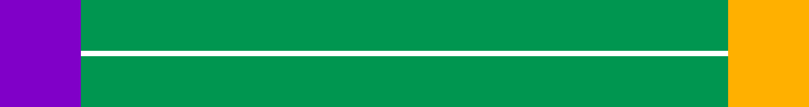
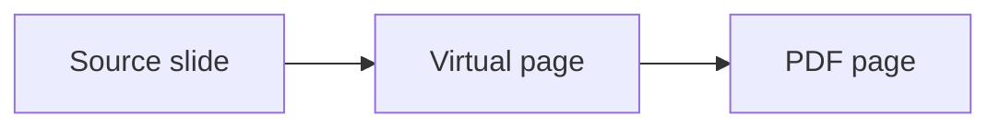
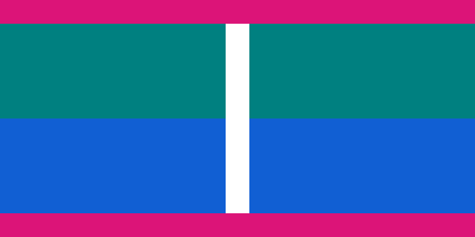
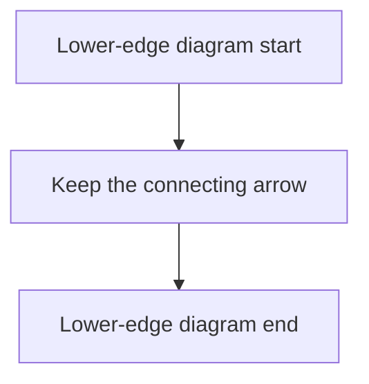

---
chan:
  kind: slides
  slides:
    aspect_ratio: "16:9"
---

# Wide image

Ordinary text, **bold text** and `inline code` expose the selected theme. Both coloured end caps and the white centre line belong to the image.

# Mermaid diagram

# Excalidraw diagram

The scene's blue rectangle and overlapping red ellipse should both be visible.

# Tall image

The source image's orange foot marks its lower edge. The complete slide may scale to fit its virtual page.

<h1>Image near the lower edge</h1>
The boundary image starts 440 pixels below the slide content's top and ends at 700 pixels. All four coloured bands and the white centre stripe belong to this slide.

# Diagram near the lower edge

The space above the Mermaid diagram places it near the virtual page's lower edge before fitting.

