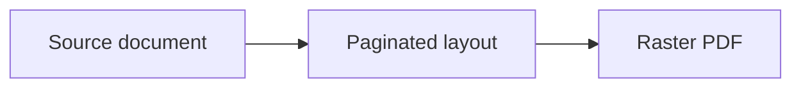
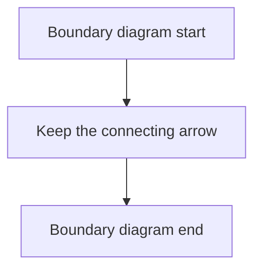

# Export reading: document

Ordinary text, **bold text**, *italic text* and `inline code` establish the document's foreground and background. The images retain their authored colours; Mermaid and Excalidraw use the selected editor theme.

## Wide image

The complete wide image has a violet left cap, a green middle, an amber right cap and a white centre line. Its native size is 1800 by 240 pixels.

## Mermaid in normal flow

# Tall image

The blue image has an orange foot. Its requested width is 600 pixels, giving a height of 1200 pixels before pagination; both the blue body and orange foot belong to one source image.

Text after the tall image identifies the end of this section.

<h1>Image across a page boundary</h1>
The image starts 850 pixels into this 1250 pixel block. Its rose top and bottom borders, teal upper half, blue lower half and white centre stripe identify the parts on either side of a cut.

# Mermaid near a page boundary

This fixed space puts the following diagram near the end of the printable page. The export can move the whole diagram; the resulting gap and page position are part of the reading.

Text after the Mermaid diagram identifies the complete lower edge.

# Excalidraw near a page boundary

This real Excalidraw scene holds a blue rounded rectangle and an overlapping red ellipse. The space before it puts the drawing near the printable page edge.

Text after the Excalidraw drawing identifies the complete lower edge.
