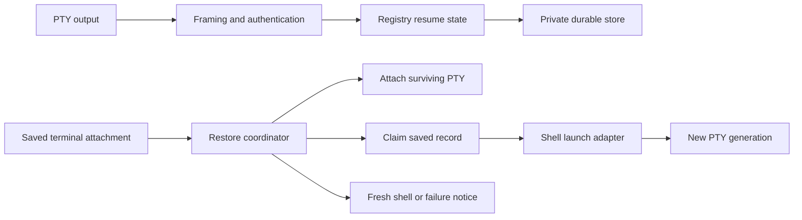

# A program in a chan terminal cannot register how to resume itself (OSC 7577)

Status: accepted for v0.136.0 by the owner on 2026-11-27, as an early item of the cycle ("including dev/osc-7577-program-resume-plan.md as an early item"); not started. The default of the setting, on or off, is open with the owner (section 16).

Record: the implementation plan below was prepared on 2026-11-26 in the development tree (`dev/osc-7577-program-resume-plan.md`) and is this row, copied whole with its links re-based. Its investigation read `main` at `3a34491ceeb70bc5b38e07f56495371582837eeb` and the terminal migration branch `v0135/int` at `2845363e388ce65bb30f8da77892a33fc5eb5356`; both are evidence snapshots. The migration shipped in v0.135.0. Of the files section 2 cites, `crates/chan-library/src/terminal_sessions.rs` changed between that snapshot and the v0.135.0 release commit (the replay's start screen and the lost tail's recovery); the others did not (`git diff --stat`). Work package A reads the baseline again before anything is built.

## 1. Intended result and decisions

A program running in a chan terminal can register how to resume itself through OSC 7577. When chan later needs to recreate that terminal, it can run the registered command in the original terminal's place. Reconnecting a viewer to a surviving process continues to attach to that process. Workspace terminals and standalone terminals use the same implementation and behavior.

The setting is `terminal.program_resume`, presented as **Program resume (OSC 7577)** in **Settings -> Terminal**, beside Program status (OSC 7501).

### Confirmed by the owner

- Cover terminals in both standalone windows and workspace windows, including tabs and splits.
- Provide an on/off setting in the existing settings menu, following the OSC 7501 presentation pattern.
- Account for the ongoing migration to Ghostty VT on `v0135/int`.
- WSL is excluded. This exclusion does not exclude native Windows terminals.
- Do not implement special tmux restoration. A future tmux implementation can report its own resume command; chan handles that outer program through the generic mechanism. tmux remains responsible for its panes and applications.
- Keep this plan in one file. It was written under `dev/`, and the owner moved it into the roadmap as this row on 2026-11-27.

### Proposed product policy, not yet owner decisions

- Default the setting to off. Enabling it authorizes automatic resumption of eligible authenticated reports, without a confirmation on every restart. The default remains the one outstanding product choice; it does not block writing this plan or building the protocol core.
- Turning the setting on enables newly created PTYs. Turning it off revokes acceptance and pending restoration, and discards retained resume records. Turning it back on does not revive discarded records or retrofit credentials into running programs.
- Restore on demand when a saved terminal is materialized by the existing layout/attach flow. Do not eagerly start every hidden terminal at server boot.
- Preserve eligibility across application shutdown, crash, reboot, and workspace off/on while the terminal's saved placement remains. Explicit terminal close, window discard, workspace forget, and deliberate terminal replacement remove eligibility.
- A terminal that cannot be resumed falls back to a normal shell with a concise reason. Do not automatically retry a failed resume on every restart.
- Resume support does not make transient control windows, throwaway default-terminal launches, or windowless sessions durable. Their existing lifetime policy remains authoritative. All ordinary durable terminal creation paths, including `cs` and Team Work, participate.

### Out of scope

- WSL transport, Linux PID/path interpretation from a Windows host, and forwarding credentials into a WSL distribution.
- Discovering commands by process name or reconstructing commands that did not report a resume instruction.
- Capturing an application's own editor/session state, or maintaining its state files.
- Reconstructing tmux panes, inventing tmux resume commands, or adding a tmux session manager.
- Restoring shell variables, shell history, stopped jobs, or screen contents as part of program resume.
- A public `cs resume` emitter, a per-program allowlist editor, or a new resume-management page. These can be separate requests.
- xterm.js implementation work or changes to the vendored Ghostty WASM merely to recognize this application protocol.

## 2. Evidence and integration points

These observations come from the inspected code. Proposed module and type names later in this document are design suggestions, not existing APIs.

- [Terminal registry](../../../crates/chan-library/src/terminal_sessions.rs): `Registry` owns PTYs independently of WebSocket attachments. `Session::spawn` creates the child and environment. `get_or_create_for_ws` attaches to an existing session or creates a replacement when the old identity is unknown. `restart` replaces a session in place under a new generation.
- [Existing OSC 7501 implementation](../../../crates/chan-library/src/terminal_sessions/program_status.rs): framing and retained program status live beside the output ring. Its parser also observes prompt/reset events, whose effects must not become resume-record policy.
- [PTY output path](../../../crates/chan-library/src/terminal_sessions.rs): `record_output` runs the tmux gate; `record_plain_output_with_foreground` updates observers and the output ring. Recording and attach snapshots share a lock. Filesystem writes or process-table scans must not be added beneath that lock.
- [Spawn environment](../../../crates/chan-library/src/terminal_sessions.rs): chan-owned environment keys are applied after caller entries and removed when absent. `CreateOptions.env` is retained, exposed through existing session helpers, and included in fd-store metadata. The new secret cannot be placed in that general-purpose map.
- [Shell construction](../../../crates/chan-library/src/terminal_sessions/platform.rs) and [shell profiles](../../../crates/chan-library/src/terminal_sessions/shell_profiles.rs): current command launches use shell command strings; there is also an internal direct-argv `SpawnProgram::Exec` arm. Neither by itself supplies the proposed interactive resume handoff.
- [Configuration](../../../crates/chan-library/src/config.rs), [preferences route](../../../crates/chan-server/src/routes/preferences.rs), and [config watcher](../../../crates/chan-server/src/config_watch.rs): OSC 7501 has a boolean setting, omission-preserving preference updates, live registry application, and propagation to other tenants through the shared configuration watcher.
- [Terminal settings component](../../../web/packages/workspace-app/src/components/settings/TerminalSection.svelte), [settings index](../../../web/packages/workspace-app/src/components/settings/settingsIndex.ts), and [API types](../../../web/packages/workspace-app/src/api/types.ts): these provide the existing toggle, settings-search entry, and frontend configuration contract.
- [Window/terminal hosting](../../../crates/chan-library/src/host.rs): the shared standalone tenant and workspace tenants use terminal registries. Standalone layout persistence already supports reopening windows with fresh shells.
- [Session persistence routes](../../../crates/chan-server/src/routes/sessions.rs), [layout serialization](../../../web/packages/workspace-app/src/state/tabs.svelte.ts), and [frontend store](../../../web/packages/workspace-app/src/state/store.svelte.ts): saved layouts retain terminal session IDs when available. Transient frontend tab IDs are regenerated during restoration and must not become the durable resume key.
- [Linux fd-store implementation](../../../crates/chan-server/src/devserver/fdstore.rs): warm restart can preserve the PTY and child. `host.rs::cleanup_skipped_fdstore_sessions` removes standalone window rows after failed adoption, while preserving workspace windows. Resume fallback must be considered before this cleanup discards a restorable standalone window.
- [Storage helpers](../../../crates/chan-server/src/store.rs): new chan-home records must reuse the project storage path. The current helpers need assessment for bounded reads, required private permissions, and platform-specific ownership checks; do not assume ordinary config persistence establishes all of those properties.
- [Ghostty guard](../../../web/packages/workspace-app/src/terminal/ghosttyStatusGuard.ts): OSC 7501 bytes are retained by the server and suppressed at the renderer boundary. The migration branch still has this boundary and uses `@chan/ghostty-web-ng` over libghostty-vt.

The inspected branch changes terminal replay, generation recovery, pacing, the frontend terminal component, and settings. The existing status parser, shell platform code, preference route, session persistence route, host restore code, and fd-store implementation were unchanged between the two inspected commits. That finding identifies useful seams; it is not a guarantee they will remain unchanged.

## 3. Upstream contract

The normative source is the [Program Resume Protocol specification](https://www.superlogical.com/rex/docs/build/program-resume), revision 0.5 dated 2026-11-25. Recheck its revision before implementation and record the version used by conformance fixtures. This document does not duplicate its grammar.

The protocol authenticates reports using a per-PTY `OSC7577_TOKEN`, a timestamp, and the specified SHA-256 construction, not HMAC. Reports describe an owner and either an argument vector or a clear operation; optional fields include the working directory and required extensions. Authentication/time failures leave records untouched, whereas an authenticated rejection removes the owner's records. Restored arguments remain data, and execution preserves user identity. The implementation must satisfy the specification's syntax, token, record, restore, and minimum-size rules. These requirements are defined by the linked specification; the architecture, resource bounds, and chan lifecycle policy below are proposed chan decisions.

Organize the conformance checklist by the upstream sections: Syntax; Keys, including `pid`, `time`, and `mac`; Feature detection; Token environment variable; Records; Restoring; Security; Limits; and Examples. Keep a test-to-section index in the implementation tests rather than copying the specification into project documentation.

## 4. Ownership and architecture

`chan-library` owns protocol interpretation, authenticated state, record selection, process identity, launch eligibility, and terminal lifecycle. `chan-server` provides persistence integration, configuration propagation, and existing serving contracts. The frontend provides the toggle, rendering suppression, and existing terminal lifecycle presentation. `chan-workspace` must not gain terminal policy.

Suggested internal boundaries:

- `terminal_sessions/program_resume.rs`: typed reports, authentication, validation outcomes, owner records, and deterministic selection policy.
- A small framing module shared with program status only where the byte-state machine is actually the same. Keep status-specific actions and resume-specific actions separate. Preserve existing fd-store readers if extracting framing changes serialized status state.
- `terminal_sessions/resume_launch.rs`: private launch specification and shell adapters. Extend existing shell/profile helpers rather than creating another shell-discovery system.
- A narrow persistence interface installed on the registry by its host, following the existing hook patterns. Its absence means durable resume is unavailable; it must not silently fall back to browser storage.
- A server-side store adapter, using `crate::store`, scoped to the hosting deployment and tenant.

Do not expose a new public command-execution endpoint for this feature. A browser attachment refers to a saved terminal identity; only the backend can resolve that identity to an authenticated saved record. Existing terminal access checks apply before restoration. Any new route or wire frame needs the normal authority classification and compatibility treatment.

Keep the credential scoped to the local PTY host. Chan must not add SSH/container environment forwarding to make a report work. Its validation cannot promise isolation from a local program already running with the user's authority. The setting is authorization to use this capability, not a claim that command arguments are an allowlist.

## 5. Settings and capability lifecycle

### Configuration surface

Add a boolean `terminal.program_resume` to Rust configuration, the TypeScript mirror, settings registration, and the terminal settings component. Proposed UI help text: "Let supporting programs resume when saved terminals reopen. Applies to new terminals. Turning off clears saved resume commands."

The preference patch must distinguish an omitted field from an explicit false. A client from the previous release must not change this setting merely by saving another terminal preference. Configuration loaded from older files uses the chosen default. External edits use the same application path as settings writes.

The setting belongs to the terminal host's configuration. A connected remote devserver resumes on that server and follows that server's setting; a viewer's local preference cannot cause remote execution on the viewer's machine.

### State transitions

- Off at startup: no resume credential is injected, reports do not create records, and saved eligibility is revoked before any restore can run.
- Off to on: subsequent eligible PTY spawns receive support. Existing PTYs remain unadvertised; no attempt is made to modify their environment or type shell commands into them.
- On to off: revoke active acceptance, cancel claims that have not launched, and invalidate durable records in the affected configuration scope, including records for unmounted workspaces. Running applications continue normally.
- Off to on again: only new PTYs become eligible. Previously revoked PTYs remain revoked even if their child still has an old environment variable.
- Unchanged on: a surviving PTY retains its own capability across viewer reconnects and valid warm handoffs.

Treat disabling as a lifecycle operation, not just hiding a frontend control. Use a persisted policy generation or equivalent revocation marker so stale asynchronous writes cannot resurrect records from a previous enable period. Define the ordering with `server.toml` writes and cross-tenant reloads before coding the settings path. A failed durable revocation must be reported; do not return success while silently retaining launchable records.

The registry must check policy again when admitting a report and immediately before claiming or launching a restore. A spawn concurrent with disable must not publish an eligible session after the disable operation has completed.

Root/elevated operation needs an explicit policy check. Recommended behavior is to require an explicit enable for that execution identity; an inherited/default-on value must not count. If the product default becomes on, retain enough configuration provenance to distinguish an explicit opt-in. Do not add another approval dialog as an incidental implementation choice.

### Token handling

Generate the token inside `Session::spawn`, after the final execution context has been selected and before the child starts. Keep it in a private, redacted session field. Reserve its environment key so caller overrides cannot supply it, including case-insensitive aliases on Windows. Remove inherited values when support is disabled or the profile is excluded.

Do not put the token into `CreateOptions.env`, generic spawn metadata, `Debug` output, terminal roster/details, URLs, control responses, layout JSON, ordinary manifests, or logs. Audit all environment serialization paths when adding the new key. Reuse the existing random/base64 dependencies; the workspace already provides SHA-256 and constant-time comparison dependencies if needed.

The capability is attached to a PTY lifetime, not a browser connection, tab name, or renderer instance. Cold replacement and deliberate restart create a new capability. A warm adoption continues the old one only when its handoff has been verified.

## 6. Parsing and report processing

### Byte handling

Observe new PTY output exactly once. Replay, saved scrollback, browser snapshots, and loss recovery never re-register a resume command. Keep the raw output and its sequence numbering unchanged.

The parser must be streaming, bounded, and independent of read chunk boundaries. It must distinguish actual OSC traffic from data inside other terminal strings. Test boundaries against the existing status framer and the actual Ghostty core rather than assuming that a byte-prefix search is sufficient.

Prefer a small shared framing primitive if that avoids duplicating the existing escape-state machine. Do not refactor unrelated output processing, or couple the resume feature's enabled state to the OSC 7501 switch. Both protocols must work independently in all four on/off combinations.

Proposed initial bounds are a 64 KiB complete sequence, 256 decoded arguments, and 32 active owner records per terminal. These are implementation choices to validate against the upstream minimums and realistic examples. Bound decoded storage, pending validation work, and retained owner metadata separately. Size enforcement must use the protocol's ignore/reject classification, not a single generic parse error.

### Ordered processing

Use an explicit outcome type separating no effect, authenticated invalidation, record replacement, and clear. A malformed payload must not accidentally delete a record through an error-handling fallback.

Capture the PTY generation, policy generation, output position, receipt time, and body at the read boundary. Perform bounded local framing/authentication without process-table or filesystem I/O under the output lock. Where validation needs OS queries, hand work to a bounded per-registry worker and retain ordering per terminal. A slow query for one session must not block the shared ring/attach lock or unrelated sessions.

Asynchronous results apply only if the session, generation, policy, and report order still match. A later clear or disable cannot be undone by an earlier validation completion. Keep anti-replay bookkeeping even when a clear removes the command. Bound that bookkeeping without admitting older reports through eviction or clock rollback.

Do not copy OSC 7501's prompt, foreground-change, or reset clearing rules. Resume ownership has its own lifecycle; arbitrary output must not be able to mutate authenticated records through an unrelated observer.

### Process observation

Extend the existing registry sampling machinery where practical. Keep a typed distinction between process gone, process observed with different identity, and observation unavailable. Access denied or a transient sampling failure is not evidence of exit.

On Linux, reuse boot/start-time concepts already used for fd-store adoption. Add equivalent native process identity checks on macOS and Windows; account for the existing FreeBSD code paths without silently claiming untested coverage. Validate ownership and association with the PTY/process tree using what the platform can actually establish. The protocol credential remains the authorization mechanism; process metadata is additional validation and lifetime evidence.

The native Windows implementation needs a ConPTY-specific design and tests, not a Unix foreground-group assumption behind conditional compilation. WSL profiles are excluded before advertising capability.

## 7. Record model and selection

Keep two related identities: a durable logical terminal identity and its current PTY incarnation. Existing terminal session IDs are the preferred durable reference because layouts already carry them. Preserve or map that reference on cold replacement; do not allocate an unrelated session for each viewer reconnect.

The storage namespace must distinguish deployment, tenant, and terminal. A desktop library and a devserver sharing a chan home must not overwrite each other's records. Tenant route prefixes and display names alone are insufficient identities. Use existing stable host/workspace identity where available and verify uniqueness across all construction paths.

Proposed data carried by a terminal record:

- Schema version, stable deployment/tenant/terminal keys, and policy generation.
- Window association and server-validated placement reference, with moves updating the association. Frontend pane/tab IDs can be diagnostic hints, not sole restoration authority.
- PTY generation and a monotonically ordered record revision.
- Saved shell profile reference and whether the reporting owner was the directly launched process or a job beneath the interactive shell.
- Owner identity, observed ancestry, and lifetime observations needed for selection and cleanup.
- Typed launch data and directory provenance, kept separately from ordinary `CreateOptions.command` and arbitrary spawn environment.
- Restore state, claim identifier, and minimal success/failure metadata. These do not contain the token.

Do not persist the reporting process's entire environment. Rebuild chan's current control/MCP discovery environment normally. Treat prior application arguments as sensitive, including when preparing error messages or details for display.

Resolve and retain directory provenance at report acceptance. Chan's proposed policy excludes OSC 7 and title text as directory authority; use the authenticated report, native owner observation, or the ordinary spawn default as applicable. A directory explicitly required by the command cannot silently turn into the workspace root on failure. Directory validation uses the terminal's existing backend path policy, and chan never opens application session files merely because an argument names one.

Keep a bounded set of owner records so a nested application's report cannot permanently erase its reporting parent merely by arriving later. Select at most one command for the foreground of a restored terminal. Prefer an eligible ancestor within a reporting chain; for unrelated owners, use a documented deterministic foreground/recent-report policy. If ownership is ambiguous, skip rather than launch several unrelated jobs. Pin the exact selector with tests before adding UI around it.

Record normal owner exit with a proposed two-second shutdown grace. A timely application/server shutdown may preserve eligibility; continued normal operation expires it. Capture this observation durably and use an injected clock in tests. Persist wall-clock observations for reboot decisions and use monotonic time for waits within a running process. Unknown liveness must not be converted to a positive claim that a process died.

## 8. Private persistence and crash behavior

Store records under the host's chan-home metadata, outside the user's workspace tree. Use opaque keys for filenames; a reported path, terminal label, or argv element must never become a storage path component.

Implement the adapter through `crate::store` and the project's atomic writer. Extend that shared layer narrowly for bounded reads and required permissions if needed. Use a private directory and private record files on Unix, and verify equivalent access restrictions on Windows. Check ownership, file type, and size before loading executable state. Do not rely on hiding the directory in the UI as access control.

Use one ordered persistence stream per logical terminal or an equivalent serialized store. A command replacement, clear, policy revocation, lifecycle deletion, and restore claim must be ordered together. Record revisions prevent an older write from overwriting a newer deletion. Do not debounce away a clear or collapse ordering to an arbitrary last snapshot.

Do not perform storage I/O beneath the PTY output lock. Bounded pending work and explicit failure behavior are required: an overloaded or failing writer must not accumulate unlimited bodies or quietly leave a superseded in-memory command eligible. A registry can disable further resume acceptance for an affected terminal and report the condition while leaving ordinary terminal I/O operational.

Crash recovery can only promise the last committed state. A process crash while an update/removal is in flight may precede its durable commit; the feature must not claim stronger guarantees. A completed explicit discard or settings disable, however, must have a durable revocation before success is reported. Tests must distinguish received, validated, committed, and claimed states.

Use a durable restore claim before launch. Suggested states are `registered`, `claimed`, `running`, and `suppressed`, with owner-exit observations separate from those states. An interrupted or failed claim is not automatically returned to `registered` at the next boot. Establish a bounded startup-success rule and document its tradeoff; do not infer application success merely from opening a PTY.

A successful resumed process may take ownership of the retained command so another normal shutdown can resume it even if it does not immediately report again. Fresh reports replace that state. Prevent an immediately repeated report from bypassing the startup-failure suppression policy during a rapid crash loop. A missing executable, failed helper handoff, or missing required directory must leave a durable non-retry outcome.

Malformed or future-version records produce a skipped restore, never execution of partially decoded data. Preserve unreadable future state according to the repository's compatibility policy rather than rewriting it through an older serializer. Keep old layouts usable; an installation without resume records behaves as before.

## 9. Restoration and terminal lifecycle

### Restore sequence

1. Complete host startup and any inherited PTY adoption before ordinary attachment can decide to launch a replacement.
2. Authenticate/authorize the normal terminal attachment and resolve its tenant and saved terminal reference.
3. If a live PTY already owns that reference, attach immediately. Resume records have no authority to replace it.
4. Respect durable discard/replacement information and existing ended-session policy. An old browser layout must not resurrect an intentionally closed terminal after server restart.
5. Resolve the saved record in the same deployment and tenant, check current policy, user identity, placement, and old-process evidence, and select one candidate.
6. Atomically reserve the logical terminal for restoration. Concurrent attachments wait on or join that reservation.
7. Commit a restore claim, prepare the launch handoff, then spawn outside the registry's broad lock. Recheck cancellation before releasing execution to the child/helper.
8. Publish the replacement under the logical reference with a new PTY generation, and attach all waiting viewers to that result.
9. Reconcile success, failure, owner lifetime, and subsequent reports through the same record state machine.

Failed fd-store adoption does not establish that the previous process is dead. If it is still alive but cannot be adopted, do not start a duplicate automatically. Return a clear terminal state or a fresh shell with a notice according to the ordinary attachment contract, while suppressing program relaunch. Never kill a possibly unrelated process to make a restore succeed.

Cold restore must cooperate with the migration branch's generation and stale-view handling. Reusing a logical terminal identity does not authorize reusing an old screen snapshot, private modes, output cursor, or renderer state for a new process.

### Lifecycle policy

| Event | Proposed resume behavior |
| --- | --- |
| Browser reload or another viewer attaches | Attach existing PTY |
| Window hidden/buried | Preserve live session and record |
| App quit or server shutdown | Preserve eligible durable terminals |
| Crash or machine reboot | Restore from eligible committed state |
| Valid warm fd-store handoff | Adopt; never launch again |
| Explicit terminal/tab close | Revoke record and retain discard intent |
| Explicit window discard | Revoke every owned terminal record |
| Workspace off, then on | Preserve; restore only after mount and attach |
| Workspace forget/remove | Revoke that workspace's records |
| Deliberate terminal restart/replacement | Revoke old incarnation |
| Move between windows | Update association; do not duplicate |
| Headless/ephemeral terminal ends | Do not create durable restoration |
| Ordinary program exit | Apply owner-exit policy |

Keep manual Restart's existing meaning. OSC resume should not silently replace a user-requested restart command or Team Work's deliberate command override. A new incarnation can register new resume state normally.

Apply shutdown/discard intent before signalling children. Exit watchers and standalone window reapers must see that intent, so application shutdown does not look like an ordinary user exit and erase the records or window rows it is meant to preserve. Drain pending record operations in order before dropping the store, with a bounded shutdown wait and explicit reporting if the final state could not be committed. A validated clear still takes its normal place in that ordering.

Window cleanup needs a shared eligibility decision. Before `cleanup_skipped_fdstore_sessions` drops a standalone window, determine whether it has a valid saved layout and any eligible terminal that needs cold restoration. Preserve the window when appropriate; retain the existing cleanup for genuine orphans. A window with multiple terminals must not be deleted because one pane's adoption failed.

## 10. Shell execution design

This is an implementation milestone that requires executable proof. The inspected code has shell-command construction and direct execution, but no established generic first-command resume mechanism. Do not treat a proposed shell-hook trick as already solved.

Introduce a private typed `ResumeLaunch` input rather than converting resume data into `CreateOptions.command`. Keep shell setup, executable lookup, argv construction, cwd selection, and process ownership explicit in that type and its adapters.

The preferred approach is a private single-use ticket consumed by a helper in the chan executable, invoked through a one-time native shell integration. Shell source contains only a fixed chan-owned invocation and its controlled ticket reference. The helper loads typed data, resolves the executable in the resulting environment, and executes it. It does not interpret reported text as code. The ticket must not propagate as a reusable environment-based launch instruction to nested shells or programs.

Bind a ticket to the deployment, tenant, terminal generation, execution identity, and durable claim. Resolve an opaque identifier inside the private store rather than accepting an arbitrary command-file path. Consume it atomically and check cancellation before execution. A second helper invocation, stale generation, substituted file, or startup-launched nested shell must not reuse the ticket.

Preserve the executable's argument vector including empty arguments and argv[0] semantics. Native Windows process creation needs an explicit quoting/argv contract and actual child-process tests. Script launchers and batch files must not receive an implicit command-interpreter fallback that interprets metacharacters. If a target cannot satisfy that contract, suppress its resume with a reason.

Use the shell profile the terminal was created with when it remains available. A missing or changed profile is not permission to execute the resume command in an unrelated shell environment; fall back to a normal shell and report the skipped resume. Directly launched programs retain their direct-process role.

### Prototype matrix

- Bash and zsh: user startup configuration, hooks, prompts during startup, foreground job placement, Ctrl-Z/foreground continuation, and return to the interactive shell.
- Fish: a native adapter, not assumptions inherited from the generic POSIX profile classification.
- PowerShell on Windows: profile setup, external executable lookup, literal argument delivery, foreground interaction, and return to the prompt.
- `cmd.exe`: startup behavior and native helper invocation without reparsing reported command text.
- Git Bash/native custom profiles: identify which proven adapter applies and test the path/argument boundary. Unknown profiles get an explicit unsupported-launch outcome unless a safe direct-process fallback is deliberately implemented and documented.
- WSL profiles: excluded; no token advertisement or attempted cross-environment restoration.

The first implementation milestone must settle whether these adapters can provide the intended interactive behavior. If a shell needs a reduced direct-process fallback, record that behavior and its loss of shell job control explicitly. Do not silently narrow supported native platforms or pretend every shell is equivalent.

The ordinary shipped native shell profiles are part of the implementation target. An adapter failure is an unresolved delivery item, not permission to mark the platform supported because the parser compiles there. Unknown custom profiles can have a documented unsupported outcome; WSL is the explicitly excluded environment.

Do not edit the user's shell startup files. Any generated wrapper/configuration lives in private chan metadata and respects the user's existing startup behavior. Do not rely on a fixed sleep followed by typed input, a pasted reconstructed command, or OSC 133 alone as proof of a safe execution point.

The helper must remain within the single-binary runtime model. A private CLI entry needs the usual clap/dispatch wiring, desktop CLI dispatch coverage, and command-prefix compatibility checks. It must work when chan is launched from desktop packaging and a shell's PATH does not yet contain `chan`.

## 11. Warm fd-store handoff

Treat warm adoption and cold program resume as separate operations. Successful adoption preserves the child and its PTY lifetime; it consumes no cold-restore attempt.

Proposed token handoff on Linux: a sealed, private anonymous descriptor parked with the PTY, with only its opaque descriptor name in the manifest. Bind the descriptor to terminal identity and generation. Account for the extra descriptor in fd-store limits, provisioning, partial-failure rollback, and cleanup. Never put the secret in the existing manifest `env` field.

Carry resume parsing/ordering state at the same boundary as the stopped reader and ring snapshot. An intact sealed handoff can continue an escape sequence split across processes. A lossy/unsealed handoff needs an explicitly tested reset/resynchronization policy; it cannot reconstruct authenticated state by reparsing replay bytes or pretending missing bytes were seen. Separate retaining a capability from knowing the correct parser state.

If a token descriptor is absent, mismatched, or corrupt, retain the ordinary PTY adoption behavior where safe, but disable resume acceptance for that incarnation. Do not replace its token behind the running shell's back, use another terminal's token, or relaunch the program to repair the capability. Old manifests therefore remain adoptable without advertising a capability they never had.

Preserve the last committed eligible records independently of viewer presence. Explain and test how an uncertain handoff affects those records; uncertainty must not silently authorize an outdated replacement command. Freeze new claims while adoption is unresolved.

All systemd restart/crash tests run in the existing isolated guest/container workflow. Never restart the devserver hosting the development team to test this feature.

## 12. Ghostty, tmux, and frontend behavior

### Ghostty boundary

Extend the current OSC guard to handle both application protocols, renaming it only if that improves clarity without expanding the change. Keep state across split writes, and reset it consistently with new terminal generations and lossy stream recovery.

Suppression must apply during live output and replay, including disabled or rejected reports and oversized payloads. The frontend is not a second protocol authority. It must not decode resume commands, authenticate reports, hold tokens, or initiate process restoration.

Preserve the server's raw-byte cursor and acknowledgement semantics even when the renderer consumes fewer bytes after suppression. Add tests on the actual vendored Ghostty core for adjacent visible text, fragmented sequences, termination/cancellation, and stream recovery. Do not change the WASM pin or bring back xterm.js to implement this feature.

Existing terminal notices are sufficient for a skipped/failed resume. Prefer a short reason without full argv. If the implementation adds optional status to terminal details, expose only sanitized metadata under the existing terminal authority and make the wire field optional for the previous-release peer. A new dashboard or confirmation flow is not part of this plan.

### tmux boundary

Do not allocate chan resume credentials for tmux-owned pane sessions or rebuild those panes from saved chan records. A tmux process running on an ordinary chan-owned PTY is eligible to submit a generic report like any other program, subject to the same validation.

Exercise the existing tmux gate with generic reports in ordinary outer-terminal output and confirm that pane payloads never become outer-terminal records. The current `tmux -CC` connection/control rows have transient lifetime rules; this feature does not make them durable. Interoperability with a future tmux reporter must be verified when its reporting behavior exists. Do not claim that future `-CC` restoration is proven merely because the OSC decoder works, and do not invent a tmux-specific transport or restore format now.

Reattaching to a surviving tmux server and reconstructing state after a reboot are tmux's responsibilities. Chan's action, when an eligible durable outer terminal exists, is to execute the reported command through the generic path.

## 13. Implementation sequence and deliverables

These are dependency-ordered work packages, not instructions to start another team or assign concurrent agents. The eventual roadmap owner can divide them after the terminal migration settles.

### A. Refresh the baseline and prove launch/handoff feasibility

Read the final migration code and record the implementation base. Confirm shell/profile construction, output boundaries, generation handling, and fd-store cleanup. Build isolated prototypes for the shell launch contract and private token handoff. Measure where startup hooks and job control actually work. Produce a short supported-shell result and select the final handoff design before exposing the setting as working.

Exit evidence: literal-argv child output, shell startup behavior, interactive continuation/exit, and a token handoff that survives a guest restart without entering a manifest. Any unsupported native profile is named, not counted as a passing test.

### B. Add protocol state and capability lifecycle

Implement the parser, typed outcomes, private token field, environment-key reservation, policy/generation checks, and process observation seam. Reuse dependency pins. Keep decoder tests deterministic through injected clocks, process observations, and random sources. Keep protocol acceptance functional without any frontend attached.

Exit evidence: upstream conformance cases, fragmentation tests, independent setting combinations, and no secret serialization.

### C. Add private storage and lifecycle invalidation

Implement scoped storage, bounded loading, private permissions, revision ordering, policy revocation, and durable claims. Wire explicit close, discard, workspace teardown/forget, moves, and intentional replacement to the policy in this document. Define normal exit and shutdown grace precisely.

Exit evidence: crash/fault tests show the last committed state, deletion cannot be undone by late writes, and storage from another scope cannot be selected.

### D. Integrate restore with attachment and fd-store adoption

Add single-flight restoration around the existing attach/create flow. Preserve or map saved logical IDs, publish new generations, and resolve warm adoption first. Adjust standalone cleanup only after resume eligibility is known. Wire the proven shell adapters and launch outcome reporting.

Exit evidence: two simultaneous viewers produce one process; a surviving/adopted PTY produces zero launches; standalone and workspace layouts recover the intended terminal placements.

### E. Add settings and Ghostty presentation

Add the configuration/type/settings changes, omission-preserving patch behavior, live propagation, and the extended renderer guard. Add failure notices using existing presentation. Rebuild the embedded frontend before smoke testing.

Exit evidence: toggling from either window kind reaches every affected registry, older preference payloads preserve the value, and suppressed bytes do not corrupt pacing or nearby output.

### F. Run platform/lifecycle verification and document shipped behavior

Run the matrix below, fix failures, and update user and design documentation to match the actual support. Reconcile this plan with any decisions made during the prototypes. Keep planned, tested, skipped, and unsupported behavior distinguishable in the handoff.

Exit evidence: the required scoped checks, full integration gate, and platform/desktop readings are recorded against the committed implementation. Do not treat a successful parser suite as proof of restart behavior.

## 14. Verification matrix

### Protocol and ordering

- Use upstream valid/invalid examples with controlled time, plus independent generated cases indexed to each normative section. Expected outcomes must not be calculated by the parser under test.
- Exercise every split position in complete sequences, one-byte reads, several reports in one read, interrupted traffic, and valid traffic following overflow.
- Cross terminal identities, PTY generations, and token lifetimes. Assert both acceptance outcomes and preservation of unrelated records.
- Exercise delayed process validation followed by clear, close, replacement, disable, and a newer report. Old completions must not commit.
- Exercise anti-replay state after clear and record removal, clock changes, and owner metadata bounds.
- Interleave OSC 7501, prompt/reset traffic, tmux control traffic, and ordinary output. Neither setting should silently control the other protocol.

### Persistence and scope

- Round-trip all record states, omitted fields from supported older formats, unknown future formats, corrupt data, oversized files, wrong owner, wrong permissions, and non-regular files.
- Inject failure before and after each claim/write/rename boundary. Verify actual durable files, not just in-memory outcomes.
- Delay an update until after deletion/revocation, then release it. It must not restore eligibility.
- Disable with a workspace unmounted, restart, re-enable, and remount. Old commands must not reappear.
- Run two deployment scopes sharing chan home and two tenants with identical tab labels. No records cross either boundary.
- Move a terminal, discard the old window, and restart. Restore it only in its current saved association.
- Restart after explicit close with a stale browser layout. No automatic program resurrection.

### Launch behavior

- A helper application writes its received argument vector and startup environment marker to a private test file. Compare to independently specified values, including empty arguments, spaces, quotes, Unicode, leading dashes in arguments, dollar syntax, semicolons, and Windows path separators.
- User startup files run in the actual PTY, can ask for input, and contribute environment/PATH. A startup file that replaces the shell must not accidentally execute a leftover resume ticket again.
- Alias/function/builtin names cannot redirect the reported executable. Failed lookup does not become a shell-string fallback.
- Exercise suspend/continue and return to the prompt for each interactive adapter. Unsupported job control is reported explicitly.
- Exercise direct-exec terminals separately from programs launched under a shell.
- Missing profile, executable, directory, ticket, and helper entry all produce bounded failure with no restart loop.
- Consume a launch ticket twice, substitute its backing file, change its generation, and race disable against helper startup. No second or revoked launch succeeds.
- A resumed process that reports immediately and then repeatedly crashes must not bypass failure suppression.
- Native Windows tests exercise ConPTY output delivery, actual argv received by the child, native identity checks, and file access restrictions. WSL exclusion is a separate positive test.

### End-to-end terminal lifecycle

- Standalone and workspace windows: one terminal, several tabs, split panes, background tabs, hidden windows, and cross-window moves.
- UI, `cs`, and Team Work terminal creation; distinguish durable ordinary terminals from intentionally transient sessions.
- Desktop and browser views, including remote attachment to a devserver; execution remains on the owning host.
- Cold restart and guest reboot with a small deterministic reporting application. Verify actual process identity and placement after restore.
- A browser reload and a second viewer attach preserve the live PID and launch counter.
- Two simultaneous cold attachments share one restore reservation and one resulting PTY.
- App shutdown, workspace off/on, workspace forget, explicit tab/window close, manual restart, and normal owner exit each follow the stated lifecycle policy.
- Delay child exit and standalone window reaping across shutdown intent and record persistence. The retained layout and command must agree with the lifecycle reason.
- A multi-pane standalone window survives one failed fd-store adoption when another terminal remains restorable.
- Missing adoption metadata with a still-live old process produces no duplicate launch.

### Warm handoff and Ghostty

- Guest systemd restart preserves PID, token capability, accepted record state, and output continuity without launching a replacement.
- Exercise split protocol traffic across a sealed handoff and deliberately lossy/unsealed snapshots. Assert the chosen framing policy and absence of replay registration.
- Missing or wrong token descriptors affect capability only; they cannot make a live process execute again.
- Inspect manifests, generic session metadata, API responses, logs, and layout JSON for a test token marker. Its absence must be asserted at all intended boundaries.
- Drive the real Ghostty core with guarded live/replay streams, including oversized traffic and stream-loss recovery. Check visible text, generated terminal input, raw-byte acknowledgement positions, and generation reset.
- Compare ordinary output throughput and attachment latency with resume off and on, using the migration's existing pacing fixtures. Flood report input and verify bounded memory/worker queues without starving unrelated terminals.

### Required checks

Start with the smallest useful parser/store/launch test targets. Then run `cargo fmt --check`, scoped clippy with warnings denied, and scoped tests for each changed Rust crate. Check `--no-default-features` when affected. Run `make web-check` for frontend changes, and shell/workflow checks if generated adapters or packaging change tracked shell/workflow sources.

Use the repository's gate workflow for final integration, including the desktop build and any other workspace affected by shared types. Systemd cases stay in isolated guests. Rebuild frontend assets and the Rust binary before browser/desktop smoke tests. Mac desktop behavior requires an actual desktop reading; a browser or Linux test is not a substitute. Record unavailable platform checks as gaps, not passes.

## 15. Documentation and compatibility

- Update [chan-library design](../../../crates/chan-library/design.md) for record ownership, cold restoration, process lifetime, and warm handoff.
- Update [chan-server design](../../../crates/chan-server/design.md) for storage/configuration contracts and any additional wire metadata.
- Update [whole-system design](../../../design.md) if the host/serving contract or persisted-state ownership changes, as required by project standards.
- Update [frontend design](../../../web/packages/workspace-app/src/design.md) for application-protocol suppression and restore presentation.
- Update the settings and terminal manuals with the chosen default, new-terminal enable behavior, disable/clear behavior, restoration triggers, native-shell limitations, WSL exclusion, and tmux ownership boundary.
- Keep persisted layouts and prior fd-store manifests readable. Missing resume state means ordinary terminal behavior. New wire fields are optional for the previous release's peer.
- Do not document exact-once execution across every crash. Document single-flight attachment, durable launch claims, last-committed recovery, and failure suppression as the actual guarantees.

## 16. Acceptance and unresolved items

The feature is ready when an ordinary saved standalone or workspace terminal can register, survive a cold restart, and resume in its original location; an already-live terminal never launches a duplicate; explicit close/disable prevents resurrection; literal argument delivery and private state are verified; and Ghostty rendering, replay, and pacing remain correct.

Product decision still open: default on or off. Recommendation: off. This can be settled before the settings/docs work is finalized and does not require another planning pause.

Engineering decisions to settle in work package A: the exact native shell adapters and their supported behavior, the private token descriptor format, the safe handling of uncertain framing after a lossy warm handoff, and the startup-success/failure threshold. These need implementation evidence rather than additional owner input at this stage.

Scope is settled for WSL and tmux: WSL is excluded; tmux gets no dedicated resume implementation. Any limitation of future tmux reporting through transient control-mode sessions must be stated honestly rather than hidden behind a claim of automatic compatibility.
