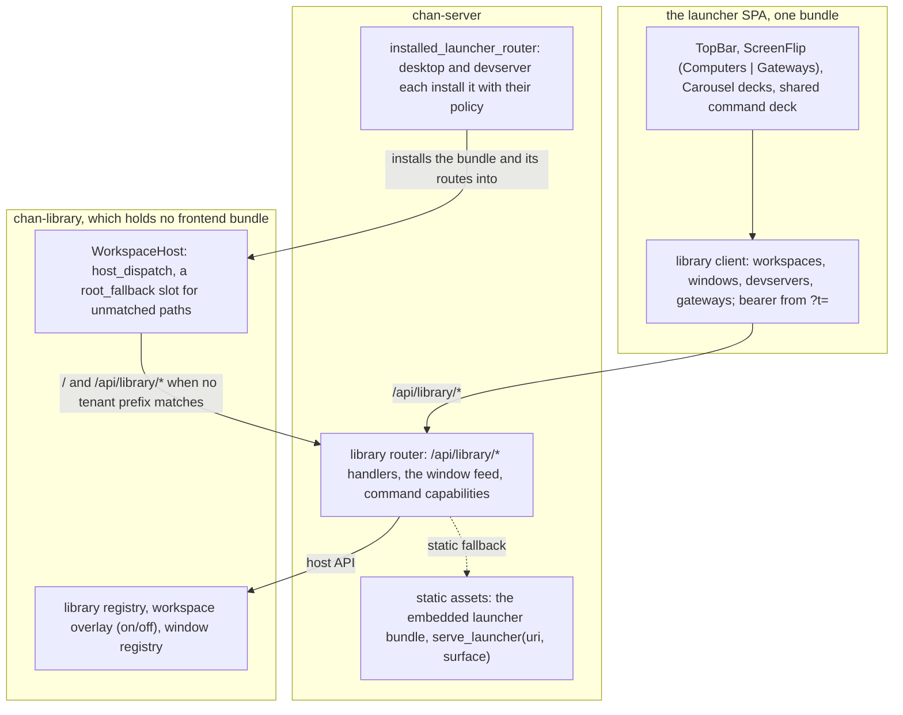
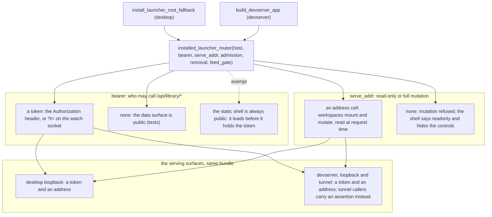
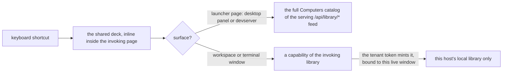

# chan launcher design

The launcher is the Computers screen: the SPA that lists this machine, every devserver, every gateway and every window, and opens or mints windows over them. It is `@chan/launcher`, served at the root `/` of every chan-server host, in a browser tab or as the panel chan-desktop toggles over any of its windows. This document is where the launcher is served, how its API surface is authorized, and how the screen is built. The [README](README.md) covers the stack and the dev loop; the server side is described in [crates/chan-server/design.md](../../../crates/chan-server/design.md) and the desktop that hosts the panel in [desktop/design.md](../../../desktop/design.md).

## What the launcher is

The viewer's privacy mode conceals machine and gateway fields, connection forms, diagnostic notices and secondary labels through `@chan/web-shared/privacy` and `PrivateField`. Its eye buttons reveal individual fields; concealed values and their tooltips are not rendered. Preferences come from the desktop bridge or browser origin storage, rather than the library API. The [privacy contract](../../../desktop/design.md#privacy-mode) defines persistence, live updates and reload behavior.

The launcher is an HTTP client of the serving library and nothing more: it never opens native windows, never dials a devserver and never parses an opaque window or workspace id. Every type in `src/api/library.ts` mirrors a struct the library serializes, and the field names are the wire, pinned by the server's byte tests. It renders four registries, workspaces, windows, devservers and gateways, and a feed: the window set over a watch WebSocket, pushed on every change together with the live tmux control-mode connections and the per-tenant leaders. It reads its bearer from `?t=` in its own URL and presents it as a header on fetch and as a query on the watch socket, since a browser WebSocket cannot set headers. The bundle uses a relative asset base so it resolves under any mount, and it carries none of the workspace app's editor, terminal or graph weight.

*The SPA talks to the library router; chan-server installs that router, with the bundle, into the host's root fallback.*

## Three surfaces through the root fallback

`host_dispatch` routes a request whose path matches a workspace tenant's prefix to that tenant and everything else to the host's root fallback. chan-library defines the slot and chan-server fills it, through `installed_launcher_router`, with the launcher bundle and the `/api/library/*` routes; the router holds the host weakly so the slot never keeps its own host alive. The direction is the point: chan-server depends on chan-library, so a frontend artifact lives in chan-server and is injected down into the host, never the reverse. The same bundle is installed on three surfaces:

1. the **desktop loopback**, through the embedded `WorkspaceHost`, where the launcher is the panel inside a native window;
2. the **devserver**, on its loopback bind and over the gateway tunnel alike, where a browser manages its own windows;
3. the **gateway origin**, which is the devserver reached through the gateway's proxy at `{owner}--{disc}.{proxy}.proxy.{domain}/`.

The served shell carries `<meta name="chan-launcher-surface">` with `desktop`, `devserver` or `readonly`, the one boot-time descriptor the SPA splits its capabilities on: whether it may mutate the registry, whether a desktop window bridge is attached, and whether it manages its own windows in the browser. The three values are the only valid combinations, so an illegal one is unrepresentable. The shell also carries the host's OS family, so the local machine card can show its icon, and a PWA manifest link, so a devserver loopback or a gateway origin can be installed to a dock or home screen. The launcher also runs with no server at all on the chan.app site, against an in-memory backend, which [the workspace design](../workspace-app/src/design.md) describes.

## Authorization per surface

The router's handlers are policy-free; the installer sets two knobs per surface. `bearer` gates `/api/library/*`: a token requires it on every call, compared in constant time, while the static shell is always public because it loads before it holds the token. `serve_addr` is both the read-only discriminator and the mount enabler: with a listen address the surface serves workspace mutation and mounts a workspace by reading the address from a cell the embedder fills after it binds, so the install can happen before the bind; without one the surface has nowhere to mount a workspace, the mutation handlers refuse, and the shell says `readonly`, on which the SPA hides the mutation controls behind a "manage from the desktop app or the CLI" hint rather than offering buttons that fail. With a listen address the surface is `desktop` when a desktop bridge is attached and `devserver` otherwise.

*The two policy knobs the installer sets per surface.*

On the gateway surface the proxy strips browser cookies and `Authorization` and forwards a signed gateway assertion; the devserver verifies it with the tunnel's key, marks the request as tunnel origin, and refuses a tunnel request without one. A grant is all-or-nothing: a grantee's assertion mutates `/api/library/*` over the tunnel exactly as the owner's does, windows and workspaces included, and gets the owner's surface meta. The reverse-tunnel legs are the one launcher route a grantee does not share. Owners also manage a headless devserver's workspaces over the bearer-gated devserver management API and `cs`.

Refusals use the server's JSON envelope: a display sentence in `error`, with a code only where the client branches on it. The launcher renders the sentence in its corner notice and never matches on its text. The one branch is a workspace turned off or removed while terminals run: the server answers a `live_terminals` refusal with the count, the launcher confirms and retries the same route with force. A workspace another chan process holds answers one sentence whichever of add, on or delete asks, since the one serving process per workspace is a system invariant and not the launcher's to work around.

## The Computers screen

On the desktop surface both screens deal their cards as a carousel, one card in front (`Carousel.svelte`). The Computers deck holds All windows first, then This machine, the devservers by name and one card per live tmux control-mode connection in the order the pure `lib/machineTree.ts` builds, a Connecting card while windows wait for their machine, and the Add devserver card last. The Gateways deck holds the gateways by name and the Add gateway card, which also tells the empty state. `g` flips between the two screens through `ScreenFlip`, a forward-only turn that mirrors the workspace pane's side flip. The devserver and read-only surfaces list the cards one under another.

The selected screen and each deck's card key and turn live in sessionStorage for that browser tab or native launcher webview, so reloading returns to the same badge without changing another window's view. Focus and open forms stay transient. A saved card key stays available while the registry loads, so a remote machine can reclaim the front when its row arrives.

The machine tree is a pure, DOM-free grouping of the feed: every window lands in exactly one bucket (the control terminal, standalone terminals, a workspace card, or an orphan), keyed by library id and workspace path, so no window id repeats inside a keyed list. A tmux connection's windows go to its card whatever library runs them, so This machine and the devservers do not list them, with one exception: the control terminal that `tmux -CC` buried also shows on the card of the machine whose terminal ran it (This machine, or the devserver card that holds the record's library, for a local run and a carrier's run alike), marked buried, with a detach button for the connection. It sits in a list of its own beside the machine's buckets, and All windows and the command launcher read only the buckets, so they still list it once; a control terminal whose library no card holds yet, or whose record has not arrived, stays on the connection's card alone. The connection card's title says where the tmux server runs, its rows are the control terminal pinned first, the open windows, then the tmux windows past the cap that have no chan window yet, and every action on it is one request to the library's tmux route, with the outcome arriving through the feed. The All windows card lists the aggregate feed once per window id with its machine, workspace and visibility. Window rows mark the native launcher's host as `This window`, using the library and window identity injected by the desktop; a control terminal matches its stable window id while its pending library identity changes on connection. A standalone browser launcher has no host marker.

Every card shares one navigation: Up and Down select rows, Left and Right move between a row's enabled controls and turn the deck at either edge, Enter focuses a window row or activates a row's first control, and a row's letters (`o` for on, off, connect and disconnect, `t` for a new terminal or tmux window, `w` for a new workspace window, `h` for show and hide) activate the buttons that declare them. Text fields, dialogs and the command deck keep their own keys. Turning the deck moves focus onto the card in front, and every other card is inert, so focus and the accessibility tree hold only that card.

The ring is a 3D gallery: cards stand around a vertical axis, each turned by its index times the step and pushed out from the axis, and the deck turns to bring one forward, dimming the others by their angle. The card in front stands on the identity transform and renders on a flat layer, which is what lets its list scroll under the wheel in WebKit, where an overflow box inside a layer pushed along Z takes no wheel scrolling. Cards turned far from the front are hidden, which also keeps a mirrored back off the screen on WebKitGTK, where `backface-visibility` is ignored. Fewer cards than a full ring stand on an arc with a full ring's step, so two or three sit side by side. An Add card's front is one button that turns the card over to its screen's form, the same `DevserverForm` or `GatewayForm` the edit dialog renders; a save re-lists the registry, which deals the new card by name, and brings it to the front.

Behind the cards a transparent WebGL canvas draws flowing plasma lines tinted by the host window's focus colour (the brand colour in a plain browser). It cannot take pointer input, runs at a bounded frame rate and resolution, stops while the document is hidden, and stays flat under reduced motion, without a GPU, without WebGL, or on a shader failure. The native panel signals when the carousel has settled so the background allocates its context only then, and a root-style observer forwards later focus-colour and theme changes.

A gateway badge shows its label over its URL and, for a gateway reached through WireGuard, the path of its wg-quick file under them; the gateway form sets and clears that path like the label, the registry reads the file at save time, and a refused path or file comes back as the server's sentence, which the form shows verbatim (it names the path, the line and the key, never a value). The desktop runs a file as soon as the row is saved, so the badge shows the tunnel's live state (`wireguard_status`) beside the file, refreshed every two seconds while visible, and a file the desktop refused arrives as the row's `last_error`, which the status line narrates like any other reason. On the desktop the form also generates the gateway's WireGuard key through the key route: on a new gateway it adds the row first and stays open as that row's form, showing the public key in a selectable field with a Copy button and a Done button that saves any later edit; a gateway whose discovery offers no enrollment refuses with the desktop's sentence, shown like a file refusal. The private key stays with the desktop. A badge with a key shows its first eight characters with a copy action and `enrolled`, or `not enrolled: connect to sign in`; the connect's sign-in enrolls it and stores the enrollment's public parameters on the row with one owner-only key file, writing no client file, so the badge reads the tunnel's live state from the enrolled key alone; the two-second refresh runs for a row with a file, a summary status, an enrolled key or a nonempty ingress list. An enrolled row's `wireguard_ingresses` supplies ordered id/status pairs: the badge renders a WireGuard line for each ingress, even when the list holds only one, and a refused ingress keeps its reason beside the others. The API retains `wireguard_status` as a summary; the badge uses that summary and the file path when the list is empty or an older peer omits it. Ingress ids and status details each have their own privacy reveal, keyed by gateway and ingress id, so a reveal stays with its ingress across list reordering. A retained ingress list keeps polling active after key regeneration, including when every ingress is refused.

A machine's health is on its glyph: connected or local, pending, lost, or disconnected. Window rows read as the generated `Terminal Window N` or `Window N` plus an optional caption, and clicking the label edits only the caption; the window naming is shared with the workspace app through `@chan/web-shared/window-label` so both spell a window the same way. A workspace row shows its label or, with none, the last component of its root cut at `/` alone, so a Windows root reads whole; both command decks name rows and windows the same way. A workspace whose mount is up over a root it can no longer read (a stalled network mount, a replaced directory) is `unavailable`: its row reads as degraded with the server's reason, offers Turn off, and keeps New window disabled, because the library mints a window only over a running mount.

While visible, the launcher re-lists workspaces periodically to refresh writer-lock status, which the host probes on list without a feed signal; host-owned changes arrive through the feed, and the demo installs no poll. Refreshes after a mutation share one ordered, coalesced request loop, so an older answer never overwrites a newer one.

## Browser-managed windows

On the devserver surface the launcher is its own window manager (`state/windowManager.svelte.ts`). Creating a window opens a blank browser window synchronously inside the user's gesture, since the browser blocks one opened later, mints the record, names the window by the record id and builds the tenant URL itself, with no launch route between: the tenant prefix, `?w=` for the session, `?kind=` for a standalone window, `?lib=`, the tenant bearer, and `h`, the holder tag minted once for this load of the launcher page. Before navigating, the launcher fetches the tenant URL through the shared window-page wait, which retries while the server answers that it is starting and gives up at a bound; a refusal reaches the notice ring once, and a refused mint discards its record unless a window already shows it.

A window record reads `connected` while any socket is live for its id and cannot say whose; the holder list says which tags hold a socket. Open and Focus therefore decide by the tag read from the window's own URL when the record lists holders, and by `connected` otherwise: a page the record holds is focused without a check or a navigation, a blank window or one whose page is not held is checked and navigated whatever it shows. A readable document carries a mark saying until when a wait or a navigation holds it, so a second gesture follows a live wait instead of racing it, and a stale mark reads as none so a stopped navigation is repaired by the next gesture. The costs are accepted: a tag names a page load rather than a browser tab, so a duplicated tab presents the same tag; where `connected` decides, another tab's socket can keep a broken page from being repaired; and a connected window this page cannot reach by name gets a second window on its id.

Reconciliation keeps a record that has no local handle, since a missing handle cannot prove a window is gone: such a row waits for an explicit Open or Close, and a reload loses every handle. A closed handle stays while its record reads connected, because another window may hold the socket, and the first push that reads it disconnected discards both. Show on a browser-origin record repairs it through the same path as Focus before clearing hidden state; on a native-origin record Show changes visibility only, because chan-desktop owns that window and a browser page acquired here would be a second live window on its id. A page a browser already holds hears on its own socket that it was shown and takes down the cover it raised when hidden.

## One command deck, two authority hosts

The command launcher is one shared Svelte component, rendered inline inside the page that invoked it on every surface; there is no native command-launcher window. Its empty query is the contextual deck, focused tab actions first, then pane, window and Computers; this bundle exposes the Computers scope alone, over the same feed the screens render, so the launcher page's deck carries the full catalog of the surface that serves it. A workspace or terminal window runs the workspace app's deck with a narrower scope: the library's command-capability route mints a capability from the tenant token only for a window with live presence in that tenant, the capability expires on a sliding window and dies with the window, its snapshot omits tokens, prefixes and remote rows, and its launch redirects revalidate liveness. The Computers scope's actions go through the same wrappers the cards call, so window ownership, leader claims, native trust and the live-terminal confirmation cannot drift between entry points.

The deck owns where a command's outcome goes. An error shows on the deck's card only while the deck is open on the draft that ran it and the command still owns the card; otherwise it reaches the host's `onError` once, and this host reports it to its notice ring with the command title. A success shows briefly on an awaited command's card and then closes the deck. Cmd+K toggles the deck on the macOS desktop and Ctrl+Alt+K on the web and elsewhere; arrows move through results and the scope rail, Enter enters or executes, Backspace on an empty query goes back, Escape hides. A confirmation opened by pointer accepts the first Enter with Cancel selected, and one opened by Enter waits for the key's release. Each window keeps one deck draft in session storage across reloads and hides, cleared by a close and by a successful command.

The New Workspace and Confirm dialogs share focus entry, Tab wrapping and Escape containment with the workspace app through `@chan/web-shared/modal-focus`. While a dialog is open the launcher's surface is inert and the dialog and the notice region sit outside that boundary, so an error can be announced during a dialog.

## The `/api/library/*` surface

- **workspaces**: list, add by path, turn on and off, remove. A row carries its status and, for a degraded mount, the server's reason; a devserver row carries its remote mount prefix. Turning a workspace on answers with its row, so a degraded mount reports itself without a second request.
- **windows**: list, mint, discard, label, the desktop-bridge open, hide and close, visibility, and the watch socket that pushes the whole window set with per-tenant leaders on every change. A label is separately persisted user text that never parses or alters the library's own title and ordinal.
- **tmux**: the feed's snapshot carries one record per live `tmux -CC` connection and a window row's mark says which connection owns it; a closed request set (a new window, open a window, detach, end) goes to the connection's route.
- **command capabilities**: mint from a tenant token and a live window; a token-redacted local snapshot, an approved action subset, and a launch redirect that revalidates.
- **devservers**: the desktop-side registry over HTTP, plus the bridge operations (connect and disconnect, native trust, a terminal, workspace open, on, off and forget) that dispatch to the attached desktop; a registry-less surface lists nothing and the bridge operations refuse without a desktop.
- **gateways**: the registry (URL, label and the optional wg-quick file path, `wireguard`, with the generated WireGuard key's public half and whether the gateway enrolled it) plus connect, disconnect and WireGuard key generation; a gateway's roster rows synthesize read-only devserver entries, and the desktop forwards a fed tmux request to the owning devserver over its existing authenticated connection, so the browser holds no remote credentials.

## Build integration

The launcher bundle is built into the repository-root `web-launcher/dist/`, the frozen rust-embed input, beside the workspace bundle and under the same rebuild contract: a fresh checkout compiles before the artifact exists, and a rebuilt launcher relinks the embedding server crate. The top-level web targets build it before any CLI, desktop, packaging or release consumer embeds the server, so every distribution ships the same launcher without per-consumer wiring. A gzip size budget on the bundle fails the build when an accidental heavy import lands.
