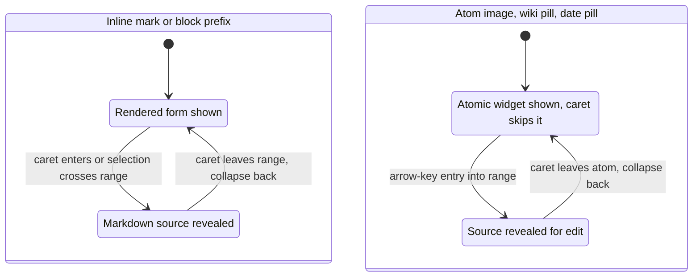

# Editor UX

How the editor in the workspace app behaves for the person typing. This is the interaction model; the mechanism behind it (the decoration pipeline, sessions and saves, drawings, export) is [src/editor/design.md](src/editor/design.md).

## Core principle

The editor is live preview: a line or inline element shows its rendered form while the caret is elsewhere and reveals its Markdown source when the caret enters it. Moving the caret away hides the source again. This is the default surface for renderable files, the same model Obsidian's Live Preview uses: the user types Markdown freely, the editor renders it on the fly and shows the markers again as soon as they are needed.

*Marks render when the caret is away and reveal their source when it enters; atoms render as a widget the caret skips and reveal source on entry. Both collapse back on exit.*

A whole-document source view is also available: Show Source Code (Mod+E, or the tab menu) flips to the raw text in a plain CodeMirror editor. The toggle exists only for files with a rendered surface: Markdown to WYSIWYG, JSON to the pretty tree, CSV and TSV to the table, Excalidraw to the board. A plain source file has only the source view, so the toggle does nothing there and never forces a Markdown render on non-Markdown text.

## Per-element behavior

- **Headings.** Rendered large; a fold chevron appears when the heading has a section under it. With the caret on the line the `#` prefix appears muted at the start; typing or erasing `#` characters is a plain text edit and the level follows the count. Only a non-empty top-level heading gets the heading scale; a heading inside a list item or quote, or a bare `#`, keeps body styling and visible marks.
- **Wiki links `[[...]]`.** A pill with the target's label; a link whose destination cannot be placed renders as a broken pill. With the caret inside, the brackets show and the label stays editable, and typing there reopens the same search popup that `[[` opens. Breaking a marker leaves the literal text; nothing is auto-repaired.
- **Tags `#tag` and mentions `@contact`.** Typing `#` or `@` opens a search over the workspace's tags or contacts. Both render as pills that reveal their marker with the caret on them, and a click opens the graph filtered to the tag or focused on the contact.
- **Images ``.** Typing `![` opens an image bubble: a search over workspace images with a thumbnail preview and an upload button. Uploads and clipboard image pastes write the file beside the Markdown being edited and insert a relative reference. An optional width rides the URL fragment as `#w=N`, which other renderers ignore. A click on a rendered image offers zoom and edit; arrowing onto an image enters edit directly, revealing the source with the caret at its start. Editing the source path opens the same search bubble; a path that does not resolve shows an inline error under the source.
- **Date macros `@today` and `@date`.** Typed as reserved words and committed with Space or Enter, which is consumed rather than inserted. Both write the date in the window's default format; `@date` also opens the calendar and format popover anchored at it. The written date is then detected and rendered as a date pill whose click opens the same popover. Dates are an editor convenience only: they insert plain text, never a marker, and are not indexed.
- **Page breaks `@pagebreak` and `@break`.** Reserved words that commit into a page-break line, rendered as an atomic divider the caret skips. The macro words, with the date macros, keep the `@` from opening the contact bubble.
- **Lists.** Markers stay visible on every list line; a task item's `[ ]` becomes a clickable box that toggles only on a pointer press, so it never shows a state its source lacks. Enter at the end of an item continues the list with the same marker (numbers increment, tasks start unchecked); Enter on an empty item removes the prefix, which is how a list ends; Enter mid-line inserts a plain newline. Tab nests the item under the nearest list line above, landing on that sibling's content column, since a fixed indent step can turn an ordered item into a lazy paragraph continuation; Shift-Tab outdents to the parent's indent and never strips the marker. Backspace at an item's text start removes a top-level prefix in one press and outdents a nested item.
- **Inline formatting.** Bold, italic and strikethrough render styled and reveal their markers while the caret is in the span; the usual bold and italic chords apply. There is no underline.
- **Tables.** A read-only grid; a press on a cell places the caret in that cell's source, and the pipe form shows for editing.
- **Diagrams.** A closed `mermaid` or `mermaid-to-excalidraw` fence renders as a diagram while the caret is outside, with a fullscreen view on hover; the caret inside reveals the source, and a render error shows on the diagram face with the failing line marked.

## Cross-cutting rules

- **One bubble pattern.** The wiki, tag, mention and image bubbles share one keyboard model: arrows to navigate, Enter to commit, Escape to dismiss, click to commit. A dismissed bubble stays closed while the caret stays in the text that opened it. Each bubble owns its own results and preview. Bubbles anchor under the caret and flip above when out of room.
- **Broken Markdown is preserved.** Deleting part of a marker keeps what the user typed; the renderer stops recognizing the construct and shows the text plainly. Never auto-repair.
- **Rules stay visible.** A horizontal rule `---` has no rendered replacement and stays editable source; Enter at its end adds a line below.
- **The caret never rests in a hidden prefix.** A list item's first caret position is the start of its text.

## Out of scope

- No underline.
- No date indexing, date search or date graph edges.
