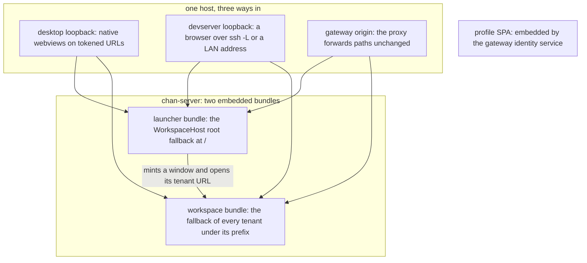
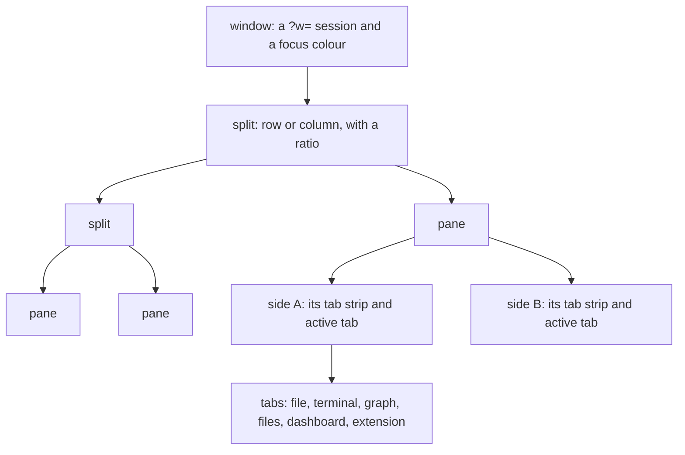
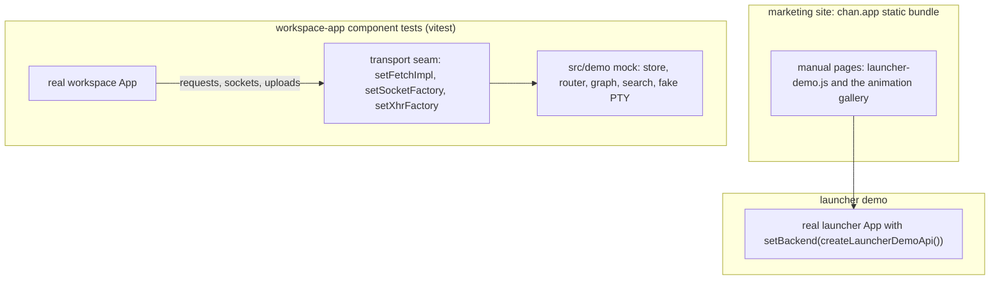
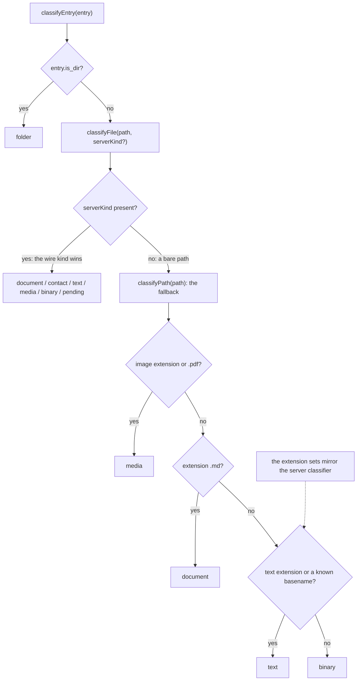

# chan web frontend design

The workspace app is the Svelte 5 single-page application chan-server serves for every workspace and terminal window. This document is the reference for the frontend as a whole: which web apps chan ships and how each is served, what a window learns at boot, the command deck both apps share, the window and pane model, the terminal surface, the file and transfer surfaces, and the color system. The editor has its own design in [editor/design.md](editor/design.md), the launcher's is [../../launcher/design.md](../../launcher/design.md), the server that serves both is described in [crates/chan-server/design.md](../../../../crates/chan-server/design.md), and the desktop shell that embeds that server in [desktop/design.md](../../../../desktop/design.md).

## Three SPAs, two embedded

chan ships three Svelte 5 and Vite SPAs under the `web/` npm workspace. `@chan/profile` is the gateway's sign-in and profile app, embedded by the gateway's identity service and outside this document. `@chan/launcher` is the Computers screen. `@chan/workspace-app` is the workspace and terminal window. The last two are embedded into chan-server through rust-embed: debug builds read the bundles from disk per request and release builds bake them into the binary. `@chan/web-shared` holds what the two share: the command deck, the window-holder and window-page helpers, modal focus, the keyboard identity of a key, and window naming.

The launcher is served at the root of every host through the `WorkspaceHost` root fallback, and the workspace app is the fallback of every workspace or terminal tenant under its path prefix. Asset URLs are relative and the served shell carries its tenant's prefix in a meta tag, so one bundle works on the desktop loopback, on a devserver under a tenant prefix, and through a gateway, which forwards paths unchanged. Requests under `/api` and to `/ws` that match no route are real 404s, never the shell, so a client sees a JSON refusal instead of HTML.

*The launcher and the workspace app are the same two bundles on every surface; the profile SPA lives in the gateway.*

## What a window learns at boot

The server splices meta tags into the shell's `<head>` so the SPA has its answers before its first render, without a probe round trip.

| Meta tag                 | What the SPA does with it                      |
|--------------------------|------------------------------------------------|
| `chan-prefix`            | prepended to every fetch and WebSocket URL     |
| `chan-settings-disabled` | nothing; the server refuses the writes itself  |
| `chan-files`             | a standalone window also gets files and editor |
| `chan-drafts`            | a standalone window also gets drafts           |
| `chan-webgl-renderer`    | xterm.js draws with WebGL (1) or the DOM (0)   |
| `chan-gpu`               | the welcome keeps to 2D animations on 0        |

The tenant sets the first four from what it mounted and from the `--no-settings` flag; the last two carry answers the desktop computed.

The two desktop values start as query parameters chan-desktop appends to a window URL. `chan-renderer` is appended whenever the desktop's GUI bootstrap has decided whether WebKit's accelerated path is usable: the Linux AppImage runs that decision, other Linux packages and FreeBSD send nothing, and every other platform sends WebGL. `chan-gpu` is always appended, from a render-node probe on Linux and FreeBSD and as true elsewhere. The serving tenant stamps the last recognized value into the meta, a devserver on another machine included, so the SPA never repeats driver detection or guesses from the operating system. In an ordinary browser the terminal keeps WebGL; in a native window a missing or invalid renderer meta means the DOM renderer. A localStorage key is the diagnostic hatch in both directions.

The window kind rides the URL too. `?kind=terminal` opens a standalone window and `?kind=control` the singleton control terminal that runs a devserver's connect script; a workspace window has no kind. `?w=` keys the window's session, `?t=` is the tenant bearer, `?lib=` names the owning library, `?h=` is the holder tag of the page that opened the window, and `?pane=` is the library's pane highlight colour. `state/windowCaps.ts` projects the kind and the `chan-files` and `chan-drafts` tags onto the capabilities the rest of the app gates on: a workspace, a file surface, drafts, terminals only, control. The tenant is the authority for the file and draft bits because it is what mounted those surfaces or did not, and the bits are separate because the draft store can fail to construct while the file surface works.

## The command deck

Both SPAs mount the same `CommandDeck` from `@chan/web-shared`, rendered inline inside the page that invoked it; there is no native launcher window. The chord is Cmd+K on the native macOS desktop and Ctrl+Alt+K on the web and other platforms, because the browser owns Cmd+K there. It toggles: pressed again it closes the open deck, wherever the deck stands, as a dismissal. The open deck takes every key ahead of its host's own listener, so the host tells it which key the chord is (`toggleChord`): in a window, the built-in chord or one the user assigned to `app.launcher.toggle`. The component owns presentation, the keyboard, motion and the draft, and knows nothing of what it lists: a host hands it the rows, the scopes of its rail and what choosing a row does. The workspace app's host is `components/CommandLauncher.svelte`, which lists the command catalog, the settings index and this window's part of the Computers tree; the launcher's host lists the Computers tree alone and is described in [the launcher design](../../launcher/design.md).

The deck is a search capsule with a rail of scopes beside it and a panel under both. A scope is an orb with its caption under it, dimmed and inert while its host says it is unavailable. The active scope, or the branch the deck stands in, shows as a chip of crumbs before the query, with a button that clears it. The panel lists rows of one line: an icon, the title and a right column of fixed slots (a state such as `on`, `off` or a choice's value, a check on an option in effect, the chord, a chevron on a row that opens a list of its own), each slot as wide as the list's longest entry, so the columns line up whichever rows fill them. A row takes a second line for its subtitle, an object's machine or the reason a disabled row cannot run, and a row outside any section takes one for its breadcrumb, which is how a typed result says where it lives. Consecutive rows that share a section sit in one group under a sticky header carrying the section's name and its scope's icon. The footer names the keys that apply where the deck stands, offers the key list and counts the rows.

### Keys

Focus stays on the query for as long as the deck is open. The input is a combobox that names the selected row through `aria-activedescendant`; rows and orbs are never tab stops, and a press on one hands focus straight back. One element holding the keyboard is what keeps the focus ring and the selected row from disagreeing, and it lets typing reach the query from anywhere in the deck. The deck handles keys ahead of the page while it is open and stops them there, because a command can switch on a key mode of the app's that the same event would then drive; it yields only to a visible modal dialog.

The deck holds the keyboard itself, in one place for every row and both hosts: it watches each focus change in the page while it is open. A row that changes in place can show a surface that focuses itself, at once or a moment later: `Rich Prompt` shows a composer and, turned off, hands the terminal the keyboard, and `Source mode` remounts the editor. Such a surface shows under the deck without the keyboard, which goes straight back to the query, so the next key, Enter and Esc included, is still the deck's. The deck remembers the last element that asked, and a key that reaches an element under the deck all the same is taken with the keyboard. Two things are left alone: focus inside a visible modal dialog, a survey over a terminal among them, and every focus change while the host says the page may not take focus, as it does under the desktop's Computers panel shown over the window.

| Key              | What it does                                              |
|------------------|-----------------------------------------------------------|
| Up, Down         | the previous or next row, wrapping at both ends           |
| PageUp, PageDown | a page, by the number of rows the list shows              |
| Home, End        | the first or last row, on an empty query                  |
| Alt+Up, Alt+Down | the first row of the previous or next section             |
| Tab, Shift+Tab   | the next or previous scope, with "no scope" as one stop   |
| Enter            | run the row, or open its branch or its options            |
| Right            | open a branch, a choice or a row's own page; never runs   |
| Left, Backspace  | on an empty query, back out of a branch, then the scope   |
| Esc              | back one level inside a branch, close at the root         |
| `?`              | the key list, on an empty query; any key leaves it        |

The first row is selected as the deck opens, so the first Down selects the second. Right acts only with the caret at the end of the query, and on a row with nothing under it the key is the caret's; Left and Backspace edit the query while it holds text. Esc closes from the root even with a scope chosen, and a click on the active orb or on the chip's button clears the scope. Tab is always taken, so focus cannot walk off the input. A key pressed with Ctrl, Alt or Cmd, those in the table aside, does nothing in the deck, so Enter with a modifier runs no row. On a confirmation or an error card, Left, Right and Tab move between its two answers, Enter chooses and Esc or Backspace returns to the list; a confirmation opens with Cancel selected, and one opened by Enter waits for that key's release before it reads another. Esc on a card that is checking or working releases the card, and the command settles by itself. Under any card Tab is still taken and the query is read-only: the card's buttons and the scrim are not tab stops, and a query that could be edited would filter the card's row out of the list and leave its action nothing to run.

Each window keeps one deck draft in session storage: whether the deck is open, the query, the scope, the path of branches entered, the selected row and a confirmation or error card. A reload restores an open deck as it stood. Opening the deck from closed starts at the root with no scope and keeps the last query, selected, so Enter repeats it and typing replaces it; the chord never lands in the branch or the scope of an earlier visit. A dismissal therefore keeps what was typed and nothing else, and a command that closes the deck clears the query too.

### The command catalog

The workspace app's commands are the catalog in `state/commands.ts`: every action the launcher can invoke, as data, registered per surface by the modules under `state/commands/`. An entry pairs a stable id with the one title the action carries everywhere. Two axes place it. `scope` says where it acts, the focused tab's content (`app`, with the tab kinds it acts on as `surface`), the pane and its tabs, the window, the workspace or a preference, and that is the launcher scope that lists it; `group` and `order` say where inside the scope. `category` is the surface that owns the command, which the Settings rail and the Keyboard Shortcuts grid group by, and it does not decide the scope. `kind` says what choosing it does: an `action` runs, a `toggle` flips the thing it is named for, a `choice` offers its options and an `open` command raises a dialog or an overlay. A toggle reports its state and a choice lists its options with a check on each that is in effect; both take a context, so a terminal's own menu can ask about its terminal. `requirement` names the capability the window must have, in one table that the catalog filter and the dispatch gate both consult, and `unavailableReason` says why a command cannot run where the requirement and the surface do not already say.

A title is a verb and its object in sentence case (`Close tab`, `Split right`), and one id has one title. A toggle is named for the thing and shows its state, never `Toggle`, `Show/Hide` or an enable and disable pair: `Details`, `Rich Prompt`, `Hidden files`. A narrower reach goes in parentheses (`Secret masking (this terminal)`, `Details (search)`), and an action at a path says so (`New terminal here`). One value of a setting is not a command: it is an option of a choice, or of a field in the settings index. Every title a command has carried stays among its `keywords`, so a search by an old name still finds it. `state/commands/registry.test.ts` holds the rules: every command declares a scope, only an app command names a surface, no title names a toggle by its verb or carries a value, no two commands of a scope that can be listed together share a title, and one id is registered once.

No other surface types a catalog action's words. A menu row, a toolbar button, a tooltip, an inspector action and a Hybrid Nav help row name their action by id and render `commandTitle(id)`; a toggle's menu row is the title with a check read from `commandState(id)`, and where a menu draws a choice in place (the pane menu's focus colours and shells, the graph menu's filters, the dashboard menu's slides) its rows are that choice's options. A row that flips a Settings field takes its words from the settings index. The shortcut table (`state/shortcuts.ts`) holds the chords under the same ids, with a label per chord that a test holds to the catalog title; a chorded id with no catalog entry, the launcher's own toggle among them, has the table's label alone, which is where a menu's `Command launcher` row gets its words. A tab's menu ends with `Flip pane`, where the pane has sides, and `Close tab`; the menu of a tab's body ends with `Command launcher`; a surface with one menu for both ends with all three. What a menu draws that is not a catalog action keeps its own words: a display row, a field label over an input, and the Hybrid Nav help's stage rows, which stage a tab in the draft layout and have no command.

A user's chord assignments are a sparse table keyed by command id, with a slot per client platform (`state/keymapOverrides.svelte.ts`), saved in the preferences as `shortcuts` and resolved ahead of the built-in chord. A saved table outlives the catalog it was assigned against, so `RETIRED_COMMAND_IDS` lists the ids the catalog no longer holds: a row that named one value of a setting, one option of what is a single choice, or a second id for another command's action. A chord saved for one of them would run nothing while a focused terminal still gave the keystroke up for it, and the Keyboard Shortcuts grid has no row to clear it from. So a retired row is left out when the table loads and the saved table is written back without it, taken out of the table the server holds when the write runs: of several windows that load the same table the first removes the rows, and its status line says once how many went. Only a listed id is ever dropped, because an id the catalog does not hold proves nothing: an extension registers its commands after the table loads, and some chorded ids live in the shortcut table alone. A window served with settings disabled writes nothing back.

### What the launcher lists

`state/commands/deck.ts` turns the catalog and the settings index into the launcher's lists, as pure builders over a snapshot of the window; the host adds the icons, the Computers rows and the running of a row.

The rail holds up to six scopes. The first is the focused tab's app and takes its name: `Terminal`, `Editor`, `File browser` (captioned `Files`), `Graph`, `Dashboard` or an extension's own name, and it is unavailable while the pane holds no tab. Then come Pane, Window, Workspace in a window that has one, Settings, and Computers where a library stands behind the window.

An empty query browses. With no scope the list runs, each part under its header: `Recent`, up to five commands last run from the launcher in this window that can run now; the focused app's commands; the pane's three groups, `New tab`, `Tab` and `Pane`; `Window`; `Workspace`; `Settings`, as the row that opens the overlay and a branch into the focused app's section, `Terminal settings`, when that section has a field this window shows; and `Computers`, as the ways into the tree described below. A scope lists its own sections alone, and the Settings and Computers scopes list in full what the unscoped list only leads into. Inside a section commands follow their `order`, which follows the menu that offers them, and then their titles. Browsing lists only what can run: a command its requirement, its surface or its own predicate rules out is left out. The recent ids are kept in session storage and read as the deck opens, so the section does not move under a row that changes in place.

A typed query gets one flat ranked list, over every scope or over the active one (`matchDeckItems` in `@chan/web-shared/command-deck`). The query is split on whitespace and every word must match the row's title, breadcrumb, subtitle or search text, which holds its keywords, in any order. A word that starts a word of the title outranks one inside a title word, either outranks the same hit in another field, and a word found whole nowhere may still match as an abbreviation of the title, its letters in order within twice its length. Among hits of one kind the host lists the nearest scope first (the focused app, the pane, the window, the workspace, another app's commands, the settings, this machine's objects), since position and length say little about which of two scopes was meant: `close` leads with `Close tab` and not with another window's Close. A choice lists its options as rows of their own, titled `Focus border colour: green`, and so does a choice of the settings index, so one step applies a value; a setting that a listed command also changes is left to the command. A command that accepts an argument matches on its first word and runs with the rest (`Open notes/x.md`). Commands that cannot run here follow the ones that can, disabled, five at most, each with its reason on the second line: the capability the window lacks (`Needs a workspace window`), the tab it needs focused (`Needs a terminal tab`), or its own. With no scope chosen, this machine's workspaces and windows and each of their actions rank with the commands.

What choosing a row does follows from its kind. An action closes the launcher first, so that what the command opens lands on top, clears the draft and runs. A command that reports a state, a toggle or a value that an action steps, runs in place: the launcher stays open on the row and reads the new state once the run settles. It waits 400 ms at most (`IN_PLACE_WAIT_MS`): a refusal inside that bound lands on the deck's card, and a write that takes longer settles by itself, holding neither the deck nor the focus the deck hands back when it closes, and reports a refusal on the status line. A choice opens its options as a branch with a check on each that is in effect, and an option applies in place too, unless choosing it is an action of its own, as a shell under `New terminal with profile` is. Entering a branch or an object's page empties the query: the query found the row, and what the row opens is listed whole and in its own order.

### Settings in the launcher

The settings index (`components/settings/settingsIndex.ts`) holds one entry per field of the Settings overlay: an id of the form `<section>.<field>`, its rail section, its label, a kind, a choice's options, a `read` and a `write` that work while the overlay is closed, the overlay's own gate as `available`, and keywords that keep a field's former words findable. The overlay's sections render each label and option word from the entry and the launcher's Settings scope lists the entries, so a setting reads the same in both and the launcher's row is the field's own words: `Editor body theme` with the value `Dark`. The label is the heading of the field that holds the control, and a control that is one of several under a heading reads `Heading: caption`, as `Screen lock: Theme` does. A coverage test mounts every section and holds the rendered fields to exactly the index plus a named list of fields left out, each with its reason.

A `toggle` flips from the launcher in place and a `choice` opens its options. Both write through the entry: a machine preference through the serial configuration write chain, applied over the record this window was served until the server's next record replaces it, and any other value through the state module that owns it. A toggle whose write would do more than store the value says so through the entry's `confirm`, and the launcher puts that question on the deck's card before it writes: `Semantic search` in a workspace whose embedding model is not on disk asks to download the model, by name and size, and only that answer starts the download, which the entry's plain `write` never does. While the download runs the row reads `downloading`, the entry's `progress` word, and takes no press; the deck stays open on the list throughout. The overlay's own toggle starts the same download at a press and reports it beside itself. Every other field (a slider, a number, text, a colour, a list, a button flow such as the screen lock PIN) is `open`: its row closes the launcher and opens Settings on the field. An entry that names a catalog `command`, as the two file browser docks do, is one setting under two names, and a typed query then lists the command alone.

The way to a field is `openSettings({ section, field })`, which records the target in `settingsPanel.target`. The overlay, closed or already open, switches to the section the field is filed under and waits up to three seconds for the field to render, since the form mounts once the configuration has loaded and a workspace control renders part of itself only once its own state has. It then scrolls the field's anchor (`data-setting`, the entry's id) to the centre, puts the focus on its first control, a radio group's checked pill, and marks the field for a moment. A control the user reached for while the field was on its way keeps the focus.

### The Computers scope

The Computers scope is built by the shared Computers tree (`@chan/web-shared/computers-deck`, described in [the launcher design](../../launcher/design.md)) from a narrower model than the launcher's: the tenant bearer may mint a capability bound to this live window through the library's command-capability route, whose snapshot lists only the serving library and omits tokens and prefixes, so a remote workspace never receives the desktop launcher's aggregate inventory. The host states that snapshot as one machine, `This machine`, holding the workspaces the snapshot lists and the windows this surface can act on, and says the window may open a window of a workspace and a terminal window and nothing else. The tree then offers the rows, words, pages, disabled reasons and counted Close card the Computers screen offers. A workspace that is off is a disabled row that says to turn it on from the Computers screen, since this window may not. The capability is minted when the deck is first shown, and the snapshot is read again every 2.5 seconds while the deck stays open; until the first answer the scope reads as connecting, and a route that has failed with no snapshot to show leaves the orb disabled. A server with no such route has no library behind the window, as under `chan serve --standalone`, which mounts no launcher router, and the rail then leaves the scope out.

With no scope chosen the list ends, under `Computers`, with the ways into the tree: `New terminal window`, then `Workspaces` and `Windows` where the snapshot holds any, each a branch into the page of that type. The tree itself is the Computers scope's. On chan-desktop the host is also handed the desktop's launcher toggle, and both lists then end with `All computers...`, which closes the deck and shows the Computers launcher over the window. The capability boundary stays where it is: the row leads from the one library this window may see to the screen that holds every one.

In privacy mode the scope names every window `Window` and every workspace `Workspace` (`privateText` from `@chan/web-shared/privacy`), in each row's title and second line and on the Close card, as the launcher's deck does, so neither the user's labels nor a root's folder name shows; a row has no reveal button, which a deck option cannot hold, and typed search still matches the hidden names.

### Outcomes, focus and new windows

The deck owns the destination of a command's outcome. An error shows on the deck's card only while the deck is still open on the draft that ran the command and the command still owns the card; otherwise it reaches the host's `onError`, which the workspace app shows on its status line and the launcher in its notice ring. A success shows briefly on an awaited command's card and closes the deck. Every execution holds a token, and a later execution or a confirmation takes it, so a stale answer never paints over a newer one. A close is the user leaving the command, whether by Esc, a click on the scrim or the host hiding the deck: a run that saw one answers nothing in a deck opened after it, so its success paints no card there and does not close it, the question it comes back with is not put, and its error goes to `onError`. The deck also owns where the keyboard goes when it closes. A dismissal hands focus to the surface that last asked for it under the open deck, the composer a row showed for one, so the keyboard lands where it would be had the deck not been open; when nothing asked, or what asked can no longer take focus, it goes back to the element the deck opened from. A run that closes the deck leaves focus where the command put it; a command that put it nowhere, such as one that copies a path, gets it handed to the same place once the run has settled, or the host is asked to focus its active tab when neither element can take it; none of this happens while a survey is modal over the active terminal or the Computers launcher is shown over the window, the same guard the terminal's own refocus reads. A dialog a command opens as it runs takes that same element as its opener, so it returns focus there when it closes.

A browser window the deck opens is a two-step: a blank popup opened synchronously inside the user's gesture, because the browser blocks a later one, then navigated once the launch path has been checked through the shared window-page wait, which retries while the server says it is starting and gives up at a bound. A page tags the windows it opens with a holder tag and reads the tag back from a popup's URL to tell its own page from another client's socket on the same window id; the record's holder list is what makes that readable. The tag is a claim rather than an identity, so a duplicated tab presents the same one. The desktop opens and focuses windows through its native commands and uses no popup.

## Client identity and the event socket

Every workspace page claims one client holder: the `h` from its URL, else a tag kept in sessionStorage across reloads, else a fresh one. The transport puts it on every socket and request, so the server can list the holders of a window. The page's event socket (`/ws`) carries the window id and the holder; the server pushes watch frames, session frames, window commands and config changes over it. A wake gap or a visibility return probes the socket with a ping and replaces it on silence, with a backoff, and a page reconciles its root listing when the socket becomes ready and on resume. A client the server detaches has its sockets closed and later requests refused, and `SessionEndedOverlay` offers Reconnect without clearing credentials, terminals or saved layouts.

The library lists clients, and a window has a participant roster with a leader and followers; `cs session` handover and takeover act on participants, and a `cs terminal survey` or an Identify request reaches the window as a card. None of those is persisted: a blocking request a reload interrupts resolves on the server as a timeout rather than leaving a stale card.

## Windows, panes, sides and tabs

A window is a tree of splits and panes (`state/tabs.svelte.ts`). A split has a direction and a ratio that gives its first child its share of the length; a pane is a leaf. Every pane has two tab sides, A and B, each with its own tab strip and active tab, and shows one side at a time; flipping the pane turns it over to the other. With the `pane_strip_auto_hide` preference on, a side's strip is drawn only while that side holds two or more tabs, so a lone tab fills its pane and an empty pane shows its welcome alone; the hidden strip takes its menu and side toggle with it, and the pane's centre still takes the tabs and files the strip takes. A tmux pane and the control terminal have no strip either way; with tabs in the title bar a tmux pane's name stands in the band instead. Only a strip's tabs scroll (`components/tabStripScroll.svelte.ts`): its actions, the side toggle and the pane menu, stay at its right end with an empty stretch of at least 24px beside them, 40px in the window tab bar. While the tabs need more room than the strip has, a scroll button stands on each side of them, out of the Tab order and disabled at its end, and pages the tabs its way; a vertical wheel over the tabs scrolls them sideways, a tab or file dragged and held over a button scrolls them that way so a drop can reach a hidden place, and the active tab is scrolled into view by its nearest edge whenever it changes and whenever the strip resizes or moves into the bar. Tabs that fit draw no buttons. Right-clicking the strip's empty stretch or a scroll button, or the body of a side with no tab, opens the pane's menu in place of the browser's: `Command launcher`, `Reload window` and, on the desktop, `Open Inspector`, each with its chord; the right press leaves the focused surface holding the keyboard while the menu is open, including when the menu belongs to another pane, and `Command launcher` hands it back to that surface. A right press on a strip action or on a dashboard, extension or Hybrid Nav preview body leaves focus in place, including where the browser owns the menu; an extension iframe's inner document receives its own pointer events, which the parent page cannot intercept. A left press on the strip's empty stretch focuses that pane's active terminal or editor, or its welcome when one is shown. A terminal's and an editor's right-click menu and the file tree's row menu end with `Command launcher` too, and so do the menus of a file browser, a graph, a dashboard and an extension tab. A tab is a file editor, a terminal, a graph, a file browser, a dashboard or an extension; search and settings are overlays over the window rather than tabs. The active pane carries the window's focus colour, a per-window preset or the library's own colour, and every drag highlight reads the same variable.

The pane tree (`components/PaneTreeOverlay.svelte`, `state/paneTree.svelte.ts`) lists every pane of the window in reading order, its two sides and their tabs, with each tab's program status and a filter. A pick makes the tab the one the window shows, as a press on it in its strip does: its pane becomes the active pane and its side the visible side. `Cmd+Shift+A` (`app.pane.tree`) opens it in any window, under the element carrying `data-pane-tree-anchor` when one is drawn and at the window's top-left otherwise. The tree carries no name for the window: the window tab bar shows the window's title (see below). A tmux pane's row reads what tmux calls that pane, its title or under a default title its command, which the terminal roster carries as `tmux_name` (`tmuxPaneName` in `state/tabs.svelte.ts`): the session's tab name beside it is unique among live sessions, so of two panes at a shell the second is `bash-2` there and both rows read `bash`. A window rename moves no row.

A terminal's row also shows what runs in the terminal, secondary beside the tab's name: the server's reading of the foreground program's OSC 0 or 2 title and its command (`state/terminalProgram.ts`), shown as the title, else the command, and nothing when the reading holds neither. `TerminalTab.svelte` keeps it on the tab as `terminalProgram`, set from each `session` prelude (none when an older server sends no field) and replaced whole by a `program` frame only when the frame names the tab's session id and the generation of its current attachment, so a reading from a session the tab no longer holds, or from before a restart, never lands. Exit, `closed` and an explicit close clear it with the session (`clearTerminalSession`), while a dropped socket keeps it until the reattach prelude replaces it. It is the server's for each attachment, so a clone carries it, a reopened tab, a terminal moved to another window and the saved layout drop it, and every page attached to the session shows the same text from its own socket, hidden tabs included. A tmux pane's row shows none (`tabProgramReading`): its title is already what tmux calls the pane, and the server sends such a session the empty pair. The filter reads tab names only, and the row's tooltip does not carry the reading. In privacy mode the row shows the fixed text `Hidden` (`privateText` from `@chan/web-shared/privacy`) with the reading nowhere in the row's text, attributes or accessible name, and the latest reading is back when privacy mode is off; it is not a reveal button, which a row that is itself a button cannot hold.

The window tab bar puts the active pane's tab strip in a band across the top of the window (`state/windowTabBar.svelte.ts`, `components/WindowTabBar.svelte`). In chan-desktop on macOS and Windows the band is the window's title bar. On macOS the traffic lights sit in its left inset. The band is as tall as its content row (28 CSS px, the 24 px buttons and the tab pills with room) or as the controls' own band, whichever is taller: the row centres on the controls when their band is the taller and fills the band from its top when a zoomed-in page makes the row the taller, since the controls keep their size in points while the page zoom scales CSS px, so no empty strip sits under the tabs at any zoom. On Windows the window has no frame while the bar is in its title bar, and the desktop's chrome reports `drawControls`: the bar draws minimize, maximize or restore (picked from the chrome's `maximized`, which the resize after a maximize, restore or snap refreshes) and close as three equal buttons filling its right inset, the bar's full height, in the look of Windows 11 caption buttons. The chrome gives those controls a 32 DIP band, Windows 11's title bar height, as their centre, so the band follows the same rule as beside the traffic lights: 32 px at 100%, and the tab row's height with no empty strip when the page is zoomed in. They sit out of the tab order and carry no drag attribute; a press on one keeps the focus where it is, never drags the window or reaches the strip, and calls `titlebar_window_control`, whose `close` takes the native close button's route; a refusal is logged. They are a fixed layer of their own after the bar, over its right inset, which stays an empty spacer that drags nothing, and above every full-window overlay, so an open overlay never hides them; while they are drawn a full-height overlay panel (`OverlayShell`) starts below the band, clear of them. It follows chan-desktop's own preference, Settings, Global, Title bar tabs, on by default, and switches live when the desktop announces a change; the page learns that the installed app can do it from `native_vocabulary`, which must advertise `set_titlebar_tabs` on macOS and both `set_titlebar_tabs` and `titlebar_window_control` on Windows, so a page served to a desktop without them keeps its strips and its window frame and offers no row. Linux is not a host for it. A stored `chan.windowTabBar` of `1` or `0` forces the bar on or off in that browser profile whatever the preference, and a forced bar where the title bar is out of reach (a browser, Linux, a desktop without the commands) is a plain top bar. In the mode no pane draws its strip in place: the active pane's strip element moves into the bar's slot (`portalTo` in `components/portal.ts`) with every handler it has, and every other pane's strip is hidden, so a focus change moves the strip and never resizes a pane. The auto-hide preference has nothing to hide there, so its Settings row leaves while the bar is on. The boot holds the layout restore until the mode and the desktop's chrome settle, for at most 400 ms, so a terminal fits once. A page the engine restores from its back-forward cache on a step back in history does not boot again, yet the desktop gave its window the normal title bar while it showed the other page, so the restored page reads the preference again and asks for the mode as its boot did, reporting the band it draws. In the desktop the bar's empty stretch, and the strip's, drag the window and a double-click there zooms or maximizes it; a press on a tab does not drag. Left of the strip, a button drawn as a small map of the window's panes, the active one lit, with a badge for the most urgent program status among the tabs the bar does not show, is the pane tree's anchor and opens it. While the window's Computers launcher is shown over the page, which chan-desktop marks with `data-launcher-shown` on the page's root from before the launcher slides in until after it slides away, the bar hides the button and the strip in place and closes an open tree, and the band names the window it covers: on macOS chan-desktop shows the window's title in the title bar again, and on Windows, whose frameless window has no title of its own, the bar draws the window's title at its left, clear of the window controls, and follows a rename; it is the title the bar shows uncovered, so privacy mode masks it there too from the moment the page hears of it. That window wears no menubar either, so the chrome lists the launcher menubar's File, Edit and View by id and title (`menus`, empty on every other host and in an app that predates them), and while covered the bar draws them before the title as text buttons in the look of a Windows 11 menubar, out of the tab order. A press on one opens its menu under it through `titlebar_menu_popup`, at the button's bottom-left corner in CSS px, and holds the button pressed until the desktop answers, which it does once the menu has closed; like a window control's, the press keeps the page's focus where it is, never drags the window and goes no further than the button, and a refusal is logged. The menus are the menubar's own, so each item does what it does there. In a tmux window, whose panes draw no strip, the band shows the active tmux pane's name where the strip would sit, the label the pane tree gives it and so what tmux calls that pane, and a black tmux badge at its right end, where a window whose panes have sides keeps its side toggle; both are display only and drag the window as the band around them does.

The bar shows the window's title, since a title bar that holds the bar hides its own. In chan-desktop it is the title the desktop composes for the OS window, sent as `titlebar-window-title` when the page asks for the mode and again on every retitle (`windowTabBar.title`), so it follows a rename made in Computers or by tmux: an arrow drawn as text (down for this machine, up and right for a devserver), the machine, the workspace and the window's name: after the arrow, "local / chan Window 1 [my own title]" for a workspace on this machine, "geekom / chan Window 1 [label]" for a devserver's, and "local Terminal Window 1 [label]" or "geekom Terminal Window 1" for a terminal window. The arrow is part of the string, not an icon of the bar's. A browser has no such title and no way to learn the devserver's name, which is the desktop's name for its connection, so a bar forced on there names the window as Computers names its row ("Terminal Window 2 [deploy shell]", "Window 3", "Control terminal"). Privacy mode shows the generated name alone ("Window 2", "Terminal Window 2"), or a control terminal's fixed "Control terminal", without the machine, the workspace or the label: the page's own setting decides (`windowName` in `state/windowTitle.svelte.ts`), since the title it holds from before privacy mode turned on is the full one and the one the desktop sends meanwhile is its mask, and the full title is back as soon as privacy mode is off, the desktop having sent it again before announcing the change. The naming fields behind those two forms come from the window's scoped library snapshot, read at boot in a browser; on the desktop the bar reads them only when it needs them, when privacy mode is on or, with no title received, at a pane tree open. A read fails while the window has no live presence, as at boot, and leaves the bar without a title, so the bar reads again when the window's socket changes state (`ui.ws`), up to five more times a second apart after that (`WINDOW_TITLE_READ_RETRIES`, `WINDOW_TITLE_READ_RETRY_MS`), since the socket opens a moment before the server counts the presence, and at the next pane tree open. The `window_labeled` frame the server sends the window's own socket on a rename keeps the caption current on both surfaces, and only a browser's document title follows it, since a desktop window's name is its OS title. A tmux window's caption is its tmux window's name, which the server relabels and sends the same way on each tmux rename; once the user labels the window in Computers the caption is that label, and tmux's renames send nothing until it is cleared.

The title is one element with two places (`components/windowBarTitle.ts`). While no pane of the window holds a tab, on either side, it sits after the pane tree button, takes the room the strip's actions leave and ends in an ellipsis. Once any pane holds a tab it sits at the bar's end, left of the strip's side toggle: the strip in the bar offers a place between its dead zone and its actions (`windowTabBar.titleSlot`, which `Pane.svelte` renders only for a strip that shows in the bar), and the bar moves the element into it, so the title is a flex item of the strip itself. There it shows whole, however long, while the tabs leave it the room. When they do not, the title gives way before any tab does: its flex shrink factor is 100000 against the 1 of the tabs' viewport, so the row's shortfall falls on the title, which ends in an ellipsis, and every tab keeps its width. It gives way down to a floor, its `min-width`: the reserve of two reference tabs (`WINDOW_TITLE_RESERVE_PX` in `state/windowTabBar.svelte.ts`, two `Terminal-1` tabs and the gap between them, 250 px, which the bar publishes as `--window-title-reserve`), or two fifths of the row in a narrow window, or the title's own width when that is smaller, all measured over the whole box with its 8 px padding at each end. The title's own width is measured and published on the title as `--window-title-natural`, so the floor never widens a short title; until it is measured the floor is zero. It is the width of the inline run that holds the text, rounded up, plus the padding, read from the run and not from the box around it: a box's scroll width is never less than the box, and the box is never narrower than the floor, so a floor read from the box could only grow, and one read from the run follows a retitle to a shorter name down. The overflow the roll travels is that same width less the box's. At the end place the text is set against the box's end, so the title sits flush with the strip's actions. Only with the title at its floor do the tabs give way: they scroll as they do in any strip, the strip's actions and the dead zone's minimum stay in view, and while more tabs lie past the viewport's end the last ones in view fade out under a gradient mask 32 px wide (`fade-end` on the strip's viewport, in the bar only; `TAB_STRIP_END_FADE_PX` in `components/tabStripScroll.svelte.ts`), and the active tab is brought into view clear of that width, so the fade never covers its name or its close button. Where no strip shows in the bar to take the title (a tmux window, the control terminal) it sits in the bar's own end place, which in a tmux window is between the pane's name and the tmux badge, so that bar reads pane name, then the window's title, then the badge. The change of place is a slide of 200 ms (`WINDOW_TITLE_MOVE`, `WINDOW_TITLE_SLIDE_MS`): the element changes place at once and plays back the distance between its old and new left edges as a transform easing to none, so the strip's layout is never animated; a move between two panes' strips at the same place, the first placement, every placement before the boot has restored the layout (the bar's `restored` prop, so a window that boots or reloads with tabs shows its title at the end at once) and reduced motion are cuts. A title wider than its box shows its head with an ellipsis and the whole title as a tooltip, and rolls to its tail and back inside the box while the pointer is over it (`WINDOW_TITLE_ROLL`: `hover`, or `auto` to roll all the time, or `off`), by the measured width it runs past the box at 40 px a second with a rest at each end; reduced motion never rolls. The title is display only and drags the window, box and text alike, as the tmux name does, and hides with the tree button while the Computers launcher covers the window.

*A window is a binary split tree whose leaves are panes; each pane holds two sides of tabs and shows one.*

Hybrid Nav is the keyboard layout editor: Cmd+. opens a staged copy of the layout in which single keys split, move, resize and spawn, Enter commits the draft and Escape discards it. Terminals are drawn once, above the pane tree and keyed by tab id, and each terminal's element is docked into the pane that holds it, so a split or a tab move carries the renderer, its socket and its screen with it; rebuilding the terminal would redial its session for the whole history and replay bytes written at the old width. A tab dragged to another window carries a snapshot; a terminal reattaches to the same PTY by session id, and one with no session starts a new shell there.

A tab dropped on a strip joins that pane's visible side where the drop bar shows, or at the end past the last tab. A pane's body has a band along each edge, a quarter of the body across it and at most 120px, and the centre inside the bands: a tab of this window dropped in a band splits the pane there and becomes the new pane, and one dropped in the centre does what a drop past the strip's last tab does, so a pane with its strip hidden still takes tabs. Only a tab of this window splits a pane. A tab from another window of the same kind, library and workspace is rebuilt in the pane and a file dragged from the file tree opens there, and for either the whole body is the centre; so it is for an empty pane, which a drop fills and never splits. A pane's own tab dropped on its own centre stays where it is. The body takes these three drags wherever nothing inside it took the drag first, as the file tree's rows take a move between folders, and handles the drop before the surface under it. A file dragged from the file tree over an editor, a terminal's Rich Prompt among them, is the editor's, which types the file's path as text; over every other body, the terminal's screen included, the centre opens the file. An OS file passes through to the terminal or editor that takes it, and a tmux pane takes no drop.

A terminal-only window hides the welcome and narrows the command set, and the control terminal is a singleton that cannot spawn or split, because one PTY is all it is for. The empty single pane shows the welcome: the chan mark, then an animation picked from the catalog the GPU answer allows.

### What a page saves and restores

Pane and tab changes write the layout to the URL hash and, debounced, to the window's session blob on the server, keyed by the window id. A reload restores from the hash when the hash is the page's own, else from the saved session, else from the terminal tab's reload snapshot. A copied URL opened in a new tab takes the saved session over its hash, because writing the copy-time layout back would drop every tab the window gained since. Two pages on one window id share one blob: each hears the other's save as a `session_changed` frame and refetches, and structure syncs while per-client view state never does. One session write is out at a time, a failed write retries with a backoff, and at page exit the layout is sent once more with keepalive, because the browser cancels an ordinary request with its page.

## The terminal surface

A terminal tab shows a session the server owns: a PTY the library spawned, or a tmux pane it mirrors. Attaching replays the retained scrollback from a byte cursor. A bounded ANSI snapshot of the screen is kept in localStorage at page hide, keyed by the session id and its generation, so a reload paints at once and asks the server only for the delta; a generation mismatch or dropped bytes fall back to a full replay behind a screen reset, so history is never repeated.

The backend is chosen once, when the terminal spawns. With `terminal.ghostty` on, the default on every platform, a terminal is ghostty-web's renderer, input and selection over Ghostty's own release build of libghostty-vt, vendored under `vendor/ghostty-vt/` and bound to the calls ghostty-web makes by `terminal/ghosttyVt.ts`; ghostty-web's bundled wasm is never loaded. ghostty-web is not an npm dependency: its sources at upstream commit `1858a5947` are the workspace package `@chan/ghostty-web-ng` (`web/packages/ghostty-web-ng`, whose README records the import), which the app's build compiles with the rest of the app. The module is compiled lazily, since it sits on no xterm.js user's path, and each terminal instantiates it into its own memory, because a wasm memory only grows and a shared instance would keep every closed terminal's scrollback allocated for the page's life. A load that fails falls back to xterm.js for that terminal, and a stored `false` keeps xterm.js. xterm.js draws with WebGL where the renderer meta allows it and with the DOM renderer otherwise; ghostty draws box drawing and block elements itself, which is why it is the default on the Linux desktop as well.

A terminal's colours follow a theme switch live on both backends: the terminal surface's light or dark theme, or the custom colours from the settings, decide its background, foreground, cursor and 16-colour palette. xterm.js repaints from its theme option; ghostty-web takes its colours only when it opens, so a switch writes them into the live core through the binding's `setColors`, converted as the widget converts them at open, and hands them to the renderer's `setTheme` (`terminal/ghosttyTheme.ts`). The binding then reports a full redraw, so the next frame repaints every cell, the cursor and the selection without rebuilding the terminal, and colours the program set itself with OSC 4, 10, 11 or 12 stay, as in Ghostty.

A terminal repaints its visible rows in full when its host may have dropped pixels: on a pane or window focus change, when the page turns visible, on a detected wake, after a relocation and on every PTY redial's `ready` frame (`recoverTerminalRendererAfterHostResume` in `TerminalTab.svelte`), at once and again 50 ms and 250 ms later. On ghostty that is a forced pass of the canvas renderer over every cell (`refreshTerminalRows`, `terminal/renderer.ts`). Each terminal holds at most one such repaint pending (`createRepaintScheduler`, same file): a page whose window is off-screen runs no animation frame, so every repaint asked for meanwhile would otherwise wait and run in the frame in which the window comes back, and WebKit shows a returning window's content only once that frame commits. A hidden page is asked often, because WebKit suspends it and each resumption reads to the wake detector as a wake, which redials every terminal. Measured on macOS with six terminals printing and the window off-screen for 45 minutes, the frame on return ran 8,419 repaints and the window stayed blank 19.5 s without the bound, against 0.20 s with it; `scripts/e2e/desktop-observations/macos-wake-blank.sh` is the reading.

The same recovery fits the terminal to its host, as does every resize its host observer reports. That leading-edge fit is held the same way, at most one pending per terminal (`createFitFrameScheduler`, `terminal/resize.ts`), and it reads the host's size when it runs, so a window that comes back fits each terminal once in its first frame rather than once for every fit asked for while it was off-screen; teardown cancels a pending one. A trailing fit 120 ms after the last request catches a final size the observer swallowed.

A ghostty terminal uses chan's xterm.js key encoding rather than ghostty-web's. A capture-phase listener on the host (`terminal/ghosttyKeys.ts`, a port of xterm.js's encoder with Option as Meta) encodes every key xterm.js would, leaves plain typing and IME composition to ghostty-web, and lets the keys the browser must keep, a dead key or a native paste chord, pass with their default. The keyboard protocol a program requests (kitty, modifyOtherKeys) is followed from the output stream on ghostty, which has no parser hooks, and from parser hooks on xterm.js, so the modified Enter and the protocol queries answer the same on both. Copy of scrollback or of a selection on ghostty is one call into the core's plain-text formatter rather than a per-cell read, which turns seconds of blocked page on a long history into milliseconds. The formatter is asked to read as an xterm.js copy does: a row the program soft-wrapped joins the row it continues, so a command that wrapped on screen pastes as one line, a hard line break stays, and each line's trailing spaces go. The text then leaves out what the screen does not draw (the control characters but the line feed, DEL, and the invisible format characters, `terminal/ghosttyCopy.ts`), and every copy writes through `writeClipboardText`, ghostty-web's own copies on mouse release and double or triple click included, which would otherwise write the clipboard themselves. A double click selects a word and a triple click the whole line across soft wraps, as xterm.js's do, from a capture listener on the host that answers before ghostty-web's click handler, which keeps to one screen row (`installGhosttyClickExtents`, `terminal/ghosttySelection.ts`). Every paste into a ghostty terminal goes through `pasteIntoGhostty` (`terminal/ghosttyPaste.ts`): the native paste of the chord and an `insertFromPaste` input are taken from ghostty-web by capture listeners on the tab, and the menu's Paste row and Linux desktop middle click call it. Line ends become `\r` as xterm.js sends them, in both bracketed and plain mode, then the core's own paste encoder, native Ghostty's (`VtTerminal.encodePaste` over `ghostty_paste_encode`), turns NUL, BS, ENQ, EOT, ESC, DEL and the tty's control characters into spaces, so a pasted `ESC[201~` cannot end the bracket, and frames the text when the program asked for bracketed paste; the bytes go out through ghostty-web's public `input`, past its own framing. Native Ghostty keeps a text's line ends under bracketed paste; chan sends `\r` there too, so both engines send the same bytes.

On the Linux desktop, terminal mouse selections also write the native PRIMARY selection (`terminal/primarySelection.ts`, `api/desktop.ts`). Ghostty's mouse release and double and triple clicks write the same joined, trimmed text to PRIMARY and CLIPBOARD; xterm.js writes its selection to PRIMARY in a task after a mouse release that changed the selection or dragged over the terminal, once xterm.js's own release listener has announced it; WebKitGTK copies any selected textarea into PRIMARY with line breaks as spaces, and the later write replaces its copy of the selection xterm.js keeps in its textarea. Explicit chord and menu copies keep writing CLIPBOARD only. Capture listeners consume the middle button before the renderer and webview can paste it, then read PRIMARY through the native bridge and call the same paste path as the menu, and take a right click before either widget can select its textarea, opening chan's menu in its place. An empty or unavailable PRIMARY pastes nothing, with no CLIPBOARD fallback; teardown removes the listeners and ignores any outstanding read. A browser and the other desktops install no PRIMARY listeners.

The terminal's copy chord copies only its renderer selection when the renderer owns the key: Cmd+C on macOS and Ctrl+Shift+C elsewhere. An empty renderer selection writes nothing, and the chord sends no PTY input. A chord the user assigns to the terminal's `Copy` command is that key under another spelling: it copies the selection alone and does nothing with none, and the built-in chord stays the terminal's beside it. The menu's `Copy` row and the launcher's copy the whole scrollback when nothing is selected, since choosing a row asks for a result. A focused editable field or text selected in a terminal descendant, such as a per-terminal survey or find input, keeps the browser's native copy instead of copying a stale renderer selection; a window-wide survey sits outside the terminal root and follows the same native path.

Find in a terminal is one bar over two engines. On xterm.js it is the search addon, which decorates and counts matches up to a limit of 1000; on ghostty it is libghostty-vt's own search through chan's binding (`VtSearch` in `terminal/ghosttyVt.ts`), which `terminal/ghosttyFind.ts` runs a few milliseconds per animation frame from the newest output up, so a long history never holds up a keystroke. Both read the same way: a new query selects the newest match, the one closest to the prompt, Enter and Find next step to older output, Shift+Enter and Find previous to newer, and both wrap. The bar counts `k of n` with k counted from the newest match; the total carries a `+` while it is a floor (a ghostty scan still running, the addon at its limit) and k reads `?` where no index is known. On ghostty the active match is ghostty-web's own selection, written through its selection manager's anchors, and a selection the user makes while the bar is open stays theirs. A resize makes the core forget its selected match and scan again, so find keeps the active match itself as two tracked cells (libghostty-vt's tracked grid references, `VtTrackedCell`) on its first and last characters, which the core moves with their text through a reflow: the highlight moves with them before ghostty-web repaints, a match that was on the screen stays on it, and once the rescan finds the match it is selected again and the count has its index back. The core only steps from match to match, so find walks to it from the nearer end of the matches found so far, a frame's budget at a time; until it lands the count has no index, and steps pressed meanwhile apply from it. A match the resize removed (its row pruned, or cut by the alternate screen, which crops its rows rather than reflowing them) falls back: the highlight goes, the count has no index, and the next step starts over from the newest or the oldest match. While output streams with the bar open, find brings the core's search up to date once a frame before it reads it, and that feed is one wasm call no budget can split: it takes in every row moved into the history since the last feed and, while the scan is complete, checks every match the search holds against the history's pages, a cost of the matches times the history's cells; with a frequent needle at the largest scrollback either part outlasts a frame by itself. So each frame predicts its feed from costs it measures on this terminal (milliseconds per cell of the new rows, and per match held per cell of history for a feed's check and for the check the unit completing a scan makes; `FIND_COST_PRIORS` until measured and never under them, so a read measured cheap on small feeds or on a history not yet full cannot predict a burst into a full one as cheap; each measure counts at most one and a half times the estimate, so one feed that ran long cannot hold the search in restarts) and, when the prediction passes the frame's budget (`FIND_FRAME_BUDGET_MS`, 12 ms) and the completing unit's check would cost less, restarts the search instead: the same needle on a fresh scan, budgeted as any scan is, whose step leaves room in the frame for that check, at least a millisecond, and runs its whole budget when the check alone is over the frame's. A restart moves the check to a later frame rather than saving it; it saves the reading and the dropping of pruned matches, so where the check alone is most of a feed find goes on feeding. A running scan restarts again only for a read of at least a scan step's budget (4 ms) that would not fit beside the completion: heavier output keeps it from completing until it eases, and lighter writes, or writes that move no row into the history, are fed, so the scan completes under them. The count is a floor with `+` until the rescan ends, and the active match is kept by its tracked cells and selected again as after a resize, the highlight following its cells while pruned history moves them; a match the output pruned falls back the same way, and so does one the rescan has not found again `FIND_WAIT_CAP_MS` after the first restart, as under heavy output that goes on. After a resize, and when the output since the last feed spans the whole history, the core starts over by itself and find feeds. At the default scrollback, up to 200 columns, the whole history reads in under the budget at the assumed cost, so there feeds do not restart while this terminal's measured read cost stays within about a third over the assumed one; on a machine or under a load where feeds measure dearer, they restart there too. `vitest.findframes.config.ts` runs the frame measurement (`terminal/ghosttyFind.frames.measure.ts`) over the row's configurations. The tab's own keydown handler opens the bar on the `terminal.find` chord. Find next and Find previous arrive as commands from the desktop's key bridge, except Ctrl+G, which the bridge leaves to a focused terminal tab as the shell's BEL and the find input takes as a key; a browser has neither chord unless the user assigns one.

Secret masking exists on both backends over one detection: the value of a `NAME=value` whose name ends in a listed suffix, and the token of a launch URL chan prints beside its marker. On xterm.js it is a decoration per span; on ghostty, which has no decorations, the painter fills each span onto the canvas in the frame that draws the content under it. Masking is visual: the buffer keeps the text, so a copy carries the whole value. An unset `terminal.secret_masking` is on in a control terminal, where the connect script prints the devserver token, and off elsewhere, and the tab's toggle changes that terminal alone.

Data the user makes goes to its own PTY or, with broadcast on, to the whole broadcast group: same-window members directly and other windows through the server's fan-out. xterm.js marks user-made chunks and leaves parser replies unmarked, and chan reads that mark, so a reply the parser makes to the program is never broadcast and a key typed while a replay is being parsed is never lost.

`Group broadcast`, from a terminal's tab menu, its chord or the launcher, turns the whole group on or off across the tenant's windows: a member in this window flips directly, and a member in another window flips through the server, which asks that window's page to flip its tab. The terminal roster says whether a page holds each member's window. A member whose window no page holds, such as one the desktop's Hide put away, is left out of the toggle, of the row's check, of the list of targets the menu and the launcher's `Broadcast targets` show, and of the indicator's count until a page holds its window again, since nothing would flip it; the server still fans input to it while its own broadcast is on.

Programs report through OSC 7501, the Program Status Protocol: the tab strip shows a working, done, blocked or error mark per session, the terminal's Details lists every record, and the `program_status` terminal preference, on by default, switches it. Neither engine answers the sequence: xterm.js registers it as consumed, and a byte guard in front of ghostty-web's write path swallows it, since that engine rings its bell on a BEL-ended OSC.

The Rich Prompt is a Markdown editor over a terminal for prompts longer than a line. Each terminal's prompt is backed by a draft on disk, so pasted images are files an agent can read, and submit goes through the terminal socket into the session's write queue, where the server appends the submit chord of the agent it knows is running; the SPA sends only the identity. The card can show the editor's style toolbar and swap to source with the editor's chord, and a reload keeps the card and the toolbar per terminal.

tmux control mode is off by default. With it on, a `tmux -CC` marker printed by tmux itself is accepted, and one printed by another foreground program raises a consent banner over the terminal, answered once for every attached client. The terminal where tmux ran becomes the control terminal: on the desktop it moves to a hidden control window, in a browser it stays in its tab without chrome. Each tmux window is a chan window the connection minted and each tmux pane a session, and tmux owns the layout: a split, a divider drag, Cmd+T or a new window in such a window is a request to tmux on a pane's session, and the window redraws from the layout tmux reports. Its panes have no A and B sides, so nothing flips one or sends a tab to a side. The connection's status never reaches the page; the launcher's card shows it from the window feed.

Hybrid Nav in a tmux window stages what tmux will be asked for. A split adds an empty pane, titled New tmux pane, and a staged pane takes no further split until tmux has made it; a divider move, by key or by dragging the divider, shows the new size, and a drag sends nothing on its release. Nothing stages a tab, swaps tiles or flips a side there, and the cheatsheet lists none of those keys. Enter sends the requests one at a time, the resizes and then the splits in the order staged, and leaves the live tree as tmux last laid it out, so the result arrives as tmux's next layout; Escape sends nothing. Since such a commit never replaces the live tree, tmux's layouts, a peer's save and a terminal's new name apply to the live tree at once and never make the transaction stale. The window-size ask to tmux waits while Hybrid Nav is up, since a terminal measures nothing while the draft shows, and follows when it ends.

Terminal background opacity is chan-desktop's own setting, followed live by every desktop window and ignored by a browser tab. Below full opacity only the terminals are see-through: the backdrop behind the pane tree is a layer masked with a hole behind each pane that shows a terminal, since CSS cannot erase a parent's background under one child.

## Files, drafts and transfers

A Files tab shows one directory at a time with breadcrumbs, history, an editable path and sorting, and a docked file browser beside the panes keeps the compact tree; both run on the same operation dispatcher and selection model. A workspace window browses the workspace. A standalone window with the `chan-files` tag browses the host's filesystem through the server's standalone routes, where a file's token is its modification time and a save carries a content hash, so a stale token cannot pass as current. Drafts live outside the workspace, so the Drafts group is drawn from one request rather than the tree, and a draft's close or promotion goes through its own dialog.

A directory listing is the truth for one level: it replaces the children, and a cached row the listing no longer holds goes with its subtree, so a rename made outside chan leaves no ghost. Listings are stamped, and one that started before a newer listing or a drop is discarded when it answers. A save through a live session sends no watch frame, so the saved row is patched in place. Every request that creates, moves or deletes an entry names its window, and the watch frames the server fans out carry that writer, so the writer relists without raising a changed-on-disk banner on its own tabs.

A mutation the server stores and announces (a create, a move, a delete, a transfer, a draft's promotion) is answered within a bound or ends as an uncertain outcome: the server's worker runs on past the page's abort, so the caller says the action may have completed and relists the affected view instead of claiming failure. Nothing is retried.

Workspace paths are `/`-separated with no leading slash, and on a Unix server a `\` is an ordinary character of a name. Windows reads `\` as a separator, so no surface lets a typed or dropped name gain one where the tree can judge the path, and the refusal names the gesture; on a server whose root spells as a Windows path the rule stays out of the way. `state/pathValidate.ts` holds the rule beside the Windows reserved-name checks.

Transfers are a per-window model: `cs upload`, `cs download`, the Files app's uploads and the browser's own form one bubble with progress and cancel, persisted to sessionStorage so a reload turns an active row into an interrupted one rather than a frozen bar; a download retries from its source, an upload cannot. A row is named after what it transfers, a file's name or the count of several files, and its text puts a verb before that name. A desktop upload's row begins while the native picker is still open, so it waits for the selection without a name and takes one from the desktop's polled status once the files are validated; an upload that ends before a status named it is named from the paths the server stored, or from its failure when the desktop says what was picked, and a row that ends with neither reads as an unnamed upload. The row offers no Cancel while the native picker is open, since the desktop cannot close an open native dialog and a file picked in it after a cancel would be dropped. A picker closed without a choice leaves no row, and a desktop upload's cancel reads as a browser upload's: the transient "Upload cancelled" and no failure line. A cancel is read from the desktop's own mark on its named failure, and only from the reason of a desktop that answers the bare reason, so a server reason that mentions a cancel stays a failure. Admission belongs to the server. A `cs upload` from a terminal with no live user activation becomes a Choose files request card, because a browser opens a file chooser only inside a gesture. The request column at the window's right edge stacks the transfer panel and the request cards (Identify, handover, paste, upload), beside a right-docked Files browser so none covers it. The status pill at the top right carries the index state, imports, the transfer launcher, workspace warnings and the session role, and each section a person cannot answer has a close that hides it until its content changes.

## The graph and the index

The inspectors read one cached graph view. A burst of filesystem events re-arms a quiet window and costs one fetch when the burst ends, after any fetch already in flight; with no graph or browser tab open the view is dropped instead and the next surface fetches it. The server's `graph_applied` frame, sent when the indexer has written a set of watched changes, counts as one more change of the window, so a save in the editor costs one fetch after its watch frames and one after its apply frame. A view fetched while the index was rebuilding is marked gated and reloaded when the index returns to idle.

## The Dashboard

A Dashboard tab is a carousel of slides addressed by stable slot ids: 0 Workspace, 1 Search (the indexing graph), 2 About and 3 Metrics (`DASHBOARD_SLOT_LABELS` in `state/tabs.svelte.ts`). A layout saves the id of the slide a tab is on and `cs dashboard --carousel-index` takes one, so the order the slides are shown in is a table of its own (`DASHBOARD_SLOT_ORDER`: Metrics, Workspace, Search, About) and a slide added to the carousel takes a fresh id without changing what a saved one means. A window with no workspace has the two slots that need none, About and Metrics (`dashboardSlotAvailable`), and a tab opens on Metrics unless it was asked for another slide the window has. A Dashboard opens wherever its tab can be switched away from: `dashboardOpenAllowed` in `state/commands.ts` refuses a control terminal, whose window draws no tab strip, and a focused pane that shows a tmux pane, and the launcher's row, Hybrid Nav's `b` and its cheatsheet row all read that one rule; `cs dashboard` is refused in the same two places with a status line. The Metrics slide reads `/api/metrics` once a second through one poller per window (`state/metrics.svelte.ts`), however many Dashboard tabs are open, only while it is the visible slide of a visible page, and keeps the last 600 samples for its graphs, the server's own history capacity. While the first sample is pending, its header, cards and channel rows stay mounted with unavailable readings and a waiting message in the summary, so the centered slide reserves its content height. In privacy mode the Metrics slide's host name and chan home path and the Workspace slide's root path are private fields (`PrivateField`), each hidden behind its own reveal button, and the Workspace slide's heading drops the root from its hover title; the Workspace slide's body (`WorkspaceInfoBody`) is also the root's inspector in the file browser and the graph, which conceal the path the same way.

In a stage larger than its content each slide sits in the middle of it on both axes, and in a smaller one it starts at the stage's top and scrolls from its first line: the Metrics, Workspace and About slides hold their content in a box with auto margins inside the scrolling slide, which take only the room there is to spare. The Search slide spans the tab and frames its spine's bounding box in the middle of the canvas, with equal room on either side on both axes (`focalAnchor="bounds"` on `GraphCanvas`, as the Graph tab's tag, mention, contact and language lenses use too, while its workspace, directory and file scopes keep `"bottom"`, the focal node seated near the canvas's bottom edge), while the layout keeps the workspace root at the bottom of the spine; its waiting, error and empty notes sit in the middle of the room under its title.

## Details, outline and overlays

The editor mounts Outline and Details through the shared `Inspector` frame as floating cards that reserve space beside the document, and search, files, graph, terminal Details and the dashboard's index inspector use the same frame. A new editor or files tab opens Details on a screen wider than a phone's, a document opens Outline there, and a slide deck always opens its Outline because it holds `Preview slide deck` and `Present slide deck`. The outline lists ATX headings from a single regex pass that skips fenced code and follows the caret; for a deck it shows numbered thumbnails rendered from the buffer through the shared slide helpers.

App-root dialogs share `ModalShell`, which keeps a stack so the top dialog owns Escape and focus restoration, and while one is open nothing acts on the window under it. The screensaver overlay sits over everything and unlocks only with the PIN, hashed client-side. A full-window cover (the reconnect overlay, the session-ended and missing-token covers, the preflight cover and the screensaver) blocks the app's input while it is up: the window key handler cancels every key aimed at the app, the Ctrl+D capture swallows its chord, the host-command bridge drops every command but the desktop's close request, and only the cover's own fields and buttons keep their typing and Enter or Space. The window key handler leaves their default to two kinds of chord, which belong to the window rather than the app: Cmd+` for the macOS window cycler, and on chan-desktop for macOS the menubar's Toggle Launcher, New Window, Hide, Hide Others, Minimize and Quit (`state/menubarChords.ts`), because WKWebView hands a Command chord to the menubar only when the page leaves its default. The Computers launcher therefore opens over a window that is reconnecting. While the launcher shows over the window it holds the keyboard, so the reconnect overlay focuses its card only while no launcher shows, and focuses it again on the window's next focus if focus left every cover. Team Work's dialog bootstraps a team lead-first: the lead terminal exists before the dialog saves the config into the workspace and spawns the workers.

## Local extensions

A workspace window fetches the process-ready extension catalog and registers each extension in the command catalog with its placement declared. The extension's own row, under its name, sits in the Pane scope's `New tab` group and opens the extension in a keep-alive tab holding a sandboxed iframe served through the tenant's own prefix. The commands an extension declares are `app` commands of the extension surface, listed under the extension's name while one of its tabs is focused. Every extension tab also has two commands of the catalog's own, the rows of its tab menu: `Reload extension`, and `Present extension`, a toggle offered where the extension declares the presentation capability. The page never holds the extension's port or token, a tab persists only the id and title, and the iframe receives only the host chords chan advertises through a versioned `postMessage` contract.

## The marketing embeds and the test transport

The launcher also runs with no backend on the chan.app site, so the manual shows a live Computers screen: `@chan/launcher/demo` mounts the real `App` with `setBackend(createLauncherDemoApi())`, a backend-interface swap, and the marketing build scopes the launcher's global CSS to the embed frame. The animations page mounts the real `EmptyPaneWelcome` without the workspace app. The workspace app has no single backend interface, since it reaches many endpoints and several sockets, so its in-memory backend swaps one level lower, at the transport seam: `api/transport.ts` routes requests through `chanFetch`, sockets through `createSocket` and uploads through an XHR factory, each defaulting to the browser global and each settable. `src/demo/` is the mock the component tests mount the real `App` against, seeded from the test's data; it is a fixture rather than a serving path, and the embedded bundle never carries it.

## Colors and themes

Body-theme writes apply optimistically per surface and share the serial configuration write chain. Only the latest choice for that surface may roll back, using the last successful value held for the pending writes; an earlier refusal cannot overwrite a newer choice or restore a value another write was refused. Each refusal still reaches its caller, and the next configuration refresh reconciles the window with the server.

Two independent axes, both live at runtime. The color scheme (`data-theme="light"` or `"dark"` on `<html>`) owns the app chrome: the dark palette is the default block and light is an override, and because the blocks key off the attribute rather than the element, a pane's surface can re-apply a scheme to its own subtree from the `hybrid_surface_themes` preference. The editor theme (`data-editor-theme="github"`, `"google_docs"` or `"word"`, default github) owns the document surface alone, expressed as `--chan-editor-*` variables with neutral defaults in `editor/themes/base.css` and per-theme overrides; the preference lives on the server and reaches every open window through the config-changed event. Any scheme by theme combination is valid. A third, fixed dimension is the syntax palette: GitHub Primer light or dark, branched off the scheme and shared by all three editor themes, so a code snippet reads the same under any document chrome, with one deliberate divergence: plain identifiers get no color, because Primer's orange collides with chan's brand orange.

Each palette block declares the CSS `color-scheme` it paints in, because the engine draws some controls itself (a select's popup list, native scrollbars, spinners) and colours them from that property; WebKitGTK and WebView2 painted them light inside the dark theme until it said otherwise. The property is inherited, so a surface's own theme carries it, and the launcher's stylesheet declares it the same way.

Within the workspace app each concept has one hue across graph nodes, tree rows, inspector accents and editor pills, so the same item reads the same everywhere: document orange, media purple, tag green, contact and warning yellow, date and directory neutral grey, broken red, source royalblue, binary dark grey, language pink, drafts a yellow tint. Pill backgrounds are alpha tints of the hue; dark mode uses the text colour as ink and light mode the deep hue. The graph's node hues are settable per theme in `editor.graph_colors`, applied to the graph surface's subtree only, and contact and mention share one `--g-contact` token that defaults to the warning hue.

The window's focus colour is `var(--pane-highlight-color, var(--pane-active-focus))`: the colour chosen from the pane menu or carried by the desktop on the URL, else the pane's preset. It paints the focused pane's border, every tab and pane drag highlight, and the resize bars of the floating cards.

### Kind taxonomy

One taxonomy serves every chip, tree icon and inspector glyph. `FileKind` is what exists as a file: `document`, `contact`, `text`, `media`, `binary`, `pending`. `EntityKind` is graph-only: `tag`, `mention`, `date`. `ContainerKind` is `folder`. The server projects a `kind` on every regular file it lists and that wire value wins; the path-only fallback serves callers that hold a bare path (graph ghost rows, broken link targets) and mirrors the server classifier, so the two extension sets widen together. `pending` is the server's state for an unknown extension awaiting its UTF-8 sniff and renders neutrally.

`text` shares the document hue and differs by icon and label. A mention shares the contact palette because a resolved mention points at a contact file and an unresolved one is the same concept without a backing file; telling the two apart is the inspector's job. One `KindChip` component renders every kind.

### Adding a concept or an editor theme

A new concept picks a hue family, reusing one before adding a hue that must defend its distance from the others, adds its dark and light values under domain-specific variable names, and pipes its own variable into every surface that shows it, so a later hue swap is one palette edit. A new editor theme is one stylesheet that overrides only the `--chan-editor-*` tokens it changes, light under `:root[data-editor-theme="<name>"]` and dark under the `[data-theme="dark"]` forms so a per-surface dark override restyles the editor too, registered at startup and in the config picker; it inherits the syntax palette.
