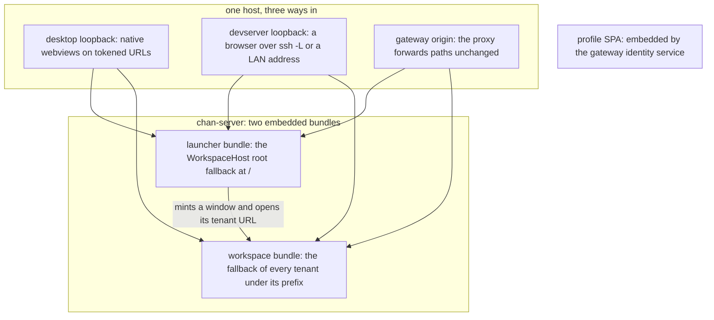
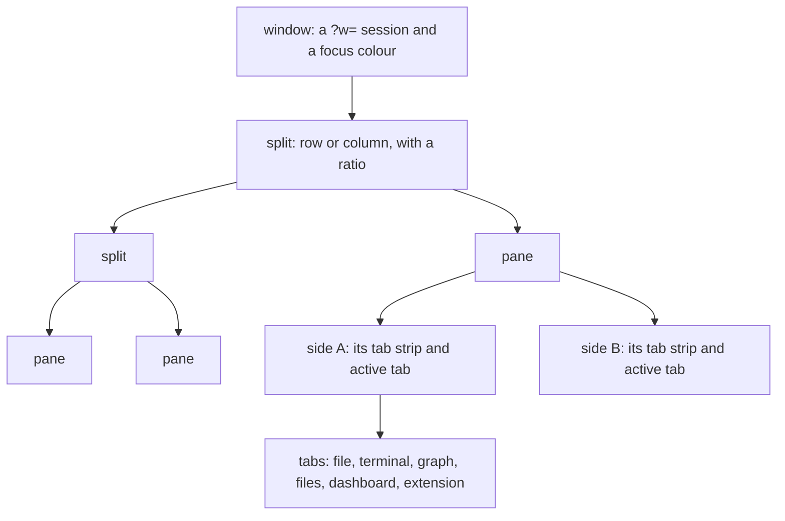
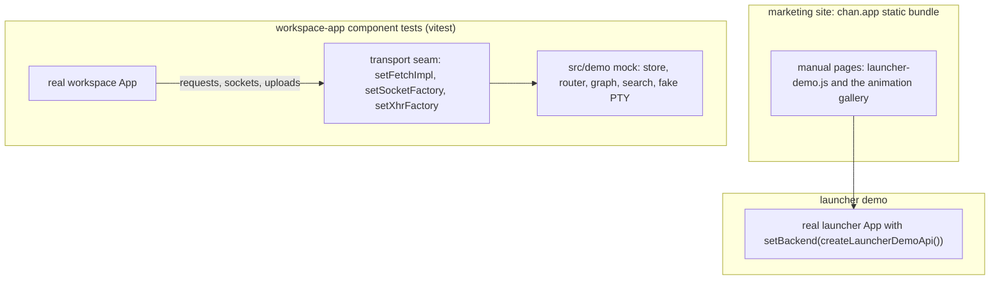
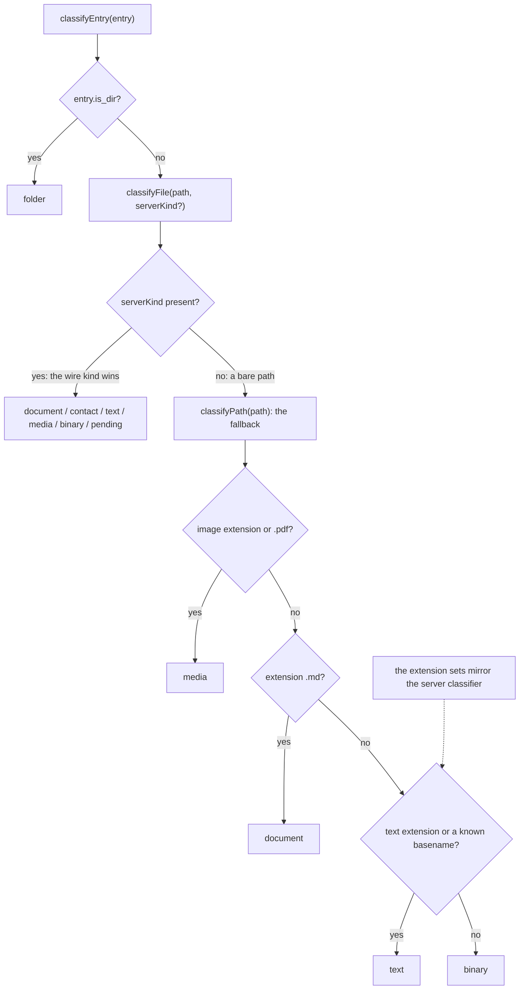

# chan web frontend design

The workspace app is the Svelte 5 single-page application chan-server serves for every workspace and terminal window. This document is the reference for the frontend as a whole: which web apps chan ships and how each is served, what a window learns at boot, the command deck both apps share, the window and pane model, the terminal surface, the file and transfer surfaces, and the color system. The editor has its own design in [editor/design.md](editor/design.md), the launcher's is [../../launcher/design.md](../../launcher/design.md), the server that serves both is described in [crates/chan-server/design.md](../../../../crates/chan-server/design.md), and the desktop shell that embeds that server in [desktop/design.md](../../../../desktop/design.md).

## Three SPAs, two embedded

chan ships three Svelte 5 and Vite SPAs under the `web/` npm workspace. `@chan/profile` is the gateway's sign-in and profile app, embedded by the gateway's identity service and outside this document. `@chan/launcher` is the Computers screen. `@chan/workspace-app` is the workspace and terminal window. The last two are embedded into chan-server through rust-embed: debug builds read the bundles from disk per request and release builds bake them into the binary. `@chan/web-shared` holds what the two share: the command deck, the window-holder and window-page helpers, modal focus, the keyboard identity of a key, and window naming.

The launcher is served at the root of every host through the `WorkspaceHost` root fallback, and the workspace app is the fallback of every workspace or terminal tenant under its path prefix. Asset URLs are relative and the served shell carries its tenant's prefix in a meta tag, so one bundle works on the desktop loopback, on a devserver under a tenant prefix, and through a gateway, which forwards paths unchanged. Requests under `/api` and to `/ws` that match no route are real 404s, never the shell, so a client sees a JSON refusal instead of HTML.

*The launcher and the workspace app are the same two bundles on every surface; the profile SPA lives in the gateway.*

## What a window learns at boot

The server splices meta tags into the shell's `<head>` so the SPA has its answers before its first render, without a probe round trip.

| Meta tag                 | What the SPA does with it                      |
|--------------------------|------------------------------------------------|
| `chan-prefix`            | prepended to every fetch and WebSocket URL     |
| `chan-settings-disabled` | nothing; the server refuses the writes itself  |
| `chan-files`             | a standalone window also gets files and editor |
| `chan-drafts`            | a standalone window also gets drafts           |
| `chan-webgl-renderer`    | xterm.js draws with WebGL (1) or the DOM (0)   |
| `chan-gpu`               | the welcome keeps to 2D animations on 0        |

The tenant sets the first four from what it mounted and from the `--no-settings` flag; the last two carry answers the desktop computed.

The two desktop values start as query parameters chan-desktop appends to a window URL. `chan-renderer` is appended whenever the desktop's GUI bootstrap has decided whether WebKit's accelerated path is usable: the Linux AppImage runs that decision, other Linux packages and FreeBSD send nothing, and every other platform sends WebGL. `chan-gpu` is always appended, from a render-node probe on Linux and FreeBSD and as true elsewhere. The serving tenant stamps the last recognized value into the meta, a devserver on another machine included, so the SPA never repeats driver detection or guesses from the operating system. In an ordinary browser the terminal keeps WebGL; in a native window a missing or invalid renderer meta means the DOM renderer. A localStorage key is the diagnostic hatch in both directions.

The window kind rides the URL too. `?kind=terminal` opens a standalone window and `?kind=control` the singleton control terminal that runs a devserver's connect script; a workspace window has no kind. `?w=` keys the window's session, `?t=` is the tenant bearer, `?lib=` names the owning library, `?h=` is the holder tag of the page that opened the window, and `?pane=` is the library's pane highlight colour. `state/windowCaps.ts` projects the kind and the `chan-files` and `chan-drafts` tags onto the capabilities the rest of the app gates on: a workspace, a file surface, drafts, terminals only, control. The tenant is the authority for the file and draft bits because it is what mounted those surfaces or did not, and the bits are separate because the draft store can fail to construct while the file surface works.

## The command deck

Both SPAs mount the same `CommandDeck` from `@chan/web-shared`, rendered inline inside the page that invoked it; there is no native launcher window. Its empty query is the contextual deck: the focused tab's commands, generic tab commands, then pane, window and Computers, and a typed query searches every level. The chord is Cmd+K on the native macOS desktop and Ctrl+Alt+K on the web and other platforms, because the browser owns Cmd+K there. Each window keeps one deck draft in session storage, so a reload or a hide keeps what was typed.

In the workspace app the commands are the catalog in `state/commands.ts`, registered per surface, and the deck owns presentation, keyboard zones and the draft. Its Computers scope is narrower than the launcher's: the tenant bearer may mint a capability bound to this live window through the library's command-capability route, whose snapshot lists only the serving library and omits tokens and prefixes, so a remote workspace never receives the desktop launcher's aggregate inventory. A `chan serve --standalone` tenant has no launcher router behind it, and the scope says so instead of fabricating a roster.

The deck owns the destination of a command's outcome. An error shows on the deck's card only while the deck is still open on the draft that ran the command and the command still owns the card; otherwise it reaches the host's `onError`, which the workspace app shows on its status line and the launcher in its notice ring. A success shows briefly on an awaited command's card and closes the deck. Every execution holds a token, and a later execution or a confirmation takes it, so a stale answer never paints over a newer one.

A browser window the deck opens is a two-step: a blank popup opened synchronously inside the user's gesture, because the browser blocks a later one, then navigated once the launch path has been checked through the shared window-page wait, which retries while the server says it is starting and gives up at a bound. A page tags the windows it opens with a holder tag and reads the tag back from a popup's URL to tell its own page from another client's socket on the same window id; the record's holder list is what makes that readable. The tag is a claim rather than an identity, so a duplicated tab presents the same one. The desktop opens and focuses windows through its native commands and uses no popup.

## Client identity and the event socket

Every workspace page claims one client holder: the `h` from its URL, else a tag kept in sessionStorage across reloads, else a fresh one. The transport puts it on every socket and request, so the server can list the holders of a window. The page's event socket (`/ws`) carries the window id and the holder; the server pushes watch frames, session frames, window commands and config changes over it. A wake gap or a visibility return probes the socket with a ping and replaces it on silence, with a backoff, and a page reconciles its root listing when the socket becomes ready and on resume. A client the server detaches has its sockets closed and later requests refused, and `SessionEndedOverlay` offers Reconnect without clearing credentials, terminals or saved layouts.

The library lists clients, and a window has a participant roster with a leader and followers; `cs session` handover and takeover act on participants, and a `cs terminal survey` or an Identify request reaches the window as a card. None of those is persisted: a blocking request a reload interrupts resolves on the server as a timeout rather than leaving a stale card.

## Windows, panes, sides and tabs

A window is a tree of splits and panes (`state/tabs.svelte.ts`). A split has a direction and a ratio that gives its first child its share of the length; a pane is a leaf. Every pane has two tab sides, A and B, each with its own tab strip and active tab, and shows one side at a time; flipping the pane turns it over to the other. With the `pane_strip_auto_hide` preference on, a side's strip is drawn only while that side holds two or more tabs, so a lone tab fills its pane and an empty pane shows its welcome alone; a tmux pane and the control terminal have no strip either way. A tab is a file editor, a terminal, a graph, a file browser, a dashboard or an extension; search and settings are overlays over the window rather than tabs. The active pane carries the window's focus colour, a per-window preset or the library's own colour, and every drag highlight reads the same variable.

*A window is a binary split tree whose leaves are panes; each pane holds two sides of tabs and shows one.*

Hybrid Nav is the keyboard layout editor: Cmd+. opens a staged copy of the layout in which single keys split, move, resize and spawn, Enter commits the draft and Escape discards it. Terminals are drawn once, above the pane tree and keyed by tab id, and each terminal's element is docked into the pane that holds it, so a split or a tab move carries the renderer, its socket and its screen with it; rebuilding the terminal would redial its session for the whole history and replay bytes written at the old width. A tab dragged to another window carries a snapshot; a terminal reattaches to the same PTY by session id, and one with no session starts a new shell there.

A terminal-only window hides the welcome and narrows the command set, and the control terminal is a singleton that cannot spawn or split, because one PTY is all it is for. The empty single pane shows the welcome: the chan mark, then an animation picked from the catalog the GPU answer allows.

### What a page saves and restores

Pane and tab changes write the layout to the URL hash and, debounced, to the window's session blob on the server, keyed by the window id. A reload restores from the hash when the hash is the page's own, else from the saved session, else from the terminal tab's reload snapshot. A copied URL opened in a new tab takes the saved session over its hash, because writing the copy-time layout back would drop every tab the window gained since. Two pages on one window id share one blob: each hears the other's save as a `session_changed` frame and refetches, and structure syncs while per-client view state never does. One session write is out at a time, a failed write retries with a backoff, and at page exit the layout is sent once more with keepalive, because the browser cancels an ordinary request with its page.

## The terminal surface

A terminal tab shows a session the server owns: a PTY the library spawned, or a tmux pane it mirrors. Attaching replays the retained scrollback from a byte cursor. A bounded ANSI snapshot of the screen is kept in localStorage at page hide, keyed by the session id and its generation, so a reload paints at once and asks the server only for the delta; a generation mismatch or dropped bytes fall back to a full replay behind a screen reset, so history is never repeated.

The backend is chosen once, when the terminal spawns. With `terminal.ghostty` on, the default on every platform, a terminal is ghostty-web's renderer, input and selection over Ghostty's own release build of libghostty-vt, vendored under `vendor/ghostty-vt/` and bound to the calls ghostty-web makes by `terminal/ghosttyVt.ts`; ghostty-web's bundled wasm is never loaded. The module is compiled lazily, since it sits on no xterm.js user's path, and each terminal instantiates it into its own memory, because a wasm memory only grows and a shared instance would keep every closed terminal's scrollback allocated for the page's life. A load that fails falls back to xterm.js for that terminal, and a stored `false` keeps xterm.js. xterm.js draws with WebGL where the renderer meta allows it and with the DOM renderer otherwise; ghostty draws box drawing and block elements itself, which is why it is the default on the Linux desktop as well.

A ghostty terminal uses chan's xterm.js key encoding rather than ghostty-web's. A capture-phase listener on the host (`terminal/ghosttyKeys.ts`, a port of xterm.js's encoder with Option as Meta) encodes every key xterm.js would, leaves plain typing and IME composition to ghostty-web, and lets the keys the browser must keep, a dead key or a native paste chord, pass with their default. The keyboard protocol a program requests (kitty, modifyOtherKeys) is followed from the output stream on ghostty, which has no parser hooks, and from parser hooks on xterm.js, so the modified Enter and the protocol queries answer the same on both. Copy of scrollback or of a selection on ghostty is one call into the core's plain-text formatter rather than a per-cell read, which turns seconds of blocked page on a long history into milliseconds.

Secret masking exists on both backends over one detection: the value of a `NAME=value` whose name ends in a listed suffix, and the token of a launch URL chan prints beside its marker. On xterm.js it is a decoration per span; on ghostty, which has no decorations, the painter fills each span onto the canvas in the frame that draws the content under it. Masking is visual: the buffer keeps the text, so a copy carries the whole value. An unset `terminal.secret_masking` is on in a control terminal, where the connect script prints the devserver token, and off elsewhere, and the tab's toggle changes that terminal alone.

Data the user makes goes to its own PTY or, with broadcast on, to the whole broadcast group: same-window members directly and other windows through the server's fan-out. xterm.js marks user-made chunks and leaves parser replies unmarked, and chan reads that mark, so a reply the parser makes to the program is never broadcast and a key typed while a replay is being parsed is never lost.

Programs report through OSC 7501, the Program Status Protocol: the tab strip shows a working, done, blocked or error mark per session, the terminal's Details lists every record, and the `program_status` terminal preference, on by default, switches it. Neither engine answers the sequence: xterm.js registers it as consumed, and a byte guard in front of ghostty-web's write path swallows it, since that engine rings its bell on a BEL-ended OSC.

The Rich Prompt is a Markdown editor over a terminal for prompts longer than a line. Each terminal's prompt is backed by a draft on disk, so pasted images are files an agent can read, and submit goes through the terminal socket into the session's write queue, where the server appends the submit chord of the agent it knows is running; the SPA sends only the identity. The card can show the editor's style toolbar and swap to source with the editor's chord, and a reload keeps the card and the toolbar per terminal.

tmux control mode is off by default. With it on, a `tmux -CC` marker printed by tmux itself is accepted, and one printed by another foreground program raises a consent banner over the terminal, answered once for every attached client. The terminal where tmux ran becomes the control terminal: on the desktop it moves to a hidden control window, in a browser it stays in its tab without chrome. Each tmux window is a chan window the connection minted and each tmux pane a session, and tmux owns the layout: a split, a divider drag, Cmd+T or a new window in such a window is a request to tmux on a pane's session, and the window redraws from the layout tmux reports. Its panes have no A and B sides, so nothing flips one or sends a tab to a side. The connection's status never reaches the page; the launcher's card shows it from the window feed.

Hybrid Nav in a tmux window stages what tmux will be asked for. A split adds an empty pane, titled New tmux pane, and a staged pane takes no further split until tmux has made it; a divider move, by key or by dragging the divider, shows the new size, and a drag sends nothing on its release. Nothing stages a tab, swaps tiles or flips a side there, and the cheatsheet lists none of those keys. Enter sends the requests one at a time, the resizes and then the splits in the order staged, and leaves the live tree as tmux last laid it out, so the result arrives as tmux's next layout; Escape sends nothing. Since such a commit never replaces the live tree, tmux's layouts, a peer's save and a terminal's new name apply to the live tree at once and never make the transaction stale. The window-size ask to tmux waits while Hybrid Nav is up, since a terminal measures nothing while the draft shows, and follows when it ends.

Terminal background opacity is chan-desktop's own setting, followed live by every desktop window and ignored by a browser tab. Below full opacity only the terminals are see-through: the backdrop behind the pane tree is a layer masked with a hole behind each pane that shows a terminal, since CSS cannot erase a parent's background under one child.

## Files, drafts and transfers

A Files tab shows one directory at a time with breadcrumbs, history, an editable path and sorting, and a docked file browser beside the panes keeps the compact tree; both run on the same operation dispatcher and selection model. A workspace window browses the workspace. A standalone window with the `chan-files` tag browses the host's filesystem through the server's standalone routes, where a file's token is its modification time and a save carries a content hash, so a stale token cannot pass as current. Drafts live outside the workspace, so the Drafts group is drawn from one request rather than the tree, and a draft's close or promotion goes through its own dialog.

A directory listing is the truth for one level: it replaces the children, and a cached row the listing no longer holds goes with its subtree, so a rename made outside chan leaves no ghost. Listings are stamped, and one that started before a newer listing or a drop is discarded when it answers. A save through a live session sends no watch frame, so the saved row is patched in place. Every request that creates, moves or deletes an entry names its window, and the watch frames the server fans out carry that writer, so the writer relists without raising a changed-on-disk banner on its own tabs.

A mutation the server stores and announces (a create, a move, a delete, a transfer, a draft's promotion) is answered within a bound or ends as an uncertain outcome: the server's worker runs on past the page's abort, so the caller says the action may have completed and relists the affected view instead of claiming failure. Nothing is retried.

Workspace paths are `/`-separated with no leading slash, and on a Unix server a `\` is an ordinary character of a name. Windows reads `\` as a separator, so no surface lets a typed or dropped name gain one where the tree can judge the path, and the refusal names the gesture; on a server whose root spells as a Windows path the rule stays out of the way. `state/pathValidate.ts` holds the rule beside the Windows reserved-name checks.

Transfers are a per-window model: `cs upload`, `cs download`, the Files app's uploads and the browser's own form one bubble with progress and cancel, persisted to sessionStorage so a reload turns an active row into an interrupted one rather than a frozen bar; a download retries from its source, an upload cannot. Admission belongs to the server. A `cs upload` from a terminal with no live user activation becomes a Choose files request card, because a browser opens a file chooser only inside a gesture. The request column at the window's right edge stacks the transfer panel and the request cards (Identify, handover, paste, upload), beside a right-docked Files browser so none covers it. The status pill at the top right carries the index state, imports, the transfer launcher, workspace warnings and the session role, and each section a person cannot answer has a close that hides it until its content changes.

## The graph and the index

The inspectors read one cached graph view. A burst of filesystem events re-arms a quiet window and costs one fetch when the burst ends, after any fetch already in flight; with no graph or browser tab open the view is dropped instead and the next surface fetches it. The server's `graph_applied` frame, sent when the indexer has written a set of watched changes, counts as one more change of the window, so a save in the editor costs one fetch after its watch frames and one after its apply frame. A view fetched while the index was rebuilding is marked gated and reloaded when the index returns to idle.

## Details, outline and overlays

The editor mounts Outline and Details through the shared `Inspector` frame as floating cards that reserve space beside the document, and search, files, graph, terminal Details and the dashboard's index inspector use the same frame. A new editor or files tab opens Details on a screen wider than a phone's, a document opens Outline there, and a slide deck always opens its Outline because it holds Preview and Present. The outline lists ATX headings from a single regex pass that skips fenced code and follows the caret; for a deck it shows numbered thumbnails rendered from the buffer through the shared slide helpers.

App-root dialogs share `ModalShell`, which keeps a stack so the top dialog owns Escape and focus restoration, and while one is open nothing acts on the window under it. The screensaver overlay sits over everything and unlocks only with the PIN, hashed client-side. Team Work's dialog bootstraps a team lead-first: the lead terminal exists before the dialog saves the config into the workspace and spawns the workers.

## Local extensions

A workspace window fetches the process-ready extension catalog, registers one Apps command per extension and opens each in a keep-alive tab holding a sandboxed iframe served through the tenant's own prefix. The page never holds the extension's port or token, a tab persists only the id and title, and the iframe receives only the host chords chan advertises through a versioned `postMessage` contract.

## The marketing embeds and the test transport

The launcher also runs with no backend on the chan.app site, so the manual shows a live Computers screen: `@chan/launcher/demo` mounts the real `App` with `setBackend(createLauncherDemoApi())`, a backend-interface swap, and the marketing build scopes the launcher's global CSS to the embed frame. The animations page mounts the real `EmptyPaneWelcome` without the workspace app. The workspace app has no single backend interface, since it reaches many endpoints and several sockets, so its in-memory backend swaps one level lower, at the transport seam: `api/transport.ts` routes requests through `chanFetch`, sockets through `createSocket` and uploads through an XHR factory, each defaulting to the browser global and each settable. `src/demo/` is the mock the component tests mount the real `App` against, seeded from the test's data; it is a fixture rather than a serving path, and the embedded bundle never carries it.

## Colors and themes

Two independent axes, both live at runtime. The color scheme (`data-theme="light"` or `"dark"` on `<html>`) owns the app chrome: the dark palette is the default block and light is an override, and because the blocks key off the attribute rather than the element, a pane's surface can re-apply a scheme to its own subtree from the `hybrid_surface_themes` preference. The editor theme (`data-editor-theme="github"`, `"google_docs"` or `"word"`, default github) owns the document surface alone, expressed as `--chan-editor-*` variables with neutral defaults in `editor/themes/base.css` and per-theme overrides; the preference lives on the server and reaches every open window through the config-changed event. Any scheme by theme combination is valid. A third, fixed dimension is the syntax palette: GitHub Primer light or dark, branched off the scheme and shared by all three editor themes, so a code snippet reads the same under any document chrome, with one deliberate divergence: plain identifiers get no color, because Primer's orange collides with chan's brand orange.

Each palette block declares the CSS `color-scheme` it paints in, because the engine draws some controls itself (a select's popup list, native scrollbars, spinners) and colours them from that property; WebKitGTK and WebView2 painted them light inside the dark theme until it said otherwise. The property is inherited, so a surface's own theme carries it, and the launcher's stylesheet declares it the same way.

Within the workspace app each concept has one hue across graph nodes, tree rows, inspector accents and editor pills, so the same item reads the same everywhere: document orange, media purple, tag green, contact and warning yellow, date and directory neutral grey, broken red, source royalblue, binary dark grey, language pink, drafts a yellow tint. Pill backgrounds are alpha tints of the hue; dark mode uses the text colour as ink and light mode the deep hue. The graph's node hues are settable per theme in `editor.graph_colors`, applied to the graph surface's subtree only, and contact and mention share one `--g-contact` token that defaults to the warning hue.

The window's focus colour is `var(--pane-highlight-color, var(--pane-active-focus))`: the colour chosen from the pane menu or carried by the desktop on the URL, else the pane's preset. It paints the focused pane's border, every tab and pane drag highlight, and the resize bars of the floating cards.

### Kind taxonomy

One taxonomy serves every chip, tree icon and inspector glyph. `FileKind` is what exists as a file: `document`, `contact`, `text`, `media`, `binary`, `pending`. `EntityKind` is graph-only: `tag`, `mention`, `date`. `ContainerKind` is `folder`. The server projects a `kind` on every regular file it lists and that wire value wins; the path-only fallback serves callers that hold a bare path (graph ghost rows, broken link targets) and mirrors the server classifier, so the two extension sets widen together. `pending` is the server's state for an unknown extension awaiting its UTF-8 sniff and renders neutrally.

`text` shares the document hue and differs by icon and label. A mention shares the contact palette because a resolved mention points at a contact file and an unresolved one is the same concept without a backing file; telling the two apart is the inspector's job. One `KindChip` component renders every kind.

### Adding a concept or an editor theme

A new concept picks a hue family, reusing one before adding a hue that must defend its distance from the others, adds its dark and light values under domain-specific variable names, and pipes its own variable into every surface that shows it, so a later hue swap is one palette edit. A new editor theme is one stylesheet that overrides only the `--chan-editor-*` tokens it changes, light under `:root[data-editor-theme="<name>"]` and dark under the `[data-theme="dark"]` forms so a per-surface dark override restyles the editor too, registered at startup and in the config picker; it inherits the syntax palette.
