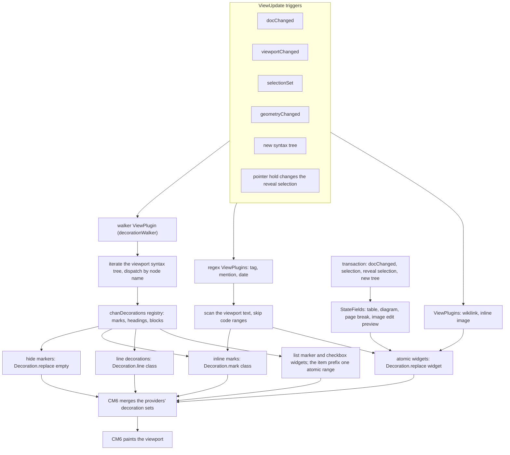
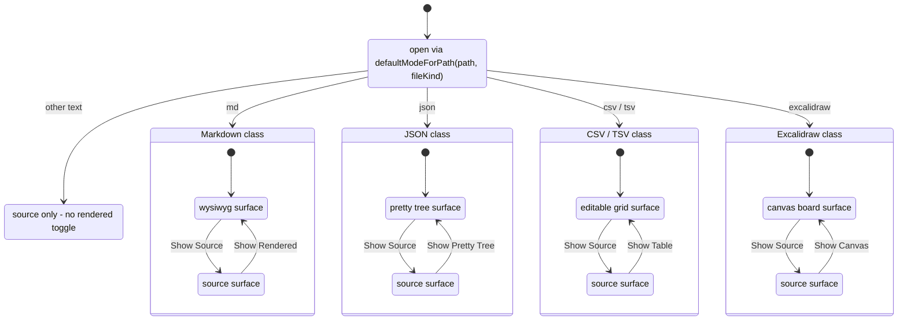
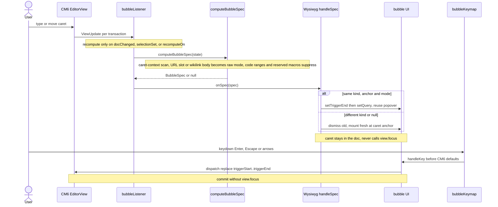
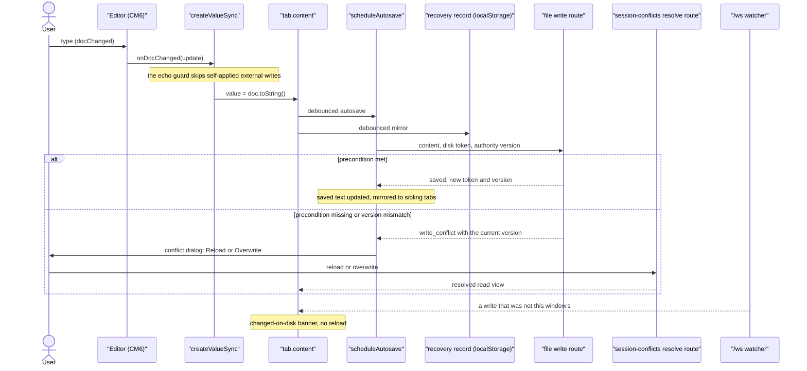

# chan editor design

The editor is the CodeMirror 6 surface behind every file tab of the workspace app: Markdown rendered live, source mode for everything else, a JSON tree, a CSV grid and an Excalidraw board. This document is its reference: the model and its invariants, the decoration pipeline, the modes, the bubbles, how a document is saved and who holds authority over the disk, drawings, recovery records, slide decks and PDF export. The frontend as a whole is [../design.md](../design.md); the server's document and scene sessions are described in [crates/chan-server/design.md](../../../../../crates/chan-server/design.md). The interaction model a user sees is [EDITOR.md](../../EDITOR.md).

## Where it sits

`components/FileEditorTab.svelte` hosts a tab and picks its mode. `Wysiwyg.svelte` and `Source.svelte` are two CodeMirror views over the same buffer, sharing theme, find and value-sync plumbing in `base.ts`. The buffer lives in `state/tabs.svelte.ts`, which owns saves. While a tab is attached to a live session (`state/docSync.svelte.ts` for text, `state/sceneSync.svelte.ts` for drawings) the server owns the document and the disk; otherwise the classic debounced autosave writes through the file route. The editor reaches the server for link resolution, the pickers behind the bubbles, image upload and export, and never writes a file itself.

## Model

The document text is the Markdown source. `view.state.doc.toString()` is the file on disk; there is no rendered tree and no serialization layer. The editor decorates the source in place, hiding markers and rendering widgets, so it reads like rendered Markdown while every character stays editable. This is the Live Preview model, the architecture Obsidian uses.

Because the source is the single truth, a class of structural bugs a rendered-tree model is prone to does not arise: one-character marks like `*a*`, flickering pending-mark heuristics, and round-trip escaping. `*a*` is three real characters whose emphasis token spans them all, and both `*` markers reveal whenever a selection touches that outer range, its ends included; a caret at any of the four offsets sees the same thing, Backspace deletes a real character, and round-trip is the identity. A tree model that represents `*a*` as one marked node has no integer caret position strictly inside a one-character range, which is why that model needs a per-pattern boundary patch and this one does not.

## The contract

1. **Doc invariant.** The document is the Markdown source, always. Autosave writes it directly.
2. **Token detection.** The lezer syntax tree from `@codemirror/lang-markdown` with GFM, extended by three custom parsers in `markdown/`: `[[wikilink]]`, YAML frontmatter at the document start (so headings inside it are not promoted), and a ref-aware link so `[label with [inner]](path)` still forms the outer link. Fenced code bodies parse with lazily loaded per-language packs, one chunk each. Tokens that are not lezer nodes (`#tag`, `@@mention`, dates) are matched by regex in their own view plugins, skipping code ranges.
3. **Decoration taxonomy.** Hide markers replace the syntax of marks, links, fences and heading prefixes with nothing; inline marks class the content between them; line decorations class heading, list, quote and fence rows so CSS paints size, indent and slab; atomic widgets replace a whole range (a wikilink pill, an image, a date pill, a table grid, a diagram, a page break) and register as atomic ranges so caret motion skips them in one keystroke. A list item's indent, marker and gap are one atomic prefix, and the item's first caret position is the start of its text, because a caret inside the prefix would type into a hidden span. Blockquote `>` and `---` rules are never hidden: `>` is the visual cue that a line is quoted, and a rendered rule in place of `---` makes the Markdown harder to edit.
4. **Visibility.** Marks reveal when a selection range touches the token's outer range, equality at the boundary included; the outer-range rule, rather than per marker, is what reveals both `*` of `*a*` together. A heading prefix reveals by line, because a selection test alone flickers as the caret crosses the prefix mid-line. Each atom runs its own test: the wikilink pill, the date pill, the table and a diagram show unless a range touches the range they replace, an image keeps its widget with a caret at either end and enters edit mode only from inside, and a fence reveals its markers while a range's lines overlap the block. List markers take no selection test and render the same with the caret on the item. While the pointer button is held, every test reads the selection from before the press, so nothing moves under a drag and a widget pressed shows its source only at the release.
5. **Atom strategy.** Wikilinks and internal `[label](path)` links are one pill whose kind (file, contact, image, broken) resolves through the server's link-resolution route, cached per target and dropped when this window or a watch frame reports a created, moved or deleted path. External links keep a mark on the label and hide the tail unless revealed. Tables are a read-only grid; a press on a cell places the caret at the end of that cell's source. A closed `mermaid` or `mermaid-to-excalidraw` fence renders as a diagram while the caret is outside, with the library loaded on first render and a fullscreen pan-and-zoom view on a light panel so a dark-theme diagram never vanishes on the backdrop. Tags and mentions are marks with one delegated click handler. A widget dispatches a document change only into a view the user can edit: read-only is spelled two ways, `EditorState.readOnly` for the prompt composer and `EditorView.editable` for documents, CodeMirror enforces neither against a programmatic dispatch, and `widgets/writable.ts` is the one predicate that answers both.
6. **Ranges.** A non-empty selection has no rule of its own; every test runs over every range as it runs over a caret.
7. **Bubbles.** `[[`, `![`, `@@`, `@` and `#` open a popover from `computeBubbleSpec`, which inspects the text around the caret on every document or selection change. Triggers also fire in raw mode when the caret sits inside an existing link URL, autolink or wikilink body, so a commit replaces the right range; they never fire inside code, and the reserved macro words suppress the contact bubble. A plain press on an external link, an autolink or a `chan://graph` link puts the caret at the end of its URL, which reveals the source and opens the link bubble; Cmd/Ctrl+press opens the target directly (`external_links.ts`). The bubble keymap intercepts before the defaults, and a bubble never calls `view.focus()`: the caret stays in the document and the popover runs beside it.
8. **Find.** One shared `scanMatches` pipeline and one find field serve both modes.
9. **Fold.** A custom heading gutter over `@codemirror/language`'s fold state. A line is a heading if and only if the tree resolves it to a non-empty ATX heading node, so a `#` inside a fence, a code span or frontmatter never folds, and a heading folds to the next heading of its level or higher. The gutter is custom because `foldGutter()` would chevron every foldable block, paragraphs and quotes included. The same code-node guard keeps the block-formatting chords from rewriting a `#` comment inside a fence.
10. **Autosave.** The view writes its document to the tab's buffer on every change behind an echo guard, so a prop write-back never clobbers the caret, and the tab's save pipeline owns the server write.

## Decoration pipeline

Several providers each build a decoration set with their own recompute test, and CodeMirror merges them when it paints. The walker re-walks the viewport's syntax tree on a document, viewport, selection or geometry change, when the pointer hold changes the reveal selection, or when the parser hands it a longer tree; its registry yields the hide markers, inline marks, line decorations and list widgets. The atoms come from view plugins (wikilink, image, date) and state fields (table, diagram, page break, the image edit preview), each reading the same reveal selection, and the tag and mention plugins scan the viewport text.

## Modes

The host owns a per-tab mode: `wysiwyg`, `source`, `pretty`, `table` or `canvas`. Markdown pairs WYSIWYG with source; an Excalidraw scene opens as the board; JSON opens as a collapsible tree and CSV or TSV as an editable grid, each with source as the toggle. Any other text file, `.txt` included, is source only, because source is the sensible surface for a `.py`, a `.toml` or a Makefile. Source mode highlights by extension through the same lazy language packs. A mode restored from a stale URL that no longer fits the path falls back to the path's default.

The JSON tree only renders; edits happen in source, and a buffer that does not parse is saved as typed, like any text file, with the tree view saying so. The CSV grid edits cells and re-emits the text through a small tolerant parser; broken files fall back to source.

## Drawings

A drawing's board (`ExcalidrawCanvas.svelte`) writes the tab's buffer only from a seeded board: one that holds the whole buffer of a finished load as the library's own restore would put it, with the library's serialization of it as the baseline. The board seeds when the library first reports its init has settled and again whenever the tab's load finishes or its buffer changes without the board, as a reload, a conflict's resolution or a sibling pane's mirror does. It publishes a serialization only while seeded and only when it differs from the baseline or from what it last published, so a board nobody drew on writes nothing and never dirties its tab. The library's order of events this rests on is read from the pinned `@excalidraw/excalidraw` source and modelled by a test that fails when the installed version changes.

A stroke reaches the buffer after a short pause with no further change. Every way a tab or its window goes that runs page code commits the waiting stroke first, a forced close aside: a tab's close, a pane's close, a move to another window, a layout reconcile, and the `cs pane` close commands, which therefore see the stroke as an unsaved change. A window's close or hide through the desktop runs no save at all; it commits every waiting stroke into the recovery buffer and the next page load offers it. A drawing's save checks its text first: text that does not parse is not written, the tab keeps its editor with the text as typed and the toolbar says why, and such a tab takes no live session so its eventual write meets the conflict check.

With a live scene session the server is the authority. Local changes are element-level pushes the authority merges by Excalidraw's version rule and fans to the other attachments; remote changes arrive as updates the canvas reconciles. The board binds to its session after its first seed, and the bind replays what the session holds beyond the file, so an older copy in the file loses to the session's. Only the grid and the background of the appState reach the board, and an appState key has no version, so the keys this window picked are kept as a claim laid over the authority's value until a push carrying them is acknowledged; a reload, a resolve to the disk's scene, or a read-only flip ends the claim. A tab can hold a session with no seeded board (a restored tab never brought to the front), and a save of such a tab writes nothing: a classic write of its buffer would delete every element the text lacks, a peer's edit among them.

## Bubbles

A document or selection change recomputes the bubble spec; the host mounts or reuses one popover and commits a range replace through a high-precedence keymap, never stealing focus from the document. A bubble that closes itself is not reopened while the caret stays in the trigger that opened it, since the next keystroke there only changes the query; a new trigger clears that memory. Hiding the editor dismisses its bubble, calendars and previews, and showing it again does not reopen them. The wiki, tag, mention and image bubbles share one keyboard model (arrows, Enter, Escape, click) and each owns its results and preview.

## Save authority

A text tab attaches to the server's per-document session over `/api/doc/ws`. While attached, the server owns the document and the disk: local edits ride `@codemirror/collab` update logs, pushed at the matching version and rebased when stale, remote edits arrive as update frames and paint as peer cursors, and a save is a flush confirmation rather than a write. The session's confirmed shadow of the authority is mirrored to the tab's saved text, so dirty means unconfirmed local edits and every existing consumer of that state keeps its meaning. There is one session per tab, not per path, and it outlives editor remounts through a short release linger.

Before installing collaboration, the session compares its first snapshot with the tab's saved base and current text. A clean tab adopts the authority without pushing older text; local edits against an unchanged authority proceed as live updates; when buffer and authority both diverged from the base, the session holds the buffer and asks for Reload or Overwrite, keeping save authority while the choice waits. Reload takes the authority's text; Overwrite submits the difference through collaboration, so a peer edit arriving meanwhile is rebased beside it.

When the channel is unavailable the tab degrades to the classic path: a debounced autosave writes the buffer through the file route carrying the disk token and the last authority version, a write whose precondition fails opens the conflict dialog, a watch event for a write that was not this window's raises a changed-on-disk banner rather than reloading, and a dirty or conflicted session is resolved explicitly through the server's resolve route. A failed live flush keeps the editor and shows "Not saved" with the reason; a failed live save degrades the session only after pending pushes have settled, so no push races the replacement. Closing a dirty file after a failed save asks whether to keep editing or close without saving.

*The classic path, taken when no live session is attached; an attached session replaces the write with collab pushes and flush confirmations.*

## Recovery records

Unsaved editor content is mirrored, debounced, to localStorage under a key of the workspace root and the file path, with the id of the page load that wrote it. A tab id would not survive the reload the record exists for, and the root keeps two workspaces' same-named files apart. On mount, a record left by a different page load whose content differs from the file is offered in a banner; the user's own live edits remount without a reload and never see one. A record is retired once the file holds its content byte for byte. On a live drawing, Restore does not replace the board, which holds the authority's scene a peer may have changed since: it lays the record's newer elements and missing files over the scene as a local change and pushes them, and takes nothing of the record's appState, whose keys cannot be told from older values.

## Slide decks

A Markdown file whose frontmatter declares a slides spec (an aspect ratio of 16:9 or 4:3 and a zoom factor) is a deck. Pages split at page breaks, an `
` whose only attribute is the class `chan-page-break`, which `@pagebreak` writes and which every surface recognizes through one module so a line is a page break everywhere or nowhere. The outline shows numbered thumbnails rendered from the buffer, Preview shows one slide at a time in a fullscreen viewer and Present plays the deck. The slide DOM, its diagram and image hydration and its page CSS come from `slide_dom.ts`, shared with the PDF export, so a slide looks the same in play, in a thumbnail and on paper.

## PDF export

`exportMarkdownToPdf` renders in the page itself: a deck gives one A4 landscape page per slide, a document is paginated A4 portrait, each page is composed as DOM, made self-contained and rasterized, and embedded as one PNG through pdf-lib, loaded on first use. A page is drawn from an SVG document holding the page in a `foreignObject`, which loads no external resource, so images, fonts and CSS URLs are inlined first and an audit refuses anything left external; a missed reference would rasterize as a blank, and a named failure beats a silently incomplete PDF. Images are the one thing that SVG document is not trusted to paint, because an engine may report it loaded before the images nested in it have decoded: each image is decoded in the app document, the page keeps an empty stand-in of its size, a marker raster says where the stand-in landed, and the bitmap is drawn there with its object-fit and clipping. An image the lift cannot place (a rotation, a clip path, a mask) stays in the page document.

Pagination measures block geometry only once every diagram and image in the composition has settled. A deck page is laid out in the box a slide gets on a reference screen and rasterized at the scale that maps that box onto the page, so one deck gives one PDF from any window and from `cs export`; a slide larger than its box comes out whole and smaller. A `cs export` job runs inside a workspace window's page, reports each finished page so the server's quiet bound restarts, uploads under the server's guard to the job's output path alone, and stops at the server's stop frame.

## Implementation notes

- List continuation, indent and outdent match the current line with a regex rather than the tree, so the edit stays cheap and correct while the parser lags; Backspace at an item's text start reads the tree, since it acts only where the decorations hide a prefix.
- Heavy or optional modules load on first use: mermaid, mermaid-to-excalidraw with Excalidraw and React, turndown for HTML paste, HEIC conversion before an image upload, pdf-lib, and the per-language code packs.
- Rich copy carries workspace images across windows and workspaces: a selection with an image writes the exact Markdown as text and a wrapper with inlined images as HTML, so a chan-to-chan paste is lossless and an external app still renders it.

## Out of scope

- In-cell table editing: the grid is read-only and edits happen in the revealed source.
- YAML highlighting inside frontmatter: the block is isolated and dimmed, the body unstyled.
